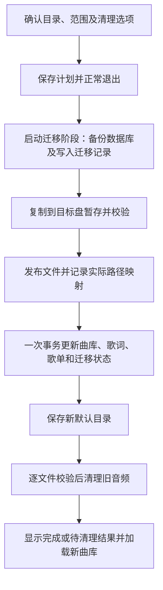

# 桌面安装位置、音乐下载目录与旧歌曲迁移方案

状态：**源码与本地构建已完成，实际安装验收待补**。本文保留确认的设计约定；4.2.4 实现下载目录选择、受控重启迁移和安装目录选择。实际通过项与环境限制见 [变更与验证记录](READABILITY_CHANGES.md)，不能将构建成功等同于实际安装验收。

确认日期：2026-10-13（北京时间）。适用范围：Windows 桌面版；共享歌单接口的改动须兼容 Android 原有行为。

## 1. 目标与实施前基线

用户可以分别选择程序安装位置和音乐下载位置。更改下载目录时，同一版功能提供旧歌曲迁移，完成文件复制、曲库和歌单路径更新，并在成功后逐项清理旧音频，释放原盘空间。

实施前的 4.2.3 安装包使用按用户安装，没有开启安装目录选择。普通在线单曲下载使用应用数据目录；Windows 安装版通常是 `%LOCALAPPDATA%\ZA-Music-Data`。歌单可以单独选择保存位置，但目前先在应用数据目录的 `.playlist-staging` 暂存。数据库和缓存同样位于应用数据目录。

| 用途 | 实现的选择方式 | 示例 |
| --- | --- | --- |
| 程序安装位置 | 安装向导选择盘符和文件夹 | `D:\应用\ZA-Music` |
| 普通歌曲下载位置 | 首次下载选择并记住，设置中可修改 | `E:\音乐\ZA音乐` |
| 歌单下载位置 | 新歌单默认使用当前音乐目录，可单独修改 | `E:\音乐\收藏歌单` |
| 数据库、歌词缓存、封面与播放缓存 | 继续由现有应用数据目录管理 | `%LOCALAPPDATA%\ZA-Music-Data` |

安装位置与下载位置互不推导。将程序安装到 D 盘，不会自动把歌曲保存到 D 盘；更改下载位置也不搬动程序文件。数据库和应用缓存继续留在原位置，本方案不承诺全部应用数据都离开 C 盘。

## 2. 安装目录选择

在 [package.ps1](../package.ps1) 的 EXE 安装参数中加入 `--win-dir-chooser`。继续使用现有按用户安装、应用名称、快捷方式和升级 UUID，保留 `ZA-Music` 作为默认安装目录名称。

首次安装允许选择任意有写入权限的盘符和文件夹。升级默认沿用原安装位置；已有安装需要换盘时，采用卸载程序后重新选择位置安装的流程。曲库数据和音乐位于安装目录之外，安装和卸载流程应保留这些用户文件。实际行为必须使用新安装包在隔离环境验证。

后续交付需要构建新安装包。当前已发布的安装包不会因为本方案文件或源码修改而自动获得目录选择能力。

## 3. 下载目录设置与任务行为

主界面增加“下载位置”按钮，移动竖屏预览在菜单中提供同名入口，显示当前路径，提供“选择文件夹”和“打开文件夹”。复用现有用户偏好设置及测试隔离节点，保存归一化的绝对路径。

未设置目录时，第一次点击“下载并播放”先弹出文件夹选择窗口。只有选择、后台验证和设置保存成功后，才改变播放状态并提交下载。取消选择继续原播放，不启动任务，也不改变现有设置。选择成功后记住目录，重启仍有效。

修改默认目录只影响之后提交的任务。已经运行和排队的任务在提交时固定目标目录；完成回调、文件发布和入库均使用同一目标。盘符不存在、设备被拔出、目录无法写入或磁盘满时，显示具体错误，保留原设置，不悄悄改回 C 盘。

目录验证和创建在后台完成。目标必须是可用的绝对目录，不能位于程序安装目录内部，避免卸载影响音乐。迁移时的新旧目录不能相同或互相包含；检查须按 Windows 路径规则处理大小写和实际目录指向。

### 3.1 歌单与音频暂存

新建或导入歌单时，动态读取最新的默认下载目录，避免已打开的歌单窗口一直使用构造时的旧值。已有歌单保留自己的目录，也可以通过歌单“下载目录”修改；全局设置变化不会直接覆盖所有歌单配置。

普通单曲已经在传入目标目录内创建 `.part`，沿用该行为。桌面歌单改为在实际目标目录下的内部暂存目录下载，每个任务使用独立子目录，发布后清理本任务文件。取消和失败同样清理本任务暂存内容。

```text
E:\音乐\ZA音乐\
├─ 歌曲文件
└─ .za-music-staging\
   └─ 独立任务目录\
```

内部暂存目录不参与本地曲库扫描、导入和歌单重复检查。共享 `PlaylistDownloads.Publisher` 增加兼容的默认暂存策略入口，桌面适配器覆盖为目标盘暂存；现有调用及 Android 保持原暂存策略。任务使用提交时固定的歌单目标。

## 4. 更改目录时迁移旧歌曲

### 4.1 用户确认与范围

选择新目录后，显示旧目录、新目录、可迁移歌曲数量、总大小、可用空间和迁移文件清单。默认勾选“将旧下载目录中的歌曲迁移到新目录，成功后清理旧歌曲文件”，也允许选择“仅更改以后下载的位置”。在用户确认前不复制、不删除、不切换目录。

迁移范围为旧下载根目录中的有效音频和配套同名 `.lrc`，保留子目录结构。排除数据库及其辅助文件、缓存、备份、内部暂存、未完成下载文件和目录链接；不递归进入链接目标。其他文件夹中的外部导入歌曲保持原位置。

历史数据库没有严格的下载来源标记，所以不能承诺自动分辨旧根目录内每个音频的来源。界面以实际路径和用户确认清单说明迁移范围；对旧根内曾手动放入的音频，同样在清单中展示。文件缺失或无法读取须列出，不能把未复制的文件记录为迁移成功。

### 4.2 受控重启与资源释放

涉及旧歌曲迁移时，保存待执行计划并正常退出；界面明确说明需要重新启动播放器。退出前完成已提交的数据库写入，停止播放并释放文件句柄，关闭歌词、在线下载和歌单工作资源。下一次启动在播放、歌词及下载服务初始化之前显示迁移进度并执行计划。

迁移阶段只允许一个播放器实例操作这套数据。检查到实例或数据库忙时，提示关闭其他播放器再重试，不强制终止进程。文件复制在后台执行，进度与错误通过界面回调显示。迁移协调组件负责关闭自己创建的任务和执行器，借用资源仍由原生命周期关闭。

这一顺序避免 Windows 文件占用，也避免曲库队列、歌单队列或旧异步回调在迁移后重新写入旧路径。仅修改未来下载位置时，不需要为文件迁移重启。

### 4.3 复制、校验、切换与清理



1. 创建包含已提交数据的 SQLite 一致性备份，保存迁移 ID、源根、目标根、文件清单、路径映射和进度状态。备份的是数据库，不在 C 盘再备份一整套音频。
2. 检查目标空间、目录权限及源文件可读性。复制到目标盘的独立临时目录，校验文件大小与 SHA-256；复制过程中不删除源文件。
3. 在不覆盖目标已有文件的前提下发布音频，保存每个旧路径实际对应的新路径。不同名、重名和配套歌词都依据实际结果建立映射，不能仅按字符串前缀替换。
4. 复制及校验完成后，在一个数据库事务内更新所有关联路径和“数据库已提交”迁移状态。保存歌曲信息、导入时间和歌单身份、顺序等原有内容。
5. 更新并持久化默认下载目录；完成清理或明确保留旧副本后，进入正常启动流程，以新路径加载曲库、歌单和播放对象。`Track.path` 是不可变字段，需要构造新对象，不能继续使用旧路径的内存对象。
6. 确认新文件仍可用、源文件内容仍与复制时一致后，按清单逐项删除旧音频及已成功迁移的配套歌词，记录每项清理结果。保留数据库、缓存、备份和其他用户文件，不递归删除旧下载根目录。

### 4.4 重名与配套歌词

同名音频内容相同且配套歌词没有冲突时，可以复用目标文件；内容不同则为迁移文件增加编号，不覆盖原文件。音频另名后，配套 LRC 使用对应的新文件名。若复用音频会与不同内容的配套歌词冲突，则音频和歌词作为一组另名保存。

复用目标时还要处理数据库主键碰撞：目标已有歌曲信息和歌词保留，缺失项从旧记录补齐；所有源路径引用统一更新到实际目标。迁移备份保留原记录。目标原有文件不是本次创建的文件，回滚时不能删除。

## 5. 数据库和设置的一致性

| 记录 | 本次更新 | 保留内容 |
| --- | --- | --- |
| `tracks` | `path` | 标题、歌手、时长、导入时间等 |
| `lyrics` | `track_path` | 歌词正文、来源、封面 URL 等 |
| `named_playlist_items` | `payload` JSON 的 `location` | 条目 ID、位置、重复条目、状态、信息及下载版本 |
| `named_playlists` | `metadata` JSON 的 `directory`，仅映射旧根内的目录 | 歌单 ID、名称、来源与其他配置 |

所有歌曲引用使用已校验的实际文件映射；旧根之外的歌曲和独立目录保持原值。更新歌单时只改相应 JSON 路径字段，不调用会改变条目状态的便利方法。

当前 `lyrics.track_path` 外键没有 `ON UPDATE CASCADE`，不能直接修改歌曲主键。新增专门的同步迁移方法，以一次事务先建立目标歌曲记录、转移或合并歌词、修改歌单关联，再移除旧歌曲记录并检查外键一致性。不能用 `INSERT OR REPLACE` 替换目标歌曲，以免级联删除目标歌词。

现有 `saveTracks`、`savePlaylist` 各自提交事务，不能将它们串起来充当迁移事务。迁移方法应在同一个事务内直接执行相应 SQL，必要时抽取不自行开启事务的私有写入方法。

迁移状态与上述路径变更同事务提交。Preferences 与 SQLite 不能作为同一事务提交，因此数据库提交后设置保存失败时，保留两处文件；下一次启动先根据已提交的迁移记录恢复新设置和内存目录，再开放下载、再清理源文件。新增迁移记录结构采用兼容的扩展，不重建或丢弃现有曲库和歌单数据。

## 6. 失败、取消与恢复

| 情况 | 行为 |
| --- | --- |
| 用户取消确认 | 保留设置、文件和当前播放，不安排迁移 |
| 复制前检查失败 | 保留旧目录与曲库，显示路径、权限或空间问题 |
| 复制或校验失败、提交前取消 | 保留源文件与旧曲库；仅清理本次创建且归属明确的临时或目标文件 |
| 数据库更新失败 | 整个事务回滚，默认目录继续使用旧位置；源文件保留 |
| 数据库已提交，设置写入失败或程序崩溃 | 按已提交日志恢复新设置，暂不清理源文件，不再执行提交前回滚 |
| 提交完成后的取消请求 | 停止后续清理，记录“迁移已完成，旧文件待清理”；保留已经生效的新路径 |
| 清理失败或源文件被其他程序修改 | 新曲库继续有效，保留对应旧文件，列出原因并提供重试 |
| 迁移中断后重新启动 | 先识别提交前或提交后状态，继续或恢复；验证完成前不开放新下载 |

清理与回滚只能操作本次迁移记录中的文件，且操作前重新确认内容和归属。迁移日志逐文件记录完成状态，重复恢复不得重复覆盖或误删目标文件。

## 7. 实现涉及的组件

| 组件或文件 | 实际职责 |
| --- | --- |
| [package.ps1](../package.ps1) | 开启安装目录选择，验证新装和升级身份 |
| [AppPaths](../src/main/java/app/musicplayer/config/AppPaths.java) | 继续管理应用数据、数据库和缓存位置，区分音乐下载根 |
| [MusicPlayerApp](../src/main/java/app/musicplayer/MusicPlayerApp.java) | 下载目录设置入口、首次选择、启动迁移阶段及完成后的界面重载 |
| [DesktopOnlineTasks](../src/main/java/app/musicplayer/ui/DesktopOnlineTasks.java) | 使用每次任务捕获的下载目标，沿用进度、取消及发布回调 |
| [PlaylistWindow](../src/main/java/app/musicplayer/ui/PlaylistWindow.java) | 新歌单动态读取默认目录，保留各歌单的独立目录设置 |
| [PlaylistDownloads](../shared/src/main/java/app/musicplayer/playlist/PlaylistDownloads.java) 与 [DesktopPlaylistFiles](../src/main/java/app/musicplayer/playlist/DesktopPlaylistFiles.java) | 兼容暂存策略、目标盘暂存、实际文件发布及查重排除 |
| [MusicDatabase](../src/main/java/app/musicplayer/data/MusicDatabase.java) 与 [PlaylistCodec](../shared/src/main/java/app/musicplayer/playlist/PlaylistCodec.java) | 一次事务更新四处路径、合并冲突并保存迁移状态 |
| [LegacyInstallMigration](../src/main/java/app/musicplayer/config/LegacyInstallMigration.java) | 参考其一致性备份、临时复制及校验思路；它只在新库未建立时运行，不能直接代替本方案 |

新增 [DownloadDirectorySettings](../src/main/java/app/musicplayer/config/DownloadDirectorySettings.java) 持久化音乐目录并验证真实路径；[DownloadSettingsDialog](../src/main/java/app/musicplayer/ui/DownloadSettingsDialog.java) 处理首次选择和迁移确认；[DownloadMigrationService](../src/main/java/app/musicplayer/config/DownloadMigrationService.java) 复制校验、管理日志和恢复；[StorageInstanceLock](../src/main/java/app/musicplayer/config/StorageInstanceLock.java) 管理新版本实例锁；[DesktopStorageBootstrap](../src/main/java/app/musicplayer/ui/DesktopStorageBootstrap.java) 在正常服务初始化前独占恢复并关闭自身任务执行器。新增共享入口保留兼容默认实现，Android 行为沿用现有约定。自写文件说明及人工职责索引已同步更新。

## 8. 验证与交付要求

以下保留完整验收要求。已运行的自动测试、界面烟雾、构建结果与未运行的实际安装检查分别写入 [READABILITY_CHANGES.md](READABILITY_CHANGES.md)：

- 安装：新装可选择不同盘、中文及带空格路径；升级沿用身份；卸载重装后外置曲库、音乐和设置保留。
- 设置：首次选择、取消不打断播放、重启记忆、后台目录验证、不可用磁盘和权限错误；修改设置不会重定向已提交任务。
- 下载：普通单曲、新歌单、已有独立歌单的目标正确；音频暂存位于目标盘；扫描和查重不纳入暂存文件；取消及失败清理有效。
- 迁移：跨盘、子目录、未登记但存在于旧根的音频、配套歌词、缺失文件、外部导入、同名相同或不同内容、目标已有曲库记录、歌单重复引用和状态保留。
- 一致性与恢复：歌词外键、事务回滚、设置保存失败、复制中崩溃、文件发布后未提交、提交后未更新设置、清理中断、源文件被修改，以及多实例和文件占用。
- 回归：桌面及共享验证、桌面播放和歌单烟雾；涉及共享接口时运行 Android 构建及适用检查。测试使用独立数据和偏好设置。

以 4.2.4 构建新的 Windows 安装包，记录实际验证结果；不自动安装到个人环境或上传发布。更新 [项目说明](PROJECT_GUIDE.md)、[变更记录](READABILITY_CHANGES.md) 和 [全量附录](PROJECT_INVENTORY.html)，最后执行生成器及 `--check`，数量以最终扫描为准。
