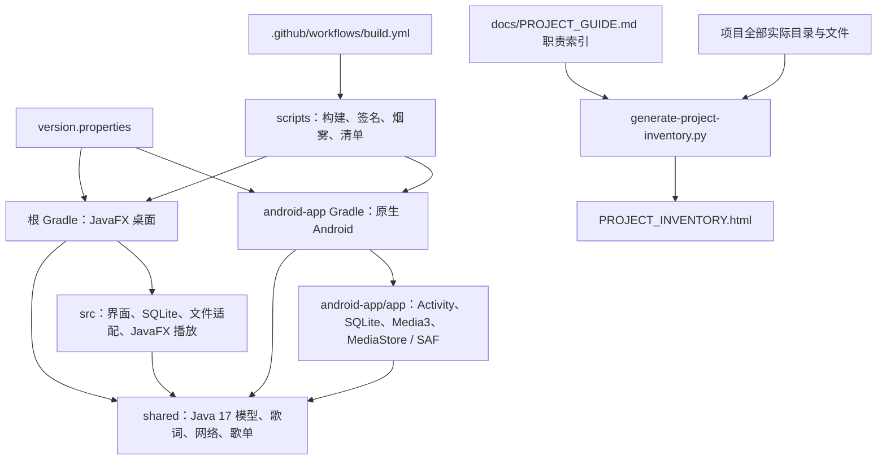
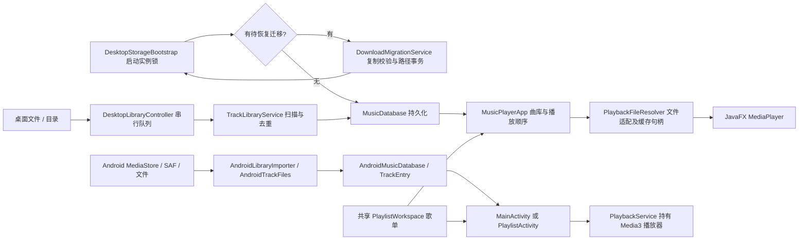
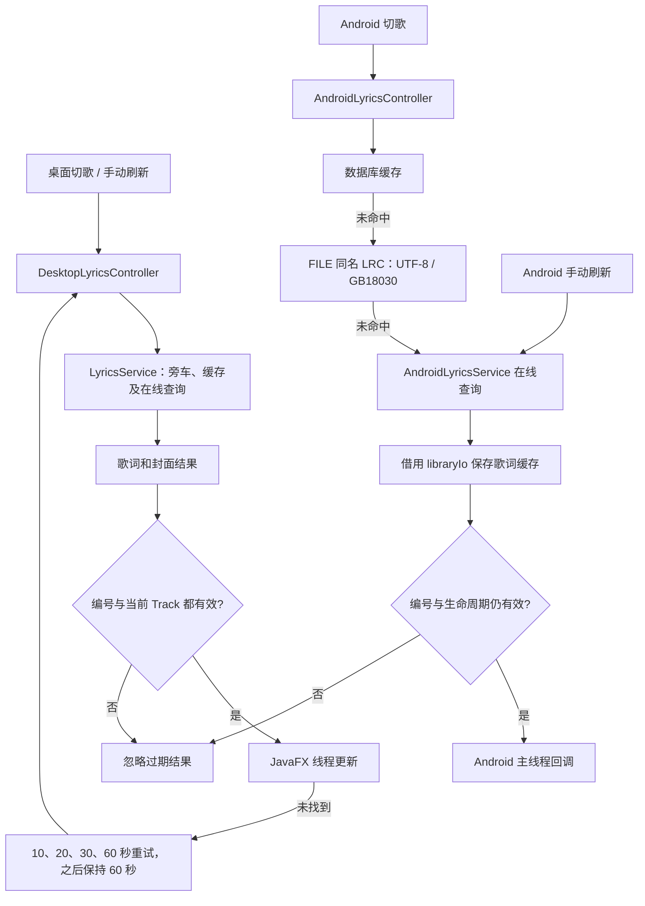
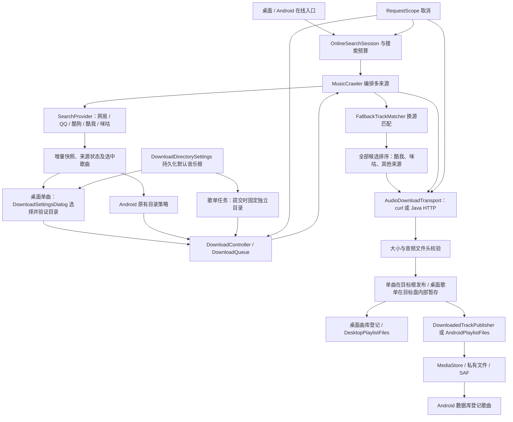
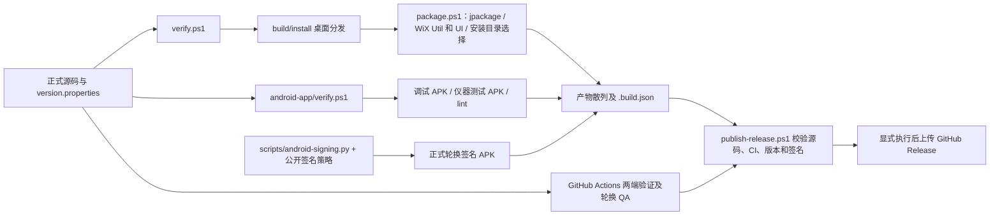

# 音乐播放器项目结构与文件说明

本项目包含 **JavaFX 桌面应用、原生 Android 应用和共享 Java 业务模块**。两个应用共用歌曲模型、歌词解析、在线来源和歌单逻辑，分别使用自己的界面、数据库适配和播放器。先读运行关系和目录职责，再根据文件名查阅下面的逐项说明。

## 全量范围与阅读方法

此文逐项解释项目自写源码、配置、资源、测试、文档及原位置保留的本地诊断代码。磁盘上每个实际文件和目录，包括隐藏目录、空目录、Git 内部文件、依赖、缓存、构建产物和历史附件，都在 [离线全量附录](PROJECT_INVENTORY.html) 中独占一项。附录的条目数量与扫描时间以最终生成页面为准。它是磁盘快照，不能用 Git 文件数量代替。

建议阅读顺序：[共享模块](#shared) → [桌面端](#src) → [Android 端](#android-app) → [正式脚本](#scripts) → 本地诊断与工具目录。用编辑器搜索完整相对路径可直接定位文件小节；离线附录适合查询海量工具和生成路径。

第三方工具和生成文件的内部条目依据所属组件、文件类型及已知生成入口解释；未经逐文件阅读的细节明确标为“推断”。压缩包作为一个文件，不枚举包内虚拟路径；目录链接列出自身与目标，不进入目标目录。项目根目录外的 JDK、用户数据、Gradle 用户缓存和本轮独立 AVD 只说明关系，不属于本次根目录扫描集合。

文件章节中的“直接引用”表示源码 import 或同包类型引用，帮助阅读依赖；不是所有运行时调用或反射路径的完整调用图。回调、资源引用和构建生成关系另行说明。源码里方法的简短中文 Javadoc 解释用途，复杂线程、取消和资源约定留在组件与方法附近。

## 桌面存储功能（4.2.4）

完整设计见 [桌面安装位置、音乐下载目录与旧歌曲迁移方案](DESKTOP_STORAGE_PLAN.md)。方案包括安装时选择盘符和文件夹、首次下载选择并记住音乐目录、目标盘音频暂存，以及更改目录时复制校验旧歌曲、同步更新曲库/歌词/歌单路径并清理旧副本。涉及旧文件的迁移采用受控重启，在播放和下载服务初始化前执行，并通过迁移记录恢复中断。

下载位置设置、首次下载选择、目标盘暂存及旧音乐迁移已经加入源码。主界面“下载位置”可选择盘符和文件夹；迁移默认勾选，保存待办后正常退出，下次启动在播放和下载服务之前执行。新构建安装包启用目录选择；既有安装包不会自行更新。数据库和缓存继续使用应用数据目录，安装目录与音乐目录分别选择。验证和安装环境限制见 [变更记录](READABILITY_CHANGES.md)。

## 初学者需要的术语

| 术语 | 在本项目中的含义 |
| --- | --- |
| 模块 / 包 | 模块有自己的构建配置；包是 Java 类型的命名层级。目录不是执行顺序。 |
| Track / TrackEntry | Track 是共享歌曲信息；Android TrackEntry 额外记录位置、创建时间与 FILE / MEDIA_STORE 分类。MEDIA_STORE 也用于歌单的 SAF content URI，沿用原数据库格式。 |
| LRC / 旁车文件 | LRC 是带时间标记的歌词；旁车指与音频同名、扩展名为 .lrc 的文件。 |
| Future / 回调 | 后台工作稍后完成；完成回调将结果传给调用方，不阻塞界面等待网络。 |
| 执行器 / 界面线程 | 执行器安排后台任务；JavaFX 控件与 Android View 必须在各自界面线程更新。 |
| 请求编号 / 取消范围 | 编号使旧结果失效；RequestScope 进一步取消连接、流或进程。两者处理不同层次。 |
| 缓存 / 句柄 | 缓存避免重复下载或解码；句柄表示使用权，释放后缓存文件才允许清理。 |
| MediaStore / SAF | MediaStore 是 Android 媒体库；SAF 是用户授权的文档树，均不能把 URI 当作普通本地路径。 |
| Wrapper / lint / instrumentation | Wrapper 启动指定 Gradle；lint 静态检查 Android；instrumentation 在设备运行测试 APK。 |
| 生成文件 / 夹具 | 生成文件由工具重建；夹具是测试专用输入，不能替代要维护的原始源码。 |

## 模块依赖



### 导入与播放



### 歌词加载



### 在线搜索与下载



### 构建与发布



## 线程、生命周期与接口约定

- 桌面 MusicPlayerApp 组装组件并持有数据库、歌词服务、在线工作区、播放器与界面。DesktopLyricsController 只拥有其新建的重试调度器；Lookup、UI 执行器和服务是借用对象。load / invalidate 在界面线程调用，网络完成后再次检查请求编号与当前 Track 的对象身份。
- DesktopLibraryController 拥有非 daemon 的单线程 library-io，扫描、恢复、保存及借用该队列的数据库工作串行执行。finish 先排入最后的工作区及数据库清理，再 orderly shutdown；已经提交的写入先完成。它不自行提前关闭借用的数据库。关闭阶段不依赖 UI 回调完成数据库写入。
- Android MainActivity 拥有页面 I/O 执行器与在线服务。AndroidLyricsController 借用它们及数据库，close 使旧 UI 回调失效，不关闭借用资源；页面按原生命周期释放执行器和服务。已安排的缓存写入沿用原有队列处理约定。Android 不新增桌面式自动重试策略。
- DownloadedTrackPublisher 借用应用 Context 和私有目录，按原规则保存单曲。Android Q 起先插入 IS_PENDING 媒体项，复制成功后发布并删除暂存文件；失败删除未完成媒体记录。API 28 私有目录保存沿用同名后缀规则。歌单 SAF 保存仍由 AndroidPlaylistFiles 负责，AndroidTrackFiles 提供名称、元数据及普通文件适配。
- AudioDownloadTransport 借用 CrawlerSession，不关闭会话；每次传输自己管理 HTTP 响应、输入输出流及 curl 进程。MusicCrawler 保留来源顺序、超时预算、取消范围、临时文件收尾及最终路径发布。FallbackTrackMatcher 是纯匹配函数，不创建线程或连接。
- 4.2.4 在桌面数据库兼容新增 download_migrations 和单个待办的唯一索引，既有表和数据保留。PlaylistDownloads.Publisher 的默认暂存策略保持原有函数式调用和 Android 路径行为。应用包名及原有入口保持原约定；4.2.5 的下载换源优先尝试酷我和咪咕。被烟雾测试反射使用的入口和必要字段保留；新增控制器让复杂后台职责有独立验证边界。

- DesktopStorageBootstrap 在正常服务创建之前临时拥有迁移线程，模态进度页仍处理事件。取消后等待任务结束，再关闭该阶段连接；正常 Session 的数据库及实例锁交给 MusicPlayerApp，在串行写入与歌单任务关闭完成后释放。DownloadMigrationService 借用数据库和设置，不创建线程；DownloadSettingsDialog 借用 library-io，完成回调先检查 closing。
- 迁移先在目标盘暂存并校验，再原子提交曲库、歌词、歌单歌曲位置、歌单目录和 COMMITTED 标记。Preferences 单独补写；标记已提交时只能恢复新设置及继续清理，不能退回旧路径。旧文件与目标文件内容均再次确认后才删除源文件；链接、缓存、备份和旧根外的导入歌曲不迁移。

## 逐层目录与文件说明

下面先列根目录及功能目录，再在各目录下逐文件说明。每个“核心入口”来自当前源码的类或方法用途；完整实现、参数和异常约定可从对应源码注释继续阅读。工具发行目录和构建内部海量路径在离线附录逐项列出，以下目录说明解释其组件边界。

### `.`

音乐播放器项目根目录。并列放置桌面构建、Android 独立构建、共享源码、工具脚本、说明、缓存及历史发布附件。

子目录：`.agents`、`.codex`、`.git`、`.github`、`.gradle`、`.idea`、`.tools`、`.wix`、`__pycache__`、`android-app`、`assets`、`build`、`docs`、`downloads`、`gradle`、`packaging`、`release`、`scripts`、`shared`、`src`。

#### [.gitignore](../.gitignore)

Git 忽略规则。排除工具、缓存、构建输出、本机配置和诊断数据；被忽略的实际条目仍全部进入 HTML 附录。

关联与使用：所属目录 .；结合此文件职责与本节目录说明使用，不作为独立运行入口。

#### [HANDOFF.md](../HANDOFF.md)

项目交接与历史验证记录。保留架构、兼容约定、历史问题和验证证据，阅读当前源码时需结合对应版本背景。

关联与使用：所属目录 .；结合此文件职责与本节目录说明使用，不作为独立运行入口。

#### [LICENSE](../LICENSE)

项目许可证全文。说明使用和分发本项目的授权条款，与应用运行逻辑无关。

关联与使用：所属目录 .；结合此文件职责与本节目录说明使用，不作为独立运行入口。

#### [项目进度.md](../项目进度.md)

项目根目录的进度记录，保留磁盘占用检查及后续各阶段的状态和交接信息。

关联与使用：2026-11-01 的搜索和下载改进链接到 docs/PROJECT_PROGRESS.md；两份记录均随工作推进维护。

#### [README.md](../README.md)

项目使用与开发入口说明。介绍功能、工具链、运行、构建、测试、签名及发布流程，并链接详细专题文档。

关联与使用：项目阅读入口；链接 PROJECT_GUIDE 与 PROJECT_INVENTORY，运行命令关联 run.ps1、verify.ps1 和 android-app/build-apk.ps1。

#### [build.gradle](../build.gradle)

桌面 Gradle 构建。固定 Java 25 和 JavaFX 25.0.1，引用 shared 与 SQLite，配置 JUnit 5、UTF-8 编译及可重复归档，installDist 生成运行目录。

关联与使用：由所属根工程的 Gradle 读取；关联 version.properties、settings.gradle、模块依赖及对应 build 产物。

补充职责与关系：4.2.4 桌面直接依赖 Gson 2.11.0 读写迁移日志和歌单 JSON；shared 原 implementation 依赖不作为桌面公开编译接口。

#### [gradle.properties](../gradle.properties)

Gradle 构建参数。配置 JVM 或 Android 构建选项，由对应工程的 Gradle 启动时读取。

关联与使用：所属目录 .；结合此文件职责与本节目录说明使用，不作为独立运行入口。

#### [gradlew](../gradlew)

官方 Gradle Wrapper 的 Unix 启动脚本。读取 wrapper 配置并启动对应构建，保留上游实现。

关联与使用：Gradle 官方 Wrapper 引导文件或配置；构建入口使用本机 Gradle 或按 wrapper 版本启动，第三方引导源码保持原状。

#### [gradlew.bat](../gradlew.bat)

官方 Gradle Wrapper 的 Windows 启动脚本。读取 wrapper 配置并启动对应构建，项目脚本会通过构建辅助调用。

关联与使用：Gradle 官方 Wrapper 引导文件或配置；构建入口使用本机 Gradle 或按 wrapper 版本启动，第三方引导源码保持原状。

#### [package.ps1](../package.ps1)

Windows 安装包生成入口。先验证项目，再使用 JDK jpackage 和 WiX 创建安装包，并生成可核对的构建记录。

关联与使用：命令入口保持本路径；源码直接提到 scripts/build-common.ps1、verify.ps1，固定历史输入路径沿用原约定。

补充职责与关系：4.2.4 EXE 加入 --win-dir-chooser，保留按用户安装与升级 UUID。同时检查 WiX 5.0.2 Util 和 UI 扩展；--temp 保留 installer-work 的 WiX、MSI 便于只读检查安装向导。

#### [run.ps1](../run.ps1)

桌面开发运行入口。调用 build-common 的 Gradle 启动辅助，处理中文路径及 Java 环境后执行应用运行任务。

关联与使用：命令入口保持本路径；源码直接提到 scripts/build-common.ps1，固定历史输入路径沿用原约定。

#### [settings.gradle](../settings.gradle)

桌面根工程组成与仓库。将 shared 纳入 simple-music-player，集中配置插件仓库及 Maven Central。

关联与使用：由所属根工程的 Gradle 读取；关联 version.properties、settings.gradle、模块依赖及对应 build 产物。

#### [verify.ps1](../verify.ps1)

桌面验证入口。执行桌面和 shared 测试、installDist，再验证构建来源、签名拒绝分支和 Release 状态；SkipClean 可复用构建缓存。

关联与使用：命令入口保持本路径；源码直接提到 scripts/build-common.ps1、scripts/test-build-tools.ps1、scripts/test-release-state.ps1，固定历史输入路径沿用原约定。

#### [version.properties](../version.properties)

全项目统一版本来源。桌面和 Android 构建读取 versionName，Android 还读取 versionCode，发布工具据此检查附件版本。

关联与使用：被两端 build.gradle、build-common.ps1 和 android-signing.py 读取，决定打包版本。

### `.agents`

代理环境预留目录；本次扫描为空时也单独列出，与应用运行无关。

### `.codex`

Codex 环境预留目录；存在于磁盘便列入清单，不是音乐数据存储位置。

### `.git`

Git 仓库内部数据。保存对象、引用、索引与本机配置，完整子项在 HTML 中按路径解释，应用不会读取它。

### `.github`

GitHub 自动化定义，workflows 中的构建验证使用正式脚本入口。

子目录：`workflows`。

### `.github/workflows`

GitHub Actions 工作流目录，CI 按事件调用其中 YAML。

#### [build.yml](../.github/workflows/build.yml)

GitHub Actions 构建验证工作流。分别验证 Windows、Android、Linux 缓存保护及 Android 签名轮换，并上传测试和构建附件。

关联与使用：调用两端验证、生成缓存符号链接检查及签名轮换 QA；上传构建和测试报告。

补充职责与关系：4.2.4 Windows 构建同时安装 WiX 5.0.2 Util 与 UI 扩展，以支持安装目录选择。远端流程须在 CI 中另行执行，不能用本地构建代替。

### `.gradle`

桌面 Gradle 的本地工作状态和缓存，构建自动维护。

### `.idea`

本机 IDE 项目设置，与源代码、构建产物分开。

### `.tools`

本机工具、依赖、历史诊断和测试夹具集中目录。JDK、Gradle、SDK 属于第三方；performance 等目录的自写脚本逐项说明。

实际子目录会随着工具安装和测试变化；当前完整目录清单见离线附录。

#### [PlaylistDialogProbe.java](../.tools/PlaylistDialogProbe.java)

本地 JavaFX 歌单对话框探针。启动测试窗口检查导入对话框和选择流程，依赖桌面测试环境。

核心入口：`main`：命令行或应用启动入口，准备运行环境并启动本文件的主流程。

关联与使用：直接引用项目类型：MusicPlayerApp（src/main/java/app/musicplayer/MusicPlayerApp.java）。

#### [playlist-diagnose-db.py](../.tools/playlist-diagnose-db.py)

本地 SQLite 歌单诊断脚本。读取指定数据库的歌单及条目信息，辅助排查持久化状态。

执行方式：保留原命令行入口，按源码顶层顺序执行；导入诊断脚本也可能触发工作，不将其当作无副作用的库。

关联与使用：命令入口保持本路径；源码直接提到 user-entries.json，固定历史输入路径沿用原约定。

#### [publish-round.ps1](../.tools/publish-round.ps1)

历史版本发布整理脚本。调用构建与 GitHub 发布工具收集附件和证据，依赖其中固定的历史版本路径。

关联与使用：命令入口保持本路径；源码直接提到 Version-debug.apk、app-debug.apk、build-apk.ps1、package.ps1，固定历史输入路径沿用原约定。

#### [verify-android-round2.ps1](../.tools/verify-android-round2.ps1)

历史 Android 第二轮验证入口。复用项目构建工具检查对应 APK 与测试产物。

关联与使用：命令入口保持本路径；调用的工具、设备或数据由源码参数及同目录夹具决定；执行前按文件职责选择场景。

### `.tools/android-sdk`

本机工具 / android-sdk目录；工具、第三方及生成子项在 HTML 中逐条解释。

### `.tools/control-probe`

本机工具 / control-probe目录；工具、第三方及生成子项在 HTML 中逐条解释。

### `.tools/dialog-probe`

本机工具 / dialog-probe目录；工具、第三方及生成子项在 HTML 中逐条解释。

### `.tools/gradle-8.11.1`

本机工具 / gradle-8.11.1目录；工具、第三方及生成子项在 HTML 中逐条解释。

### `.tools/gradle-8.14.3`

本机工具 / gradle-8.14.3目录；工具、第三方及生成子项在 HTML 中逐条解释。

### `.tools/gradle-9.6.1`

本机工具 / gradle-9.6.1目录；工具、第三方及生成子项在 HTML 中逐条解释。

### `.tools/gradle-cache-android-app`

本机工具 / gradle-cache-android-app目录；工具、第三方及生成子项在 HTML 中逐条解释。

### `.tools/gradle-cache-desktop`

本机工具 / gradle-cache-desktop目录；工具、第三方及生成子项在 HTML 中逐条解释。

### `.tools/jdk-17-android`

本机工具 / jdk-17-android目录；工具、第三方及生成子项在 HTML 中逐条解释。

### `.tools/performance`

本地性能、通知、传输、历史发布与真机诊断代码及证据。自写源码保持原位置，外部 AOSP 参考源码不修改。

子目录：`androidtransport-jvm`、`aosp-api33`。

#### [OnlineSearchBenchmark.java](../.tools/performance/OnlineSearchBenchmark.java)

在线搜索协调性能基准。通过可控来源测量搜索预算、慢来源及增量返回行为，输出可比较的结果。

核心入口：`provider`：创建可控来源或发布夹具，使回归不依赖真实网站和用户文件。；`sourceName`：返回来源的稳定名称，用于结果标记、去重与渠道选择。；`referer`：取得来源要求的 Referer 请求头，供 HTTP 请求使用。；`search`：按查询文字搜索歌曲，返回本来源或当前搜索组件的结果。；`resolve`：准备或解析可实际使用的地址、路径或运行配置。；`main`：命令行或应用启动入口，准备运行环境并启动本文件的主流程。

关联与使用：直接引用项目类型：OnlineTrackInfo（shared/src/main/java/app/musicplayer/model/OnlineTrackInfo.java）；MusicCrawler（shared/src/main/java/app/musicplayer/online/MusicCrawler.java）；OnlineSourceProvider（shared/src/main/java/app/musicplayer/online/OnlineSourceProvider.java）。

#### [ParserBoundaryRepro.java](../.tools/performance/ParserBoundaryRepro.java)

歌词解析边界复现程序。构造异常或大输入，检查 LRC 解析器的边界行为。

核心入口：`main`：命令行或应用启动入口，准备运行环境并启动本文件的主流程。；`sourceName`：返回来源的稳定名称，用于结果标记、去重与渠道选择。；`referer`：取得来源要求的 Referer 请求头，供 HTTP 请求使用。；`search`：按查询文字搜索歌曲，返回本来源或当前搜索组件的结果。；`resolve`：准备或解析可实际使用的地址、路径或运行配置。

关联与使用：直接引用项目类型：OnlineTrackInfo（shared/src/main/java/app/musicplayer/model/OnlineTrackInfo.java）；KugouSourceProvider（shared/src/main/java/app/musicplayer/online/KugouSourceProvider.java）；KuwoSourceProvider（shared/src/main/java/app/musicplayer/online/KuwoSourceProvider.java）；MiguSourceProvider（shared/src/main/java/app/musicplayer/online/MiguSourceProvider.java）；MusicCrawler（shared/src/main/java/app/musicplayer/online/MusicCrawler.java）；NeteaseSourceProvider（shared/src/main/java/app/musicplayer/online/NeteaseSourceProvider.java）；OnlineSourceProvider（shared/src/main/java/app/musicplayer/online/OnlineSourceProvider.java）；QqSourceProvider（shared/src/main/java/app/musicplayer/online/QqSourceProvider.java）。

#### [ParserCacheRepro.java](../.tools/performance/ParserCacheRepro.java)

歌词缓存复现程序。构造解析和缓存场景，检查重复请求及缓存读取行为。

核心入口：`main`：命令行或应用启动入口，准备运行环境并启动本文件的主流程。；`openConnection`：实现歌词缓存复现用的可控 URL 连接行为。；`connect`：建立测试媒体控制器或可控连接。；`disconnect`：实现歌词缓存复现用的可控 URL 连接行为。；`usingProxy`：实现歌词缓存复现用的可控 URL 连接行为。；`getResponseCode`：取得响应、状态码，供本文件的主流程使用。；`getHeaderFields`：实现歌词缓存复现用的可控 URL 连接行为。；`getInputStream`：取得数据流，供本文件的主流程使用。

关联与使用：直接引用项目类型：OnlineMusicSearchService（shared/src/main/java/app/musicplayer/online/OnlineMusicSearchService.java）。

#### [ProbeTransportRepro.java](../.tools/performance/ProbeTransportRepro.java)

HTTP 传输探测复现程序。使用本地可控响应检查流读取、超时及资源清理。

核心入口：`main`：命令行或应用启动入口，准备运行环境并启动本文件的主流程。

关联与使用：直接引用项目类型：CrawlerSession（shared/src/main/java/app/musicplayer/online/CrawlerSession.java）；RequestCancellation（shared/src/main/java/app/musicplayer/online/RequestCancellation.java）。

#### [QueueCloseRepro.java](../.tools/performance/QueueCloseRepro.java)

下载队列关闭复现程序。制造在途和排队任务，检查关闭、取消和清理行为。

核心入口：`field`：提取指定字段或当前控件的值，缺失值使用本组件约定的备用结果。；`main`：命令行或应用启动入口，准备运行环境并启动本文件的主流程。

关联与使用：直接引用项目类型：OnlineTrackInfo（shared/src/main/java/app/musicplayer/model/OnlineTrackInfo.java）；DownloadQueue（shared/src/main/java/app/musicplayer/online/DownloadQueue.java）；RequestCancellation（shared/src/main/java/app/musicplayer/online/RequestCancellation.java）。

#### [analyze_hprof.py](../.tools/performance/analyze_hprof.py)

Android HPROF 堆转储分析脚本。读取二进制记录并汇总对象或类型占用，输出诊断结果。

核心入口：`num`：按指定宽度读取堆转储的无符号整数并移动读取位置。

关联与使用：命令入口保持本路径；调用的工具、设备或数据由源码参数及同目录夹具决定；执行前按文件职责选择场景。

#### [assemble_round3_evidence.py](../.tools/performance/assemble_round3_evidence.py)

历史第三轮性能证据汇总。读取桌面和 Android 的测试记录，整理可比较的结果。

核心入口：`read`：读取历史证据 JSON，供本轮结果汇总。；`desktop`：提取桌面测量的关键指标，转换为报告使用的数据。；`rows`：整理输入测量中的结果行，供历史报告比较。

关联与使用：命令入口保持本路径；源码直接提到 -final.json、android-controlled.json、android-original-diagnostic.json、desktop.json、round3-controlled-protocol.json，固定历史输入路径沿用原约定。

#### [download_ci_failure.py](../.tools/performance/download_ci_failure.py)

GitHub CI 失败附件下载辅助。通过受控 HTTP 请求读取工作流附件并解压到本地诊断目录。

核心入口：`NoRedirect`：限制附件下载的自动跳转行为，避免认证信息传给其他目标。；`redirect_request`：按附件下载规则处理跳转，交由调用方继续验证目标。

关联与使用：命令入口保持本路径；调用的工具、设备或数据由源码参数及同目录夹具决定；执行前按文件职责选择场景。

#### [final_release_evidence.py](../.tools/performance/final_release_evidence.py)

历史发布证据检查。核对 APK、安装状态和设备信息，为最终产物保存验证摘要。

核心入口：`adb`：执行 adb 子命令并读取输出，沿用脚本指定的设备选择和超时。

关联与使用：命令入口保持本路径；源码直接提到 12.apk、base.apk、build.json、round3-notification-final-phone-evidence.json，固定历史输入路径沿用原约定。

#### [gh_authenticated.py](../.tools/performance/gh_authenticated.py)

本地 GitHub CLI 身份环境辅助。为历史诊断命令提供认证环境后执行 CLI，说明中不记录凭据值。

执行方式：保留原命令行入口，按源码顶层顺序执行；导入诊断脚本也可能触发工作，不将其当作无副作用的库。

关联与使用：命令入口保持本路径；调用的工具、设备或数据由源码参数及同目录夹具决定；执行前按文件职责选择场景。

#### [packaged-runtime-smoke.ps1](../.tools/performance/packaged-runtime-smoke.ps1)

Windows 打包运行时烟雾测试入口。检查打包目录中的 Java 运行时与桌面测试夹具。

关联与使用：命令入口保持本路径；源码直接提到 scripts/DesktopSmoke.java、scripts/OnlineSmokeFixtures.java，固定历史输入路径沿用原约定。

#### [phone_notification_case.py](../.tools/performance/phone_notification_case.py)

历史真机媒体通知用例。调用 phone_qa 检查播放时的通知和媒体控件。

执行方式：保留原命令行入口，按源码顶层顺序执行；导入诊断脚本也可能触发工作，不将其当作无副作用的库。

关联与使用：命令入口保持本路径；源码直接提到 round3-notification-final-notification-setting-evidence.json，固定历史输入路径沿用原约定。

#### [phone_notification_diagnostic.py](../.tools/performance/phone_notification_diagnostic.py)

历史真机通知诊断。并发收集 UI 和设备信息，帮助定位媒体通知异常。

执行方式：保留原命令行入口，按源码顶层顺序执行；导入诊断脚本也可能触发工作，不将其当作无副作用的库。

关联与使用：命令入口保持本路径；源码直接提到 round3-phone-notification-diagnostic.json，固定历史输入路径沿用原约定。

#### [phone_qa.py](../.tools/performance/phone_qa.py)

历史 Android 真机 QA 共用辅助。包装 adb、UI 节点读取、点击、解锁、安装和 instrumentation 操作。

核心入口：`adb`：执行 adb 子命令并读取输出，沿用脚本指定的设备选择和超时。；`nodes`：读取 Android UI XML 节点，供文字和控件状态匹配。；`tap`：根据用例给定位置或节点点击设备界面。；`unlock`：按既定 QA 步骤唤醒并解锁测试设备。；`install`：按本脚本既定设备与 APK 参数执行安装；失败即停止后续检查。；`instrument`：在指定设备运行 instrumentation 用例，并检查 Android 测试结果。

关联与使用：命令入口保持本路径；源码直接提到 -tests.apk、policy.json，固定历史输入路径沿用原约定。

#### [phone_remaining_playback.py](../.tools/performance/phone_remaining_playback.py)

历史真机剩余播放用例入口。调用 phone_qa 执行指定的回归检查。

执行方式：保留原命令行入口，按源码顶层顺序执行；导入诊断脚本也可能触发工作，不将其当作无副作用的库。

关联与使用：命令入口保持本路径；调用的工具、设备或数据由源码参数及同目录夹具决定；执行前按文件职责选择场景。

#### [phone_vivo_notification_case.py](../.tools/performance/phone_vivo_notification_case.py)

历史 vivo 真机媒体通知检查。操作设置开关并观察通知和播放状态，依赖设备界面。

核心入口：`setting_switch`：查找设备设置开关并切换到用例要求的状态。

关联与使用：命令入口保持本路径；源码直接提到 round3-notification-final-notification-setting-evidence.json，固定历史输入路径沿用原约定。

#### [publish_final.ps1](../.tools/performance/publish_final.ps1)

历史最终发布 PowerShell 入口。使用当时的构建产物和发布命令，包含外部写操作。

关联与使用：命令入口保持本路径；源码直接提到 scripts/publish-release.ps1，固定历史输入路径沿用原约定。

#### [rotation-diagnostic-repro.py](../.tools/performance/rotation-diagnostic-repro.py)

签名轮换诊断复现脚本。通过 AST 和临时夹具检查签名诊断逻辑，依赖历史脚本结构。

核心入口：`command`：执行本用例命令并检查退出码；输出用于后续断言或诊断。

关联与使用：命令入口保持本路径；源码直接提到 scripts/rotation-qa.py，固定历史输入路径沿用原约定。

#### [round3-completion-verifier-inspect.py](../.tools/performance/round3-completion-verifier-inspect.py)

历史第三轮完成状态核查。读取文件、散列和 XML 等证据，生成完成状态摘要。

执行方式：保留原命令行入口，按源码顶层顺序执行；导入诊断脚本也可能触发工作，不将其当作无副作用的库。

关联与使用：命令入口保持本路径；源码直接提到 android-controlled.json、round3-baseline-main.apk、round3-completion-verifier-evidence.json、round3-controlled-protocol.json、round3-protocol-main-after.apk、round3-protocol-tests.apk，固定历史输入路径沿用原约定。

#### [round3-final-artifact-verifier-inspect.py](../.tools/performance/round3-final-artifact-verifier-inspect.py)

历史第三轮最终产物核查。检查打包运行时、文件一致性及测试证据，输出 JSON 摘要。

执行方式：保留原命令行入口，按源码顶层顺序执行；导入诊断脚本也可能触发工作，不将其当作无副作用的库。

关联与使用：命令入口保持本路径；源码直接提到 12.apk、build.json、policy.json、round3-final-artifact-verifier-evidence.json、round3-final-artifact-verifier-signing.json、round3-phone-installed-binary.json，固定历史输入路径沿用原约定。

#### [round3-notification-final-verifier-inspect.py](../.tools/performance/round3-notification-final-verifier-inspect.py)

历史第三轮最终通知证据核查。解析清单与设备记录，整理媒体通知验证结果。

执行方式：保留原命令行入口，按源码顶层顺序执行；导入诊断脚本也可能触发工作，不将其当作无副作用的库。

关联与使用：命令入口保持本路径；源码直接提到 12.apk、build.json、policy.json、round3-notification-final-verifier-evidence.json、tools.apk，固定历史输入路径沿用原约定。

#### [round3-public-release-verifier.py](../.tools/performance/round3-public-release-verifier.py)

历史第三轮公开 Release 核查。调用 GitHub CLI 获取发布状态，并核对下载附件散列。

核心入口：`gh`：执行 GitHub CLI 并读取结果，失败时保留诊断信息。；`api`：通过 GitHub CLI 读取指定 API 的 JSON，供发布状态核对。；`sha`：以二进制方式读取文件并计算 SHA-256，供发布附件完整性核对。

关联与使用：命令入口保持本路径；源码直接提到 12.apk、build-info.json、gh_authenticated.py、round3-notification-final-verifier-evidence.json、round3-public-build-info.json、round3-public-release-verifier-evidence.json，固定历史输入路径沿用原约定。

#### [run-androidtransport-jvm.py](../.tools/performance/run-androidtransport-jvm.py)

在桌面 JVM 运行 Android 传输回归的辅助。生成轻量 AndroidJUnit4 测试桩，组合依赖后编译运行对应夹具。

执行方式：保留原命令行入口，按源码顶层顺序执行；导入诊断脚本也可能触发工作，不将其当作无副作用的库。

关联与使用：生成 androidtransport-jvm/AndroidJUnit4.java 桩，借用 JUnit、shared 与桌面依赖，编译并运行 AndroidTransportTest。

#### [run_round3_layout_pilot.py](../.tools/performance/run_round3_layout_pilot.py)

历史第三轮布局试验。通过 adb 和夹具收集界面布局与交互的试验数据。

核心入口：`adb`：执行 adb 子命令并读取输出，沿用脚本指定的设备选择和超时。

关联与使用：命令入口保持本路径；源码直接提到 qa-activity-startup-results.json、qa-import-write-results.json、qa-large-library-results.json、qa-lyric-text-results.json、round3-baseline-main.apk、round3-layout-protocol.json、round3-layout-tests.apk、round3-protocol-main-after.apk，固定历史输入路径沿用原约定。

#### [run_round3_layout_protocol.py](../.tools/performance/run_round3_layout_protocol.py)

历史第三轮布局验证协议。按既定步骤运行设备测试并保存结果及散列。

核心入口：`adb`：执行 adb 子命令并读取输出，沿用脚本指定的设备选择和超时。

关联与使用：命令入口保持本路径；源码直接提到 qa-activity-startup-results.json、qa-import-write-results.json、qa-large-library-results.json、qa-lyric-text-results.json、round3-baseline-main.apk、round3-layout-protocol.json、round3-layout-tests.apk、round3-protocol-main-after.apk，固定历史输入路径沿用原约定。

#### [run_round3_protocol.py](../.tools/performance/run_round3_protocol.py)

历史第三轮性能验证协议。安排桌面或设备工作负载，收集多轮记录。

核心入口：`adb`：执行 adb 子命令并读取输出，沿用脚本指定的设备选择和超时。

关联与使用：命令入口保持本路径；源码直接提到 qa-activity-startup-results.json、qa-import-write-results.json、qa-large-library-results.json、qa-lyric-text-results.json、round3-baseline-main.apk、round3-controlled-protocol.json、round3-protocol-main-after.apk、round3-protocol-tests.apk，固定历史输入路径沿用原约定。

### `.tools/performance/androidtransport-jvm`

本机工具 / performance目录；工具、第三方及生成子项在 HTML 中逐条解释。

子目录：`androidx`。

### `.tools/performance/androidtransport-jvm/androidx`

本机工具 / performance目录；工具、第三方及生成子项在 HTML 中逐条解释。

子目录：`test`。

### `.tools/performance/androidtransport-jvm/androidx/test`

JVM 单元回归源码与夹具，由所属工程 Gradle test 运行。

子目录：`ext`。

### `.tools/performance/androidtransport-jvm/androidx/test/ext`

本机工具 / performance目录；工具、第三方及生成子项在 HTML 中逐条解释。

子目录：`junit`。

### `.tools/performance/androidtransport-jvm/androidx/test/ext/junit`

本机工具 / performance目录；工具、第三方及生成子项在 HTML 中逐条解释。

子目录：`runners`。

### `.tools/performance/androidtransport-jvm/androidx/test/ext/junit/runners`

本机工具 / performance目录；工具、第三方及生成子项在 HTML 中逐条解释。

#### [AndroidJUnit4.java](../.tools/performance/androidtransport-jvm/androidx/test/ext/junit/runners/AndroidJUnit4.java)

本地 JVM 传输测试的 AndroidJUnit4 测试桩，由 run-androidtransport-jvm.py 写入；只替代测试运行器，不是应用代码。

关联与使用：由 .tools/performance/run-androidtransport-jvm.py 生成，源码桩及 class 只用于 JVM 回归。

### `.tools/performance/aosp-api33`

本机工具 / performance目录；工具、第三方及生成子项在 HTML 中逐条解释。

#### [NotificationManagerService.java](../.tools/performance/aosp-api33/NotificationManagerService.java)

Android Open Source Project API 33 的通知实现参考源码。用于排查系统媒体通知行为，属于第三方参考资料，不进入本项目应用构建。

关联与使用：AOSP API 33 系统通知参考，供本地分析对照，不参与项目构建且未修改。

#### [NotificationMediaManager.java](../.tools/performance/aosp-api33/NotificationMediaManager.java)

Android Open Source Project API 33 的通知实现参考源码。用于排查系统媒体通知行为，属于第三方参考资料，不进入本项目应用构建。

关联与使用：AOSP API 33 系统通知参考，供本地分析对照，不参与项目构建且未修改。

### `.tools/playlist-audio`

本机工具 / playlist-audio目录；工具、第三方及生成子项在 HTML 中逐条解释。

### `.tools/playlist-batch-audio`

本机工具 / playlist-batch-audio目录；工具、第三方及生成子项在 HTML 中逐条解释。

### `.tools/playlist-diagnostic`

本地歌单诊断和证据摘要；源码读取同目录历史 JSON，夹具与结果由 HTML 单独列项。

#### [PlaylistBatchProbe.java](../.tools/playlist-diagnostic/PlaylistBatchProbe.java)

本地歌单批量下载探针。用可控来源及存储夹具检查批量状态、取消和持久化。

核心入口：`loadPlaylists`：从本平台数据库读取对应歌单、歌曲或歌词缓存。；`savePlaylist`：把对应歌单、歌曲或歌词数据写入数据库，遵守事务及线程约定。；`updatePlaylistEntry`：保存歌单中指定条目的最新状态与配置。；`deletePlaylist`：删除歌单及其条目记录，保留关联音频和歌词。；`main`：命令行或应用启动入口，准备运行环境并启动本文件的主流程。

关联与使用：直接引用项目类型：NamedPlaylist（shared/src/main/java/app/musicplayer/playlist/NamedPlaylist.java）；PlaylistCodec（shared/src/main/java/app/musicplayer/playlist/PlaylistCodec.java）；PlaylistDownloads（shared/src/main/java/app/musicplayer/playlist/PlaylistDownloads.java）；PlaylistStore（shared/src/main/java/app/musicplayer/playlist/PlaylistStore.java）。

#### [PlaylistDiagnosticPreview.java](../.tools/playlist-diagnostic/PlaylistDiagnosticPreview.java)

本地歌单预览探针。启动 JavaFX 预览界面以检查布局和歌单条目状态。

核心入口：`main`：命令行或应用启动入口，准备运行环境并启动本文件的主流程。

关联与使用：直接引用项目类型：NamedPlaylist（shared/src/main/java/app/musicplayer/playlist/NamedPlaylist.java）；PlaylistCodec（shared/src/main/java/app/musicplayer/playlist/PlaylistCodec.java）；PlaylistWorkspace（shared/src/main/java/app/musicplayer/playlist/PlaylistWorkspace.java）；MusicDatabase（src/main/java/app/musicplayer/data/MusicDatabase.java）；DesktopPlaylistFiles（src/main/java/app/musicplayer/playlist/DesktopPlaylistFiles.java）；PlaylistWindow（src/main/java/app/musicplayer/ui/PlaylistWindow.java）。

#### [PlaylistMediaProbe.java](../.tools/playlist-diagnostic/PlaylistMediaProbe.java)

本地歌单音频播放探针。检查下载或关联歌曲的 MediaPlayer 可播放性。

核心入口：`main`：命令行或应用启动入口，准备运行环境并启动本文件的主流程。

关联与使用：由所属模块编译；通过此类型的接口、数据或测试职责参与同包及上层组件，具体成员说明见源码 Javadoc。

#### [PlaylistSearchProbe.java](../.tools/playlist-diagnostic/PlaylistSearchProbe.java)

本地歌单在线搜索探针。检查分享歌曲的候选来源、名称和版本匹配。

核心入口：`main`：命令行或应用启动入口，准备运行环境并启动本文件的主流程。

关联与使用：直接引用项目类型：MusicCrawler（shared/src/main/java/app/musicplayer/online/MusicCrawler.java）；NamedPlaylist（shared/src/main/java/app/musicplayer/playlist/NamedPlaylist.java）；PlaylistCodec（shared/src/main/java/app/musicplayer/playlist/PlaylistCodec.java）；PlaylistSongMatcher（shared/src/main/java/app/musicplayer/playlist/PlaylistSongMatcher.java）。

#### [VerifierEvidence.py](../.tools/playlist-diagnostic/VerifierEvidence.py)

历史歌单验证证据核对。检查文件散列、JSON 和 XML 测试记录，输出验证摘要。

执行方式：保留原命令行入口，按源码顶层顺序执行；导入诊断脚本也可能触发工作，不将其当作无副作用的库。

关联与使用：命令入口保持本路径；源码直接提到 build.json、real-download-results.json，固定历史输入路径沿用原约定。

#### [brief.py](../.tools/playlist-diagnostic/brief.py)

历史歌单诊断摘要脚本。读取 JSON 证据并打印精简结果，固定输入由该目录的历史记录决定。

执行方式：保留原命令行入口，按源码顶层顺序执行；导入诊断脚本也可能触发工作，不将其当作无副作用的库。

关联与使用：命令入口保持本路径；源码直接提到 search-report.json，固定历史输入路径沿用原约定。

#### [summarize.py](../.tools/playlist-diagnostic/summarize.py)

历史歌单证据汇总脚本。读取诊断 JSON 并整理主要检查结果。

执行方式：保留原命令行入口，按源码顶层顺序执行；导入诊断脚本也可能触发工作，不将其当作无副作用的库。

关联与使用：命令入口保持本路径；源码直接提到 search-report.json，固定历史输入路径沿用原约定。

### `.tools/playlist-probe`

本机工具 / playlist-probe目录；工具、第三方及生成子项在 HTML 中逐条解释。

#### [PlaylistAudioProbe.java](../.tools/playlist-probe/PlaylistAudioProbe.java)

本地歌单音频探针。核对临时音频、队列和播放状态。

核心入口：`main`：命令行或应用启动入口，准备运行环境并启动本文件的主流程。

关联与使用：直接引用项目类型：OnlineMusicSearchService（shared/src/main/java/app/musicplayer/online/OnlineMusicSearchService.java）；PlaylistImportService（shared/src/main/java/app/musicplayer/online/PlaylistImportService.java）。

#### [PlaylistBatchProbe.java](../.tools/playlist-probe/PlaylistBatchProbe.java)

本地歌单批量下载探针。用可控来源及存储夹具检查批量状态、取消和持久化。

核心入口：`loadPlaylists`：从本平台数据库读取对应歌单、歌曲或歌词缓存。；`savePlaylist`：把对应歌单、歌曲或歌词数据写入数据库，遵守事务及线程约定。；`updatePlaylistEntry`：保存歌单中指定条目的最新状态与配置。；`deletePlaylist`：删除歌单及其条目记录，保留关联音频和歌词。；`main`：命令行或应用启动入口，准备运行环境并启动本文件的主流程。

关联与使用：直接引用项目类型：DownloadFiles（shared/src/main/java/app/musicplayer/online/DownloadFiles.java）；PlaylistImportService（shared/src/main/java/app/musicplayer/online/PlaylistImportService.java）；NamedPlaylist（shared/src/main/java/app/musicplayer/playlist/NamedPlaylist.java）；PlaylistDownloads（shared/src/main/java/app/musicplayer/playlist/PlaylistDownloads.java）；PlaylistStore（shared/src/main/java/app/musicplayer/playlist/PlaylistStore.java）。

#### [PlaylistProbe.java](../.tools/playlist-probe/PlaylistProbe.java)

本地歌单工作区探针。构造导入、保存和下载夹具，观察共享歌单接口行为。

核心入口：`main`：命令行或应用启动入口，准备运行环境并启动本文件的主流程。

关联与使用：直接引用项目类型：PlaylistImportService（shared/src/main/java/app/musicplayer/online/PlaylistImportService.java）。

### `.tools/playlist-qa`

本地歌单设备 QA 与探针。部分脚本安装 APK、生成数据或操作手机，只做静态检查时不会执行这些副作用。

#### [PhoneMediaProbe.java](../.tools/playlist-qa/PhoneMediaProbe.java)

Android 媒体探针源码。生成设备侧媒体与存储检查入口，供本地 QA 构建使用。

核心入口：`main`：命令行或应用启动入口，准备运行环境并启动本文件的主流程。

关联与使用：由所属模块编译；通过此类型的接口、数据或测试职责参与同包及上层组件，具体成员说明见源码 Javadoc。

#### [PhoneUiDump.java](../.tools/playlist-qa/PhoneUiDump.java)

Android UI 状态导出探针。读取设备页面节点并输出可用于诊断的界面信息。

核心入口：`main`：命令行或应用启动入口，准备运行环境并启动本文件的主流程。

关联与使用：由所属模块编译；通过此类型的接口、数据或测试职责参与同包及上层组件，具体成员说明见源码 Javadoc。

#### [android-verifier-build.py](../.tools/playlist-qa/android-verifier-build.py)

历史 Android 歌单验证 APK 构建脚本。生成或编译专用设备验证夹具。

执行方式：保留原命令行入口，按源码顶层顺序执行；导入诊断脚本也可能触发工作，不将其当作无副作用的库。

关联与使用：命令入口保持本路径；源码直接提到 scripts/android-signing.py、scripts/build-common.ps1，固定历史输入路径沿用原约定。

#### [android-verifier-facts.py](../.tools/playlist-qa/android-verifier-facts.py)

历史 Android 验证事实收集。解析 APK、XML 和设备证据，生成验证摘要。

执行方式：保留原命令行入口，按源码顶层顺序执行；导入诊断脚本也可能触发工作，不将其当作无副作用的库。

关联与使用：命令入口保持本路径；源码直接提到 3-preview-20261009.apk、app-release.apk、build.json、live-downloads.json、verifier-live-downloads.json，固定历史输入路径沿用原约定。

#### [finish-phone.py](../.tools/playlist-qa/finish-phone.py)

历史手机 QA 收尾脚本。读取前序测试信息并完成剩余设备检查。

执行方式：保留原命令行入口，按源码顶层顺序执行；导入诊断脚本也可能触发工作，不将其当作无副作用的库。

关联与使用：命令入口保持本路径；源码直接提到 3-preview-20261010.apk、installed-artifact.json、native-media-check.json、playlist-live-check.json、result.json、seed.json、za-phone-requested.json，固定历史输入路径沿用原约定。

#### [phone-fixtures.py](../.tools/playlist-qa/phone-fixtures.py)

历史手机 QA 数据夹具创建。为歌单及播放检查准备音频或测试数据。

执行方式：保留原命令行入口，按源码顶层顺序执行；导入诊断脚本也可能触发工作，不将其当作无副作用的库。

关联与使用：命令入口保持本路径；源码直接提到 3-preview-20261009.apk、installed-artifact.json、installed-base.apk、seed.json，固定历史输入路径沿用原约定。

#### [phone.py](../.tools/playlist-qa/phone.py)

历史手机歌单 QA 主流程。通过 adb 驱动页面和回归步骤，依赖指定设备与产物。

核心入口：`adb`：执行 adb 子命令并读取输出，沿用脚本指定的设备选择和超时。；`tree`：取得设备当前 UI 层级并解析 XML，供控件定位。；`tap`：根据用例给定位置或节点点击设备界面。；`pick`：按用例条件选择 UI 节点，找不到时让断言失败。；`install`：按本脚本既定设备与 APK 参数执行安装；失败即停止后续检查。

关联与使用：命令入口保持本路径；源码直接提到 -tests.apk，固定历史输入路径沿用原约定。

#### [ui.py](../.tools/playlist-qa/ui.py)

历史手机 UI 操作辅助。读取 UI XML 节点并提供查找或操作工具，供同目录 QA 脚本调用。

核心入口：`run`：执行命令并检查退出码；需要捕获时返回输出，失败由调用方处理。；`tree`：取得设备当前 UI 层级并解析 XML，供控件定位。

关联与使用：命令入口保持本路径；调用的工具、设备或数据由源码参数及同目录夹具决定；执行前按文件职责选择场景。

### `.tools/playlist-verifier`

本地歌单回归探针。NativeControlsProbe 生成专用 JavaFX 控件夹具，其历史副本按生成文件解释。

子目录：`native-controls-1e6e220da4ea40c18d4960c12a346bcc`、`native-controls-429a7f1c52944282b15fc7bbd07d130f`、`native-controls-7ffc87f07d234fbb9349f822bea196e9`。

#### [AppendProbe.java](../.tools/playlist-verifier/AppendProbe.java)

本地播放队列追加探针。检查追加歌单后队列顺序、去重及已有播放位置。

核心入口：`main`：命令行或应用启动入口，准备运行环境并启动本文件的主流程。

关联与使用：直接引用项目类型：Track（shared/src/main/java/app/musicplayer/model/Track.java）；MusicPlayerApp（src/main/java/app/musicplayer/MusicPlayerApp.java）；MusicDatabase（src/main/java/app/musicplayer/data/MusicDatabase.java）。

#### [DeleteSelectionProbe.java](../.tools/playlist-verifier/DeleteSelectionProbe.java)

本地歌单删除选择探针。检查删除条目或歌单后界面选择和播放状态。

核心入口：`main`：命令行或应用启动入口，准备运行环境并启动本文件的主流程。

关联与使用：直接引用项目类型：OnlineTrackInfo（shared/src/main/java/app/musicplayer/model/OnlineTrackInfo.java）；NamedPlaylist（shared/src/main/java/app/musicplayer/playlist/NamedPlaylist.java）；PlaylistWorkspace（shared/src/main/java/app/musicplayer/playlist/PlaylistWorkspace.java）；MusicPlayerApp（src/main/java/app/musicplayer/MusicPlayerApp.java）；MusicDatabase（src/main/java/app/musicplayer/data/MusicDatabase.java）；PlaylistWindow（src/main/java/app/musicplayer/ui/PlaylistWindow.java）。

#### [NativeControlsProbe.ps1](../.tools/playlist-verifier/NativeControlsProbe.ps1)

历史原生歌单控件验证入口。创建专用烟雾测试源码副本并编译运行，生成文件关联到本脚本。

关联与使用：从 scripts/PlaylistControlsSmoke.java 生成 native-controls-* 副本，编译并运行；替换允许源码空白排版变化且要求恰好匹配。

### `.tools/playlist-verifier/native-controls-1e6e220da4ea40c18d4960c12a346bcc`

本机工具 / playlist-verifier目录；工具、第三方及生成子项在 HTML 中逐条解释。

#### [PlaylistControlsSmoke.java](../.tools/playlist-verifier/native-controls-1e6e220da4ea40c18d4960c12a346bcc/PlaylistControlsSmoke.java)

NativeControlsProbe.ps1 生成的历史歌单控件烟雾测试源码副本。重新生成会覆盖该文件，修改应落在生成脚本或原始夹具。

关联与使用：由 .tools/playlist-verifier/NativeControlsProbe.ps1 与 scripts/PlaylistControlsSmoke.java 生成；历史副本不手工整理。

### `.tools/playlist-verifier/native-controls-429a7f1c52944282b15fc7bbd07d130f`

本机工具 / playlist-verifier目录；工具、第三方及生成子项在 HTML 中逐条解释。

#### [PlaylistControlsSmoke.java](../.tools/playlist-verifier/native-controls-429a7f1c52944282b15fc7bbd07d130f/PlaylistControlsSmoke.java)

NativeControlsProbe.ps1 生成的历史歌单控件烟雾测试源码副本。重新生成会覆盖该文件，修改应落在生成脚本或原始夹具。

关联与使用：由 .tools/playlist-verifier/NativeControlsProbe.ps1 与 scripts/PlaylistControlsSmoke.java 生成；历史副本不手工整理。

### `.tools/playlist-verifier/native-controls-7ffc87f07d234fbb9349f822bea196e9`

本机工具 / playlist-verifier目录；工具、第三方及生成子项在 HTML 中逐条解释。

#### [PlaylistControlsSmoke.java](../.tools/playlist-verifier/native-controls-7ffc87f07d234fbb9349f822bea196e9/PlaylistControlsSmoke.java)

NativeControlsProbe.ps1 生成的历史歌单控件烟雾测试源码副本。重新生成会覆盖该文件，修改应落在生成脚本或原始夹具。

关联与使用：由 .tools/playlist-verifier/NativeControlsProbe.ps1 与 scripts/PlaylistControlsSmoke.java 生成；历史副本不手工整理。

### `.tools/qa-round2`

本机工具 / qa-round2目录；工具、第三方及生成子项在 HTML 中逐条解释。

#### [DesktopSmoke.java](../.tools/qa-round2/DesktopSmoke.java)

JavaFX 真实播放烟雾测试。创建独立临时曲库，检查恢复、快速选歌、循环、暂停恢复及歌词和封面呈现。

核心入口：`field`：提取指定字段或当前控件的值，缺失值使用本组件约定的备用结果。；`call`：通过反射调用测试对象的指定入口，保留实际行为断言。；`get`：按当前组件的键或上下文取得已有值；缓存的期限规则见类说明。；`fx`：将检查操作投递到 JavaFX 线程并等待结果。；`await`：等待测试条件满足；到达期限仍未满足时报告失败。；`main`：命令行或应用启动入口，准备运行环境并启动本文件的主流程。

关联与使用：直接引用项目类型：LrcParser（shared/src/main/java/app/musicplayer/lyrics/LrcParser.java）；Track（shared/src/main/java/app/musicplayer/model/Track.java）；MusicPlayerApp（src/main/java/app/musicplayer/MusicPlayerApp.java）；MusicDatabase（src/main/java/app/musicplayer/data/MusicDatabase.java）。

### `.tools/qa-round3`

本机工具 / qa-round3目录；工具、第三方及生成子项在 HTML 中逐条解释。

### `.tools/release-4.2.3`

4.2.3 历史发布 CLI 辅助和证据；其中版本路径沿用历史背景。

#### [github_cli.py](../.tools/release-4.2.3/github_cli.py)

历史发布 GitHub CLI 共用辅助。准备命令环境，执行 gh 并向同目录脚本提供结果。

核心入口：`environment`：准备 GitHub CLI 的子进程环境，沿用已有身份配置。；`run`：执行命令并检查退出码；需要捕获时返回输出，失败由调用方处理。

关联与使用：命令入口保持本路径；源码直接提到 scripts/publish-release.ps1，固定历史输入路径沿用原约定。

#### [watch_ci.py](../.tools/release-4.2.3/watch_ci.py)

历史版本 CI 观察脚本。调用 github_cli 读取工作流状态并等待目标变化，依赖固定的历史发布背景。

执行方式：保留原命令行入口，按源码顶层顺序执行；导入诊断脚本也可能触发工作，不将其当作无副作用的库。

关联与使用：命令入口保持本路径；源码直接提到 ci-final.json，固定历史输入路径沿用原约定。

### `.tools/releases`

本机工具 / releases目录；工具、第三方及生成子项在 HTML 中逐条解释。

### `.tools/signing-inspector`

本机工具 / signing-inspector目录；工具、第三方及生成子项在 HTML 中逐条解释。

### `.tools/signing-qa`

本地签名与安装观察代码及夹具，与正式 signing 策略和 rotation-qa 关联。

#### [install-watcher.py](../.tools/signing-qa/install-watcher.py)

历史安装过程观察脚本。通过 adb 和 UI XML 检查 Android 安装界面的进展。

执行方式：保留原命令行入口，按源码顶层顺序执行；导入诊断脚本也可能触发工作，不将其当作无副作用的库。

关联与使用：命令入口保持本路径；调用的工具、设备或数据由源码参数及同目录夹具决定；执行前按文件职责选择场景。

### `.tools/wix`

本机工具 / wix目录；工具、第三方及生成子项在 HTML 中逐条解释。

### `.wix`

Windows 打包使用的 WiX 工具与运行状态；package.ps1 关联这些本机打包组件。

### `__pycache__`

Python 自动生成的模块字节码缓存，不应把它当作需要维护的源码。

### `android-app`

独立的原生 Android Gradle 根工程。应用在 app，借用 ../shared，与根目录的 JavaFX 构建并列。

子目录：`app`、`gradle`、`signing`。

#### [.gitignore](../android-app/.gitignore)

Android 子工程忽略规则。排除本机 SDK 配置、Gradle 缓存和 APK 构建目录；不影响磁盘全量扫描。

关联与使用：所属目录 android-app；结合此文件职责与本节目录说明使用，不作为独立运行入口。

#### [build-apk.ps1](../android-app/build-apk.ps1)

Android 开发 APK 构建入口。准备对应 SDK/JDK，调用 Android 验证和构建任务，再输出调试 APK 及构建记录。

关联与使用：命令入口保持本路径；源码直接提到 app-debug.apk、scripts/build-common.ps1、version-debug.apk，固定历史输入路径沿用原约定。

#### [build.gradle](../android-app/build.gradle)

Android 根构建。固定 Android Gradle 插件 8.9.2；应用依赖、SDK 与签名在 app/build.gradle 中声明。

关联与使用：由所属根工程的 Gradle 读取；关联 version.properties、settings.gradle、模块依赖及对应 build 产物。

#### [gradle.properties](../android-app/gradle.properties)

Gradle 构建参数。配置 JVM 或 Android 构建选项，由对应工程的 Gradle 启动时读取。

关联与使用：所属目录 android-app；结合此文件职责与本节目录说明使用，不作为独立运行入口。

#### [gradlew](../android-app/gradlew)

官方 Gradle Wrapper 的 Unix 启动脚本。读取 wrapper 配置并启动对应构建，保留上游实现。

关联与使用：Gradle 官方 Wrapper 引导文件或配置；构建入口使用本机 Gradle 或按 wrapper 版本启动，第三方引导源码保持原状。

#### [gradlew.bat](../android-app/gradlew.bat)

官方 Gradle Wrapper 的 Windows 启动脚本。读取 wrapper 配置并启动对应构建，项目脚本会通过构建辅助调用。

关联与使用：Gradle 官方 Wrapper 引导文件或配置；构建入口使用本机 Gradle 或按 wrapper 版本启动，第三方引导源码保持原状。

#### [settings.gradle](../android-app/settings.gradle)

Android 根工程组成与仓库。包含 app，并将同一份 ../shared 源码映射为共享模块；集中配置 Google 和 Maven 仓库。

关联与使用：由所属根工程的 Gradle 读取；关联 version.properties、settings.gradle、模块依赖及对应 build 产物。

#### [verify.ps1](../android-app/verify.ps1)

Android 验证入口。运行 shared 的 Java 17 测试、调试 APK、仪器测试 APK 编译及 Android lint；它自身不启动设备测试。

关联与使用：命令入口保持本路径；源码直接提到 app-debug.apk、scripts/build-common.ps1，固定历史输入路径沿用原约定。

### `android-app/app`

Android 应用模块。main 是应用，androidTest 是在设备上运行的用例，build 是编译生成目录。

子目录：`src`。

#### [build.gradle](../android-app/app/build.gradle)

原生 Android 应用构建。设置 SDK 35、minSdk 28、Java 17、反糖化、Media3、AndroidX、Glide 和仪器测试；正式发布要求完整签名环境。

关联与使用：由所属根工程的 Gradle 读取；关联 version.properties、settings.gradle、模块依赖及对应 build 产物。

#### [proguard-rules.pro](../android-app/app/proguard-rules.pro)

Android 混淆规则入口。供 release 构建引用，说明当前模块需要的保留规则；是否启用缩小由 app/build.gradle 决定。

关联与使用：所属目录 android-app/app；结合此文件职责与本节目录说明使用，不作为独立运行入口。

### `android-app/app/src`

所属模块的源码集根目录，按 main、test 或 androidTest 区分运行场景。

子目录：`androidTest`、`main`。

### `android-app/app/src/androidTest`

Android 仪器测试源码与清单，需要安装测试 APK 后在独立设备上运行。

子目录：`java`。

#### [AndroidManifest.xml](../android-app/app/src/androidTest/AndroidManifest.xml)

仪器测试专用清单。声明 ImportFixtureProvider 的测试文件提供能力，仅合并到测试 APK，不属于正式应用页面。

关联与使用：所属目录 android-app/app/src/androidTest；结合此文件职责与本节目录说明使用，不作为独立运行入口。

### `android-app/app/src/androidTest/java`

Java 源码根目录，下面的包路径对应 package 名称，不是文件加载顺序。

子目录：`app`。

### `android-app/app/src/androidTest/java/app`

Java 包层级目录。路径与源码 package 对应；真正职责见下一层功能包和文件。

子目录：`musicplayer`。

### `android-app/app/src/androidTest/java/app/musicplayer`

Java 包层级目录。路径与源码 package 对应；真正职责见下一层功能包和文件。

子目录：`android`、`online`。

### `android-app/app/src/androidTest/java/app/musicplayer/android`

Android 端的目录层级；包含本节逐项解释的子目录和文件。

#### [ActivityStartupBenchmarkTest.java](../android-app/app/src/androidTest/java/app/musicplayer/android/ActivityStartupBenchmarkTest.java)

测量 Android 主页面在不同曲库规模下的启动耗时。

核心入口：`measureActivityAndLibraryReadiness`：测量本基准构造的启动、曲库或交互工作负载并记录结果。；`seed`：按指定规模写入测试数据，供恢复或性能测量使用。；`measure`：测量本基准构造的启动、曲库或交互工作负载并记录结果。；`field`：提取指定字段或当前控件的值，缺失值使用本组件约定的备用结果。；`clear`：清空当前集合或缓存，为后续操作保留可复用的组件。；`hasImports`：检查数据库中是否存在导入历史记录。；`restore`：恢复已保存的数据或界面状态，并应用当前可用性检查。；`heap`：读取运行时堆内存占用，用于比较测量前后变化。

关联与使用：直接引用项目类型：MainActivity（android-app/app/src/main/java/app/musicplayer/android/MainActivity.java）；AndroidMusicDatabase（android-app/app/src/main/java/app/musicplayer/android/data/AndroidMusicDatabase.java）；TrackEntry（android-app/app/src/main/java/app/musicplayer/android/data/TrackEntry.java）；TrackAdapter（android-app/app/src/main/java/app/musicplayer/android/ui/TrackAdapter.java）；LyricLine（shared/src/main/java/app/musicplayer/model/LyricLine.java）；Lyrics（shared/src/main/java/app/musicplayer/model/Lyrics.java）；Track（shared/src/main/java/app/musicplayer/model/Track.java）。

#### [AndroidLibraryImporterTest.java](../android-app/app/src/androidTest/java/app/musicplayer/android/AndroidLibraryImporterTest.java)

AndroidLibraryImporter 的回归测试。使用可控夹具验证正常流程、边界输入及资源或失败处理。被测职责：Android SAF 批量音频导入器。复制用户选择的文档、提取元数据、批量提交数据库，取消或失败时清理尚未提交的副本。

核心入口：`setup`：准备隔离的数据库、目录和测试依赖。；`cleanup`：关闭测试依赖并清理本用例创建的夹具。；`copy`：把输入内容复制到目标；读取或写入失败按异常约定交由调用方处理。；`uris`：生成待导入夹具的文档 URI 列表。；`batchesAndCompletedDuplicatesPreserveOriginalSongs`：验证分批导入和已完成重复项保留原歌曲。；`queuedRepeatedSubmissionIsMergedAndCloseDoesNotStopUnrelatedTasks`：验证排队重复提交合并，关闭不会停止无关任务。；`readFailureReportsReasonAndCommitsOtherFiles`：验证文件读取失败报告原因，其他有效文件仍可提交。；`databaseFailureRollsBackWholeBatchAndDeletesOnlyItsCopies`：验证数据库失败回滚整个导入批次，只删除自己的复制文件。；`closeDuringCopyCleansUncommittedFile`：验证复制中关闭清理尚未提交的文件。；`actualProviderPartialReadCleansReservedFileAndReportsFailures`：验证真实来源的部分响应读取失败会清理预留文件并报告错误。；`databaseQueryFailureHasDatabaseReason`：验证数据库查询失败保留数据库错误原因。；`deliveryRejectionCleansStagingAndReleasesPendingUri`：验证投递被拒绝时清理暂存文件并释放待处理 URI。

关联与使用：直接引用项目类型：AndroidLibraryImporter（android-app/app/src/main/java/app/musicplayer/android/data/AndroidLibraryImporter.java）；AndroidMusicDatabase（android-app/app/src/main/java/app/musicplayer/android/data/AndroidMusicDatabase.java）；AndroidTrackFiles（android-app/app/src/main/java/app/musicplayer/android/data/AndroidTrackFiles.java）；TrackEntry（android-app/app/src/main/java/app/musicplayer/android/data/TrackEntry.java）；Track（shared/src/main/java/app/musicplayer/model/Track.java）。

#### [AndroidLyricsControllerTest.java](../android-app/app/src/androidTest/java/app/musicplayer/android/AndroidLyricsControllerTest.java)

验证 Android 歌词缓存优先级、UTF-8/GB18030 旁车读取、强制刷新及过期回调。

核心入口：`setup`：每项用例创建自己的数据库目录。；`cleanup`：先关闭数据库，再清理本用例夹具。；`cacheWinsAndManualRefreshReplacesIt`：数据库优先于旁车文件，手动刷新仍会跳过二者并覆盖缓存。；`sidecarEncodingAndMediaStoreRulesArePreserved`：UTF-8 和旧中文 GB18030 旁车均可读取，MediaStore 歌曲不猜测旁车路径。；`queuedOldResultsAndClosedViewAreIgnored`：旧结果已排队仍不能覆盖新请求，关闭也会使等待中的 UI 结果失效。；`entry`：创建 FILE 歌曲，仅用于本用例数据库和旁车规则。；`controller`：使用即时 I/O 和可控在线 Future；只把 UI 回调交给指定队列。

关联与使用：直接引用项目类型：AndroidLyricsController（android-app/app/src/main/java/app/musicplayer/android/AndroidLyricsController.java）；AndroidMusicDatabase（android-app/app/src/main/java/app/musicplayer/android/data/AndroidMusicDatabase.java）；TrackEntry（android-app/app/src/main/java/app/musicplayer/android/data/TrackEntry.java）；Lyrics（shared/src/main/java/app/musicplayer/model/Lyrics.java）；LyricsLookupResult（shared/src/main/java/app/musicplayer/model/LyricsLookupResult.java）；Track（shared/src/main/java/app/musicplayer/model/Track.java）。

#### [AndroidLyricsPresenterTest.java](../android-app/app/src/androidTest/java/app/musicplayer/android/AndroidLyricsPresenterTest.java)

AndroidLyricsPresenter 的回归测试。使用可控夹具验证正常流程、边界输入及资源或失败处理。被测职责：Android 歌词文本呈现。复用富文本内容，按 LyricTimeline 高亮活动行，使用实际排版位置滚动，支持跳转与重复时间戳。

核心入口：`reusesTextHandlesDuplicateTimestampsAndSeeksBackwards`：验证歌词文本复用、重复时间戳及向后跳转的定位。；`scrollUsesWrappedLayoutInsteadOfMultiplyingRowHeight`：验证歌词滚动依据实际换行排版位置。；`layout`：给测试控件指定可用尺寸并触发布局。；`highlighted`：读取当前富文本中被高亮的歌词内容。

关联与使用：直接引用项目类型：AndroidLyricsPresenter（android-app/app/src/main/java/app/musicplayer/android/ui/AndroidLyricsPresenter.java）；LyricLine（shared/src/main/java/app/musicplayer/model/LyricLine.java）；Lyrics（shared/src/main/java/app/musicplayer/model/Lyrics.java）。

#### [AndroidTrackFilesTest.java](../android-app/app/src/androidTest/java/app/musicplayer/android/AndroidTrackFilesTest.java)

AndroidTrackFiles 的回归测试。使用可控夹具验证正常流程、边界输入及资源或失败处理。被测职责：Android 音频元数据与文件名规则。安全生成文件名，原子预留不冲突的目标文件，并在标签读取失败时保留文件名元数据。

核心入口：`parallelReservationsNeverOverwriteExistingOrOtherTaskFiles`：验证并发文件名预留不覆盖已有歌曲或其他任务文件。

关联与使用：直接引用项目类型：AndroidTrackFiles（android-app/app/src/main/java/app/musicplayer/android/data/AndroidTrackFiles.java）。

#### [BenchmarkSupport.java](../android-app/app/src/androidTest/java/app/musicplayer/android/BenchmarkSupport.java)

Android 测试共用辅助。生成和清理音频或曲库夹具、测量资源和时间，为设备基准及回归提供一致环境。

核心入口：`settleHeap`：设置堆内存，供本文件的主流程使用。；`collectionSentinel`：识别集合歌单所需的特殊标记。；`runtimeStats`：收集运行时间、内存及运行时统计。；`heapAccounting`：读取运行时堆内存占用，用于比较测量前后变化。；`batches`：生成批次数量或执行分批测量。；`requireEmulator`：确认运行设备是测试要求的模拟器，避免把基准操作用于个人设备。；`databaseContext`：为测试提供隔离数据库位置的 Context。；`getDatabasePath`：取得路径，供本文件的主流程使用。；`openOrCreateDatabase`：在测试约定的位置打开或创建数据库。；`deleteFixture`：删除测试夹具，供本文件的主流程使用。

关联与使用：由所属模块编译；通过此类型的接口、数据或测试职责参与同包及上层组件，具体成员说明见源码 Javadoc。

#### [DownloadedTrackPublisherTest.java](../android-app/app/src/androidTest/java/app/musicplayer/android/DownloadedTrackPublisherTest.java)

验证 Android 单曲保存的重名保护、失败回滚与 MediaStore 发布。

核心入口：`setup`：创建专用临时目录及不会与用户歌曲同名的文件名。；`cleanup`：仅删除本用例保存的媒体 URI 和临时目录。；`repeatedNamesPreserveEachPublishedPayload`：重复文件名生成独立可读音频，保存成功后移除各自的暂存源文件。；`missingSourceRollsBackPendingMediaStoreEntry`：创建媒体条目后源文件读取失败，必须撤销未完成的 MediaStore 记录。；`online`：构造不依赖真实网站的在线元数据。

关联与使用：直接引用项目类型：DownloadedTrackPublisher（android-app/app/src/main/java/app/musicplayer/android/data/DownloadedTrackPublisher.java）；TrackEntry（android-app/app/src/main/java/app/musicplayer/android/data/TrackEntry.java）；OnlineTrackInfo（shared/src/main/java/app/musicplayer/model/OnlineTrackInfo.java）。

#### [ImportFixtureProvider.java](../android-app/app/src/androidTest/java/app/musicplayer/android/ImportFixtureProvider.java)

Android 导入测试的 ContentProvider。提供可控文档及失败响应，用来验证 SAF 授权、复制与失败清理。

核心入口：`onCreate`：创建页面或服务，初始化控件、持久化和生命周期依赖。；`query`：执行本测试的数据库、ContentProvider 或查询测量。；`openFile`：为测试 ContentProvider 打开指定文档夹具。；`getType`：返回测试文档的 MIME 类型。；`insert`：实现测试 ContentProvider 的写接口约定。；`delete`：删除当前选中对象，并处理对应持久化和界面状态。；`update`：实现测试 ContentProvider 的写接口约定。

关联与使用：由所属模块编译；通过此类型的接口、数据或测试职责参与同包及上层组件，具体成员说明见源码 Javadoc。

#### [InteractionBenchmarkTest.java](../android-app/app/src/androidTest/java/app/musicplayer/android/InteractionBenchmarkTest.java)

测量 Android 列表、页面切换和歌词等交互的耗时与资源变化。

核心入口：`optimized`：运行优化后的工作负载，供基准比较。；`measureImportWrites`：构造导入写入负载并收集相关测量。；`writeImports`：构造导入写入负载并收集相关测量。；`measureLyricTextUpdates`：构造歌词呈现的对比工作负载。；`legacyText`：构造歌词呈现的对比工作负载。；`run`：执行当前任务的实际工作；调度方决定所在线程。；`measure`：测量本基准构造的启动、曲库或交互工作负载并记录结果。；`report`：把基准结果和统计写入测试报告。；`heap`：读取运行时堆内存占用，用于比较测量前后变化。；`main`：将指定测试操作投递到 Android 主线程并等待结果，避免在测试线程直接访问控件。

关联与使用：直接引用项目类型：AndroidMusicDatabase（android-app/app/src/main/java/app/musicplayer/android/data/AndroidMusicDatabase.java）；TrackEntry（android-app/app/src/main/java/app/musicplayer/android/data/TrackEntry.java）；LyricLine（shared/src/main/java/app/musicplayer/model/LyricLine.java）；Lyrics（shared/src/main/java/app/musicplayer/model/Lyrics.java）；Track（shared/src/main/java/app/musicplayer/model/Track.java）。

#### [LargeLibraryBenchmarkTest.java](../android-app/app/src/androidTest/java/app/musicplayer/android/LargeLibraryBenchmarkTest.java)

测量 Android 大曲库恢复、搜索、排序及页面交互。

核心入口：`measureLibraryRestoreAndSearch`：测量本基准构造的启动、曲库或交互工作负载并记录结果。；`restore`：恢复已保存的数据或界面状态，并应用当前可用性检查。；`warmup`：预热待测流程，减少首次运行对后续测量的影响。；`measure`：测量本基准构造的启动、曲库或交互工作负载并记录结果。；`heap`：读取运行时堆内存占用，用于比较测量前后变化。；`query`：执行本测试的数据库、ContentProvider 或查询测量。

关联与使用：直接引用项目类型：AndroidMusicDatabase（android-app/app/src/main/java/app/musicplayer/android/data/AndroidMusicDatabase.java）；TrackEntry（android-app/app/src/main/java/app/musicplayer/android/data/TrackEntry.java）；Track（shared/src/main/java/app/musicplayer/model/Track.java）；SearchSnapshot（shared/src/main/java/app/musicplayer/playlist/SearchSnapshot.java）。

#### [OnlineTrackAdapterTest.java](../android-app/app/src/androidTest/java/app/musicplayer/android/OnlineTrackAdapterTest.java)

OnlineTrackAdapter 的回归测试。使用可控夹具验证正常流程、边界输入及资源或失败处理。被测职责：Android 在线歌曲 RecyclerView 适配器。用稳定身份及 DiffUtil 更新增量结果，并保留用户选择，避免复用行误触其他歌曲。

核心入口：`main`：将指定测试操作投递到 Android 主线程并等待结果，避免在测试线程直接访问控件。；`submit`：提交后台工作并返回结果句柄，完成或失败由句柄通知调用者。；`layout`：给测试控件指定可用尺寸并触发布局。；`appendingSourcesPreservesSelectionAndRemovedHolderCannotClickAnotherSong`：验证追加来源保留选择，旧列表行不会误点击其他歌曲。

关联与使用：直接引用项目类型：OnlineTrackAdapter（android-app/app/src/main/java/app/musicplayer/android/ui/OnlineTrackAdapter.java）；OnlineTrackInfo（shared/src/main/java/app/musicplayer/model/OnlineTrackInfo.java）。

#### [OptimizedBenchmarkWork.java](../android-app/app/src/androidTest/java/app/musicplayer/android/OptimizedBenchmarkWork.java)

Android 性能测试的工作负载辅助。构造优化后处理流程，供交互和大曲库基准对比。

核心入口：`imports`：构造导入写入负载并收集相关测量。；`presenter`：构造歌词呈现的对比工作负载。；`show`：展示窗口或当前歌单条目，并保留有效选择状态。；`update`：实现测试 ContentProvider 的写接口约定。

关联与使用：直接引用项目类型：AndroidMusicDatabase（android-app/app/src/main/java/app/musicplayer/android/data/AndroidMusicDatabase.java）；TrackEntry（android-app/app/src/main/java/app/musicplayer/android/data/TrackEntry.java）；AndroidLyricsPresenter（android-app/app/src/main/java/app/musicplayer/android/ui/AndroidLyricsPresenter.java）；Lyrics（shared/src/main/java/app/musicplayer/model/Lyrics.java）。

#### [PlaybackServiceTest.java](../android-app/app/src/androidTest/java/app/musicplayer/android/PlaybackServiceTest.java)

PlaybackService 的回归测试。使用可控夹具验证正常流程、边界输入及资源或失败处理。被测职责：Android 后台播放服务。持有 Media3 播放器及媒体会话，支持页面退出后继续播放、系统媒体控制和播放队列恢复。

核心入口：`main`：将操作投递到 Android 主线程并等待完成，把回调错误重新抛给测试线程。；`openActivity`：启动或关闭独立测试页面并等待生命周期完成。；`closeActivity`：启动或关闭独立测试页面并等待生命周期完成。；`context`：取得本测试使用的应用或隔离上下文。；`connect`：建立测试媒体控制器或可控连接。；`before`：在测试开始或结束时准备和清理页面、会话及夹具。；`after`：在测试开始或结束时准备和清理页面、会话及夹具。；`audio`：按文件名识别可参与歌曲扫描的音频扩展名。；`start`：开始当前组件的工作，并接通所需状态与完成回调。；`playbackDiagnostics`：收集播放服务、队列和媒体通知状态以诊断失败。；`queueLoopsAfterActivityDestroyedAndReopensWithSameSession`：验证页面销毁后队列继续循环，重开仍连接同一媒体会话。；`onMediaItemTransition`：切换媒体条目时同步当前歌曲及歌词。

关联与使用：直接引用项目类型：MainActivity（android-app/app/src/main/java/app/musicplayer/android/MainActivity.java）；PlaybackService（android-app/app/src/main/java/app/musicplayer/android/PlaybackService.java）；AndroidMusicDatabase（android-app/app/src/main/java/app/musicplayer/android/data/AndroidMusicDatabase.java）；TrackEntry（android-app/app/src/main/java/app/musicplayer/android/data/TrackEntry.java）。

#### [PlaylistLiveCheck.java](../android-app/app/src/androidTest/java/app/musicplayer/android/PlaylistLiveCheck.java)

Android 歌单现场回归辅助。驱动页面、服务和存储检查，使用测试夹具核对列表及播放状态。

核心入口：`downloadedQaPlaylistSurvivesRestartWithReadableAudio`：验证 QA 歌单重启后仍存在且音频可读。；`hex`：将散列或二进制身份转为可比较的文本。

关联与使用：直接引用项目类型：NamedPlaylist（shared/src/main/java/app/musicplayer/playlist/NamedPlaylist.java）；PlaylistCodec（shared/src/main/java/app/musicplayer/playlist/PlaylistCodec.java）；PlaylistSongMatcher（shared/src/main/java/app/musicplayer/playlist/PlaylistSongMatcher.java）。

#### [PlaylistPersistenceTest.java](../android-app/app/src/androidTest/java/app/musicplayer/android/PlaylistPersistenceTest.java)

验证 Android 歌单数据库升级、条目往返存储及歌曲和歌词保留。

核心入口：`setup`：准备隔离的数据库、目录和测试依赖。；`cleanup`：关闭测试依赖并清理本用例创建的夹具。；`schemaThreeUpgradePreservesAudioLyricsImportsAndAddsIndependentPlaylists`：验证旧三版数据库升级保留音频、歌词与导入记录，并新增独立歌单。；`transactionRollsBackInvalidDuplicateIds`：验证事务对不合法的重复条目 ID 整体回滚。；`publishingRepeatedNamesCreatesSeparateReadableAudioAndKeepsBoth`：验证同名发布生成独立可读音频并保留两份。；`publicationAndDuplicateScanWorkThroughPersistedDocumentTreeGrant`：验证持久 SAF 文档树授权支持发布和重复扫描。；`readBytes`：读取字节数，供本文件的主流程使用。

关联与使用：直接引用项目类型：AndroidMusicDatabase（android-app/app/src/main/java/app/musicplayer/android/data/AndroidMusicDatabase.java）；AndroidPlaylistFiles（android-app/app/src/main/java/app/musicplayer/android/data/AndroidPlaylistFiles.java）；OnlineTrackInfo（shared/src/main/java/app/musicplayer/model/OnlineTrackInfo.java）；NamedPlaylist（shared/src/main/java/app/musicplayer/playlist/NamedPlaylist.java）；PlaylistDuplicates（shared/src/main/java/app/musicplayer/playlist/PlaylistDuplicates.java）。

#### [SigningMigrationTest.java](../android-app/app/src/androidTest/java/app/musicplayer/android/SigningMigrationTest.java)

验证 Android 新旧签名版本覆盖升级后曲库、歌词、权限与播放状态保留。

核心入口：`context`：取得本测试使用的应用或隔离上下文。；`argument`：读取 instrumentation 或命令行传入的测试参数。；`snapshot`：捕获当前状态，供后续断言比较。；`hash`：将散列或二进制身份转为可比较的文本。；`prefix`：取得验证数据使用的前缀或初始内容。；`state`：读取当前服务、数据或夹具状态。；`seed`：按指定规模写入测试数据，供恢复或性能测量使用。；`recordBeforeUpgrade`：记录覆盖升级前的数据与权限证据。；`verifyAfterUpgrade`：把升级后数据与原快照比较，检查保留约定。；`removeTemporarySnapshot`：移除当前用例创建的临时状态快照。

关联与使用：直接引用项目类型：AndroidMusicDatabase（android-app/app/src/main/java/app/musicplayer/android/data/AndroidMusicDatabase.java）。

#### [TrackAdapterTest.java](../android-app/app/src/androidTest/java/app/musicplayer/android/TrackAdapterTest.java)

TrackAdapter 的回归测试。使用可控夹具验证正常流程、边界输入及资源或失败处理。被测职责：Android 本地歌曲 RecyclerView 适配器。基于 TrackRow 的不可变内容比较更新列表，保存选择并分发点击与长按操作。

核心入口：`main`：将指定测试操作投递到 Android 主线程并等待结果，避免在测试线程直接访问控件。；`submit`：提交后台工作并返回结果句柄，完成或失败由句柄通知调用者。；`layout`：给测试控件指定可用尺寸并触发布局。；`diffPreservesVisibleRowAndOffsetWhenEarlierRowsChange`：验证前方行变化后的差异更新保留可见行及滚动偏移。；`selectionSurvivesDiffSortFilterAndMutableMetadataChanges`：验证差异更新、排序、筛选和元数据变化后保留有效选择。

关联与使用：直接引用项目类型：TrackEntry（android-app/app/src/main/java/app/musicplayer/android/data/TrackEntry.java）；TrackAdapter（android-app/app/src/main/java/app/musicplayer/android/ui/TrackAdapter.java）；TrackRow（android-app/app/src/main/java/app/musicplayer/android/ui/TrackRow.java）；Track（shared/src/main/java/app/musicplayer/model/Track.java）。

### `android-app/app/src/androidTest/java/app/musicplayer/online`

Android 端的 online 包。HTTP 会话、来源搜索、取消、下载及平台在线任务协调。共享模块提供网络行为，平台接入 UI。

#### [AndroidOnlineTasksTest.java](../android-app/app/src/androidTest/java/app/musicplayer/online/AndroidOnlineTasksTest.java)

验证 Android 在线列表选择、搜索状态、下载发布及离开页面后的清理。

核心入口：`main`：将指定测试操作投递到 Android 主线程并等待结果，避免在测试线程直接访问控件。；`await`：等待测试条件满足；到达期限仍未满足时报告失败。；`rejectedPublicationCleansStagingAndReportsFailureOnMinimumSupportedApi`：验证最低支持 API 上发布拒绝后清理暂存并报告失败。；`batchesSelectionProgressCancellationAndRetryUseExistingControls`：验证已有歌单控件处理分批、选择、进度、取消和重试。；`provider`：创建可控来源或发布夹具，使回归不依赖真实网站和用户文件。；`sourceName`：返回来源的稳定名称，用于结果标记、去重与渠道选择。；`referer`：取得来源要求的 Referer 请求头，供 HTTP 请求使用。；`search`：按查询文字搜索歌曲，返回本来源或当前搜索组件的结果。；`resolve`：准备或解析可实际使用的地址、路径或运行配置。

关联与使用：直接引用项目类型：TrackEntry（android-app/app/src/main/java/app/musicplayer/android/data/TrackEntry.java）；AndroidOnlineTasks（android-app/app/src/main/java/app/musicplayer/android/ui/AndroidOnlineTasks.java）；OnlineTrackAdapter（android-app/app/src/main/java/app/musicplayer/android/ui/OnlineTrackAdapter.java）；OnlineTrackInfo（shared/src/main/java/app/musicplayer/model/OnlineTrackInfo.java）；DownloadController（shared/src/main/java/app/musicplayer/online/DownloadController.java）；DownloadEvent（shared/src/main/java/app/musicplayer/online/DownloadEvent.java）；MusicCrawler（shared/src/main/java/app/musicplayer/online/MusicCrawler.java）；OnlineMusicSearchService（shared/src/main/java/app/musicplayer/online/OnlineMusicSearchService.java）；OnlineSourceProvider（shared/src/main/java/app/musicplayer/online/OnlineSourceProvider.java）；SearchResultCache（shared/src/main/java/app/musicplayer/online/SearchResultCache.java）。

#### [AndroidPlaylistDownloadsTest.java](../android-app/app/src/androidTest/java/app/musicplayer/online/AndroidPlaylistDownloadsTest.java)

验证 Android 歌单下载的持久化、目录发布、取消、重复保护与版本匹配。

核心入口：`setup`：准备隔离的数据库、目录和测试依赖。；`getDatabasePath`：取得路径，供本文件的主流程使用。；`openOrCreateDatabase`：在测试约定的位置打开或创建数据库。；`cleanup`：关闭测试依赖并清理本用例创建的夹具。；`track`：按测试参数创建歌曲模型或持久化记录。；`playlist`：组合平台返回的歌单名称、身份与条目。；`provider`：创建可控来源或发布夹具，使回归不依赖真实网站和用户文件。；`sourceName`：返回来源的稳定名称，用于结果标记、去重与渠道选择。；`referer`：取得来源要求的 Referer 请求头，供 HTTP 请求使用。；`search`：按查询文字搜索歌曲，返回本来源或当前搜索组件的结果。；`resolve`：准备或解析可实际使用的地址、路径或运行配置。

关联与使用：直接引用项目类型：AndroidMusicDatabase（android-app/app/src/main/java/app/musicplayer/android/data/AndroidMusicDatabase.java）；AndroidPlaylistFiles（android-app/app/src/main/java/app/musicplayer/android/data/AndroidPlaylistFiles.java）；OnlineTrackInfo（shared/src/main/java/app/musicplayer/model/OnlineTrackInfo.java）；KuwoSourceProvider（shared/src/main/java/app/musicplayer/online/KuwoSourceProvider.java）；MusicCrawler（shared/src/main/java/app/musicplayer/online/MusicCrawler.java）；OnlineMusicSearchService（shared/src/main/java/app/musicplayer/online/OnlineMusicSearchService.java）；OnlineSearchSnapshot（shared/src/main/java/app/musicplayer/online/OnlineSearchSnapshot.java）；OnlineSourceProvider（shared/src/main/java/app/musicplayer/online/OnlineSourceProvider.java）；NamedPlaylist（shared/src/main/java/app/musicplayer/playlist/NamedPlaylist.java）；PlaylistDownloads（shared/src/main/java/app/musicplayer/playlist/PlaylistDownloads.java）；PlaylistSongMatcher（shared/src/main/java/app/musicplayer/playlist/PlaylistSongMatcher.java）。

#### [AndroidTransportTest.java](../android-app/app/src/androidTest/java/app/musicplayer/online/AndroidTransportTest.java)

在 Android 运行环境验证实际来源 HTTP 解析、超时、Cookie 与取消。

核心入口：`cancellingStalledBodyFreesWorkerAndPreservesSessionCookies`：验证取消卡住的响应体释放工作线程，同时保留会话 Cookie。；`base`：返回本测试 HTTP 服务的基础地址。；`handle`：按用例约定处理本地 HTTP 请求并写入可控响应。；`close`：结束本组件或句柄的使用；具体资源归属见所属类型的说明。

关联与使用：直接引用项目类型：CrawlerSession（shared/src/main/java/app/musicplayer/online/CrawlerSession.java）；RequestCancellation（shared/src/main/java/app/musicplayer/online/RequestCancellation.java）。

### `android-app/app/src/main`

正式运行源码与资源集；测试代码放在同级 test 或 androidTest 中。

子目录：`java`、`res`。

#### [AndroidManifest.xml](../android-app/app/src/main/AndroidManifest.xml)

主应用清单。声明 MainActivity、PlaylistActivity、Media3 PlaybackService，以及网络、音频、存储与通知相关权限和服务能力。

关联与使用：所属目录 android-app/app/src/main；结合此文件职责与本节目录说明使用，不作为独立运行入口。

### `android-app/app/src/main/java`

Java 源码根目录，下面的包路径对应 package 名称，不是文件加载顺序。

子目录：`app`。

### `android-app/app/src/main/java/app`

Java 包层级目录。路径与源码 package 对应；真正职责见下一层功能包和文件。

子目录：`musicplayer`。

### `android-app/app/src/main/java/app/musicplayer`

Java 包层级目录。路径与源码 package 对应；真正职责见下一层功能包和文件。

子目录：`android`。

### `android-app/app/src/main/java/app/musicplayer/android`

Android 端的目录层级；包含本节逐项解释的子目录和文件。

子目录：`data`、`ui`。

#### [AndroidLyricsController.java](../android-app/app/src/main/java/app/musicplayer/android/AndroidLyricsController.java)

Android 歌词加载协调。依次尝试数据库、同名 .lrc 与在线渠道，保存查词缓存并丢弃过期界面回调，借用应用的 I/O 队列。

核心入口：`load`：在界面线程发起加载，先尝试缓存与旁车文件，读取失败或没有内容时查询在线渠道。；`refresh`：手动刷新跳过本地缓存；成功后在线结果覆盖该歌曲的数据库缓存。；`localLookup`：先读 Android 数据库缓存，再尝试 FILE 歌曲的同名歌词文件。；`lookupOnline`：查询 Android 在线歌词，保存有效结果，再投递当前轮次的界面更新。；`active`：检查请求编号或任务状态是否仍属于当前有效工作。；`display`：通知页面显示歌词；结果含封面地址时再通知页面更新封面。；`localLrcFile`：FILE 歌曲可读取同目录同名 .lrc；MediaStore 歌曲没有可直接访问的旁车路径。；`readLyricsText`：优先严格按 UTF-8 解码，旧中文歌词文件再使用 GB18030。；`invalidate`：在线预览取代本地歌词时，只使正在加载的旧结果失效。；`close`：使旧回调失效；数据库、查询服务和执行器由 MainActivity 按原顺序关闭。

关联与使用：直接引用项目类型：AndroidMusicDatabase（android-app/app/src/main/java/app/musicplayer/android/data/AndroidMusicDatabase.java）；TrackEntry（android-app/app/src/main/java/app/musicplayer/android/data/TrackEntry.java）；LrcParser（shared/src/main/java/app/musicplayer/lyrics/LrcParser.java）；Lyrics（shared/src/main/java/app/musicplayer/model/Lyrics.java）；LyricsLookupResult（shared/src/main/java/app/musicplayer/model/LyricsLookupResult.java）；Track（shared/src/main/java/app/musicplayer/model/Track.java）。

#### [AndroidLyricsService.java](../android-app/app/src/main/java/app/musicplayer/android/AndroidLyricsService.java)

Android 在线歌词服务。依次查询网易云、QQ、酷狗和 LRCLIB，使用共享 HTTP 会话及 LatestRequest；与歌曲下载渠道分开。

核心入口：`searchOnline`：在线四连查，返回 null 表示所有渠道都没有歌词。；`searchOnlineAsync`：在后台查询在线歌词，使用异步结果通知调用者。；`close`：结束本组件或句柄的使用；具体资源归属见所属类型的说明。

关联与使用：直接引用项目类型：KugouMusicProvider（shared/src/main/java/app/musicplayer/lyrics/KugouMusicProvider.java）；LrcParser（shared/src/main/java/app/musicplayer/lyrics/LrcParser.java）；LrclibLyricsProvider（shared/src/main/java/app/musicplayer/lyrics/LrclibLyricsProvider.java）；LyricsHttp（shared/src/main/java/app/musicplayer/lyrics/LyricsHttp.java）；NeteaseMusicProvider（shared/src/main/java/app/musicplayer/lyrics/NeteaseMusicProvider.java）；OnlineLyricsProvider（shared/src/main/java/app/musicplayer/lyrics/OnlineLyricsProvider.java）；QqMusicProvider（shared/src/main/java/app/musicplayer/lyrics/QqMusicProvider.java）；Lyrics（shared/src/main/java/app/musicplayer/model/Lyrics.java）；LyricsLookupResult（shared/src/main/java/app/musicplayer/model/LyricsLookupResult.java）；OnlineLyricsResult（shared/src/main/java/app/musicplayer/model/OnlineLyricsResult.java）；Track（shared/src/main/java/app/musicplayer/model/Track.java）；CrawlerSession（shared/src/main/java/app/musicplayer/online/CrawlerSession.java）；LatestRequest（shared/src/main/java/app/musicplayer/util/LatestRequest.java）。

#### [MainActivity.java](../android-app/app/src/main/java/app/musicplayer/android/MainActivity.java)

Android 主页面与生命周期。绑定资源布局，连接播放服务，处理曲库列表、权限、在线操作及页面切换，委托歌词和下载保存组件。

核心入口：`onCreate`：创建页面或服务，初始化控件、持久化和生命周期依赖。；`bindViews`：通过 XML 资源 ID 取得主页面控件。；`configureWindowInsets`：按系统栏及窗口边距调整页面，避免控件被遮挡。；`applyResponsiveArtworkSize`：根据窗口或设备的可用尺寸调整布局或封面大小。；`configureLists`：创建曲库及在线结果适配器，并连接选择和播放事件。；`configureActions`：连接按钮、输入和导航的用户操作。；`handleOnBackPressed`：处理返回动作，按当前页面状态关闭抽屉或退出页面。；`configureImport`：注册 Android 文档选择结果入口，交给批量导入器处理。；`configureStorageAccess`：注册存储权限或设置页返回结果，恢复等待中的下载。；`resumePendingStorageDownload`：权限界面返回后继续先前等待的单曲下载。；`connectPlayer`：异步连接后台 MediaSession，完成后同步队列和控件。；`mediaItem`：将持久化歌曲记录转换为 Media3 可播放条目。

关联与使用：直接引用项目类型：AndroidLyricsController（android-app/app/src/main/java/app/musicplayer/android/AndroidLyricsController.java）；AndroidLyricsService（android-app/app/src/main/java/app/musicplayer/android/AndroidLyricsService.java）；PlaybackService（android-app/app/src/main/java/app/musicplayer/android/PlaybackService.java）；PlaylistActivity（android-app/app/src/main/java/app/musicplayer/android/PlaylistActivity.java）；PlaylistRuntime（android-app/app/src/main/java/app/musicplayer/android/PlaylistRuntime.java）；AndroidLibraryImporter（android-app/app/src/main/java/app/musicplayer/android/data/AndroidLibraryImporter.java）；AndroidMusicDatabase（android-app/app/src/main/java/app/musicplayer/android/data/AndroidMusicDatabase.java）；DownloadedTrackPublisher（android-app/app/src/main/java/app/musicplayer/android/data/DownloadedTrackPublisher.java）；TrackEntry（android-app/app/src/main/java/app/musicplayer/android/data/TrackEntry.java）；AndroidLyricsPresenter（android-app/app/src/main/java/app/musicplayer/android/ui/AndroidLyricsPresenter.java）；AndroidOnlineTasks（android-app/app/src/main/java/app/musicplayer/android/ui/AndroidOnlineTasks.java）；LocalTrackList（android-app/app/src/main/java/app/musicplayer/android/ui/LocalTrackList.java）；OnlineTrackAdapter（android-app/app/src/main/java/app/musicplayer/android/ui/OnlineTrackAdapter.java）；TrackAdapter（android-app/app/src/main/java/app/musicplayer/android/ui/TrackAdapter.java）；VerticalVolumeView（android-app/app/src/main/java/app/musicplayer/android/ui/VerticalVolumeView.java）；Lyrics（shared/src/main/java/app/musicplayer/model/Lyrics.java）；OnlineTrackInfo（shared/src/main/java/app/musicplayer/model/OnlineTrackInfo.java）；PlayMode（shared/src/main/java/app/musicplayer/model/PlayMode.java）；OnlineMusicSearchService（shared/src/main/java/app/musicplayer/online/OnlineMusicSearchService.java）；PlaylistSort（shared/src/main/java/app/musicplayer/playlist/PlaylistSort.java）；SortDirection（shared/src/main/java/app/musicplayer/playlist/SortDirection.java）。

#### [PlaybackService.java](../android-app/app/src/main/java/app/musicplayer/android/PlaybackService.java)

Android 后台播放服务。持有 Media3 播放器及媒体会话，支持页面退出后继续播放、系统媒体控制和播放队列恢复。

核心入口：`onCreate`：创建页面或服务，初始化控件、持久化和生命周期依赖。；`onTimelineChanged`：播放队列变化时同步服务保存的状态与媒体通知。；`onGetSession`：向媒体控制器提供本服务持有的 MediaSession。；`onDestroy`：页面或服务销毁时解除监听并释放自身资源，按顺序结束数据库工作。

关联与使用：直接引用项目类型：MainActivity（android-app/app/src/main/java/app/musicplayer/android/MainActivity.java）。

#### [PlaylistActivity.java](../android-app/app/src/main/java/app/musicplayer/android/PlaylistActivity.java)

Android 独立歌单页面。展示和管理共享歌单工作区，提供分享链接导入、重复检查、批量下载、目录选择与播放入口。

核心入口：`onCreate`：创建页面或服务，初始化控件、持久化和生命周期依赖。；`onItemSelected`：接收下拉选择变化，并按当前页面刷新对应数据。；`onNothingSelected`：接收下拉选择变化，并按当前页面刷新对应数据。；`beforeTextChanged`：接收输入变化；实际筛选操作由该监听器所在的界面决定。；`onTextChanged`：接收输入变化；实际筛选操作由该监听器所在的界面决定。；`afterTextChanged`：接收输入变化；实际筛选操作由该监听器所在的界面决定。；`onStart`：页面进入可见状态时接通监听并恢复界面更新。；`onStop`：页面离开可见状态时停止界面更新，后台播放继续由服务管理。；`onDestroy`：页面或服务销毁时解除监听并释放自身资源，按顺序结束数据库工作。；`reload`：重新读取已保存的歌单并显示当前条目。；`showEntries`：展示窗口或当前歌单条目，并保留有效选择状态。；`importLink`：读取分享文字，异步导入并打开歌单预览。

关联与使用：直接引用项目类型：PlaybackService（android-app/app/src/main/java/app/musicplayer/android/PlaybackService.java）；PlaylistRuntime（android-app/app/src/main/java/app/musicplayer/android/PlaylistRuntime.java）；AndroidPlaylistFiles（android-app/app/src/main/java/app/musicplayer/android/data/AndroidPlaylistFiles.java）；TrackEntry（android-app/app/src/main/java/app/musicplayer/android/data/TrackEntry.java）；NamedPlaylist（shared/src/main/java/app/musicplayer/playlist/NamedPlaylist.java）；PlaylistDuplicates（shared/src/main/java/app/musicplayer/playlist/PlaylistDuplicates.java）；PlaylistSongMatcher（shared/src/main/java/app/musicplayer/playlist/PlaylistSongMatcher.java）。

#### [PlaylistRuntime.java](../android-app/app/src/main/java/app/musicplayer/android/PlaylistRuntime.java)

Android 应用级歌单运行环境。持有歌单数据库、文件适配器和共享工作区，使批量下载可在离开歌单页面后继续。

核心入口：`get`：按应用上下文取得唯一歌单运行环境，让下载任务跨页面继续。

关联与使用：直接引用项目类型：AndroidMusicDatabase（android-app/app/src/main/java/app/musicplayer/android/data/AndroidMusicDatabase.java）；AndroidPlaylistFiles（android-app/app/src/main/java/app/musicplayer/android/data/AndroidPlaylistFiles.java）；PlaylistWorkspace（shared/src/main/java/app/musicplayer/playlist/PlaylistWorkspace.java）。

### `android-app/app/src/main/java/app/musicplayer/android/data`

Android 端的 data 包。平台数据库与本地歌曲存储适配；把共享模型持久化到 SQLite 或 Android 存储。

#### [AndroidLibraryImporter.java](../android-app/app/src/main/java/app/musicplayer/android/data/AndroidLibraryImporter.java)

Android SAF 批量音频导入器。复制用户选择的文档、提取元数据、批量提交数据库，取消或失败时清理尚未提交的副本。

核心入口：`copy`：把输入内容复制到目标；读取或写入失败按异常约定交由调用方处理。；`submit`：提交后台工作并返回结果句柄，完成或失败由句柄通知调用者。；`publish`：将准备好的数据发布到目标位置，并把结果交给后续处理。；`failure`：把后台工作失败交给界面，并安排未提交文件清理。；`discard`：释放未交付的数据或临时文件，防止取消后留下未提交内容。；`commit`：提交已经准备好的导入批次，成功后由曲库持有音频副本。；`run`：执行当前任务的实际工作；调度方决定所在线程。；`close`：结束本组件或句柄的使用；具体资源归属见所属类型的说明。

关联与使用：直接引用项目类型：AndroidMusicDatabase（android-app/app/src/main/java/app/musicplayer/android/data/AndroidMusicDatabase.java）；AndroidTrackFiles（android-app/app/src/main/java/app/musicplayer/android/data/AndroidTrackFiles.java）；TrackEntry（android-app/app/src/main/java/app/musicplayer/android/data/TrackEntry.java）。

#### [AndroidMusicDatabase.java](../android-app/app/src/main/java/app/musicplayer/android/data/AndroidMusicDatabase.java)

Android SQLite 存储实现。维护歌曲、歌词缓存、导入记录和独立歌单，处理旧数据库升级，并实现共享 PlaylistStore 接口。

核心入口：`onCreate`：首次打开数据库时创建歌曲、歌词、导入关联及歌单表；已有数据库由升级回调处理。；`onUpgrade`：升级歌曲、歌词和歌单表结构，保留已有音频及导入记录。；`createPlaylists`：创建对应的导入历史或独立歌单数据库表。；`loadPlaylists`：从本平台数据库读取对应歌单、歌曲或歌词缓存。；`savePlaylist`：把对应歌单、歌曲或歌词数据写入数据库，遵守事务及线程约定。；`updatePlaylistEntry`：保存歌单中指定条目的最新状态与配置。；`deletePlaylist`：删除歌单及其条目记录，保留关联音频和歌词。；`createImports`：创建对应的导入历史或独立歌单数据库表。；`hasImported`：检查给定文档身份是否已在导入历史中登记。；`saveImportedTracks`：在事务中保存 Android 导入的歌曲及文档历史，失败时整体回滚。

关联与使用：直接引用项目类型：TrackEntry（android-app/app/src/main/java/app/musicplayer/android/data/TrackEntry.java）；Lyrics（shared/src/main/java/app/musicplayer/model/Lyrics.java）；Track（shared/src/main/java/app/musicplayer/model/Track.java）；NamedPlaylist（shared/src/main/java/app/musicplayer/playlist/NamedPlaylist.java）；PlaylistCodec（shared/src/main/java/app/musicplayer/playlist/PlaylistCodec.java）；PlaylistStore（shared/src/main/java/app/musicplayer/playlist/PlaylistStore.java）。

#### [AndroidPlaylistFiles.java](../android-app/app/src/main/java/app/musicplayer/android/data/AndroidPlaylistFiles.java)

Android 歌单文件适配器。支持普通文件、MediaStore 和 SAF 文档目录，扫描已有歌曲、保存歌单下载并保留文档授权。

核心入口：`readable`：检查位置是否仍可读取，兼容本平台的路径或文档 URI。；`scan`：扫描目标目录及已有记录，生成供重复检查使用的本地歌曲信息。；`scanTree`：遍历 SAF 文档树，保留授权，按递归选项和条目上限检查音频。；`metadata`：读取本地文件或 content URI 的歌名与歌手。；`publish`：将准备好的数据发布到目标位置，并把结果交给后续处理。；`copy`：把输入内容复制到目标；读取或写入失败按异常约定交由调用方处理。；`register`：把可读的歌曲位置登记到曲库，返回对应的歌曲记录。；`legacyFolder`：选择旧 Android 版本使用的应用下载目录。；`audio`：按文件名识别可参与歌曲扫描的音频扩展名。；`mime`：按文件名选择 MIME 类型，无法识别时使用音频默认值。；`unique`：在已有集合中选择不冲突的名称或去重后的候选。

关联与使用：直接引用项目类型：AndroidMusicDatabase（android-app/app/src/main/java/app/musicplayer/android/data/AndroidMusicDatabase.java）；AndroidTrackFiles（android-app/app/src/main/java/app/musicplayer/android/data/AndroidTrackFiles.java）；TrackEntry（android-app/app/src/main/java/app/musicplayer/android/data/TrackEntry.java）；Track（shared/src/main/java/app/musicplayer/model/Track.java）；NamedPlaylist（shared/src/main/java/app/musicplayer/playlist/NamedPlaylist.java）；PlaylistDownloads（shared/src/main/java/app/musicplayer/playlist/PlaylistDownloads.java）；PlaylistDuplicates（shared/src/main/java/app/musicplayer/playlist/PlaylistDuplicates.java）；PlaylistFiles（shared/src/main/java/app/musicplayer/playlist/PlaylistFiles.java）。

#### [AndroidTrackFiles.java](../android-app/app/src/main/java/app/musicplayer/android/data/AndroidTrackFiles.java)

Android 音频元数据与文件名规则。安全生成文件名，原子预留不冲突的目标文件，并在标签读取失败时保留文件名元数据。

核心入口：`entry`：编码歌单头或条目，或构造当前平台的歌曲记录。；`safeName`：替换文件名中的非法字符，生成适合保存到磁盘的名称。；`reserve`：以创建新文件的方式原子预留目标名称，重名时选择下一个后缀。；`candidate`：按基础文件名及后缀序号构造候选目标路径。

关联与使用：直接引用项目类型：TrackEntry（android-app/app/src/main/java/app/musicplayer/android/data/TrackEntry.java）；Track（shared/src/main/java/app/musicplayer/model/Track.java）。

#### [DownloadedTrackPublisher.java](../android-app/app/src/main/java/app/musicplayer/android/data/DownloadedTrackPublisher.java)

Android 单曲下载的文件保存组件。根据版本及目录选择保存到公共文件夹、MediaStore 或应用目录，失败时撤销新建目标，返回待入库记录。

核心入口：`publish`：保存单曲并返回曲库记录。；`readTrackMetadata`：从下载音频读取初始歌名和歌手，供在线元数据补充。；`copyToDirectory`：原子预留新文件名后复制音频，成功才移除临时源，失败则撤销目标。；`publishToMediaStore`：创建待发布的媒体库条目，写入成功后解除待发布标记，失败时删除新条目。；`uniqueMediaStoreName`：在目标媒体目录中选择不与已有歌曲同名的文件名。；`mediaStoreNameExists`：查询目标目录是否已经存在指定显示文件名。；`mimeTypeFor`：按文件名选择 MIME 类型，无法识别时使用音频默认值。；`copyStream`：按 16 KiB 缓冲复制媒体内容；不关闭借用的流，外层 try-with-resources 负责释放。；`ensureDirectory`：确认目录已存在，必要时创建，返回创建是否成功。

关联与使用：直接引用项目类型：AndroidTrackFiles（android-app/app/src/main/java/app/musicplayer/android/data/AndroidTrackFiles.java）；TrackEntry（android-app/app/src/main/java/app/musicplayer/android/data/TrackEntry.java）；OnlineTrackInfo（shared/src/main/java/app/musicplayer/model/OnlineTrackInfo.java）；Track（shared/src/main/java/app/musicplayer/model/Track.java）。

#### [TrackEntry.java](../android-app/app/src/main/java/app/musicplayer/android/data/TrackEntry.java)

Android 持久化歌曲记录。把共享 Track 与创建时间、存储类型、文件或 content URI 位置及显示文件名关联起来。

核心入口：`mediaStore`：构造以 content URI 为位置的 Android 歌曲记录。；`key`：生成当前数据的稳定键，供去重、索引或缓存使用。

关联与使用：直接引用项目类型：Track（shared/src/main/java/app/musicplayer/model/Track.java）。

### `android-app/app/src/main/java/app/musicplayer/android/ui`

Android 端的 ui 包。平台控件、列表和歌词布局显示，调用业务组件并响应页面状态。

#### [AndroidLyricsPresenter.java](../android-app/app/src/main/java/app/musicplayer/android/ui/AndroidLyricsPresenter.java)

Android 歌词文本呈现。复用富文本内容，按 LyricTimeline 高亮活动行，使用实际排版位置滚动，支持跳转与重复时间戳。

核心入口：`show`：展示窗口或当前歌单条目，并保留有效选择状态。；`update`：实现测试 ContentProvider 的写接口约定。；`seek`：在播放跳转时重新定位活动歌词行，支持向前或向后跳转。；`highlight`：更新活动歌词的高亮样式，清除旧行高亮。；`scrollToActive`：使用歌词实际排版的位置滚动到活动行。；`close`：结束本组件或句柄的使用；具体资源归属见所属类型的说明。

关联与使用：直接引用项目类型：LyricTimeline（shared/src/main/java/app/musicplayer/lyrics/LyricTimeline.java）；Lyrics（shared/src/main/java/app/musicplayer/model/Lyrics.java）。

#### [AndroidOnlineTasks.java](../android-app/app/src/main/java/app/musicplayer/android/ui/AndroidOnlineTasks.java)

Android 在线操作的界面协调器。接收增量搜索与下载状态，保持结果选择，管理搜索取消、下载取消及按钮反馈。

核心入口：`toggleSearch`：根据当前状态启动新搜索或取消正在进行的搜索。；`search`：按查询文字搜索歌曲，返回本来源或当前搜索组件的结果。；`selectionChanged`：歌曲选择变化时更新下载按钮及对应进度提示。；`updateSearchButton`：同步搜索、按钮，供本文件的主流程使用。；`cancelSelectedDownload`：取消选中歌曲的下载任务并刷新控件状态。；`download`：启动或执行下载，接通传输进度、文件发布与完成处理。；`updateDownloadButton`：同步下载、按钮，供本文件的主流程使用。；`close`：结束本组件或句柄的使用；具体资源归属见所属类型的说明。

关联与使用：直接引用项目类型：TrackEntry（android-app/app/src/main/java/app/musicplayer/android/data/TrackEntry.java）；OnlineTrackAdapter（android-app/app/src/main/java/app/musicplayer/android/ui/OnlineTrackAdapter.java）；OnlineTrackInfo（shared/src/main/java/app/musicplayer/model/OnlineTrackInfo.java）；CancellableTask（shared/src/main/java/app/musicplayer/online/CancellableTask.java）；DownloadController（shared/src/main/java/app/musicplayer/online/DownloadController.java）；DownloadEvent（shared/src/main/java/app/musicplayer/online/DownloadEvent.java）；OnlineMusicSearchService（shared/src/main/java/app/musicplayer/online/OnlineMusicSearchService.java）；OnlineSearchSnapshot（shared/src/main/java/app/musicplayer/online/OnlineSearchSnapshot.java）；OnlineTaskMessages（shared/src/main/java/app/musicplayer/online/OnlineTaskMessages.java）。

#### [LocalTrackList.java](../android-app/app/src/main/java/app/musicplayer/android/ui/LocalTrackList.java)

Android 本地曲库搜索与排序协调。捕获不可变搜索快照，后台筛选后交给 TrackAdapter 显示，避免搜索替换正在播放的队列。

核心入口：`replace`：用新的不可变列表或控件替换旧数据，保留组件规定的选择规则。；`search`：按查询文字搜索歌曲，返回本来源或当前搜索组件的结果。；`close`：结束本组件或句柄的使用；具体资源归属见所属类型的说明。

关联与使用：直接引用项目类型：TrackEntry（android-app/app/src/main/java/app/musicplayer/android/data/TrackEntry.java）；TrackRow（android-app/app/src/main/java/app/musicplayer/android/ui/TrackRow.java）；LocalSearch（shared/src/main/java/app/musicplayer/playlist/LocalSearch.java）；PlaylistSort（shared/src/main/java/app/musicplayer/playlist/PlaylistSort.java）；SearchSnapshot（shared/src/main/java/app/musicplayer/playlist/SearchSnapshot.java）；SortDirection（shared/src/main/java/app/musicplayer/playlist/SortDirection.java）。

#### [OnlineTrackAdapter.java](../android-app/app/src/main/java/app/musicplayer/android/ui/OnlineTrackAdapter.java)

Android 在线歌曲 RecyclerView 适配器。用稳定身份及 DiffUtil 更新增量结果，并保留用户选择，避免复用行误触其他歌曲。

核心入口：`areItemsTheSame`：比较列表行的稳定身份，决定是否代表同一歌曲。；`areContentsTheSame`：比较不可变显示内容，决定列表行是否需要重绘。；`submit`：提交后台工作并返回结果句柄，完成或失败由句柄通知调用者。；`clearSelection`：清除旧选择并通知相关行更新。；`selected`：返回当前选择的歌曲或任务，没有选择时返回空值。；`changed`：通知观察者当前数据或任务状态已经改变。；`onCreateViewHolder`：创建并缓存歌曲行控件，供 RecyclerView 重复使用。；`onBindViewHolder`：将当前歌曲快照绑定到复用行，并更新点击目标。

关联与使用：直接引用项目类型：OnlineTrackInfo（shared/src/main/java/app/musicplayer/model/OnlineTrackInfo.java）。

#### [TrackAdapter.java](../android-app/app/src/main/java/app/musicplayer/android/ui/TrackAdapter.java)

Android 本地歌曲 RecyclerView 适配器。基于 TrackRow 的不可变内容比较更新列表，保存选择并分发点击与长按操作。

核心入口：`areItemsTheSame`：比较列表行的稳定身份，决定是否代表同一歌曲。；`areContentsTheSame`：比较不可变显示内容，决定列表行是否需要重绘。；`submit`：提交后台工作并返回结果句柄，完成或失败由句柄通知调用者。；`selected`：返回当前选择的歌曲或任务，没有选择时返回空值。；`onCreateViewHolder`：创建并缓存歌曲行控件，供 RecyclerView 重复使用。；`onBindViewHolder`：将当前歌曲快照绑定到复用行，并更新点击目标。

关联与使用：直接引用项目类型：TrackEntry（android-app/app/src/main/java/app/musicplayer/android/data/TrackEntry.java）；TrackRow（android-app/app/src/main/java/app/musicplayer/android/ui/TrackRow.java）。

#### [TrackRow.java](../android-app/app/src/main/java/app/musicplayer/android/ui/TrackRow.java)

Android 歌曲列表的不可变显示快照。捕获身份、名称、歌手和当前播放标记，使可变 Track 的元数据更新可被 DiffUtil 检测。

核心入口：`of`：根据输入构造当前数据类型的简明实例。

关联与使用：直接引用项目类型：TrackEntry（android-app/app/src/main/java/app/musicplayer/android/data/TrackEntry.java）。

#### [VerticalVolumeView.java](../android-app/app/src/main/java/app/musicplayer/android/ui/VerticalVolumeView.java)

Android 竖向音量控件。支持触摸、键盘和无障碍反馈，把位置换算为 0～100 的音量百分比。

核心入口：`onVolumeChanged`：将播放器或音量控件的变化同步到对应界面。；`setOnVolumeChangedListener`：注册竖向音量控件的变化监听。；`setProgress`：设置或读取音量百分比，使用控件范围约束。；`getProgress`：设置或读取音量百分比，使用控件范围约束。；`onDraw`：绘制竖向音量轨道和当前刻度。；`onTouchEvent`：把触摸位置转换为音量，并维护按下及点击反馈。；`performClick`：分发标准点击事件，支持无障碍与触摸交互一致。；`onKeyDown`：响应键盘音量调整，保持与触摸相同的进度规则。；`updateFromTouch`：将触摸坐标换算为竖向音量百分比。；`setProgressInternal`：约束音量值并按需要通知监听者及重绘。；`updateAccessibilityState`：更新控件的无障碍说明和当前值。

关联与使用：由所属模块编译；通过此类型的接口、数据或测试职责参与同包及上层组件，具体成员说明见源码 Javadoc。

### `android-app/app/src/main/res`

Android 资源根目录，按 layout、drawable、values 等类型生成 R 引用。

子目录：`color`、`drawable`、`drawable-nodpi`、`layout`、`menu`、`mipmap-anydpi-v26`、`mipmap-anydpi-v33`、`mipmap-hdpi`、`mipmap-mdpi`、`mipmap-xhdpi`、`mipmap-xxhdpi`、`mipmap-xxxhdpi`、`values`。

### `android-app/app/src/main/res/color`

Android 按控件状态变化的颜色资源，与导航和主题关联。

#### [navigation_item_color.xml](../android-app/app/src/main/res/color/navigation_item_color.xml)

Android 底部导航文字与图标颜色选择器。按选中状态切换颜色，由底部导航使用。

关联与使用：Android 资源编译生成 R 引用；MainActivity、列表适配器、应用清单或主题按资源名使用。 本文件引用：@color/accent、@color/text_secondary。

### `android-app/app/src/main/res/drawable`

Android 矢量图标、位图和状态背景，供布局及控件引用。

#### [accent_button.xml](../android-app/app/src/main/res/drawable/accent_button.xml)

Android 强调按钮资源。定义矢量图形或按状态变化的背景，供布局、菜单及代码通过 R.drawable 引用。

关联与使用：Android 资源编译生成 R 引用；MainActivity、列表适配器、应用清单或主题按资源名使用。 本文件引用：@color/accent、@color/accent_dark。

#### [artwork_background.xml](../android-app/app/src/main/res/drawable/artwork_background.xml)

Android 封面背景资源。定义矢量图形或按状态变化的背景，供布局、菜单及代码通过 R.drawable 引用。

关联与使用：Android 资源编译生成 R 引用；MainActivity、列表适配器、应用清单或主题按资源名使用。 本文件引用：@color/surface_alt。

#### [field_background.xml](../android-app/app/src/main/res/drawable/field_background.xml)

Android 输入框背景资源。定义矢量图形或按状态变化的背景，供布局、菜单及代码通过 R.drawable 引用。

关联与使用：Android 资源编译生成 R 引用；MainActivity、列表适配器、应用清单或主题按资源名使用。 本文件引用：@color/divider、@color/surface。

#### [ic_close.xml](../android-app/app/src/main/res/drawable/ic_close.xml)

Android 关闭资源。定义矢量图形或按状态变化的背景，供布局、菜单及代码通过 R.drawable 引用。

关联与使用：Android 资源编译生成 R 引用；MainActivity、列表适配器、应用清单或主题按资源名使用。 本文件引用：@color/text_primary。

#### [ic_delete.xml](../android-app/app/src/main/res/drawable/ic_delete.xml)

Android 删除资源。定义矢量图形或按状态变化的背景，供布局、菜单及代码通过 R.drawable 引用。

关联与使用：Android 资源编译生成 R 引用；MainActivity、列表适配器、应用清单或主题按资源名使用。

#### [ic_download.xml](../android-app/app/src/main/res/drawable/ic_download.xml)

Android 下载资源。定义矢量图形或按状态变化的背景，供布局、菜单及代码通过 R.drawable 引用。

关联与使用：Android 资源编译生成 R 引用；MainActivity、列表适配器、应用清单或主题按资源名使用。

#### [ic_import.xml](../android-app/app/src/main/res/drawable/ic_import.xml)

Android 导入资源。定义矢量图形或按状态变化的背景，供布局、菜单及代码通过 R.drawable 引用。

关联与使用：Android 资源编译生成 R 引用；MainActivity、列表适配器、应用清单或主题按资源名使用。

#### [ic_launcher_background.xml](../android-app/app/src/main/res/drawable/ic_launcher_background.xml)

Android 启动图标背景资源。定义矢量图形或按状态变化的背景，供布局、菜单及代码通过 R.drawable 引用。

关联与使用：Android 资源编译生成 R 引用；MainActivity、列表适配器、应用清单或主题按资源名使用。 本文件引用：@color/background。

#### [ic_launcher_foreground.xml](../android-app/app/src/main/res/drawable/ic_launcher_foreground.xml)

Android 启动图标前景资源。定义矢量图形或按状态变化的背景，供布局、菜单及代码通过 R.drawable 引用。

关联与使用：Android 资源编译生成 R 引用；MainActivity、列表适配器、应用清单或主题按资源名使用。 本文件引用：@drawable/ic_launcher_foreground_art。

#### [ic_launcher_monochrome.xml](../android-app/app/src/main/res/drawable/ic_launcher_monochrome.xml)

Android 启动图标单色版本资源。定义矢量图形或按状态变化的背景，供布局、菜单及代码通过 R.drawable 引用。

关联与使用：Android 资源编译生成 R 引用；MainActivity、列表适配器、应用清单或主题按资源名使用。

#### [ic_library.xml](../android-app/app/src/main/res/drawable/ic_library.xml)

Android 曲库资源。定义矢量图形或按状态变化的背景，供布局、菜单及代码通过 R.drawable 引用。

关联与使用：Android 资源编译生成 R 引用；MainActivity、列表适配器、应用清单或主题按资源名使用。

#### [ic_lyrics.xml](../android-app/app/src/main/res/drawable/ic_lyrics.xml)

Android 歌词资源。定义矢量图形或按状态变化的背景，供布局、菜单及代码通过 R.drawable 引用。

关联与使用：Android 资源编译生成 R 引用；MainActivity、列表适配器、应用清单或主题按资源名使用。

#### [ic_music_note.xml](../android-app/app/src/main/res/drawable/ic_music_note.xml)

Android 音符占位资源。定义矢量图形或按状态变化的背景，供布局、菜单及代码通过 R.drawable 引用。

关联与使用：Android 资源编译生成 R 引用；MainActivity、列表适配器、应用清单或主题按资源名使用。

#### [ic_online.xml](../android-app/app/src/main/res/drawable/ic_online.xml)

Android 在线资源。定义矢量图形或按状态变化的背景，供布局、菜单及代码通过 R.drawable 引用。

关联与使用：Android 资源编译生成 R 引用；MainActivity、列表适配器、应用清单或主题按资源名使用。

#### [ic_pause.xml](../android-app/app/src/main/res/drawable/ic_pause.xml)

Android 暂停资源。定义矢量图形或按状态变化的背景，供布局、菜单及代码通过 R.drawable 引用。

关联与使用：Android 资源编译生成 R 引用；MainActivity、列表适配器、应用清单或主题按资源名使用。

#### [ic_play.xml](../android-app/app/src/main/res/drawable/ic_play.xml)

Android 播放资源。定义矢量图形或按状态变化的背景，供布局、菜单及代码通过 R.drawable 引用。

关联与使用：Android 资源编译生成 R 引用；MainActivity、列表适配器、应用清单或主题按资源名使用。

#### [ic_refresh.xml](../android-app/app/src/main/res/drawable/ic_refresh.xml)

Android 刷新资源。定义矢量图形或按状态变化的背景，供布局、菜单及代码通过 R.drawable 引用。

关联与使用：Android 资源编译生成 R 引用；MainActivity、列表适配器、应用清单或主题按资源名使用。

#### [ic_repeat.xml](../android-app/app/src/main/res/drawable/ic_repeat.xml)

Android 顺序循环资源。定义矢量图形或按状态变化的背景，供布局、菜单及代码通过 R.drawable 引用。

关联与使用：Android 资源编译生成 R 引用；MainActivity、列表适配器、应用清单或主题按资源名使用。

#### [ic_repeat_one.xml](../android-app/app/src/main/res/drawable/ic_repeat_one.xml)

Android 单曲循环资源。定义矢量图形或按状态变化的背景，供布局、菜单及代码通过 R.drawable 引用。

关联与使用：Android 资源编译生成 R 引用；MainActivity、列表适配器、应用清单或主题按资源名使用。

#### [ic_search.xml](../android-app/app/src/main/res/drawable/ic_search.xml)

Android 搜索资源。定义矢量图形或按状态变化的背景，供布局、菜单及代码通过 R.drawable 引用。

关联与使用：Android 资源编译生成 R 引用；MainActivity、列表适配器、应用清单或主题按资源名使用。

#### [ic_shuffle.xml](../android-app/app/src/main/res/drawable/ic_shuffle.xml)

Android 随机播放资源。定义矢量图形或按状态变化的背景，供布局、菜单及代码通过 R.drawable 引用。

关联与使用：Android 资源编译生成 R 引用；MainActivity、列表适配器、应用清单或主题按资源名使用。

#### [ic_skip_next.xml](../android-app/app/src/main/res/drawable/ic_skip_next.xml)

Android 下一首资源。定义矢量图形或按状态变化的背景，供布局、菜单及代码通过 R.drawable 引用。

关联与使用：Android 资源编译生成 R 引用；MainActivity、列表适配器、应用清单或主题按资源名使用。

#### [ic_skip_previous.xml](../android-app/app/src/main/res/drawable/ic_skip_previous.xml)

Android 上一首资源。定义矢量图形或按状态变化的背景，供布局、菜单及代码通过 R.drawable 引用。

关联与使用：Android 资源编译生成 R 引用；MainActivity、列表适配器、应用清单或主题按资源名使用。

#### [ic_volume.xml](../android-app/app/src/main/res/drawable/ic_volume.xml)

Android 音量资源。定义矢量图形或按状态变化的背景，供布局、菜单及代码通过 R.drawable 引用。

关联与使用：Android 资源编译生成 R 引用；MainActivity、列表适配器、应用清单或主题按资源名使用。

#### [ic_volume_off.xml](../android-app/app/src/main/res/drawable/ic_volume_off.xml)

Android 静音资源。定义矢量图形或按状态变化的背景，供布局、菜单及代码通过 R.drawable 引用。

关联与使用：Android 资源编译生成 R 引用；MainActivity、列表适配器、应用清单或主题按资源名使用。

#### [icon_button_background.xml](../android-app/app/src/main/res/drawable/icon_button_background.xml)

Android 图标按钮背景资源。定义矢量图形或按状态变化的背景，供布局、菜单及代码通过 R.drawable 引用。

关联与使用：Android 资源编译生成 R 引用；MainActivity、列表适配器、应用清单或主题按资源名使用。 本文件引用：@color/navigation_ripple、@color/surface_alt。

#### [panel_background.xml](../android-app/app/src/main/res/drawable/panel_background.xml)

Android 面板背景资源。定义矢量图形或按状态变化的背景，供布局、菜单及代码通过 R.drawable 引用。

关联与使用：Android 资源编译生成 R 引用；MainActivity、列表适配器、应用清单或主题按资源名使用。 本文件引用：@color/divider、@color/surface。

#### [play_button_background.xml](../android-app/app/src/main/res/drawable/play_button_background.xml)

Android 播放按钮背景资源。定义矢量图形或按状态变化的背景，供布局、菜单及代码通过 R.drawable 引用。

关联与使用：Android 资源编译生成 R 引用；MainActivity、列表适配器、应用清单或主题按资源名使用。 本文件引用：@color/accent。

#### [player_panel_background.xml](../android-app/app/src/main/res/drawable/player_panel_background.xml)

Android 播放器面板背景资源。定义矢量图形或按状态变化的背景，供布局、菜单及代码通过 R.drawable 引用。

关联与使用：Android 资源编译生成 R 引用；MainActivity、列表适配器、应用清单或主题按资源名使用。 本文件引用：@color/divider、@color/surface。

#### [track_item_background.xml](../android-app/app/src/main/res/drawable/track_item_background.xml)

Android 歌曲行背景资源。定义矢量图形或按状态变化的背景，供布局、菜单及代码通过 R.drawable 引用。

关联与使用：Android 资源编译生成 R 引用；MainActivity、列表适配器、应用清单或主题按资源名使用。 本文件引用：@color/navigation_ripple。

#### [track_item_selected_background.xml](../android-app/app/src/main/res/drawable/track_item_selected_background.xml)

Android 已选歌曲行背景资源。定义矢量图形或按状态变化的背景，供布局、菜单及代码通过 R.drawable 引用。

关联与使用：Android 资源编译生成 R 引用；MainActivity、列表适配器、应用清单或主题按资源名使用。 本文件引用：@color/divider_strong、@color/navigation_ripple、@color/surface_alt。

#### [volume_drawer_background.xml](../android-app/app/src/main/res/drawable/volume_drawer_background.xml)

Android 音量抽屉背景资源。定义矢量图形或按状态变化的背景，供布局、菜单及代码通过 R.drawable 引用。

关联与使用：Android 资源编译生成 R 引用；MainActivity、列表适配器、应用清单或主题按资源名使用。 本文件引用：@color/divider_strong、@color/surface_elevated。

### `android-app/app/src/main/res/drawable-nodpi`

Android 端的目录层级；包含本节逐项解释的子目录和文件。

#### [ic_launcher_foreground_art.png](../android-app/app/src/main/res/drawable-nodpi/ic_launcher_foreground_art.png)

Android 自适应启动图标的前景位图。由 drawable 前景定义引用，与背景及不同 API 的 mipmap 图标组合。

关联与使用：Android 资源编译生成 R 引用；MainActivity、列表适配器、应用清单或主题按资源名使用。

### `android-app/app/src/main/res/layout`

Android XML 布局，页面或列表适配器通过 R.layout 加载。

#### [activity_main.xml](../android-app/app/src/main/res/layout/activity_main.xml)

Android 主页面布局。声明本地、歌词、在线页面、封面、导航和播放控制，MainActivity 按资源 ID 绑定。

关联与使用：Android 资源编译生成 R 引用；MainActivity、列表适配器、应用清单或主题按资源名使用。 本文件引用：@+id/appContent、@+id/appHeader、@+id/artistText、@+id/artworkView、@+id/bottomNavigation、@+id/currentTimeText、@+id/downloadButton、@+id/durationText、@+id/importButton、@+id/localSearch、@+id/lyricsPage、@+id/lyricsScroll、@+id/lyricsText、@+id/modeButton、@+id/muteButton、@+id/namedPlaylistsButton、@+id/nextButton、@+id/onlinePage、@+id/onlineResults、@+id/onlineSearch、@+id/onlineSearchButton、@+id/pageContainer、@+id/playButton、@+id/playerPanel、@+id/playlistPage、@+id/playlistView、@+id/previousButton、@+id/progressBar、@+id/refreshLyricsButton、@+id/removeButton、@+id/rootView、@+id/sortDirection、@+id/sortType、@+id/statusText、@+id/titleText、@+id/verticalVolume、@+id/volumeButton、@+id/volumeDrawer、@+id/volumePercentText、@+id/volumeScrim、@color/accent、@color/divider、@color/divider_strong、@color/navigation_item_color、@color/navigation_ripple、@color/scrim、@color/surface、@color/surface_elevated、@color/text_muted、@color/text_on_accent、@color/text_primary、@color/text_secondary、@drawable/artwork_background、@drawable/field_background、@drawable/ic_delete、@drawable/ic_download、@drawable/ic_import、@drawable/ic_music_note、@drawable/ic_play、@drawable/ic_refresh、@drawable/ic_repeat、@drawable/ic_search、@drawable/ic_skip_next、@drawable/ic_skip_previous、@drawable/ic_volume、@drawable/icon_button_background、@drawable/play_button_background、@drawable/player_panel_background、@drawable/volume_drawer_background、@string/app_name、@string/artwork_description、@string/download_play、@string/import_audio、@string/import_to_play、@string/mute、@string/next_track、@string/no_track、@string/play、@string/play_mode_order、@string/previous_track、@string/refresh_lyrics、@string/remove_track、@string/search_action、@string/search_local、@string/search_online、@string/select_track、@string/status_ready、@string/time_zero、@string/volume、@string/volume_default、@style/Widget.MaterialComponents.Button.OutlinedButton、@style/Widget.MaterialComponents.TextInputLayout.OutlinedBox.Dense。

#### [item_spinner.xml](../android-app/app/src/main/res/layout/item_spinner.xml)

Android 下拉选择器当前选中项样式布局。供曲库和歌单选项显示。

关联与使用：Android 资源编译生成 R 引用；MainActivity、列表适配器、应用清单或主题按资源名使用。 本文件引用：@color/text_primary。

#### [item_spinner_dropdown.xml](../android-app/app/src/main/res/layout/item_spinner_dropdown.xml)

Android 下拉选择器展开列表的选项布局。与 item_spinner.xml 配合控制选择器的展示。

关联与使用：Android 资源编译生成 R 引用；MainActivity、列表适配器、应用清单或主题按资源名使用。 本文件引用：@color/surface_elevated、@color/text_primary。

#### [item_track.xml](../android-app/app/src/main/res/layout/item_track.xml)

Android 单首歌曲列表行布局。供 TrackAdapter 绑定名称、歌手、封面占位及播放状态。

关联与使用：Android 资源编译生成 R 引用；MainActivity、列表适配器、应用清单或主题按资源名使用。 本文件引用：@+id/itemSubtitle、@+id/itemTitle、@color/text_primary、@color/text_secondary、@drawable/track_item_background。

### `android-app/app/src/main/res/menu`

Android 菜单与导航项定义，由页面加载并处理对应 ID。

#### [bottom_navigation.xml](../android-app/app/src/main/res/menu/bottom_navigation.xml)

Android 底部导航菜单。将曲库、歌词与在线页面的资源 ID、文字和图标关联。

关联与使用：Android 资源编译生成 R 引用；MainActivity、列表适配器、应用清单或主题按资源名使用。 本文件引用：@+id/nav_lyrics、@+id/nav_online、@+id/nav_playlist、@drawable/ic_library、@drawable/ic_lyrics、@drawable/ic_online、@string/lyrics、@string/online、@string/playlist。

### `android-app/app/src/main/res/mipmap-anydpi-v26`

Android 启动图标的密度或 API 变体，系统按设备条件选择。

#### [ic_launcher.xml](../android-app/app/src/main/res/mipmap-anydpi-v26/ic_launcher.xml)

Android 启动图标资源（mipmap-anydpi-v26，标准版本）。系统按设备密度或 API 选择，清单通过 mipmap 资源名引用。

关联与使用：Android 资源编译生成 R 引用；MainActivity、列表适配器、应用清单或主题按资源名使用。 本文件引用：@drawable/ic_launcher_background、@drawable/ic_launcher_foreground。

#### [ic_launcher_round.xml](../android-app/app/src/main/res/mipmap-anydpi-v26/ic_launcher_round.xml)

Android 启动图标资源（mipmap-anydpi-v26，圆形版本）。系统按设备密度或 API 选择，清单通过 mipmap 资源名引用。

关联与使用：Android 资源编译生成 R 引用；MainActivity、列表适配器、应用清单或主题按资源名使用。 本文件引用：@drawable/ic_launcher_background、@drawable/ic_launcher_foreground。

### `android-app/app/src/main/res/mipmap-anydpi-v33`

Android 启动图标的密度或 API 变体，系统按设备条件选择。

#### [ic_launcher.xml](../android-app/app/src/main/res/mipmap-anydpi-v33/ic_launcher.xml)

Android 启动图标资源（mipmap-anydpi-v33，标准版本）。系统按设备密度或 API 选择，清单通过 mipmap 资源名引用。

关联与使用：Android 资源编译生成 R 引用；MainActivity、列表适配器、应用清单或主题按资源名使用。 本文件引用：@drawable/ic_launcher_background、@drawable/ic_launcher_foreground、@drawable/ic_launcher_monochrome。

#### [ic_launcher_round.xml](../android-app/app/src/main/res/mipmap-anydpi-v33/ic_launcher_round.xml)

Android 启动图标资源（mipmap-anydpi-v33，圆形版本）。系统按设备密度或 API 选择，清单通过 mipmap 资源名引用。

关联与使用：Android 资源编译生成 R 引用；MainActivity、列表适配器、应用清单或主题按资源名使用。 本文件引用：@drawable/ic_launcher_background、@drawable/ic_launcher_foreground、@drawable/ic_launcher_monochrome。

### `android-app/app/src/main/res/mipmap-hdpi`

Android 启动图标的密度或 API 变体，系统按设备条件选择。

#### [ic_launcher.png](../android-app/app/src/main/res/mipmap-hdpi/ic_launcher.png)

Android 启动图标资源（mipmap-hdpi，标准版本）。系统按设备密度或 API 选择，清单通过 mipmap 资源名引用。

关联与使用：Android 资源编译生成 R 引用；MainActivity、列表适配器、应用清单或主题按资源名使用。

#### [ic_launcher_round.png](../android-app/app/src/main/res/mipmap-hdpi/ic_launcher_round.png)

Android 启动图标资源（mipmap-hdpi，圆形版本）。系统按设备密度或 API 选择，清单通过 mipmap 资源名引用。

关联与使用：Android 资源编译生成 R 引用；MainActivity、列表适配器、应用清单或主题按资源名使用。

### `android-app/app/src/main/res/mipmap-mdpi`

Android 启动图标的密度或 API 变体，系统按设备条件选择。

#### [ic_launcher.png](../android-app/app/src/main/res/mipmap-mdpi/ic_launcher.png)

Android 启动图标资源（mipmap-mdpi，标准版本）。系统按设备密度或 API 选择，清单通过 mipmap 资源名引用。

关联与使用：Android 资源编译生成 R 引用；MainActivity、列表适配器、应用清单或主题按资源名使用。

#### [ic_launcher_round.png](../android-app/app/src/main/res/mipmap-mdpi/ic_launcher_round.png)

Android 启动图标资源（mipmap-mdpi，圆形版本）。系统按设备密度或 API 选择，清单通过 mipmap 资源名引用。

关联与使用：Android 资源编译生成 R 引用；MainActivity、列表适配器、应用清单或主题按资源名使用。

### `android-app/app/src/main/res/mipmap-xhdpi`

Android 启动图标的密度或 API 变体，系统按设备条件选择。

#### [ic_launcher.png](../android-app/app/src/main/res/mipmap-xhdpi/ic_launcher.png)

Android 启动图标资源（mipmap-xhdpi，标准版本）。系统按设备密度或 API 选择，清单通过 mipmap 资源名引用。

关联与使用：Android 资源编译生成 R 引用；MainActivity、列表适配器、应用清单或主题按资源名使用。

#### [ic_launcher_round.png](../android-app/app/src/main/res/mipmap-xhdpi/ic_launcher_round.png)

Android 启动图标资源（mipmap-xhdpi，圆形版本）。系统按设备密度或 API 选择，清单通过 mipmap 资源名引用。

关联与使用：Android 资源编译生成 R 引用；MainActivity、列表适配器、应用清单或主题按资源名使用。

### `android-app/app/src/main/res/mipmap-xxhdpi`

Android 启动图标的密度或 API 变体，系统按设备条件选择。

#### [ic_launcher.png](../android-app/app/src/main/res/mipmap-xxhdpi/ic_launcher.png)

Android 启动图标资源（mipmap-xxhdpi，标准版本）。系统按设备密度或 API 选择，清单通过 mipmap 资源名引用。

关联与使用：Android 资源编译生成 R 引用；MainActivity、列表适配器、应用清单或主题按资源名使用。

#### [ic_launcher_round.png](../android-app/app/src/main/res/mipmap-xxhdpi/ic_launcher_round.png)

Android 启动图标资源（mipmap-xxhdpi，圆形版本）。系统按设备密度或 API 选择，清单通过 mipmap 资源名引用。

关联与使用：Android 资源编译生成 R 引用；MainActivity、列表适配器、应用清单或主题按资源名使用。

### `android-app/app/src/main/res/mipmap-xxxhdpi`

Android 启动图标的密度或 API 变体，系统按设备条件选择。

#### [ic_launcher.png](../android-app/app/src/main/res/mipmap-xxxhdpi/ic_launcher.png)

Android 启动图标资源（mipmap-xxxhdpi，标准版本）。系统按设备密度或 API 选择，清单通过 mipmap 资源名引用。

关联与使用：Android 资源编译生成 R 引用；MainActivity、列表适配器、应用清单或主题按资源名使用。

#### [ic_launcher_round.png](../android-app/app/src/main/res/mipmap-xxxhdpi/ic_launcher_round.png)

Android 启动图标资源（mipmap-xxxhdpi，圆形版本）。系统按设备密度或 API 选择，清单通过 mipmap 资源名引用。

关联与使用：Android 资源编译生成 R 引用；MainActivity、列表适配器、应用清单或主题按资源名使用。

### `android-app/app/src/main/res/values`

Android 命名资源：文字、颜色、主题及动态控件 ID，通过 R 引用。

#### [colors.xml](../android-app/app/src/main/res/values/colors.xml)

Android 共用颜色资源。由主题、布局与 drawable 引用，集中定义界面配色。

关联与使用：Android 资源编译生成 R 引用；MainActivity、列表适配器、应用清单或主题按资源名使用。

#### [playlist_ids.xml](../android-app/app/src/main/res/values/playlist_ids.xml)

Android 歌单页面资源 ID。为程序创建的歌单控件提供稳定标识，供页面和 UI 测试定位。

关联与使用：Android 资源编译生成 R 引用；MainActivity、列表适配器、应用清单或主题按资源名使用。

#### [playlist_theme.xml](../android-app/app/src/main/res/values/playlist_theme.xml)

Android 歌单页面主题补充。定义歌单界面使用的颜色、尺寸或主题属性。

关联与使用：Android 资源编译生成 R 引用；MainActivity、列表适配器、应用清单或主题按资源名使用。 本文件引用：@color/accent、@color/background、@color/surface_alt、@color/text_muted、@color/text_primary、@color/text_secondary。

#### [strings.xml](../android-app/app/src/main/res/values/strings.xml)

Android 字符串资源。保存应用名称和可复用的界面文字，由布局和清单引用。

关联与使用：Android 资源编译生成 R 引用；MainActivity、列表适配器、应用清单或主题按资源名使用。

#### [themes.xml](../android-app/app/src/main/res/values/themes.xml)

Android 应用主题。组合 Material/AppCompat 主题、状态栏和应用配色，由清单及页面使用。

关联与使用：Android 资源编译生成 R 引用；MainActivity、列表适配器、应用清单或主题按资源名使用。 本文件引用：@color/accent、@color/background、@color/surface。

### `android-app/gradle`

Android 端的目录层级；包含本节逐项解释的子目录和文件。

子目录：`wrapper`。

### `android-app/gradle/wrapper`

Gradle Wrapper 的固定发行配置与引导 JAR，gradlew / gradlew.bat 读取它启动 Gradle。

#### [gradle-wrapper.jar](../android-app/gradle/wrapper/gradle-wrapper.jar)

官方 Gradle Wrapper 启动库。配合启动脚本及 properties 定位或下载 Gradle，不属于项目自写业务代码。

关联与使用：Gradle 官方 Wrapper 引导文件或配置；构建入口使用本机 Gradle 或按 wrapper 版本启动，第三方引导源码保持原状。

#### [gradle-wrapper.properties](../android-app/gradle/wrapper/gradle-wrapper.properties)

Gradle Wrapper 下载配置。指定该构建的 Gradle 发行版及校验信息，由 gradlew 启动器读取。

关联与使用：Gradle 官方 Wrapper 引导文件或配置；构建入口使用本机 Gradle 或按 wrapper 版本启动，第三方引导源码保持原状。

### `android-app/signing`

公开签名策略、证书及轮换证明。私钥与密码由当前用户保险库或 CI 环境提供，不在这些公开附件内。

#### [formal-cert.der](../android-app/signing/formal-cert.der)

正式 Android 签名证书的公开 DER 文件。供签名检查核对正式证书身份。

关联与使用：android-signing.py 和 rotation-qa.py 校验或生成；公开策略与轮换证明配套，私钥存储在项目外。

#### [legacy-cert.der](../android-app/signing/legacy-cert.der)

旧 Android 签名证书的公开 DER 文件。供覆盖升级及证书轮换检查核对旧渠道身份。

关联与使用：android-signing.py 和 rotation-qa.py 校验或生成；公开策略与轮换证明配套，私钥存储在项目外。

#### [lineage.bin](../android-app/signing/lineage.bin)

Android 签名轮换证明。由签名工具使用，关联新旧证书，支持符合版本边界的覆盖升级。

关联与使用：android-signing.py 和 rotation-qa.py 校验或生成；公开策略与轮换证明配套，私钥存储在项目外。

#### [policy.json](../android-app/signing/policy.json)

Android 签名轮换公开策略。记录证书身份和版本边界，供签名与发布检查读取，不包含私钥。

核心内容：顶层字段 `applicationId`、`minSdk`、`rotationMinSdk`、`oldSignerSha256`、`newSignerSha256`、`lineageSha256`；指标的含义应结合对应版本报告。

关联与使用：android-signing.py 和 rotation-qa.py 校验或生成；公开策略与轮换证明配套，私钥存储在项目外。

### `assets`

品牌图标设计母版，与最终桌面资源及 Android 启动图标关联。

子目录：`branding`。

### `assets/branding`

品牌素材的目录层级；包含本节逐项解释的子目录和文件。

#### [za-icon-master.png](../assets/branding/za-icon-master.png)

ZA 音乐品牌图标母版。作为桌面、Android 启动图标及安装包图标的设计来源。

关联与使用：所属目录 assets/branding；结合此文件职责与本节目录说明使用，不作为独立运行入口。

### `build`

桌面构建及测试输出。install 是可运行分发，reports/test-results 是测试证据，readability 保存本轮基线、备份和检查记录。

子目录：`readability`。

4.2.4 的 package.ps1 生成 build/installer/版本-时间戳：应用名目录包含启动器、app 中的 JAR 及 runtime；app-image.args 和 installer.args 保存两次 jpackage 参数。installer-work/config 内的 .wxs、.wxf 和 .wxl 由 jpackage 生成并交给 WiX 编译，installer-work/msi 和 wixobj 保存内嵌 MSI，最终 EXE 包装安装程序。产物旁的 .exe.build.json 记录源码状态和散列；这些都是生成文件，修改打包入口而非编辑它们。每个实际文件和目录另在 HTML 附录独占一项。

### `build/readability`

本轮基线、备份、一次性源码整理器、格式化依赖及验证证据。自写工具逐项说明，备份及工具内部目录由附录按来源解释；正式清单生成器不依赖本目录。

#### [InspectJava.java](../build/readability/InspectJava.java)

JDK 标准编译器源码索引器。只解析语法，不需要 Android 或 JavaFX 依赖；输出类型、方法、构造声明、Javadoc 和 UTF-16 位置，--trees 输出不含注释的类型语法树。

关联与使用：本轮一次性工具，具体输入输出见职责说明；关联本目录源码、基线或检查证据。应用及正式清单生成器不依赖本目录，日常维护无需运行这些工具。

#### [annotate_text.py](../build/readability/annotate_text.py)

本轮一次性 Python 和文本整理器。用职责词典补文档字符串、Black 展开写法，并对移除文档字符串后的可执行 AST 作等价检查；为 XML、Gradle、CSS、CI 添加职责说明。

核心入口：`atomic_write`：先写临时文件再原子替换目标，防止写入中断留下半个源码文件。；`executable_tree`：移除文档字符串后序列化 AST，只比较会执行的 Python 结构。

关联与使用：本轮一次性工具，具体输入输出见职责说明；关联本目录源码、基线或检查证据。应用及正式清单生成器不依赖本目录，日常维护无需运行这些工具。

#### [audit_comments.py](../build/readability/audit_comments.py)

本轮上下文注释复核工具。修正重名方法、辅助类型及借用资源说明，只改注释；写入时对 Windows 短暂文件占用作有限重试。

执行方式：保留原命令行入口，按源码顶层顺序执行；导入诊断脚本也可能触发工作，不将其当作无副作用的库。

关联与使用：本轮一次性工具，具体输入输出见职责说明；关联本目录源码、基线或检查证据。应用及正式清单生成器不依赖本目录，日常维护无需运行这些工具。

#### [catalog.py](../build/readability/catalog.py)

本轮人工职责词典。逐项记录正式类型、测试、脚本、资源和本地诊断用途，供注释整理器和主说明首次编写使用；未知自写路径拒绝猜测。

核心入口：`description`：按已核对的路径、类型和资源名称取得职责，未知自写文件抛错。

关联与使用：本轮一次性工具，具体输入输出见职责说明；关联本目录源码、基线或检查证据。应用及正式清单生成器不依赖本目录，日常维护无需运行这些工具。

#### [check_guide.py](../build/readability/check_guide.py)

主说明校验工具。核对全部本地链接、人工索引对应的文件小节及五个关系图所需组件，输出 guide-check.json。

执行方式：保留原命令行入口，按源码顶层顺序执行；导入诊断脚本也可能触发工作，不将其当作无副作用的库。

关联与使用：本轮一次性工具，具体输入输出见职责说明；关联本目录源码、基线或检查证据。应用及正式清单生成器不依赖本目录，日常维护无需运行这些工具。

#### [check_local_sources.py](../build/readability/check_local_sources.py)

本地诊断静态和编译校验工具。解析 Python，按平台和烟雾夹具编译 Java；失败时对比基线，区分依赖遗漏或历史问题，不执行诊断入口。

执行方式：保留原命令行入口，按源码顶层顺序执行；导入诊断脚本也可能触发工作，不将其当作无副作用的库。

关联与使用：本轮一次性工具，具体输入输出见职责说明；关联本目录源码、基线或检查证据。应用及正式清单生成器不依赖本目录，日常维护无需运行这些工具。

#### [comment_details.py](../build/readability/comment_details.py)

本轮测试及辅助方法的人工中文用途词典。补充 comments.py 中需要结合用例场景解释的方法名称，不进入应用运行。

核心入口：`add`：把额外方法说明加入人工用途词典。

关联与使用：本轮一次性工具，具体输入输出见职责说明；关联本目录源码、基线或检查证据。应用及正式清单生成器不依赖本目录，日常维护无需运行这些工具。

#### [comments.py](../build/readability/comments.py)

Java 注释插入工具。读取 InspectJava 的 UTF-16 源码位置和职责词典，原子插入中文 Javadoc，保留既有中文及英文约定，输出缺失方法清单。

核心入口：`entries`：把按等号分隔的方法用途清单加入注释词典。；`words`：按驼峰边界拆分方法名，供局部用途词语匹配。；`purpose`：结合所在文件、声明及人工词典确定方法注释，未覆盖时返回空值。

关联与使用：本轮一次性工具，具体输入输出见职责说明；关联本目录源码、基线或检查证据。应用及正式清单生成器不依赖本目录，日常维护无需运行这些工具。

#### [document_work_tools.py](../build/readability/document_work_tools.py)

本轮一次性工具说明补充器。给本目录自写工具补文件与函数职责，以 Black 整理 Python，并比较忽略文档字符串后的 AST；仅供本轮收尾使用。

核心入口：`executable`：忽略文档字符串后比较代码，防止补说明改变工具执行逻辑。

关联与使用：本轮一次性工具，具体输入输出见职责说明；关联本目录源码、基线或检查证据。应用及正式清单生成器不依赖本目录，日常维护无需运行这些工具。

#### [finish_comments.py](../build/readability/finish_comments.py)

本轮初次脚本注释收尾工具。按职责添加 PowerShell 说明、恢复历史生成副本字节、纳入新 Java 测试；不是日常维护入口，重复运行会重复添加部分脚本注释。

核心入口：`doc`：为匹配到的 PowerShell 函数声明添加中文用途说明。

关联与使用：本轮一次性工具，具体输入输出见职责说明；关联本目录源码、基线或检查证据。应用及正式清单生成器不依赖本目录，日常维护无需运行这些工具。

#### [format-powershell.ps1](../build/readability/format-powershell.ps1)

本轮 PowerShell 排版工具。借用本目录 PSScriptAnalyzer，展开块与语句分隔符，保留 for 头部分号，并比较排版前后有效词法 token。

关联与使用：本轮一次性工具，具体输入输出见职责说明；关联本目录源码、基线或检查证据。应用及正式清单生成器不依赖本目录，日常维护无需运行这些工具。

#### [format_generated_fragments.py](../build/readability/format_generated_fragments.py)

生成片段排版工具。只提取 NativeControlsProbe 的 Java 替换字符串，以临时类包装后用 formatter 展开，再写回单引号 here-string；保留生成行为。

执行方式：保留原命令行入口，按源码顶层顺序执行；导入诊断脚本也可能触发工作，不将其当作无副作用的库。

关联与使用：本轮一次性工具，具体输入输出见职责说明；关联本目录源码、基线或检查证据。应用及正式清单生成器不依赖本目录，日常维护无需运行这些工具。

#### [list_python.py](../build/readability/list_python.py)

本轮 Python 函数清点工具。只用 AST 列出基线自写文件中的函数和类型，不导入含发布或设备副作用的脚本。

执行方式：保留原命令行入口，按源码顶层顺序执行；导入诊断脚本也可能触发工作，不将其当作无副作用的库。

关联与使用：本轮一次性工具，具体输入输出见职责说明；关联本目录源码、基线或检查证据。应用及正式清单生成器不依赖本目录，日常维护无需运行这些工具。

#### [refactor.py](../build/readability/refactor.py)

本轮一次性职责抽取工具。屏蔽 Java 字符串和注释后按括号位置移出指定方法，连接六个新组件。只能在原始源码状态使用，重构后不能重复执行。

核心入口：`read`：按 UTF-8 读取待抽取 Java 源码，统一换行。；`write`：将本轮重构文本原子写入指定项目路径。；`masked`：屏蔽 Java 字符串和注释，保留位置，避免把其中括号算作源码结构。；`method`：定位指定 Java 方法的声明和完整括号范围，缺失时拒绝继续。；`extract`：按指定名称移出完整方法，返回剩余源码及抽取正文。

关联与使用：本轮一次性工具，具体输入输出见职责说明；关联本目录源码、基线或检查证据。应用及正式清单生成器不依赖本目录，日常维护无需运行这些工具。

#### [repair_and_annotate.py](../build/readability/repair_and_annotate.py)

本轮换行问题恢复入口。先恢复备份 Java，再抽取、统一 LF、排版和分轮解析注释；任何失败立即停止。会覆盖现有整理结果，正常开发不得直接重跑。

核心入口：`atomic`：先写临时文件再替换源码，保证每轮恢复或注释写入完整。；`run`：执行本轮处理步骤并保存日志，失败立即退出，不使用过期中间结果。

关联与使用：本轮一次性工具，具体输入输出见职责说明；关联本目录源码、基线或检查证据。应用及正式清单生成器不依赖本目录，日常维护无需运行这些工具。

#### [static-powershell.ps1](../build/readability/static-powershell.ps1)

静态 PowerShell 校验入口。解析所有已记录自写脚本，只读取 NativeControls 的常量片段及纯替换函数，单独生成并编译夹具，不执行发布、安装或完整设备脚本。

关联与使用：本轮一次性工具，具体输入输出见职责说明；关联本目录源码、基线或检查证据。应用及正式清单生成器不依赖本目录，日常维护无需运行这些工具。

#### [synthetic_browser_qa.py](../build/readability/synthetic_browser_qa.py)

虚构数据浏览器检查服务。以相同 HTML 模板生成 113,001 个虚构条目，只在回环地址提供一个内存页面，没有真实清单、文件读取或目录访问接口；检查后已关闭。

核心入口：`Handler`：只返回一个内存测试页面，不映射文件系统或代理任何外部请求。；`do_GET`：只返回固定虚构数据页面，其他路径为 404，不读取磁盘或代理请求。

关联与使用：本轮一次性工具，具体输入输出见职责说明；关联本目录源码、基线或检查证据。应用及正式清单生成器不依赖本目录，日常维护无需运行这些工具。

#### [verify_readability.py](../build/readability/verify_readability.py)

本轮行为等价及报告核验。比较非拆分 Java 的类型 AST、XML 值和历史生成副本字节，检查中文声明说明，汇总 JUnit、lint 到 final-verification.json。

核心入口：`trees`：调用 JDK 索引器取得类型 AST，编译器解析失败则停止核对。；`xml_tree`：解析 XML 并输出不含注释的资源树，核对资源实际值。

关联与使用：本轮一次性工具，具体输入输出见职责说明；关联本目录源码、基线或检查证据。应用及正式清单生成器不依赖本目录，日常维护无需运行这些工具。

#### [write_guide.py](../build/readability/write_guide.py)

本轮主说明首次编写工具。组合人工职责、逐层目录、源码入口及引用关系生成 Markdown 与职责索引。日常维护人工编辑说明后只运行正式清单生成器。

核心入口：`role_for_file`：优先采用路径专属说明，再取人工职责词典。；`role_for_folder`：按模块、源码集、包与资源类型解释当前目录职责。；`relation`：根据已核对关系、直接类型引用或生成位置说明文件关联。；`link`：将项目相对路径转成主说明中的本地文件链接。；`cell`：转义表格分隔符和换行，保证职责索引始终有六列。

关联与使用：本轮一次性工具，具体输入输出见职责说明；关联本目录源码、基线或检查证据。应用及正式清单生成器不依赖本目录，日常维护无需运行这些工具。

### `docs`

项目文档。当前主说明、全量附录和桌面存储设计与实现约定，与历史发布、性能及歌单设计说明并存。

子目录：`benchmarks`。

#### [DESKTOP_STORAGE_PLAN.md](../docs/DESKTOP_STORAGE_PLAN.md)

Windows 桌面存储功能的设计与实现约定。说明安装位置选择、持久化音乐下载目录、目标盘暂存、旧歌曲与配套歌词复制校验、曲库及歌单路径事务更新、旧文件清理和中断恢复。

核心内容：说明实施前基线、4.2.4 行为、迁移范围、受控重启、路径映射、数据库与偏好设置一致性、资源归属、冲突处理及完整验收要求；实际验证通过项与未执行项另见 READABILITY_CHANGES。

关联与使用：README 和本说明提供阅读入口；对应 package.ps1、MusicPlayerApp、AppPaths、MusicDatabase、PlaylistCodec、PlaylistWindow 及桌面歌单文件适配器。记录已实施功能的设计依据；不代替测试和实际安装记录。

补充职责与关系：4.2.4 已实施下载目录、目标盘暂存和音乐迁移设计，构建与实际安装验收分别记录在 READABILITY_CHANGES；本文仍保留完整设计和验收要求。

#### [PROJECT_PROGRESS.md](../docs/PROJECT_PROGRESS.md)

项目进度记录。按日期说明搜索、下载和后续项目工作的目标、已完成事项、实际验证与未完成事项。

关联与使用：从 README 和本说明进入；记录酷我、咪咕的下载实测及构建结果，更新后随本说明的职责索引重新生成 PROJECT_INVENTORY.html。

#### [PROJECT_GUIDE.md](../docs/PROJECT_GUIDE.md)

本项目全量结构主说明。详细解释自写文件、目录、接口与主要流程，也是 HTML 清单人工职责索引的来源。

关联与使用：职责索引被 scripts/generate-project-inventory.py 读取；人工更新此文再生成附录。

#### [PROJECT_INVENTORY.html](../docs/PROJECT_INVENTORY.html)

当前磁盘全量条目快照。包含所有实际文件与目录，提供离线路径搜索、分类、分页及说明依据；由生成器重建。

关联与使用：由 generate-project-inventory.py 扫描生成；通过页面内链接返回 PROJECT_GUIDE.md。

#### [READABILITY_CHANGES.md](../docs/READABILITY_CHANGES.md)

本次可读性修改与验证记录。列出拆分边界、正式及本地诊断代码的变更和实际完成的检查。

关联与使用：关联本轮六个新组件、回归用例和 build/readability 的验证记录。

#### [performance-4.1.10.md](../docs/performance-4.1.10.md)

4.1.10 版本性能报告。解释测量方法、前后对比和边界，关联 benchmarks 下的原始记录。

关联与使用：所属目录 docs；结合此文件职责与本节目录说明使用，不作为独立运行入口。

#### [performance-4.1.11.md](../docs/performance-4.1.11.md)

4.1.11 版本性能报告。解释测量方法、前后对比和边界，关联 benchmarks 下的原始记录。

关联与使用：所属目录 docs；结合此文件职责与本节目录说明使用，不作为独立运行入口。

#### [performance-4.1.12.md](../docs/performance-4.1.12.md)

4.1.12 版本性能报告。解释测量方法、前后对比和边界，关联 benchmarks 下的原始记录。

关联与使用：所属目录 docs；结合此文件职责与本节目录说明使用，不作为独立运行入口。

#### [playlist-import-checkpoint.md](../docs/playlist-import-checkpoint.md)

歌单导入开发检查点。记录实现进度、验证范围及交接信息，用于理解该功能的演进。

关联与使用：所属目录 docs；结合此文件职责与本节目录说明使用，不作为独立运行入口。

#### [playlist-import.md](../docs/playlist-import.md)

歌单导入使用与设计说明。解释分享链接、预览、版本选择、重复处理和批量下载的操作及约定。

关联与使用：所属目录 docs；结合此文件职责与本节目录说明使用，不作为独立运行入口。

#### [release-4.1.10.md](../docs/release-4.1.10.md)

4.1.10 版本发布说明。记录该版本改动及验证情况，与相应 Release 和版本产物关联。

关联与使用：所属目录 docs；结合此文件职责与本节目录说明使用，不作为独立运行入口。

#### [release-4.1.11.md](../docs/release-4.1.11.md)

4.1.11 版本发布说明。记录该版本改动及验证情况，与相应 Release 和版本产物关联。

关联与使用：所属目录 docs；结合此文件职责与本节目录说明使用，不作为独立运行入口。

#### [release-4.1.12.md](../docs/release-4.1.12.md)

4.1.12 版本发布说明。记录该版本改动及验证情况，与相应 Release 和版本产物关联。

关联与使用：所属目录 docs；结合此文件职责与本节目录说明使用，不作为独立运行入口。

#### [release-4.1.8.md](../docs/release-4.1.8.md)

4.1.8 版本发布说明。记录该版本改动及验证情况，与相应 Release 和版本产物关联。

关联与使用：所属目录 docs；结合此文件职责与本节目录说明使用，不作为独立运行入口。

#### [release-4.1.9.md](../docs/release-4.1.9.md)

4.1.9 版本发布说明。记录该版本改动及验证情况，与相应 Release 和版本产物关联。

关联与使用：所属目录 docs；结合此文件职责与本节目录说明使用，不作为独立运行入口。

#### [release-4.2.5.md](../docs/release-4.2.5.md)

4.2.5 发布说明。介绍搜索及下载优化、Windows 安装和音乐目录选择、旧歌曲迁移、验证范围及限制。

关联与使用：scripts/publish-release.ps1 将本文件作为 GitHub Release 正文；验证细节见 PROJECT_PROGRESS.md，版本由 version.properties 决定。

#### [release-4.2.3.md](../docs/release-4.2.3.md)

4.2.3 版本发布说明。记录该版本改动及验证情况，与相应 Release 和版本产物关联。

关联与使用：所属目录 docs；结合此文件职责与本节目录说明使用，不作为独立运行入口。

### `docs/benchmarks`

按版本保存的性能 JSON 原始证据，支撑同版本的性能报告。

子目录：`4.1.12`。

### `docs/benchmarks/4.1.12`

4.1.12 的性能原始证据目录，与 docs 中同版本性能报告关联。

#### [android-controlled.json](../docs/benchmarks/4.1.12/android-controlled.json)

4.1.12 性能原始证据：android-controlled。记录对应桌面、Android 或歌词布局测量，供同版本性能报告核对。

核心内容：顶层字段 `metadata`、`pairs`、`acceptedDeviation`；指标的含义应结合对应版本报告。

关联与使用：对应 4.1.12 性能测量原始记录，供同版本 performance 文档和历史汇总脚本核查。

#### [android-original-diagnostic.json](../docs/benchmarks/4.1.12/android-original-diagnostic.json)

4.1.12 性能原始证据：android-original-diagnostic。记录对应桌面、Android 或歌词布局测量，供同版本性能报告核对。

核心内容：顶层字段 `status`、`library`、`import`、`lyrics`、`activity`；指标的含义应结合对应版本报告。

关联与使用：对应 4.1.12 性能测量原始记录，供同版本 performance 文档和历史汇总脚本核查。

#### [desktop.json](../docs/benchmarks/4.1.12/desktop.json)

4.1.12 性能原始证据：desktop。记录对应桌面、Android 或歌词布局测量，供同版本性能报告核对。

核心内容：顶层字段 `baselineCommit`、`jdk`、`library`、`lyricsLookup`、`applicationStartup`；指标的含义应结合对应版本报告。

关联与使用：对应 4.1.12 性能测量原始记录，供同版本 performance 文档和历史汇总脚本核查。

#### [lyrics-layout-after-diagnostic.json](../docs/benchmarks/4.1.12/lyrics-layout-after-diagnostic.json)

4.1.12 性能原始证据：lyrics-layout-after-diagnostic。记录对应桌面、Android 或歌词布局测量，供同版本性能报告核对。

核心内容：顶层字段 `label`、`mode`、`results`；指标的含义应结合对应版本报告。

关联与使用：对应 4.1.12 性能测量原始记录，供同版本 performance 文档和历史汇总脚本核查。

#### [lyrics-layout-before-diagnostic.json](../docs/benchmarks/4.1.12/lyrics-layout-before-diagnostic.json)

4.1.12 性能原始证据：lyrics-layout-before-diagnostic。记录对应桌面、Android 或歌词布局测量，供同版本性能报告核对。

核心内容：顶层字段 `label`、`mode`、`results`；指标的含义应结合对应版本报告。

关联与使用：对应 4.1.12 性能测量原始记录，供同版本 performance 文档和历史汇总脚本核查。

### `downloads`

开发或下载流程在项目内留下的实际文件目录；不等同于安装后用户的数据目录。

### `gradle`

桌面 Gradle Wrapper 配置和发行的引导组件。

子目录：`wrapper`。

### `gradle/wrapper`

Gradle Wrapper 的固定发行配置与引导 JAR，gradlew / gradlew.bat 读取它启动 Gradle。

#### [gradle-wrapper.jar](../gradle/wrapper/gradle-wrapper.jar)

官方 Gradle Wrapper 启动库。配合启动脚本及 properties 定位或下载 Gradle，不属于项目自写业务代码。

关联与使用：所属目录 gradle/wrapper；结合此文件职责与本节目录说明使用，不作为独立运行入口。

#### [gradle-wrapper.properties](../gradle/wrapper/gradle-wrapper.properties)

Gradle Wrapper 下载配置。指定该构建的 Gradle 发行版及校验信息，由 gradlew 启动器读取。

关联与使用：所属目录 gradle/wrapper；结合此文件职责与本节目录说明使用，不作为独立运行入口。

### `packaging`

Windows 安装包品牌与打包输入资源。

子目录：`icons`。

### `packaging/icons`

Windows 打包的目录层级；包含本节逐项解释的子目录和文件。

#### [simple-music-player.ico](../packaging/icons/simple-music-player.ico)

Windows 安装包和桌面快捷方式图标。package.ps1 通过打包参数使用该 ICO 资源。

关联与使用：所属目录 packaging/icons；结合此文件职责与本节目录说明使用，不作为独立运行入口。

### `release`

历史 Windows / Android 发布附件及 SHA-256 清单；不由应用启动时加载。

子目录：`4.1.3-desktop-ui`、`4.1.4`、`4.1.5`。

### `release/4.1.3-desktop-ui`

4.1.3-desktop-ui 历史发布目录，安装包与 SHA256SUMS.txt 配套。

#### [SHA256SUMS.txt](../release/4.1.3-desktop-ui/SHA256SUMS.txt)

4.1.3-desktop-ui 发布附件的 SHA-256 清单。用于下载后检查该目录安装包的完整性。

关联与使用：关联同目录发布安装包、SHA256SUMS.txt 及 docs 中对应版本发布说明。

#### [simple-music-player-windows-installer-4.1.3-desktop-ui.exe](../release/4.1.3-desktop-ui/simple-music-player-windows-installer-4.1.3-desktop-ui.exe)

4.1.3-desktop-ui 历史发布安装包。Windows 用户安装入口，内含应用及运行时。

关联与使用：关联同目录发布安装包、SHA256SUMS.txt 及 docs 中对应版本发布说明。

### `release/4.1.4`

4.1.4 历史发布目录，安装包与 SHA256SUMS.txt 配套。

#### [SHA256SUMS.txt](../release/4.1.4/SHA256SUMS.txt)

4.1.4 发布附件的 SHA-256 清单。用于下载后检查该目录安装包的完整性。

关联与使用：关联同目录发布安装包、SHA256SUMS.txt 及 docs 中对应版本发布说明。

#### [simple-music-player-windows-installer-4.1.4.exe](../release/4.1.4/simple-music-player-windows-installer-4.1.4.exe)

4.1.4 历史发布安装包。Windows 用户安装入口，内含应用及运行时。

关联与使用：关联同目录发布安装包、SHA256SUMS.txt 及 docs 中对应版本发布说明。

### `release/4.1.5`

4.1.5 历史发布目录，安装包与 SHA256SUMS.txt 配套。

#### [SHA256SUMS.txt](../release/4.1.5/SHA256SUMS.txt)

4.1.5 发布附件的 SHA-256 清单。用于下载后检查该目录安装包的完整性。

关联与使用：关联同目录发布安装包、SHA256SUMS.txt 及 docs 中对应版本发布说明。

#### [ZA-Music-Android-4.1.5-debug.apk](../release/4.1.5/ZA-Music-Android-4.1.5-debug.apk)

4.1.5 历史发布安装包。Android 历史分发 APK，包名和签名决定能否覆盖原安装。

关联与使用：关联同目录发布安装包、SHA256SUMS.txt 及 docs 中对应版本发布说明。

#### [ZA-Music-Windows-4.1.5.exe](../release/4.1.5/ZA-Music-Windows-4.1.5.exe)

4.1.5 历史发布安装包。Windows 用户安装入口，内含应用及运行时。

关联与使用：关联同目录发布安装包、SHA256SUMS.txt 及 docs 中对应版本发布说明。

### `scripts`

正式构建、签名、发布门禁、桌面烟雾测试和清单生成入口。脚本中的网络发布与安装只在显式执行时发生。

#### [desktop-storage-smoke.ps1](../scripts/desktop-storage-smoke.ps1)

构建桌面分发并运行目录设置与启动迁移的界面烟雾。

核心内容与使用场景：调用 build-common 的 Gradle 入口生成 installDist，用 JDK 25 编译 DesktopStorageSmoke，创建 .tools/storage-smoke-GUID 数据及随机偏好节点；未设置 download-dir 覆盖，实际检查首次选择流程。两个 JVM 先安排迁移并正常退出，再以同一隔离数据启动恢复，避免同进程模拟重启残留 Windows 播放句柄。失败返回错误。

关联、调用和资源约定：依赖 DesktopStorageSmoke.java、桌面分发和 scripts/build-common.ps1；测试夹具作为生成文件进入全量附录。

#### [DesktopStorageSmoke.java](../scripts/DesktopStorageSmoke.java)

使用真实 JavaFX 应用和设置控件验证目录选择、播放保护及退出后启动迁移。

核心内容与使用场景：六个流程：数据目录被占用时提示并在释放锁后重试启动；首次选择取消保持原播放器；确认取消保持播放；仅改变未来位置；默认勾选迁移并保存待办、正常关闭；独立第二进程重新启动确认并迁移音频和 LRC，保留外部歌曲。仅注入文件夹选择器返回值；窗口、按钮、数据库、播放器和迁移使用实际实现。120 秒看门狗只终止自己的夹具进程。

关联、调用和资源约定：desktop-storage-smoke.ps1 编译调用；借助独立 data-dir 和 preferences-node，反射入口同步 MusicPlayerApp 私有结构。不会测试真实 Windows 文件选择器的键鼠操作或执行安装。

#### [ApkSigningInspector.java](../scripts/ApkSigningInspector.java)

独立 APK 二进制签名检查入口。使用 Android apksig 读取证书、轮换证明与清单信息，供正式签名及发布门禁校验。

核心入口：`hash`：将散列或二进制身份转为可比较的文本。；`main`：命令行或应用启动入口，准备运行环境并启动本文件的主流程。

关联与使用：由 android-signing.py 用 UTF-8 编译，借用 SDK 的 apksigner.jar，输出 APK 实际签名事实 JSON。

#### [ArtworkBenchmark.java](../scripts/ArtworkBenchmark.java)

桌面封面性能基准。使用生成的大图与重复加载测量缓存、解码及资源释放行为，辅助性能记录。

核心入口：`main`：命令行或应用启动入口，准备运行环境并启动本文件的主流程。

关联与使用：直接引用项目类型：ArtworkDecoder（src/main/java/app/musicplayer/artwork/ArtworkDecoder.java）；DecodedArtworkCache（src/main/java/app/musicplayer/artwork/DecodedArtworkCache.java）。

#### [DesktopSmoke.java](../scripts/DesktopSmoke.java)

JavaFX 真实播放烟雾测试。创建独立临时曲库，检查恢复、快速选歌、循环、暂停恢复及歌词和封面呈现。

核心入口：`field`：提取指定字段或当前控件的值，缺失值使用本组件约定的备用结果。；`call`：通过反射调用测试对象的指定入口，保留实际行为断言。；`get`：按当前组件的键或上下文取得已有值；缓存的期限规则见类说明。；`fx`：将检查操作投递到 JavaFX 线程并等待结果。；`await`：等待测试条件满足；到达期限仍未满足时报告失败。；`checkSharedHttpTransport`：检查共享 HTTP 会话和在线夹具的传输约定。；`checkLyricSeeking`：检查进度跳转后的歌词活动行及滚动状态。；`checkArtworkPresentation`：检查封面，供本文件的主流程使用。；`checkOnlinePresentation`：检查在线列表、预览、下载状态与实际页面展示。；`main`：命令行或应用启动入口，准备运行环境并启动本文件的主流程。

关联与使用：直接引用项目类型：LrcParser（shared/src/main/java/app/musicplayer/lyrics/LrcParser.java）；Lyrics（shared/src/main/java/app/musicplayer/model/Lyrics.java）；OnlineTrackInfo（shared/src/main/java/app/musicplayer/model/OnlineTrackInfo.java）；Track（shared/src/main/java/app/musicplayer/model/Track.java）；CrawlerSession（shared/src/main/java/app/musicplayer/online/CrawlerSession.java）；MusicPlayerApp（src/main/java/app/musicplayer/MusicPlayerApp.java）；ArtworkPresenter（src/main/java/app/musicplayer/artwork/ArtworkPresenter.java）；ArtworkService（src/main/java/app/musicplayer/artwork/ArtworkService.java）；MusicDatabase（src/main/java/app/musicplayer/data/MusicDatabase.java）；DesktopOnlineTasks（src/main/java/app/musicplayer/ui/DesktopOnlineTasks.java）；OnlineDrawer（src/main/java/app/musicplayer/ui/OnlineDrawer.java）。

#### [DesktopStartupBenchmark.java](../scripts/DesktopStartupBenchmark.java)

JavaFX 启动基准。构造不同规模曲库，测量主界面和列表准备时间，记录启动性能数据。

核心入口：`main`：命令行或应用启动入口，准备运行环境并启动本文件的主流程。；`measure`：测量本基准构造的启动、曲库或交互工作负载并记录结果。；`field`：提取指定字段或当前控件的值，缺失值使用本组件约定的备用结果。；`run`：执行当前任务的实际工作；调度方决定所在线程。；`fx`：将检查操作投递到 JavaFX 线程并等待结果。

关联与使用：直接引用项目类型：Track（shared/src/main/java/app/musicplayer/model/Track.java）；MusicPlayerApp（src/main/java/app/musicplayer/MusicPlayerApp.java）；MusicDatabase（src/main/java/app/musicplayer/data/MusicDatabase.java）。

#### [LibraryBenchmark.java](../scripts/LibraryBenchmark.java)

曲库扫描、搜索和排序基准。生成大量歌曲记录，测量 TrackLibraryService 的主要处理耗时。

核心入口：`main`：命令行或应用启动入口，准备运行环境并启动本文件的主流程。

关联与使用：直接引用项目类型：Track（shared/src/main/java/app/musicplayer/model/Track.java）；TrackLibraryService（src/main/java/app/musicplayer/playlist/TrackLibraryService.java）。

#### [LibraryStartupBenchmark.java](../scripts/LibraryStartupBenchmark.java)

曲库数据库启动基准。构造大量歌曲与标签，测量持久化恢复及相关准备工作的耗时。

核心入口：`main`：命令行或应用启动入口，准备运行环境并启动本文件的主流程。；`measure`：测量本基准构造的启动、曲库或交互工作负载并记录结果。；`restore`：恢复已保存的数据或界面状态，并应用当前可用性检查。；`query`：执行本测试的数据库、ContentProvider 或查询测量。

关联与使用：直接引用项目类型：Track（shared/src/main/java/app/musicplayer/model/Track.java）；PlaylistSort（shared/src/main/java/app/musicplayer/playlist/PlaylistSort.java）；SearchSnapshot（shared/src/main/java/app/musicplayer/playlist/SearchSnapshot.java）；SortDirection（shared/src/main/java/app/musicplayer/playlist/SortDirection.java）；MusicDatabase（src/main/java/app/musicplayer/data/MusicDatabase.java）；TrackLibraryService（src/main/java/app/musicplayer/playlist/TrackLibraryService.java）。

#### [LyricTimelineBenchmark.java](../scripts/LyricTimelineBenchmark.java)

歌词时间轴性能基准。生成长歌词，测量逐步推进与跳转定位，比较不同实现的计算成本。

核心入口：`main`：命令行或应用启动入口，准备运行环境并启动本文件的主流程。；`measure`：测量本基准构造的启动、曲库或交互工作负载并记录结果。；`run`：执行当前任务的实际工作；调度方决定所在线程。

关联与使用：直接引用项目类型：LyricLine（shared/src/main/java/app/musicplayer/model/LyricLine.java）。

#### [OnlineSearchBenchmark.java](../scripts/OnlineSearchBenchmark.java)

在线搜索协调性能基准。通过可控来源测量搜索预算、慢来源及增量返回行为，输出可比较的结果。

核心入口：`provider`：创建可控来源或发布夹具，使回归不依赖真实网站和用户文件。；`sourceName`：返回来源的稳定名称，用于结果标记、去重与渠道选择。；`referer`：取得来源要求的 Referer 请求头，供 HTTP 请求使用。；`search`：按查询文字搜索歌曲，返回本来源或当前搜索组件的结果。；`resolve`：准备或解析可实际使用的地址、路径或运行配置。；`main`：命令行或应用启动入口，准备运行环境并启动本文件的主流程。

关联与使用：直接引用项目类型：OnlineTrackInfo（shared/src/main/java/app/musicplayer/model/OnlineTrackInfo.java）；MusicCrawler（shared/src/main/java/app/musicplayer/online/MusicCrawler.java）；OnlineMusicSearchService（shared/src/main/java/app/musicplayer/online/OnlineMusicSearchService.java）；OnlineSourceProvider（shared/src/main/java/app/musicplayer/online/OnlineSourceProvider.java）。

#### [OnlineSmokeFixtures.java](../scripts/OnlineSmokeFixtures.java)

在线烟雾测试的可控数据夹具。模拟来源、封面、歌词和传输响应，使桌面 UI 检查可重复执行。

核心入口：`provider`：创建可控来源或发布夹具，使回归不依赖真实网站和用户文件。；`sourceName`：返回来源的稳定名称，用于结果标记、去重与渠道选择。；`referer`：取得来源要求的 Referer 请求头，供 HTTP 请求使用。；`search`：按查询文字搜索歌曲，返回本来源或当前搜索组件的结果。；`resolve`：准备或解析可实际使用的地址、路径或运行配置。；`track`：按测试参数创建歌曲模型或持久化记录。；`close`：结束本组件或句柄的使用；具体资源归属见所属类型的说明。

关联与使用：直接引用项目类型：OnlineTrackInfo（shared/src/main/java/app/musicplayer/model/OnlineTrackInfo.java）；DownloadEvent（shared/src/main/java/app/musicplayer/online/DownloadEvent.java）；MusicCrawler（shared/src/main/java/app/musicplayer/online/MusicCrawler.java）；OnlineMusicSearchService（shared/src/main/java/app/musicplayer/online/OnlineMusicSearchService.java）；OnlineSourceProvider（shared/src/main/java/app/musicplayer/online/OnlineSourceProvider.java）。

#### [PlaylistActionFixtures.java](../scripts/PlaylistActionFixtures.java)

歌单操作烟雾测试夹具。提供可控导入和下载结果，覆盖重复检查、选择、暂停及重试等界面操作。

关联与使用：直接引用项目类型：OnlineTrackInfo（shared/src/main/java/app/musicplayer/model/OnlineTrackInfo.java）；MusicCrawler（shared/src/main/java/app/musicplayer/online/MusicCrawler.java）；OnlineMusicSearchService（shared/src/main/java/app/musicplayer/online/OnlineMusicSearchService.java）；PlaylistDownloads（shared/src/main/java/app/musicplayer/playlist/PlaylistDownloads.java）；PlaylistStore（shared/src/main/java/app/musicplayer/playlist/PlaylistStore.java）。

#### [PlaylistControlsSmoke.java](../scripts/PlaylistControlsSmoke.java)

JavaFX 歌单控件烟雾测试。通过实际按钮和对话框检查导入、批量选择、重复处理及任务控制。

核心入口：`control`：创建并配置当前界面使用的按钮、输入或选择控件。；`press`：在实际测试页面触发按钮或点击操作。；`current`：取得当前测试页面或歌单对象。；`click`：在实际测试页面触发按钮或点击操作。；`dialogButton`：在已打开的对话框中查找目标按钮。；`checked`：检查或设置歌单条目的批量选择状态。；`snapshot`：捕获当前状态，供后续断言比较。；`main`：命令行或应用启动入口，准备运行环境并启动本文件的主流程。

关联与使用：直接引用项目类型：OnlineTrackInfo（shared/src/main/java/app/musicplayer/model/OnlineTrackInfo.java）；NamedPlaylist（shared/src/main/java/app/musicplayer/playlist/NamedPlaylist.java）；PlaylistWorkspace（shared/src/main/java/app/musicplayer/playlist/PlaylistWorkspace.java）；MusicDatabase（src/main/java/app/musicplayer/data/MusicDatabase.java）；DesktopPlaylistFiles（src/main/java/app/musicplayer/playlist/DesktopPlaylistFiles.java）；PlaylistWindow（src/main/java/app/musicplayer/ui/PlaylistWindow.java）。

#### [PlaylistDesktopSmoke.java](../scripts/PlaylistDesktopSmoke.java)

JavaFX 歌单与播放队列烟雾测试。检查队列追加、重复行播放、歌单持久化及删除后的选择状态。

核心入口：`read`：读取或解析当前工作所需的数据。；`invoke`：通过反射调用测试对象的指定入口，保留实际行为断言。；`window`：取得当前实际 JavaFX 窗口。；`findButton`：查找按钮，供本文件的主流程使用。；`main`：命令行或应用启动入口，准备运行环境并启动本文件的主流程。；`readUnchecked`：读取测试对象字段，并把反射失败转为测试异常。

关联与使用：直接引用项目类型：LrcParser（shared/src/main/java/app/musicplayer/lyrics/LrcParser.java）；OnlineTrackInfo（shared/src/main/java/app/musicplayer/model/OnlineTrackInfo.java）；Track（shared/src/main/java/app/musicplayer/model/Track.java）；NamedPlaylist（shared/src/main/java/app/musicplayer/playlist/NamedPlaylist.java）；MusicPlayerApp（src/main/java/app/musicplayer/MusicPlayerApp.java）；MusicDatabase（src/main/java/app/musicplayer/data/MusicDatabase.java）；PlaylistWindow（src/main/java/app/musicplayer/ui/PlaylistWindow.java）。

#### [android-signing.py](../scripts/android-signing.py)

Android 正式签名命令入口。构建、签署带轮换证明的 APK，调用 ApkSigningInspector 校验并写入构建记录，支持独立 verify。

核心入口：`run`：执行命令并检查退出码；需要捕获时返回输出，失败由调用方处理。；`tools`：定位本机 JDK、Android SDK 和签名检查工具，优先使用项目内工具。；`sha`：以二进制方式读取文件并计算 SHA-256，供发布附件完整性核对。；`version`：读取唯一的版本配置，供 APK 和构建记录保持版本一致。；`material`：读取环境变量或当前 Windows 用户的签名材料；部分配置不完整时拒绝继续。；`inspect`：编译签名检查器并读取 APK 的实际签名事实，返回解析后的 JSON。；`verify`：核对二进制清单、签名轮换链和策略；任一不一致即抛错。；`sign`：使用现有签名材料签署 APK，并按策略检查输出。；`package`：构建指定渠道 APK，签署后写入与产物一致的构建记录。

关联与使用：调用 ApkSigningInspector.java、公开 signing/policy.json 及 signing_vault.py；被构建和发布门禁复用。

#### [android_signing_loader.py](../scripts/android_signing_loader.py)

签名脚本导入适配。加载文件名含连字符的 android-signing.py，供其他 Python 工具复用其中定义。

执行方式：保留原命令行入口，按源码顶层顺序执行；导入诊断脚本也可能触发工作，不将其当作无副作用的库。

关联与使用：命令入口保持本路径；源码直接提到 android-signing.py，固定历史输入路径沿用原约定。

#### [build-common.ps1](../scripts/build-common.ps1)

PowerShell 构建共用函数。读取版本、处理中文路径临时盘符、选择两端工具链、恢复环境变量并生成与检查构建来源记录。

关联与使用：被 run、verify、package、Android 构建和桌面烟雾入口点入；生成产物旁的 .build.json。

#### [desktop-smoke.ps1](../scripts/desktop-smoke.ps1)

桌面播放烟雾测试启动器。构建桌面运行目录，编译测试夹具，再使用独立数据和偏好设置目录运行 DesktopSmoke。

关联与使用：编译 DesktopSmoke.java 与 OnlineSmokeFixtures.java，运行 build/install/simple-music-player 的应用依赖。

补充职责与关系：4.2.4 显式传入隔离 download-dir，以保持既有下载烟雾的自动执行；首次目录交互另由 DesktopStorageSmoke 检查。

#### [generate-project-inventory.py](../scripts/generate-project-inventory.py)

全量项目清单生成器。读取主说明的职责索引，扫描磁盘条目，生成离线 HTML 并进行独立路径集合核对。

核心入口：`Role`：主说明人工索引的一行；用途及关联不会由扫描器自行猜测覆盖。；`Entry`：一个实际磁盘条目；目录与其中的每个文件分别占一项。；`read_roles`：解析指定标记之间的六列表格；重复路径、坏列和缺少索引都拒绝生成。；`is_directory_link`：识别符号链接和 Windows junction；任何重解析目录都只记录自身。；`scan_paths`：用 scandir 扫描真实条目；权限或读取错误直接报告，绝不静默漏项。；`independently_scan`：用 os.walk 独立核对路径集合，主动剪掉 junction，不复用 scandir 的结果。；`authored_paths`：要求 Git 文件及已知自写源码位置逐项有说明，工具内部源码使用组件推断。；`check_roles`：检查自写文件说明遗漏，以及索引中已不存在的旧路径。；`component_for`：按实际路径确定条目所在模块或工具组件，便于离线筛选。；`category_for`：区分源码、测试、依赖和产物；分类仅用于阅读，不决定是否扫描。；`inferred_role`：按组件和文件类型解释工具、缓存与产物；不把未经阅读的细节说成事实。；`entries_for`：人工说明优先；每个实际路径输出恰好一行，不用通配符合并文件。；`html_document`：嵌入 JSON 并转义 HTML 脚本边界；界面用 textContent 显示所有路径和说明。；`verify_inventory`：独立扫描并核对已生成 HTML 的路径集合和重复行；变化会明确报错。；`generate`：先检查说明和两次独立扫描，再原子替换附录；扫描期间的目录变化也会失败。；`main`：解析命令行并打印覆盖结果；失败返回非零退出码，便于脚本和 CI 使用。；`fail`：使 os.walk 的权限或读取错误导致核对失败。

关联与使用：输入 docs/PROJECT_GUIDE.md 和全部实际路径；输出 docs/PROJECT_INVENTORY.html；test-project-inventory.py 验证边界。

#### [playlist-desktop-smoke.ps1](../scripts/playlist-desktop-smoke.ps1)

桌面歌单烟雾测试启动器。编译并运行歌单队列及实际控件检查，使用独立夹具和偏好设置目录。

关联与使用：编译桌面、歌单和控件夹具；依次运行 PlaylistDesktopSmoke 与 PlaylistControlsSmoke。

#### [publish-release.ps1](../scripts/publish-release.ps1)

GitHub Release 发布入口。检查两端构建记录、签名、干净源码和 CI，再整理附件及校验文件并调用 GitHub CLI 发布。

关联与使用：命令入口保持本路径；源码直接提到 build-common.ps1、build-info.json、release-state.ps1、version.apk，固定历史输入路径沿用原约定。

#### [release-json-fixture.ps1](../scripts/release-json-fixture.ps1)

发布状态测试的 JSON/CLI 夹具。为 release-state 的正反向回归提供可控响应，不依赖真实发布。

关联与使用：命令入口保持本路径；源码直接提到 release-state.ps1，固定历史输入路径沿用原约定。

#### [release-state.ps1](../scripts/release-state.ps1)

GitHub Release 状态检查函数。解析 CLI JSON、匹配版本和附件，拒绝重复、缺失或不符合要求的发布状态。

关联与使用：命令入口保持本路径；调用的工具、设备或数据由源码参数及同目录夹具决定；执行前按文件职责选择场景。

#### [rotation-qa.py](../scripts/rotation-qa.py)

Android 签名轮换 QA。生成一次性测试密钥和安装夹具，检查旧版升级、后续升级、播放与全新安装，CI 使用它运行版本边界回归。

核心入口：`prepare`：准备隔离的签名轮换 QA 夹具和构建参数。；`exercise`：执行签名轮换安装回归，收集各阶段验证结果。；`command`：执行本用例命令并检查退出码；输出用于后续断言或诊断。；`install`：按本脚本既定设备与 APK 参数执行安装；失败即停止后续检查。；`instrument`：在指定设备运行 instrumentation 用例，并检查 Android 测试结果。；`functional_checks`：运行升级后的功能回归，检查曲库、播放及歌单仍可使用。

关联与使用：命令入口保持本路径；源码直接提到 -tests.apk、app-debug-androidTest.apk、app-debug.apk、bad-policy.json、baseline-tests.apk、baseline.apk、candidate.apk、credentials.json、final.apk、policy.json，固定历史输入路径沿用原约定。

#### [signing_vault.py](../scripts/signing_vault.py)

本机签名资料管理。使用 Windows DPAPI 保护凭据，管理密钥、证书、轮换证明与恢复资料，供签名脚本读取。

核心入口：`dpapi`：调用 Windows DPAPI 加密或解密字节，保护当前用户的签名材料。；`vault`：定位当前用户的签名保险库路径，私钥不放入项目目录。；`protect_directory`：限制签名目录的 Windows ACL，仅允许既定主体访问。；`load`：解密并读取签名配置，返回构建需要的环境字段。；`create`：使用 keytool 创建签名材料，供本机正式签名配置使用。；`initialize`：初始化当前用户保险库及签名轮换链，保存公开策略。；`Blob`：表示 Windows DATA_BLOB 结构，向 DPAPI 传递字节缓冲区。

关联与使用：命令入口保持本路径；源码直接提到 passwords.json、policy.json、scripts/signing_vault.py，固定历史输入路径沿用原约定。

#### [test-build-tools.ps1](../scripts/test-build-tools.ps1)

构建来源与签名门禁回归。构造有效及失效记录，检查源码、散列、平台身份和 APK 二进制校验，包含预期失败的负向用例。

关联与使用：命令入口保持本路径；源码直接提到 build-common.ps1、build.json、fixture.apk，固定历史输入路径沿用原约定。

#### [test-project-inventory.py](../scripts/test-project-inventory.py)

全量清单生成器回归。用临时目录验证隐藏条目、空目录、中文路径、链接、HTML 转义和遗漏检查。

核心入口：`InventoryTest`：核对真实路径、索引失败分支和 HTML 数据边界，避免仅重复实现的测试。；`setUp`：创建中文路径、隐藏文件和空目录，模拟真实工作区边界。；`tearDown`：清理本用例临时目录，链接目标由各自的临时目录管理。；`test_hidden_empty_unicode_and_independent_coverage`：隐藏文件与空目录不得遗漏，两个扫描器必须得到相同完整集合。；`test_external_directory_link_records_target_without_recursing`：外部链接必须列出自身和指向，不能把项目外部文件加入清单。；`test_html_payload_cannot_end_script_or_inject_markup`：恶意用途文本仍只作为 JSON 和文字显示，中文及特殊字符可准确往返。；`test_missing_stale_and_duplicate_roles_are_rejected`：遗漏与不存在路径要明确失败，不能靠工具推断掩盖自写文件缺少说明。；`test_self_entry_and_post_generation_omission_detection`：首次生成包含输出自身，之后新增文件必须使 --check 覆盖核对失败。；`test_new_authored_source_requires_its_parent_directory_roles`：新增自写源码及各级目录自动进入必填集合，第三方工具源码不误报。

关联与使用：导入 generate-project-inventory.py；只在临时目录创建夹具，验证扫描、链接、转义及遗漏拒绝。

#### [test-release-state.ps1](../scripts/test-release-state.ps1)

发布状态回归入口。验证 Unicode 标题、数组选择及不合法发布状态的拒绝行为。

关联与使用：命令入口保持本路径；源码直接提到 release-json-fixture.ps1、release-state.ps1，固定历史输入路径沿用原约定。

### `shared`

两端共用、无 JavaFX 或 Android UI 依赖的 Java 17 业务模块。

子目录：`src`。

#### [build.gradle](../shared/build.gradle)

共享 Java 17 类库构建。声明 Gson、Jsoup、OkHttp 与 JUnit 5，按桌面或 Android 根工程名隔离 build 输出，避免两端任务相互覆盖。

关联与使用：由所属根工程的 Gradle 读取；关联 version.properties、settings.gradle、模块依赖及对应 build 产物。

### `shared/src`

所属模块的源码集根目录，按 main、test 或 androidTest 区分运行场景。

子目录：`main`、`test`。

### `shared/src/main`

正式运行源码与资源集；测试代码放在同级 test 或 androidTest 中。

子目录：`java`。

### `shared/src/main/java`

Java 源码根目录，下面的包路径对应 package 名称，不是文件加载顺序。

子目录：`app`。

### `shared/src/main/java/app`

Java 包层级目录。路径与源码 package 对应；真正职责见下一层功能包和文件。

子目录：`musicplayer`。

### `shared/src/main/java/app/musicplayer`

Java 包层级目录。路径与源码 package 对应；真正职责见下一层功能包和文件。

子目录：`lyrics`、`model`、`online`、`playlist`、`util`。

### `shared/src/main/java/app/musicplayer/lyrics`

共享模块的 lyrics 包。LRC 解析、来源查询或桌面歌词控制；共享部分解析文本，平台部分协调显示。

#### [KugouMusicProvider.java](../shared/src/main/java/app/musicplayer/lyrics/KugouMusicProvider.java)

酷狗歌词渠道。搜索匹配歌曲，读取播放信息或 LRC 数据，提供原始歌词及封面地址。

核心入口：`search`：按查询文字搜索歌曲，返回本来源或当前搜索组件的结果。；`playDataUrl`：构造酷狗播放信息请求地址，供歌词和封面预览使用。；`downloadLrc`：读取酷狗的 LRC 歌词文本并处理响应编码。；`value`：提取指定字段或当前控件的值，缺失值使用本组件约定的备用结果。；`readableName`：返回该歌词渠道用于界面显示的名称。

关联与使用：直接引用项目类型：LyricsHttp（shared/src/main/java/app/musicplayer/lyrics/LyricsHttp.java）；OnlineLyricsProvider（shared/src/main/java/app/musicplayer/lyrics/OnlineLyricsProvider.java）；OnlineLyricsResult（shared/src/main/java/app/musicplayer/model/OnlineLyricsResult.java）；Track（shared/src/main/java/app/musicplayer/model/Track.java）；JsonSupport（shared/src/main/java/app/musicplayer/util/JsonSupport.java）。

#### [LrcParser.java](../shared/src/main/java/app/musicplayer/lyrics/LrcParser.java)

LRC 歌词解析器。处理时间标签、偏移、同一行多个时间点及无时间文本，输出共享歌词模型。

核心入口：`parse`：解析输入文本或链接，生成本组件使用的结构化结果。；`parseLine`：解析一行歌词中的时间标签、偏移及文本。；`toDuration`：将歌词时间标签换算为时长，供时间轴使用。

关联与使用：直接引用项目类型：LyricLine（shared/src/main/java/app/musicplayer/model/LyricLine.java）；Lyrics（shared/src/main/java/app/musicplayer/model/Lyrics.java）。

#### [LrclibLyricsProvider.java](../shared/src/main/java/app/musicplayer/lyrics/LrclibLyricsProvider.java)

LRCLIB 歌词渠道。按名称、歌手及可选时长匹配同步或纯文本歌词，是在线歌词查询的后续来源。

核心入口：`search`：按查询文字搜索歌曲，返回本来源或当前搜索组件的结果。；`appendQuery`：向请求地址追加正确编码的查询参数。；`toCandidate`：将歌词接口的单条数据转为可比较的歌词候选。；`readableName`：返回该歌词渠道用于界面显示的名称。

关联与使用：直接引用项目类型：LyricsHttp（shared/src/main/java/app/musicplayer/lyrics/LyricsHttp.java）；OnlineLyricsProvider（shared/src/main/java/app/musicplayer/lyrics/OnlineLyricsProvider.java）；OnlineLyricsResult（shared/src/main/java/app/musicplayer/model/OnlineLyricsResult.java）；Track（shared/src/main/java/app/musicplayer/model/Track.java）；JsonSupport（shared/src/main/java/app/musicplayer/util/JsonSupport.java）。

#### [LyricTimeline.java](../shared/src/main/java/app/musicplayer/lyrics/LyricTimeline.java)

歌词播放时间索引。捕获不可变毫秒时间戳，前进时快速移动，跳转时重新定位，重复时间戳选最后到达的行。

核心入口：`advance`：按持续前进的播放位置移动歌词索引，避免每次从头查找。；`seek`：在播放跳转时重新定位活动歌词行，支持向前或向后跳转。；`row`：返回当前数据的行索引或创建横向布局容器。

关联与使用：直接引用项目类型：LyricLine（shared/src/main/java/app/musicplayer/model/LyricLine.java）。

#### [LyricsHttp.java](../shared/src/main/java/app/musicplayer/lyrics/LyricsHttp.java)

歌词提供者所需的 HTTP 文本读取接口。隔离实际传输实现，使桌面、Android 和离线测试复用相同解析逻辑。

核心入口：`fetch`：通过共享 HTTP 会话读取指定地址的响应文本。

关联与使用：由所属模块编译；通过此类型的接口、数据或测试职责参与同包及上层组件，具体成员说明见源码 Javadoc。

#### [NeteaseMusicProvider.java](../shared/src/main/java/app/musicplayer/lyrics/NeteaseMusicProvider.java)

网易云歌词渠道。搜索歌曲后读取并解码歌词与封面，将结果交给共享歌词服务。

核心入口：`search`：按查询文字搜索歌曲，返回本来源或当前搜索组件的结果。；`firstArtist`：从来源返回的歌手列表中提取主要歌手名称。；`readableName`：返回该歌词渠道用于界面显示的名称。

关联与使用：直接引用项目类型：LyricsHttp（shared/src/main/java/app/musicplayer/lyrics/LyricsHttp.java）；OnlineLyricsProvider（shared/src/main/java/app/musicplayer/lyrics/OnlineLyricsProvider.java）；OnlineLyricsResult（shared/src/main/java/app/musicplayer/model/OnlineLyricsResult.java）；Track（shared/src/main/java/app/musicplayer/model/Track.java）；JsonSupport（shared/src/main/java/app/musicplayer/util/JsonSupport.java）。

#### [OnlineLyricsProvider.java](../shared/src/main/java/app/musicplayer/lyrics/OnlineLyricsProvider.java)

在线歌词渠道接口。接收歌曲、可选时长和 HTTP 读取器，返回找到的原始歌词，供各网站实现。

核心入口：`search`：按查询文字搜索歌曲，返回本来源或当前搜索组件的结果。

关联与使用：直接引用项目类型：LyricsHttp（shared/src/main/java/app/musicplayer/lyrics/LyricsHttp.java）；OnlineLyricsResult（shared/src/main/java/app/musicplayer/model/OnlineLyricsResult.java）；Track（shared/src/main/java/app/musicplayer/model/Track.java）。

#### [QqMusicProvider.java](../shared/src/main/java/app/musicplayer/lyrics/QqMusicProvider.java)

QQ 音乐歌词渠道。搜索匹配歌曲，读取歌词与封面，处理返回的编码文本。

核心入口：`search`：按查询文字搜索歌曲，返回本来源或当前搜索组件的结果。；`firstSinger`：从来源返回的歌手列表中提取主要歌手名称。；`readableName`：返回该歌词渠道用于界面显示的名称。

关联与使用：直接引用项目类型：LyricsHttp（shared/src/main/java/app/musicplayer/lyrics/LyricsHttp.java）；OnlineLyricsProvider（shared/src/main/java/app/musicplayer/lyrics/OnlineLyricsProvider.java）；OnlineLyricsResult（shared/src/main/java/app/musicplayer/model/OnlineLyricsResult.java）；Track（shared/src/main/java/app/musicplayer/model/Track.java）；JsonSupport（shared/src/main/java/app/musicplayer/util/JsonSupport.java）。

### `shared/src/main/java/app/musicplayer/model`

共享模块的 model 包。歌曲、歌词和来源结果的数据模型，供界面、存储、搜索及歌单传递信息。

#### [LyricLine.java](../shared/src/main/java/app/musicplayer/model/LyricLine.java)

共享单行歌词。关联歌词文本和可选时间，供 LRC 解析及播放位置高亮使用。

核心入口：`timed`：检查该歌词行是否包含可用于播放定位的时间。

关联与使用：由所属模块编译；通过此类型的接口、数据或测试职责参与同包及上层组件，具体成员说明见源码 Javadoc。

#### [Lyrics.java](../shared/src/main/java/app/musicplayer/model/Lyrics.java)

共享歌词结果。保存来源、歌词行、是否带时间轴及原始文本；空歌词也保留可显示的说明。

核心入口：`empty`：构造没有歌词行的结果，保留可向用户显示的来源说明。

关联与使用：直接引用项目类型：LyricLine（shared/src/main/java/app/musicplayer/model/LyricLine.java）。

#### [LyricsLookupResult.java](../shared/src/main/java/app/musicplayer/model/LyricsLookupResult.java)

歌词与可选封面地址的组合结果。供两端歌词服务和显示控制器传递完整的查词结果。

核心入口：`lyricsOnly`：构造只包含歌词、没有封面地址的查词结果。

关联与使用：直接引用项目类型：Lyrics（shared/src/main/java/app/musicplayer/model/Lyrics.java）。

#### [OnlineLyricsResult.java](../shared/src/main/java/app/musicplayer/model/OnlineLyricsResult.java)

在线歌词提供者的原始结果。保存来源、原始歌词和可选封面，用于检查有无内容并交给 LRC 解析器。

核心入口：`hasLyrics`：检查原始歌词内容是否可供解析和显示。

关联与使用：由所属模块编译；通过此类型的接口、数据或测试职责参与同包及上层组件，具体成员说明见源码 Javadoc。

#### [OnlineTrackInfo.java](../shared/src/main/java/app/musicplayer/model/OnlineTrackInfo.java)

共享在线歌曲模型。保存来源身份、名称、歌手、可下载状态和来源特有字段，用于搜索、下载、预览及去重。

核心入口：`withAvailability`：保留歌曲身份与元数据，仅替换下载可用状态及说明。；`canAttemptDownload`：检查当前状态是否允许尝试下载；最终可用性由实际下载确认。；`downloadable`：返回歌曲当前声明的下载可用性。；`identity`：组合来源及歌曲标识，生成跨列表稳定的歌曲身份。；`subtitle`：组合歌手、来源等副标题信息，供在线列表显示。

关联与使用：由所属模块编译；通过此类型的接口、数据或测试职责参与同包及上层组件，具体成员说明见源码 Javadoc。

#### [PlayMode.java](../shared/src/main/java/app/musicplayer/model/PlayMode.java)

共享播放模式枚举。表示顺序循环、单曲循环和随机播放，提供界面使用的中文名称。

核心入口：`toString`：返回适合界面或诊断显示的文本表示。

关联与使用：由所属模块编译；通过此类型的接口、数据或测试职责参与同包及上层组件，具体成员说明见源码 Javadoc。

#### [Track.java](../shared/src/main/java/app/musicplayer/model/Track.java)

两端共享的歌曲模型。以音频路径标识本地歌曲，从文件名提供初始标题与歌手，再由音频标签或下载信息更新元数据。

核心入口：`path`：返回歌曲模型中保存的对应路径或显示元数据。；`title`：返回歌曲模型中保存的对应路径或显示元数据。；`artist`：返回歌曲模型中保存的对应路径或显示元数据。；`updateMetadata`：使用有效的音频标签或在线信息更新歌曲标题与歌手。；`parseName`：从文件名分离初始歌名与歌手，作为标签读取前的显示值。；`toString`：返回适合界面或诊断显示的文本表示。

关联与使用：由所属模块编译；通过此类型的接口、数据或测试职责参与同包及上层组件，具体成员说明见源码 Javadoc。

### `shared/src/main/java/app/musicplayer/online`

共享模块的 online 包。HTTP 会话、来源搜索、取消、下载及平台在线任务协调。共享模块提供网络行为，平台接入 UI。

#### [AudioDownloadTransport.java](../shared/src/main/java/app/musicplayer/online/AudioDownloadTransport.java)

共享下载传输及音频校验。优先尝试 curl，再使用 CrawlerSession，校验响应长度和音频文件头，及时关闭流与下载子进程。

核心入口：`downloadViaCurl`：运行 curl 写入临时文件，持续检查取消与截止时间，结束时回收子进程。；`downloadViaJava`：使用共享 HTTP 会话流式下载，拒绝明显的 HTML 响应并核对声明长度，自动关闭响应和文件流；音频文件头由外层校验。；`contentLength`：解析声明的内容长度；缺失或非正数视为未知，非法数字报告读取错误。；`validateFile`：检查下载文件大小及音频文件头，防止 HTML 或过小的错误响应被保存成歌曲。；`isAudioContent`：按常见音频文件头判断响应内容是否像音频，不依赖文件名后缀。；`curlAvailable`：只探测一次可用 curl 命令，并缓存可执行文件位置。；`readPrefix`：读取不超过指定长度的流前缀，允许分段到达和提前结束。；`copy`：按缓冲块复制响应，每轮检查取消并报告累计字节数；total 为空表示未知总大小。

关联与使用：直接引用项目类型：CrawlerSession（shared/src/main/java/app/musicplayer/online/CrawlerSession.java）；DownloadEvent（shared/src/main/java/app/musicplayer/online/DownloadEvent.java）。

#### [CancellableTask.java](../shared/src/main/java/app/musicplayer/online/CancellableTask.java)

带取消操作的异步任务句柄。把 CompletableFuture 和取消入口组合，供界面和搜索协调器管理单次任务。

核心入口：`result`：返回此任务或句柄关联的结果，供调用者等待或使用。；`cancel`：取消指定任务或当前轮次，并通知相关工作停止。；`close`：通过取消入口结束此任务，具体网络清理由任务所属组件处理。

关联与使用：由所属模块编译；通过此类型的接口、数据或测试职责参与同包及上层组件，具体成员说明见源码 Javadoc。

#### [CrawlerSession.java](../shared/src/main/java/app/musicplayer/online/CrawlerSession.java)

共享 HTTP 会话与取消作用域。复用 OkHttp 连接和 Cookie，支持线程局部截止时间、请求取消、文本读取及流式下载。

核心入口：`setDeadline`：设置当前线程请求的截止时间，不影响其他并行请求。；`clearDeadline`：清除当前线程的临时截止时间，避免影响同线程的下一次请求。；`cancellationScope`：将取消令牌绑定到当前请求作用域，关闭后恢复原来的令牌。；`currentCancellation`：取得当前请求作用域使用的取消令牌。；`checkCancellation`：在阻塞操作前后检查取消或线程中断，必要时终止工作。；`onCancellation`：注册取消清理操作，返回可用于撤销注册的句柄。；`withinTimeout`：在限定时间预算内执行工作，完成或失败后恢复原预算。；`timeout`：根据剩余预算计算本次网络请求可使用的超时时间。；`ensurePrimed`：准备会话所需的初始 Cookie，不必为准备工作额外访问网络。；`fetch`：通过共享 HTTP 会话读取指定地址的响应文本。；`postForm`：发送表单请求并读取响应文本，复用会话和当前取消作用域。

关联与使用：直接引用项目类型：RequestCancellation（shared/src/main/java/app/musicplayer/online/RequestCancellation.java）。

#### [DownloadController.java](../shared/src/main/java/app/musicplayer/online/DownloadController.java)

单曲下载与界面状态协调。跟踪当前歌曲的下载事件、重试及取消，将已下载文件交给平台发布操作并回报完成。

核心入口：`start`：开始当前组件的工作，并接通所需状态与完成回调。；`discard`：释放未交付的数据或临时文件，防止取消后留下未提交内容。；`selected`：返回当前选择的歌曲或任务，没有选择时返回空值。；`event`：取得指定歌曲的当前下载进度事件，没有任务时返回空值。；`retry`：重试未完成工作，或检查当前歌曲是否处于可重试状态。；`cancel`：取消指定任务或当前轮次，并通知相关工作停止。；`root`：提取异常链最内层的原因或可显示信息。；`close`：结束本组件或句柄的使用；具体资源归属见所属类型的说明。

关联与使用：直接引用项目类型：OnlineTrackInfo（shared/src/main/java/app/musicplayer/model/OnlineTrackInfo.java）；CancellableTask（shared/src/main/java/app/musicplayer/online/CancellableTask.java）；DownloadEvent（shared/src/main/java/app/musicplayer/online/DownloadEvent.java）；DownloadQueueFullException（shared/src/main/java/app/musicplayer/online/DownloadQueueFullException.java）；OnlineMusicSearchService（shared/src/main/java/app/musicplayer/online/OnlineMusicSearchService.java）。

#### [DownloadEvent.java](../shared/src/main/java/app/musicplayer/online/DownloadEvent.java)

下载进度事件。描述解析、传输、校验、入库等阶段，携带已传输字节及可选总长度。

核心入口：`of`：根据输入构造当前数据类型的简明实例。

关联与使用：由所属模块编译；通过此类型的接口、数据或测试职责参与同包及上层组件，具体成员说明见源码 Javadoc。

#### [DownloadFiles.java](../shared/src/main/java/app/musicplayer/online/DownloadFiles.java)

下载文件的格式识别与原子发布。根据文件头确定扩展名，预留不冲突的最终文件，避免覆盖已有歌曲。

核心入口：`publish`：将准备好的数据发布到目标位置，并把结果交给后续处理。；`detectedExtension`：检查实际音频文件头，修正下载地址推测的扩展名。

关联与使用：由所属模块编译；通过此类型的接口、数据或测试职责参与同包及上层组件，具体成员说明见源码 Javadoc。

#### [DownloadQueue.java](../shared/src/main/java/app/musicplayer/online/DownloadQueue.java)

共享有界下载工作队列。限制同时运行和等待的任务数量，区分传输与发布，取消时释放资源并清理临时文件。

核心入口：`run`：执行当前任务的实际工作；调度方决定所在线程。；`submit`：提交后台工作并返回结果句柄，完成或失败由句柄通知调用者。；`publish`：将准备好的数据发布到目标位置，并把结果交给后续处理。；`cancel`：取消指定任务或当前轮次，并通知相关工作停止。；`close`：结束本组件或句柄的使用；具体资源归属见所属类型的说明。

关联与使用：直接引用项目类型：OnlineTrackInfo（shared/src/main/java/app/musicplayer/model/OnlineTrackInfo.java）；CancellableTask（shared/src/main/java/app/musicplayer/online/CancellableTask.java）；DownloadEvent（shared/src/main/java/app/musicplayer/online/DownloadEvent.java）；DownloadQueueFullException（shared/src/main/java/app/musicplayer/online/DownloadQueueFullException.java）；MusicCrawler（shared/src/main/java/app/musicplayer/online/MusicCrawler.java）；RequestCancellation（shared/src/main/java/app/musicplayer/online/RequestCancellation.java）；ThrottledDelivery（shared/src/main/java/app/musicplayer/online/ThrottledDelivery.java）。

#### [DownloadQueueFullException.java](../shared/src/main/java/app/musicplayer/online/DownloadQueueFullException.java)

下载队列容量已满的异常。让调用者显示可理解的任务拥塞提示，而不是无限堆积等待任务。

关联与使用：由所属模块编译；通过此类型的接口、数据或测试职责参与同包及上层组件，具体成员说明见源码 Javadoc。

#### [FallbackTrackMatcher.java](../shared/src/main/java/app/musicplayer/online/FallbackTrackMatcher.java)

下载换源的歌曲匹配规则。比较来源身份、规范化歌名与歌手，并排除片段、伴奏、童谣等不适合替代的候选。

核心入口：`sameOnlineTrack`：比较来源及主标识，判断是否是同一在线歌曲。；`strongFallbackMatch`：检查歌名与歌手是否足以支持换源，排除不适合替代的版本。；`isBadFallbackText`：识别片段、伴奏、童谣等需要排除的候选名称或歌手文本。；`normalizeArtist`：规范化歌手名称，并把未知歌手视为缺失信息。；`normalizeTitle`：移除括号内容与无关标点，保留用于匹配的中文、字母及数字。；`isChinese`：检查字符是否位于此匹配规则使用的常见汉字范围。

关联与使用：直接引用项目类型：OnlineTrackInfo（shared/src/main/java/app/musicplayer/model/OnlineTrackInfo.java）。

#### [KugouSourceProvider.java](../shared/src/main/java/app/musicplayer/online/KugouSourceProvider.java)

酷狗歌曲来源适配器。搜索并解析歌曲信息，将酷狗身份转换为可尝试下载的歌曲，再解析实际音频地址。

核心入口：`sourceName`：返回来源的稳定名称，用于结果标记、去重与渠道选择。；`referer`：取得来源要求的 Referer 请求头，供 HTTP 请求使用。；`search`：按查询文字搜索歌曲，返回本来源或当前搜索组件的结果。；`parseSearchResponse`：结构化解析，抽离成包内可见便于离线测试。；`parseSearchResponseByRegex`：旧的正则解析保留为结构化解析的兜底。；`resolve`：准备或解析可实际使用的地址、路径或运行配置。

关联与使用：直接引用项目类型：OnlineTrackInfo（shared/src/main/java/app/musicplayer/model/OnlineTrackInfo.java）；CrawlerSession（shared/src/main/java/app/musicplayer/online/CrawlerSession.java）；OnlineSourceProvider（shared/src/main/java/app/musicplayer/online/OnlineSourceProvider.java）；OnlineTextSupport（shared/src/main/java/app/musicplayer/online/OnlineTextSupport.java）；SearchResponse（shared/src/main/java/app/musicplayer/online/SearchResponse.java）；JsonSupport（shared/src/main/java/app/musicplayer/util/JsonSupport.java）。

补充职责与验证：2026-11-01：每次请求最多 50 首，结构化解析与正则后备均使用相同上限。

#### [KuwoSourceProvider.java](../shared/src/main/java/app/musicplayer/online/KuwoSourceProvider.java)

酷我歌曲来源适配器。解析搜索元数据及歌曲版本信息，处理下载地址格式，供优先软件渠道搜索与下载使用。

核心入口：`sourceName`：返回来源的稳定名称，用于结果标记、去重与渠道选择。；`referer`：取得来源要求的 Referer 请求头，供 HTTP 请求使用。；`search`：按查询文字搜索歌曲，返回本来源或当前搜索组件的结果。；`parseSearchResponse`：r.s 返回带嵌套花括号的单引号伪 JSON，需按深度扫描条目；抽离成包内可见便于离线测试。；`parseItem`：把来源响应中的单首歌曲转为统一在线歌曲模型。；`searchTitle`：提取搜索响应中的歌名，保留影响版本匹配的必要信息。；`searchText`：提取来源的完整歌名，保留版本及独立的影视原声署名。；`pseudoJsonObjectEnd`：在单引号伪 JSON 中寻找深度闭合的 } 的下标。；`resolve`：准备或解析可实际使用的地址、路径或运行配置。；`parsePlayUrl`：车载接口返回标准 JSON，抽离成包内可见便于离线测试。；`randomUserId`：生成对应来源协议需要的随机标识或随机参数。；`field`：提取指定字段或当前控件的值，缺失值使用本组件约定的备用结果。

关联与使用：直接引用项目类型：OnlineTrackInfo（shared/src/main/java/app/musicplayer/model/OnlineTrackInfo.java）；CrawlerSession（shared/src/main/java/app/musicplayer/online/CrawlerSession.java）；OnlineSourceProvider（shared/src/main/java/app/musicplayer/online/OnlineSourceProvider.java）；OnlineTextSupport（shared/src/main/java/app/musicplayer/online/OnlineTextSupport.java）；SearchResponse（shared/src/main/java/app/musicplayer/online/SearchResponse.java）；JsonSupport（shared/src/main/java/app/musicplayer/util/JsonSupport.java）。

补充职责与验证：2026-11-01：请求及伪 JSON 解析上限从 10 提高到 50；优先作为换源下载候选。

#### [MiguSourceProvider.java](../shared/src/main/java/app/musicplayer/online/MiguSourceProvider.java)

咪咕歌曲来源适配器。解析来源身份、封面与播放地址，检测加密或不可播放的数据，避免把错误响应当作音频。

核心入口：`sourceName`：返回来源的稳定名称，用于结果标记、去重与渠道选择。；`referer`：取得来源要求的 Referer 请求头，供 HTTP 请求使用。；`search`：按查询文字搜索歌曲，返回本来源或当前搜索组件的结果。；`parseSearchResponse`：抽离成包内可见便于离线测试。；`coverOf`：从来源返回的数据中提取封面地址。；`resolve`：准备或解析可实际使用的地址、路径或运行配置。；`parsePlayUrl`：listen-url 返回标准 JSON，抽离成包内可见便于离线测试。；`normalizeCdnUrl`：FTP 形式地址统一改写到 HTTPS CDN，并把路径里的中文百分号编码。；`isEncryptedStream`：检查地址或数据是否属于无法直接播放的加密音频。；`encodeNonAscii`：编码地址中的非 ASCII 字符，保留协议需要的其余内容。；`upgradeToHighQuality`：默认返回 128k，尝试把 CDN 路径改写成 320k，探活失败则保持原地址。；`highQualityCandidate`：纯改写逻辑，抽离成包内可见便于离线测试。

关联与使用：直接引用项目类型：OnlineTrackInfo（shared/src/main/java/app/musicplayer/model/OnlineTrackInfo.java）；CrawlerSession（shared/src/main/java/app/musicplayer/online/CrawlerSession.java）；MusicCrawler（shared/src/main/java/app/musicplayer/online/MusicCrawler.java）；OnlineSourceProvider（shared/src/main/java/app/musicplayer/online/OnlineSourceProvider.java）；OnlineTextSupport（shared/src/main/java/app/musicplayer/online/OnlineTextSupport.java）；SearchResponse（shared/src/main/java/app/musicplayer/online/SearchResponse.java）；JsonSupport（shared/src/main/java/app/musicplayer/util/JsonSupport.java）。

补充职责与验证：2026-11-01：最多读取 3 页、每页 20 首，按 contentId 去重；后续页失败保留已获得的歌曲，第一页失败仍报告错误，取消继续中止请求。测试构造函数可指定本地分页服务。

#### [MusicCrawler.java](../shared/src/main/java/app/musicplayer/online/MusicCrawler.java)

共享在线来源协调器。并行搜索、维护来源健康和解析缓存，组织下载候选及跨来源回退，委托独立组件传输和匹配。

核心入口：`searchExecutor`：创建来源请求线程池；并行搜索数量决定可同时运行的来源请求数。；`search`：按查询文字搜索歌曲，返回本来源或当前搜索组件的结果。；`searchIncrementally`：并行查询多个来源，按完成顺序发布累计结果，并在统一预算内结束。；`searchSnapshot`：结合累计歌曲及来源状态构造不可变搜索快照。；`resolveDownloadUrl`：从歌曲所属来源解析下载地址，优先复用仍有效的解析缓存。；`download`：启动或执行下载，接通传输进度、文件发布与完成处理。；`withinCancellation`：在指定取消作用域内执行工作，完成后恢复原作用域。；`downloadInternal`：尝试原来源及匹配的备用来源，记录失败候选，最后报告有效文件或下载错误。；`fetch`：通过共享 HTTP 会话读取指定地址的响应文本。；`tryDownloadCandidate`：解析单个候选地址、传输到临时文件、校验格式，再原子发布最终文件。

关联与使用：直接引用项目类型：OnlineTrackInfo（shared/src/main/java/app/musicplayer/model/OnlineTrackInfo.java）；AudioDownloadTransport（shared/src/main/java/app/musicplayer/online/AudioDownloadTransport.java）；CrawlerSession（shared/src/main/java/app/musicplayer/online/CrawlerSession.java）；DownloadEvent（shared/src/main/java/app/musicplayer/online/DownloadEvent.java）；DownloadFiles（shared/src/main/java/app/musicplayer/online/DownloadFiles.java）；FallbackTrackMatcher（shared/src/main/java/app/musicplayer/online/FallbackTrackMatcher.java）；KugouSourceProvider（shared/src/main/java/app/musicplayer/online/KugouSourceProvider.java）；KuwoSourceProvider（shared/src/main/java/app/musicplayer/online/KuwoSourceProvider.java）；MiguSourceProvider（shared/src/main/java/app/musicplayer/online/MiguSourceProvider.java）；NeteaseSourceProvider（shared/src/main/java/app/musicplayer/online/NeteaseSourceProvider.java）；OnlineSearchSnapshot（shared/src/main/java/app/musicplayer/online/OnlineSearchSnapshot.java）；OnlineSourceProvider（shared/src/main/java/app/musicplayer/online/OnlineSourceProvider.java）；QqSourceProvider（shared/src/main/java/app/musicplayer/online/QqSourceProvider.java）；RequestCancellation（shared/src/main/java/app/musicplayer/online/RequestCancellation.java）；ResolutionCache（shared/src/main/java/app/musicplayer/online/ResolutionCache.java）。

补充职责与验证：2026-11-01：保留用户选中来源的首次下载；需要换源时先筛选全部匹配歌曲，按酷我、咪咕及其余来源排序，再截取最多 6 个候选。

#### [NeteaseCrypto.java](../shared/src/main/java/app/musicplayer/online/NeteaseCrypto.java)

网易云来源请求的协议加密辅助。实现所需 AES、RSA 和随机参数生成，供 NeteaseSourceProvider 构造请求。

核心入口：`encrypt`：按网易云接口协议封装并加密请求参数。；`aesEncrypt`：按来源协议执行对应加密步骤，供请求参数构造使用。；`rsaEncrypt`：按来源协议执行对应加密步骤，供请求参数构造使用。；`randomString`：生成对应来源协议需要的随机标识或随机参数。；`bytesToHex`：把二进制数据转换为协议要求的十六进制文本。；`eapiEncrypt`：按网易云接口协议封装并加密请求参数。

关联与使用：由所属模块编译；通过此类型的接口、数据或测试职责参与同包及上层组件，具体成员说明见源码 Javadoc。

#### [NeteaseSourceProvider.java](../shared/src/main/java/app/musicplayer/online/NeteaseSourceProvider.java)

网易云歌曲来源适配器。处理搜索响应、加密请求和音频地址解析，支持部分响应形式的后备解析。

核心入口：`sourceName`：返回来源的稳定名称，用于结果标记、去重与渠道选择。；`referer`：取得来源要求的 Referer 请求头，供 HTTP 请求使用。；`search`：按查询文字搜索歌曲，返回本来源或当前搜索组件的结果。；`parseSearchResponse`：校验来源响应并逐条转换歌曲，区分合法空结果与解析失败。；`resolve`：准备或解析可实际使用的地址、路径或运行配置。；`isTentativeUrl`：检查地址是否具备可尝试下载的形式，实际可用性仍需传输校验。；`postEncrypted`：按网易云协议封装加密参数，再通过共享会话发送请求。；`findUrl`：从来源响应中提取音频地址，缺失时返回空值。；`addRegexFallback`：在常规结构未找到地址时，用已有响应格式的后备规则提取数据。

关联与使用：直接引用项目类型：OnlineTrackInfo（shared/src/main/java/app/musicplayer/model/OnlineTrackInfo.java）；CrawlerSession（shared/src/main/java/app/musicplayer/online/CrawlerSession.java）；NeteaseCrypto（shared/src/main/java/app/musicplayer/online/NeteaseCrypto.java）；OnlineSourceProvider（shared/src/main/java/app/musicplayer/online/OnlineSourceProvider.java）；OnlineTextSupport（shared/src/main/java/app/musicplayer/online/OnlineTextSupport.java）；SearchResponse（shared/src/main/java/app/musicplayer/online/SearchResponse.java）；JsonSupport（shared/src/main/java/app/musicplayer/util/JsonSupport.java）。

补充职责与验证：2026-11-01：搜索数量提高到 50；使用 Gson 按对象层级读取歌曲 ID、名称、歌手和专辑，避免先出现的嵌套专辑字段被当成歌曲字段。

#### [OnlineMusicSearchService.java](../shared/src/main/java/app/musicplayer/online/OnlineMusicSearchService.java)

共享在线功能门面。组合搜索协调、下载队列和歌词封面预览，提供单曲搜索、歌单候选搜索、下载及取消入口。

核心入口：`forPlaylists`：创建使用歌单批量搜索预算的在线服务。；`search`：按查询文字搜索歌曲，返回本来源或当前搜索组件的结果。；`download`：启动或执行下载，接通传输进度、文件发布与完成处理。；`playlistCandidates`：为歌单条目查询可下载版本并应用匹配规则。；`playlistSearch`：为歌单条目搜索下载候选，使用独立于交互查询的并发预算。；`preview`：准备预览数据或页面，展示结果而不改变歌曲下载状态。；`cancelPreview`：取消正在进行的在线预览，使过期结果不再更新界面。；`loadPreview`：按歌曲来源获取在线歌词与封面预览。；`loadNeteasePreview`：读取对应来源的歌曲预览信息并组合歌词与封面。；`loadQqPreview`：读取对应来源的歌曲预览信息并组合歌词与封面。；`loadKugouPreview`：读取对应来源的歌曲预览信息并组合歌词与封面。；`downloadKugouLrc`：读取酷狗的 LRC 歌词文本并处理响应编码。

关联与使用：直接引用项目类型：LrcParser（shared/src/main/java/app/musicplayer/lyrics/LrcParser.java）；Lyrics（shared/src/main/java/app/musicplayer/model/Lyrics.java）；LyricsLookupResult（shared/src/main/java/app/musicplayer/model/LyricsLookupResult.java）；OnlineTrackInfo（shared/src/main/java/app/musicplayer/model/OnlineTrackInfo.java）；CancellableTask（shared/src/main/java/app/musicplayer/online/CancellableTask.java）；DownloadEvent（shared/src/main/java/app/musicplayer/online/DownloadEvent.java）；DownloadQueue（shared/src/main/java/app/musicplayer/online/DownloadQueue.java）；MusicCrawler（shared/src/main/java/app/musicplayer/online/MusicCrawler.java）；OnlineSearchSnapshot（shared/src/main/java/app/musicplayer/online/OnlineSearchSnapshot.java）；RequestCancellation（shared/src/main/java/app/musicplayer/online/RequestCancellation.java）；SearchCoordinator（shared/src/main/java/app/musicplayer/online/SearchCoordinator.java）；PlaylistSongMatcher（shared/src/main/java/app/musicplayer/playlist/PlaylistSongMatcher.java）；JsonSupport（shared/src/main/java/app/musicplayer/util/JsonSupport.java）；LatestRequest（shared/src/main/java/app/musicplayer/util/LatestRequest.java）。

#### [OnlineSearchSnapshot.java](../shared/src/main/java/app/musicplayer/online/OnlineSearchSnapshot.java)

增量搜索的不可变快照。关联查询、累计歌曲、各来源结果、整体状态和缓存标记，供两端渐进展示。

核心入口：`finished`：检查搜索快照是否已经结束，不再等待其他来源。；`completedSources`：统计来源状态，供进度和失败提示使用。；`failedSources`：统计来源状态，供进度和失败提示使用。；`cacheable`：检查结果是否满足成功查询缓存的条件。；`asCached`：保留查询结果内容，标记它来自已有缓存。

关联与使用：直接引用项目类型：OnlineTrackInfo（shared/src/main/java/app/musicplayer/model/OnlineTrackInfo.java）。

#### [OnlineSourceProvider.java](../shared/src/main/java/app/musicplayer/online/OnlineSourceProvider.java)

在线歌曲来源接口。声明来源名、Referer、搜索和下载地址解析，供各平台实现及爬虫协调器调用。

核心入口：`sourceName`：返回来源的稳定名称，用于结果标记、去重与渠道选择。；`referer`：取得来源要求的 Referer 请求头，供 HTTP 请求使用。；`search`：按查询文字搜索歌曲，返回本来源或当前搜索组件的结果。；`resolve`：准备或解析可实际使用的地址、路径或运行配置。；`unavailableText`：解析不到直链时展示的可用性文案。；`isTentativeUrl`：解析结果是兜底地址（服务器仍可能重定向到真实音频），按“可尝试下载”展示。

关联与使用：直接引用项目类型：OnlineTrackInfo（shared/src/main/java/app/musicplayer/model/OnlineTrackInfo.java）。

#### [OnlineTaskMessages.java](../shared/src/main/java/app/musicplayer/online/OnlineTaskMessages.java)

共享在线任务的中文提示生成器。将来源状态和下载字节转换为两端一致的状态文本。

核心入口：`search`：按查询文字搜索歌曲，返回本来源或当前搜索组件的结果。；`download`：启动或执行下载，接通传输进度、文件发布与完成处理。；`bytes`：返回或格式化字节数，供缓存占用或下载进度显示。

关联与使用：直接引用项目类型：DownloadController（shared/src/main/java/app/musicplayer/online/DownloadController.java）；DownloadEvent（shared/src/main/java/app/musicplayer/online/DownloadEvent.java）；DownloadQueueFullException（shared/src/main/java/app/musicplayer/online/DownloadQueueFullException.java）；OnlineSearchSnapshot（shared/src/main/java/app/musicplayer/online/OnlineSearchSnapshot.java）。

#### [OnlineTextSupport.java](../shared/src/main/java/app/musicplayer/online/OnlineTextSupport.java)

在线响应文本辅助。提取 JSON 值、去除 HTML、解码转义和截断文本，供来源解析器与预览逻辑复用。

核心入口：`value`：提取指定字段或当前控件的值，缺失值使用本组件约定的备用结果。；`stripHtml`：移除响应文字中的 HTML 标签，保留适合显示和匹配的文本。；`unescape`：解码来源文本中的转义序列，避免把转义形式作为歌名。；`unescapeUnicode`：解码来源文本中的转义序列，避免把转义形式作为歌名。；`truncate`：限制文本长度，避免日志或界面被过长响应占满。

关联与使用：直接引用项目类型：JsonSupport（shared/src/main/java/app/musicplayer/util/JsonSupport.java）。

#### [PlaylistImportService.java](../shared/src/main/java/app/musicplayer/online/PlaylistImportService.java)

公开分享歌单读取服务。解析分享文字、展开支持的链接，并将各平台 JSON 或 HTML 转为共享 NamedPlaylist。

核心入口：`get`：读取支持的歌单页面或接口响应，并保留共享 HTTP 取消约定。；`load`：加载当前组件需要的文件、歌单或界面数据，并返回结果。；`expand`：展开支持的短链接，取得后续可识别的歌单地址。；`netease`：读取对应平台歌单并转换为共享歌单模型。；`neteaseSong`：转换对应平台的一条歌单歌曲，保留来源身份及版本信息。；`qq`：读取对应平台歌单并转换为共享歌单模型。；`qqSong`：转换对应平台的一条歌单歌曲，保留来源身份及版本信息。；`kugou`：读取对应平台歌单并转换为共享歌单模型。；`parseKugouHtml`：从酷狗移动页面的内嵌数据提取歌单，不执行页面脚本。；`assignment`：定位页面脚本中的数据赋值片段，交给 JSON 解析处理。；`playlist`：组合平台返回的歌单名称、身份与条目。；`object`：取得并校验响应对象，缺少必要结构时报告解析错误。

关联与使用：直接引用项目类型：OnlineTrackInfo（shared/src/main/java/app/musicplayer/model/OnlineTrackInfo.java）；CrawlerSession（shared/src/main/java/app/musicplayer/online/CrawlerSession.java）；PlaylistLinks（shared/src/main/java/app/musicplayer/online/PlaylistLinks.java）；NamedPlaylist（shared/src/main/java/app/musicplayer/playlist/NamedPlaylist.java）；JsonSupport（shared/src/main/java/app/musicplayer/util/JsonSupport.java）。

#### [PlaylistLinks.java](../shared/src/main/java/app/musicplayer/online/PlaylistLinks.java)

歌单分享链接识别与校验。识别酷狗、网易云、QQ 分享文本中的平台和歌单身份，限定允许请求的链接域名。

核心入口：`extract`：从分享文字中提取支持的平台歌单链接。；`validate`：检查输入结构或地址是否满足本组件的必要约束。；`domain`：提取或检查链接域名，限定歌单导入允许访问的来源。；`parse`：解析输入文本或链接，生成本组件使用的结构化结果。；`capture`：取得正则表达式匹配的目标分组，没有匹配时返回空值。；`value`：提取指定字段或当前控件的值，缺失值使用本组件约定的备用结果。

关联与使用：由所属模块编译；通过此类型的接口、数据或测试职责参与同包及上层组件，具体成员说明见源码 Javadoc。

#### [QqSourceProvider.java](../shared/src/main/java/app/musicplayer/online/QqSourceProvider.java)

QQ 音乐歌曲来源适配器。解析搜索响应与音频标识，获取可用播放地址，区分接口缺字段与没有下载地址。

核心入口：`sourceName`：返回来源的稳定名称，用于结果标记、去重与渠道选择。；`referer`：取得来源要求的 Referer 请求头，供 HTTP 请求使用。；`search`：按查询文字搜索歌曲，返回本来源或当前搜索组件的结果。；`parseSearchResponse`：校验来源响应并逐条转换歌曲，区分合法空结果与解析失败。；`resolve`：准备或解析可实际使用的地址、路径或运行配置。

关联与使用：直接引用项目类型：OnlineTrackInfo（shared/src/main/java/app/musicplayer/model/OnlineTrackInfo.java）；CrawlerSession（shared/src/main/java/app/musicplayer/online/CrawlerSession.java）；OnlineSourceProvider（shared/src/main/java/app/musicplayer/online/OnlineSourceProvider.java）；OnlineTextSupport（shared/src/main/java/app/musicplayer/online/OnlineTextSupport.java）；SearchResponse（shared/src/main/java/app/musicplayer/online/SearchResponse.java）；JsonSupport（shared/src/main/java/app/musicplayer/util/JsonSupport.java）。

#### [RequestCancellation.java](../shared/src/main/java/app/musicplayer/online/RequestCancellation.java)

请求取消令牌。标记取消状态，执行已注册的断开连接等回调，检查点可立即终止仍在运行的任务。

核心入口：`close`：标记请求取消并执行已注册清理，重复取消保持安全。；`isCancelled`：检查任务或取消令牌是否已经被取消。；`check`：创建并配置当前界面使用的按钮、输入或选择控件。；`onCancel`：注册取消清理操作，返回可用于撤销注册的句柄。

关联与使用：由所属模块编译；通过此类型的接口、数据或测试职责参与同包及上层组件，具体成员说明见源码 Javadoc。

#### [ResolutionCache.java](../shared/src/main/java/app/musicplayer/online/ResolutionCache.java)

歌曲下载地址解析缓存。按来源身份缓存有时效的直链或空结果，定期清理，避免重复请求解析接口。

核心入口：`get`：读取该来源歌曲仍有效的地址解析记录，没有记录时返回空值。；`put`：保存键对应的值，并按缓存容量及有效期规则维护已有条目。；`purge`：移除已经过期的缓存项，保留仍在有效期内的数据。；`size`：返回当前集合或缓存的条目数量。；`close`：结束本组件或句柄的使用；具体资源归属见所属类型的说明。

关联与使用：直接引用项目类型：BoundedExpiringCache（shared/src/main/java/app/musicplayer/util/BoundedExpiringCache.java）。

#### [SearchCoordinator.java](../shared/src/main/java/app/musicplayer/online/SearchCoordinator.java)

增量搜索与界面发布协调。管理当前搜索、结果缓存和节流投递，取消旧轮次，来源网络请求仍由爬虫线程池执行。

核心入口：`search`：按查询文字搜索歌曲，返回本来源或当前搜索组件的结果。；`cancel`：取消指定任务或当前轮次，并通知相关工作停止。；`close`：结束本组件或句柄的使用；具体资源归属见所属类型的说明。

关联与使用：直接引用项目类型：CancellableTask（shared/src/main/java/app/musicplayer/online/CancellableTask.java）；MusicCrawler（shared/src/main/java/app/musicplayer/online/MusicCrawler.java）；OnlineSearchSnapshot（shared/src/main/java/app/musicplayer/online/OnlineSearchSnapshot.java）；RequestCancellation（shared/src/main/java/app/musicplayer/online/RequestCancellation.java）；SearchResultCache（shared/src/main/java/app/musicplayer/online/SearchResultCache.java）；ThrottledDelivery（shared/src/main/java/app/musicplayer/online/ThrottledDelivery.java）；LatestRequest（shared/src/main/java/app/musicplayer/util/LatestRequest.java）。

#### [SearchResponse.java](../shared/src/main/java/app/musicplayer/online/SearchResponse.java)

来源搜索响应的结构校验。区分接口失败、缺字段与合法空数组，保证错误响应不会作为成功搜索进入缓存。

核心入口：`requireObject`：取得并校验响应对象，缺少必要结构时报告解析错误。；`requireSuccess`：检查接口或 HTTP 状态是否表示成功，错误响应交给调用方处理。；`array`：读取数组并验证其结构，允许接口约定的合法空数组。

关联与使用：直接引用项目类型：JsonSupport（shared/src/main/java/app/musicplayer/util/JsonSupport.java）。

#### [SearchResultCache.java](../shared/src/main/java/app/musicplayer/online/SearchResultCache.java)

在线查询快照缓存。规范化查询键，只保存可缓存的成功结果，按容量和期限限制占用。

核心入口：`key`：生成当前数据的稳定键，供去重、索引或缓存使用。；`get`：按规范化查询取得仍有效的成功搜索快照，未命中时返回空值。；`put`：保存键对应的值，并按缓存容量及有效期规则维护已有条目。；`size`：返回当前集合或缓存的条目数量。；`clear`：清空当前集合或缓存，为后续操作保留可复用的组件。；`close`：结束本组件或句柄的使用；具体资源归属见所属类型的说明。

关联与使用：直接引用项目类型：OnlineSearchSnapshot（shared/src/main/java/app/musicplayer/online/OnlineSearchSnapshot.java）；BoundedExpiringCache（shared/src/main/java/app/musicplayer/util/BoundedExpiringCache.java）。

#### [ThrottledDelivery.java](../shared/src/main/java/app/musicplayer/online/ThrottledDelivery.java)

界面更新节流器。合并快速产生的进度快照，控制定时器与已排队 UI 回调，最终结果和关闭有明确处理。

核心入口：`offer`：提供最新待投递快照，合并尚未显示的旧进度。；`finish`：提供最终结果并结束后续进度调度。；`dispatch`：安排一次界面投递，避免重复排队相同更新。；`deliver`：在指定界面执行器交付当前有效结果，丢弃过期轮次。；`close`：结束本组件或句柄的使用；具体资源归属见所属类型的说明。

关联与使用：由所属模块编译；通过此类型的接口、数据或测试职责参与同包及上层组件，具体成员说明见源码 Javadoc。

### `shared/src/main/java/app/musicplayer/playlist`

共享模块的 playlist 包。独立歌单的数据、导入、重复检查、候选匹配、下载、工作区与平台文件适配。

#### [LocalSearch.java](../shared/src/main/java/app/musicplayer/playlist/LocalSearch.java)

共享异步本地搜索协调。捕获搜索快照，后台筛选，取消过期工作并将最新结果交给界面执行器。

核心入口：`replace`：用新的不可变列表或控件替换旧数据，保留组件规定的选择规则。；`search`：按查询文字搜索歌曲，返回本来源或当前搜索组件的结果。；`start`：开始当前组件的工作，并接通所需状态与完成回调。；`deliver`：在指定界面执行器交付当前有效结果，丢弃过期轮次。；`close`：结束本组件或句柄的使用；具体资源归属见所属类型的说明。

关联与使用：直接引用项目类型：SearchSnapshot（shared/src/main/java/app/musicplayer/playlist/SearchSnapshot.java）；LatestRequest（shared/src/main/java/app/musicplayer/util/LatestRequest.java）。

#### [NamedPlaylist.java](../shared/src/main/java/app/musicplayer/playlist/NamedPlaylist.java)

共享独立歌单模型。保存歌单身份、来源及条目状态，表示缺失、本地复用、版本选择、下载配置与进度。

核心入口：`toString`：返回适合界面或诊断显示的文本表示。；`create`：用输入身份与条目创建新的歌单或本组件实例。；`status`：生成歌单条目或当前任务的可显示状态。；`local`：把条目关联到已存在的本地歌曲位置。；`downloadFrom`：将选择的在线歌曲版本配置为该条目的下载来源。；`selectVersion`：保存用户选择的歌曲版本，以供后续下载。；`prepareDownload`：为条目设置下载目的地及重复处理策略。；`reuseLocal`：复用已找到的本地歌曲位置，避免重复下载。；`pendingCopy`：将条目标记为需要保留独立副本的待下载状态。；`label`：生成歌单条目或进度的简短界面标签。；`withEntries`：保留歌单头信息，替换为新的不可变条目列表。

关联与使用：直接引用项目类型：OnlineTrackInfo（shared/src/main/java/app/musicplayer/model/OnlineTrackInfo.java）；PlaylistSongMatcher（shared/src/main/java/app/musicplayer/playlist/PlaylistSongMatcher.java）。

#### [PlaylistCodec.java](../shared/src/main/java/app/musicplayer/playlist/PlaylistCodec.java)

独立歌单持久化的 JSON 编解码器。分别编码歌单头与条目，保留来源、顺序、状态、配置及特殊文本。

核心入口：`header`：编码歌单头或条目，或构造当前平台的歌曲记录。；`entry`：编码歌单头或条目，或构造当前平台的歌曲记录。；`text`：按响应字段格式提取文本、数字、数量或名称集合。

关联与使用：直接引用项目类型：OnlineTrackInfo（shared/src/main/java/app/musicplayer/model/OnlineTrackInfo.java）；NamedPlaylist（shared/src/main/java/app/musicplayer/playlist/NamedPlaylist.java）。

#### [PlaylistDownloads.java](../shared/src/main/java/app/musicplayer/playlist/PlaylistDownloads.java)

歌单批量下载状态机。控制有界调度、暂停、继续、取消和失败重试，发布完成后保存条目并通知曲库。

核心入口：`publish`：将准备好的数据发布到目标位置，并把结果交给后续处理。；`find`：查找歌单或为歌单歌曲产生可选择的下载候选。；`candidates`：查找歌单或为歌单歌曲产生可选择的下载候选。；`listen`：注册任务或发布完成的观察者，让页面和曲库响应状态变化。；`unlisten`：取消观察者注册，避免页面关闭后继续收到更新。；`listenPublished`：注册任务或发布完成的观察者，让页面和曲库响应状态变化。；`unlistenPublished`：取消观察者注册，避免页面关闭后继续收到更新。；`changed`：通知观察者当前数据或任务状态已经改变。；`active`：检查请求编号或任务状态是否仍属于当前有效工作。；`paused`：检查批量下载是否处于暂停状态。；`start`：开始当前组件的工作，并接通所需状态与完成回调。

关联与使用：直接引用项目类型：OnlineTrackInfo（shared/src/main/java/app/musicplayer/model/OnlineTrackInfo.java）；CancellableTask（shared/src/main/java/app/musicplayer/online/CancellableTask.java）；OnlineMusicSearchService（shared/src/main/java/app/musicplayer/online/OnlineMusicSearchService.java）；RequestCancellation（shared/src/main/java/app/musicplayer/online/RequestCancellation.java）；NamedPlaylist（shared/src/main/java/app/musicplayer/playlist/NamedPlaylist.java）；PlaylistSongMatcher（shared/src/main/java/app/musicplayer/playlist/PlaylistSongMatcher.java）；PlaylistStore（shared/src/main/java/app/musicplayer/playlist/PlaylistStore.java）。

补充职责与关系：4.2.4 Publisher 默认 stagingDirectory 保持 Android 及原调用行为，桌面覆盖为目标盘暂存。Job 捕获提交时最新歌单目录；run 始终用同一个暂存和目标完成下载、发布及清理，后续改设置不重定向已提交任务。

#### [PlaylistDuplicates.java](../shared/src/main/java/app/musicplayer/playlist/PlaylistDuplicates.java)

歌单下载前的本地重复检查。将曲库和已有歌单关联为候选，按位置及名称规则生成重复匹配结果。

核心入口：`associations`：从歌单条目生成可参与重复检查的本地关联信息。；`match`：应用本组件的名称、身份或搜索规则，检查候选是否匹配。；`unique`：在已有集合中选择不冲突的名称或去重后的候选。；`known`：检查歌曲的身份、歌名或歌手是否具有可匹配的有效信息。；`key`：生成当前数据的稳定键，供去重、索引或缓存使用。；`normalize`：按本组件的比较规则统一文本或路径，减少大小写与标点差异。

关联与使用：直接引用项目类型：NamedPlaylist（shared/src/main/java/app/musicplayer/playlist/NamedPlaylist.java）；PlaylistSongMatcher（shared/src/main/java/app/musicplayer/playlist/PlaylistSongMatcher.java）。

#### [PlaylistFiles.java](../shared/src/main/java/app/musicplayer/playlist/PlaylistFiles.java)

歌单所需的平台文件接口。提供目标扫描及位置可读性检查，使共享代码兼容桌面路径与 Android 文档 URI。

核心入口：`scan`：扫描目标目录及已有记录，生成供重复检查使用的本地歌曲信息。；`readable`：检查位置是否仍可读取，兼容本平台的路径或文档 URI。

关联与使用：直接引用项目类型：PlaylistDuplicates（shared/src/main/java/app/musicplayer/playlist/PlaylistDuplicates.java）。

#### [PlaylistSongMatcher.java](../shared/src/main/java/app/musicplayer/playlist/PlaylistSongMatcher.java)

歌单条目与在线候选的版本匹配。保留现场版等版本差异，规范化歌手顺序和标点，并按来源及匹配程度排序。

核心入口：`matches`：应用本组件的名称、身份或搜索规则，检查候选是否匹配。；`live`：识别现场版本标记，防止与录音室版本误匹配。；`metadataFree`：提取用于比较的名称主体，去除不影响歌曲身份的元数据标记。；`ranked`：按匹配程度和来源优先级排列候选歌曲。；`priority`：返回当前来源或候选的排序优先级。；`known`：检查歌曲的身份、歌名或歌手是否具有可匹配的有效信息。；`artists`：规范化并分离合作歌手信息，减少歌手顺序对匹配的影响。；`normalize`：按本组件的比较规则统一文本或路径，减少大小写与标点差异。；`label`：生成歌单条目或进度的简短界面标签。

关联与使用：直接引用项目类型：OnlineTrackInfo（shared/src/main/java/app/musicplayer/model/OnlineTrackInfo.java）。

#### [PlaylistSort.java](../shared/src/main/java/app/musicplayer/playlist/PlaylistSort.java)

共享歌曲排序项枚举。提供名称、歌手、文件名及创建日期的中文标签，供两端界面和排序服务使用。

核心入口：`fromLabel`：把界面中文标签转换为对应枚举值。；`toString`：返回适合界面或诊断显示的文本表示。

关联与使用：由所属模块编译；通过此类型的接口、数据或测试职责参与同包及上层组件，具体成员说明见源码 Javadoc。

#### [PlaylistStore.java](../shared/src/main/java/app/musicplayer/playlist/PlaylistStore.java)

歌单持久化接口。由桌面和 Android 数据库分别实现，向共享工作区提供读取、保存、更新条目和删除操作。

核心入口：`loadPlaylists`：从本平台数据库读取对应歌单、歌曲或歌词缓存。；`savePlaylist`：把对应歌单、歌曲或歌词数据写入数据库，遵守事务及线程约定。；`updatePlaylistEntry`：保存歌单中指定条目的最新状态与配置。；`deletePlaylist`：删除歌单及其条目记录，保留关联音频和歌词。；`findPlaylist`：按稳定歌单 ID 查找已保存的歌单。

关联与使用：直接引用项目类型：NamedPlaylist（shared/src/main/java/app/musicplayer/playlist/NamedPlaylist.java）。

#### [PlaylistWorkspace.java](../shared/src/main/java/app/musicplayer/playlist/PlaylistWorkspace.java)

共享歌单工作区。组织持久化、文件状态刷新、候选匹配与下载任务，并通过后台工作队列协调操作。

核心入口：`work`：提交歌单工作区后台操作，将结果交给指定的界面执行器。；`read`：读取或解析当前工作所需的数据。；`list`：读取已保存的歌单列表。；`refreshFiles`：检查歌单条目的位置可读性并刷新本地或缺失状态。；`save`：保存当前数据或歌单状态，随后通知界面结果。；`candidates`：查找歌单或为歌单歌曲产生可选择的下载候选。；`edit`：修改已保存歌单并保留其身份和顺序。；`delete`：删除当前选中对象，并处理对应持久化和界面状态。；`shutdown`：停止接收新工作，等待或取消本组件持有的任务并释放资源。；`close`：结束本组件或句柄的使用；具体资源归属见所属类型的说明。

关联与使用：直接引用项目类型：OnlineTrackInfo（shared/src/main/java/app/musicplayer/model/OnlineTrackInfo.java）；PlaylistImportService（shared/src/main/java/app/musicplayer/online/PlaylistImportService.java）；NamedPlaylist（shared/src/main/java/app/musicplayer/playlist/NamedPlaylist.java）；PlaylistDownloads（shared/src/main/java/app/musicplayer/playlist/PlaylistDownloads.java）；PlaylistFiles（shared/src/main/java/app/musicplayer/playlist/PlaylistFiles.java）；PlaylistStore（shared/src/main/java/app/musicplayer/playlist/PlaylistStore.java）。

#### [QueueOrder.java](../shared/src/main/java/app/musicplayer/playlist/QueueOrder.java)

共享播放队列索引算法。处理上一首、下一首和首尾回绕，也处理尚未选择歌曲时的起始索引。

核心入口：`relative`：计算队列中相对移动的索引，支持首尾回绕及尚未选择歌曲的状态。

关联与使用：由所属模块编译；通过此类型的接口、数据或测试职责参与同包及上层组件，具体成员说明见源码 Javadoc。

#### [SearchSnapshot.java](../shared/src/main/java/app/musicplayer/playlist/SearchSnapshot.java)

本地搜索的不可变元数据快照。捕获名称、歌手和文件名的规范化文本，避免筛选过程中读取正在改变的模型。

核心入口：`matches`：应用本组件的名称、身份或搜索规则，检查候选是否匹配。；`ofTracks`：捕获歌曲的可搜索元数据，建立不可变搜索快照。；`values`：返回快照或集合中保存的对应值。；`filter`：根据规范化查询筛选快照中的条目。；`normalize`：按本组件的比较规则统一文本或路径，减少大小写与标点差异。

关联与使用：直接引用项目类型：Track（shared/src/main/java/app/musicplayer/model/Track.java）。

#### [SortDirection.java](../shared/src/main/java/app/musicplayer/playlist/SortDirection.java)

共享升序、降序枚举。把界面标签映射为排序方向，供两端曲库排序使用。

核心入口：`fromLabel`：把界面中文标签转换为对应枚举值。；`toString`：返回适合界面或诊断显示的文本表示。

关联与使用：由所属模块编译；通过此类型的接口、数据或测试职责参与同包及上层组件，具体成员说明见源码 Javadoc。

### `shared/src/main/java/app/musicplayer/util`

共享模块的 util 包。时间、文件名、JSON、路径等跨功能的小型工具；不管理应用整体生命周期。

#### [BoundedExpiringCache.java](../shared/src/main/java/app/musicplayer/util/BoundedExpiringCache.java)

通用有容量及有效期限制的缓存。支持读取、写入、主动清理和关闭，使用传入时钟便于确定性测试。

核心入口：`get`：读取未过期的缓存项；过期或不存在时返回空值。；`put`：保存键对应的值，并按缓存容量及有效期规则维护已有条目。；`purge`：移除已经过期的缓存项，保留仍在有效期内的数据。；`size`：返回当前集合或缓存的条目数量。；`clear`：清空当前集合或缓存，为后续操作保留可复用的组件。；`close`：结束本组件或句柄的使用；具体资源归属见所属类型的说明。

关联与使用：由所属模块编译；通过此类型的接口、数据或测试职责参与同包及上层组件，具体成员说明见源码 Javadoc。

#### [Hashing.java](../shared/src/main/java/app/musicplayer/util/Hashing.java)

共享 SHA-1 文本散列辅助。为歌词、封面等缓存生成稳定且可作为文件名的键。

核心入口：`sha1`：把文本转换为稳定 SHA-1 缓存键，返回文件名安全的十六进制形式。

关联与使用：由所属模块编译；通过此类型的接口、数据或测试职责参与同包及上层组件，具体成员说明见源码 Javadoc。

#### [JsonSupport.java](../shared/src/main/java/app/musicplayer/util/JsonSupport.java)

共享响应文本及轻量 JSON 辅助。处理 URL 编码、字段片段、HTML 实体和 Base64 文本，支持来源响应解析。

核心入口：`encode`：按请求或持久化格式编码文本，避免特殊字符改变数据结构。；`queryText`：提取歌曲名称与歌手形成查询文本，或解析查询参数中的文字。；`splitTopLevelObjects`：分离数组或响应中的顶层对象，忽略字符串内部的括号。；`stringValue`：从响应文本提取对应类型的字段值。；`numberValue`：从响应文本提取对应类型的字段值。；`arrayValue`：从响应文本提取对应类型的字段值。；`objectValue`：从响应文本提取对应类型的字段值。；`isCompleteObject`：检查对象，供本文件的主流程使用。；`firstObject`：取得顶层对象序列中的首个对象。；`stripHtml`：移除响应文字中的 HTML 标签，保留适合显示和匹配的文本。；`htmlDecode`：解码常见 HTML 实体，恢复可显示的歌名或歌手文字。；`decodeBase64Text`：将 Base64 编码内容还原为响应文本。

关联与使用：直接引用项目类型：Track（shared/src/main/java/app/musicplayer/model/Track.java）。

#### [LatestRequest.java](../shared/src/main/java/app/musicplayer/util/LatestRequest.java)

通用最新请求协调器。新请求取消前一次工作，过期结果不得替换最新结果，关闭时终止当前任务。

核心入口：`submit`：提交后台工作并返回结果句柄，完成或失败由句柄通知调用者。；`close`：取消当前工作并使旧结果失效；传入的执行器仍归调用者所有。

关联与使用：由所属模块编译；通过此类型的接口、数据或测试职责参与同包及上层组件，具体成员说明见源码 Javadoc。

### `shared/src/test`

JVM 单元回归源码与夹具，由所属工程 Gradle test 运行。

子目录：`java`、`resources`。

### `shared/src/test/java`

Java 源码根目录，下面的包路径对应 package 名称，不是文件加载顺序。

子目录：`app`。

### `shared/src/test/java/app`

Java 包层级目录。路径与源码 package 对应；真正职责见下一层功能包和文件。

子目录：`musicplayer`。

### `shared/src/test/java/app/musicplayer`

Java 包层级目录。路径与源码 package 对应；真正职责见下一层功能包和文件。

子目录：`lyrics`、`online`、`playlist`、`util`。

### `shared/src/test/java/app/musicplayer/lyrics`

共享模块的 lyrics 包。LRC 解析、来源查询或桌面歌词控制；共享部分解析文本，平台部分协调显示。

#### [LrcParserTest.java](../shared/src/test/java/app/musicplayer/lyrics/LrcParserTest.java)

LrcParser 的回归测试。使用可控夹具验证正常流程、边界输入及资源或失败处理。被测职责：LRC 歌词解析器。处理时间标签、偏移、同一行多个时间点及无时间文本，输出共享歌词模型。

核心入口：`parsesAndSortsTimedLyrics`：验证带时间的歌词解析与排序。；`ignoresMetadataWhenParsingPlainLyrics`：验证纯文本歌词解析不把元数据标签作为歌词行。

关联与使用：直接引用项目类型：LrcParser（shared/src/main/java/app/musicplayer/lyrics/LrcParser.java）。

#### [LyricTimelineTest.java](../shared/src/test/java/app/musicplayer/lyrics/LyricTimelineTest.java)

LyricTimeline 的回归测试。使用可控夹具验证正常流程、边界输入及资源或失败处理。被测职责：歌词播放时间索引。捕获不可变毫秒时间戳，前进时快速移动，跳转时重新定位，重复时间戳选最后到达的行。

核心入口：`line`：构造具有指定时间和文字的歌词测试行。；`advancesAndSeeksToLastReachedDuplicateIncludingBeforeFirstLine`：验证歌词推进和跳转定位到最后到达的重复时间戳，并处理第一行之前的位置。；`matchesReferenceAcrossForwardPlaybackAndRandomJumpsInTenThousandLines`：验证一万行歌词前进和随机跳转均与参考算法一致。；`capturesImmutableTimestampsAndPreservesRowsWhenUntimedTextExists`：验证时间戳被不可变捕获，并保留无时间文本对应的行。；`rejectsUnsortedInputAndLyricsModelOwnsItsList`：验证歌词时间轴拒绝未排序输入，歌词模型独立持有不可变列表。

关联与使用：直接引用项目类型：LyricTimeline（shared/src/main/java/app/musicplayer/lyrics/LyricTimeline.java）；LyricLine（shared/src/main/java/app/musicplayer/model/LyricLine.java）；Lyrics（shared/src/main/java/app/musicplayer/model/Lyrics.java）。

#### [LyricsProvidersTest.java](../shared/src/test/java/app/musicplayer/lyrics/LyricsProvidersTest.java)

验证不同在线歌词渠道的搜索、编码及歌词响应解析。

核心入口：`stub`：用固定响应充当 HTTP 层，离线验证各歌词渠道的解析逻辑。；`neteaseSearchesSongThenFetchesLyric`：验证网易云先搜索歌曲再读取歌词。；`qqSearchesSongThenFetchesLyric`：验证 QQ 音乐先搜索歌曲再读取歌词。；`kugouReadsLyricFromPlayData`：验证酷狗从播放信息读取歌词。；`kugouFallsBackToLyricsDownloadWhenPlayDataEmpty`：验证酷狗播放信息没有歌词时转向歌词下载接口。；`lrclibPrefersSyncedOverPlainLyrics`：验证 LRCLIB 优先选择同步歌词。；`lrclibReturnsEmptyWhenNoCandidates`：验证 LRCLIB 没有候选时返回空结果。

关联与使用：直接引用项目类型：KugouMusicProvider（shared/src/main/java/app/musicplayer/lyrics/KugouMusicProvider.java）；LrclibLyricsProvider（shared/src/main/java/app/musicplayer/lyrics/LrclibLyricsProvider.java）；LyricsHttp（shared/src/main/java/app/musicplayer/lyrics/LyricsHttp.java）；NeteaseMusicProvider（shared/src/main/java/app/musicplayer/lyrics/NeteaseMusicProvider.java）；QqMusicProvider（shared/src/main/java/app/musicplayer/lyrics/QqMusicProvider.java）；OnlineLyricsResult（shared/src/main/java/app/musicplayer/model/OnlineLyricsResult.java）；Track（shared/src/main/java/app/musicplayer/model/Track.java）。

### `shared/src/test/java/app/musicplayer/online`

共享模块的 online 包。HTTP 会话、来源搜索、取消、下载及平台在线任务协调。共享模块提供网络行为，平台接入 UI。

#### [AudioDownloadTransportTest.java](../shared/src/test/java/app/musicplayer/online/AudioDownloadTransportTest.java)

用本地 HTTP 服务验证传输进度、取消和借用会话保留，并检查音频文件头、最小大小及格式校验。

核心入口：`invalidHeadersAndSmallFilesAreRejected`：文件头检查与原来的 32768 字节下限保持一致。；`transferReportsBytesAndCancellationLeavesBorrowedSessionUsable`：Java 传输交付完整音频；取消作用域退出后，借用的会话仍可正常读取。；`audio`：提供超过校验下限且带 RIFF 文件头的固定音频夹具。

关联与使用：直接引用项目类型：AudioDownloadTransport（shared/src/main/java/app/musicplayer/online/AudioDownloadTransport.java）；CrawlerSession（shared/src/main/java/app/musicplayer/online/CrawlerSession.java）；DownloadEvent（shared/src/main/java/app/musicplayer/online/DownloadEvent.java）；RequestCancellation（shared/src/main/java/app/musicplayer/online/RequestCancellation.java）。

#### [CrawlerSessionTest.java](../shared/src/test/java/app/musicplayer/online/CrawlerSessionTest.java)

CrawlerSession 的回归测试。使用可控夹具验证正常流程、边界输入及资源或失败处理。被测职责：共享 HTTP 会话与取消作用域。复用 OkHttp 连接和 Cookie，支持线程局部截止时间、请求取消、文本读取及流式下载。

核心入口：`base`：返回本测试 HTTP 服务的基础地址。；`fast`：为本地 HTTP 夹具提供快速或受阻塞的响应。；`blocked`：为本地 HTTP 夹具提供快速或受阻塞的响应。；`close`：结束本组件或句柄的使用；具体资源归属见所属类型的说明。；`cancellingBeforeResponseHeadersReturnsWithoutWaitingForTheServer`：验证响应头之前的取消无需等待服务器返回。；`sessionCloseCancelsABlockedResponseBodyAndRejectsNewRequests`：验证会话关闭取消阻塞读取，并拒绝新请求。；`absoluteDeadlineInterruptsBodyReadAndDoesNotAffectTheNextRequest`：验证截止时间中断响应体读取，并且不影响下次请求。；`alreadyCancelledScopeMakesNoHttpRequest`：验证已取消的作用域不再发出 HTTP 请求。；`postHeadersCookiesAndRedirectsKeepTheirHttpContracts`：验证 POST、请求头、Cookie 与重定向的 HTTP 约定。；`cancellingOneScopedRequestDisconnectsItsBodyAndLeavesSessionUsable`：验证单次作用域取消断开响应体，同时会话仍可继续使用。；`seedCookiesStayOnTheirOwnDomainAndPrimingNeedsNoNetwork`：验证初始 Cookie 仅用于自身域名，准备会话无需联网。；`expiredDeadlinePreventsNetworkRequest`：验证已到期预算阻止新的网络请求。

关联与使用：直接引用项目类型：CrawlerSession（shared/src/main/java/app/musicplayer/online/CrawlerSession.java）；RequestCancellation（shared/src/main/java/app/musicplayer/online/RequestCancellation.java）。

#### [CrawlerTransportQueueTest.java](../shared/src/test/java/app/musicplayer/online/CrawlerTransportQueueTest.java)

验证共享 HTTP 传输取消、流读取、下载队列与临时文件清理。

核心入口：`cancellationReleasesAWorkerKeepsOtherTransferAliveAndCleansItsPart`：验证取消释放工作线程，其他传输继续，自己的临时文件被清理。

关联与使用：直接引用项目类型：CrawlerSession（shared/src/main/java/app/musicplayer/online/CrawlerSession.java）；DownloadQueue（shared/src/main/java/app/musicplayer/online/DownloadQueue.java）。

#### [DownloadControllerTest.java](../shared/src/test/java/app/musicplayer/online/DownloadControllerTest.java)

DownloadController 的回归测试。使用可控夹具验证正常流程、边界输入及资源或失败处理。被测职责：单曲下载与界面状态协调。跟踪当前歌曲的下载事件、重试及取消，将已下载文件交给平台发布操作并回报完成。

核心入口：`deleteStaging`：清理测试下载暂存文件，保留已发布音频。；`closingAfterTransferBeforeUiPublicationDiscardsStagingFile`：验证传输完成到界面发布之间关闭会清理暂存文件。；`rejectedPublicationReturnsOwnershipAndOffersRetry`：验证发布拒绝时归还文件清理责任并提供重试。；`duplicateStartsPublishOnlyOnceAndPublicationCannotBeInterrupted`：验证重复启动只发布一次，已进入发布阶段不会被中断。；`failedTransferOffersRetryAndKeepsAnotherSongIndependent`：验证传输失败可重试，另一首歌曲任务保持独立。

关联与使用：直接引用项目类型：DownloadController（shared/src/main/java/app/musicplayer/online/DownloadController.java）；DownloadEvent（shared/src/main/java/app/musicplayer/online/DownloadEvent.java）；MusicCrawler（shared/src/main/java/app/musicplayer/online/MusicCrawler.java）；OnlineMusicSearchService（shared/src/main/java/app/musicplayer/online/OnlineMusicSearchService.java）。

#### [DownloadFilesTest.java](../shared/src/test/java/app/musicplayer/online/DownloadFilesTest.java)

DownloadFiles 的回归测试。使用可控夹具验证正常流程、边界输入及资源或失败处理。被测职责：下载文件的格式识别与原子发布。根据文件头确定扩展名，预留不冲突的最终文件，避免覆盖已有歌曲。

核心入口：`concurrentSameNameDownloadsKeepBothPayloadsAndExistingSong`：验证并发同名下载保留两个新文件及已有歌曲。；`recognizesContentInsteadOfMisleadingDownloadSuffix`：验证按真实内容识别编码，不被错误扩展名误导。

关联与使用：直接引用项目类型：DownloadFiles（shared/src/main/java/app/musicplayer/online/DownloadFiles.java）。

#### [DownloadQueueTest.java](../shared/src/test/java/app/musicplayer/online/DownloadQueueTest.java)

DownloadQueue 的回归测试。使用可控夹具验证正常流程、边界输入及资源或失败处理。被测职责：共享有界下载工作队列。限制同时运行和等待的任务数量，区分传输与发布，取消时释放资源并清理临时文件。

核心入口：`enforcesTwoRunningEightWaitingAndFreesCancelledWaitingSlot`：验证两项运行、八项等待的容量上限，取消等待项释放空位。；`mergesDuplicatesAndCancellationDoesNotInterruptAnotherConsumerOrSong`：验证重复下载合并，单个取消不影响其他使用者或歌曲。；`cancelledPublicationIsRemovedAndOtherDownloadFinishes`：验证取消的发布被撤销，同时另一下载完成。；`differentDestinationDirectoriesDoNotShareAJob`：验证相同歌曲下载到不同目标目录时使用独立任务。

关联与使用：直接引用项目类型：CancellableTask（shared/src/main/java/app/musicplayer/online/CancellableTask.java）；DownloadQueue（shared/src/main/java/app/musicplayer/online/DownloadQueue.java）；DownloadQueueFullException（shared/src/main/java/app/musicplayer/online/DownloadQueueFullException.java）。

#### [FallbackTrackMatcherTest.java](../shared/src/test/java/app/musicplayer/online/FallbackTrackMatcherTest.java)

验证下载换源的名称、歌手、括号文本及片段过滤规则。

核心入口：`normalizedTitleArtistAndRejectedFragmentsKeepExistingRules`：歌名规范化相同可匹配；包含关系还需要相同歌手，片段类名称始终排除。；`sameTrackRequiresBothSourceAndPrimaryId`：只有来源与主 ID 同时相同才表示原来源同一首歌。；`track`：创建来源身份明确的可尝试下载记录。

关联与使用：直接引用项目类型：OnlineTrackInfo（shared/src/main/java/app/musicplayer/model/OnlineTrackInfo.java）；FallbackTrackMatcher（shared/src/main/java/app/musicplayer/online/FallbackTrackMatcher.java）。

补充职责与验证：新增候选数超过六项时酷我和咪咕仍优先进入换源列表的回归。

#### [IncrementalSearchTest.java](../shared/src/test/java/app/musicplayer/online/IncrementalSearchTest.java)

验证按来源完成顺序递增发布结果，并在预算内处理慢来源。

核心入口：`publishesFastSourceBeforeSlowSourceAndNeverReordersArrivals`：验证快来源先发布，后续结果不重新排列已有歌曲。；`distinguishesEmptyPartialFailureAndAllFailed`：验证空结果、部分失败和全部失败具有不同状态。；`deadlineMarksPendingSourcesAsTimedOut`：验证截止时间将未完成来源标记为超时。

关联与使用：直接引用项目类型：MusicCrawler（shared/src/main/java/app/musicplayer/online/MusicCrawler.java）；OnlineSearchSnapshot（shared/src/main/java/app/musicplayer/online/OnlineSearchSnapshot.java）。

#### [KugouSourceProviderTest.java](../shared/src/test/java/app/musicplayer/online/KugouSourceProviderTest.java)

KugouSourceProvider 的回归测试。使用可控夹具验证正常流程、边界输入及资源或失败处理。被测职责：酷狗歌曲来源适配器。搜索并解析歌曲信息，将酷狗身份转换为可尝试下载的歌曲，再解析实际音频地址。

核心入口：`parsesStructuredSearchResults`：验证来源结构化搜索响应解析。；`stripsHtmlHighlightFromSongName`：验证歌曲名中的 HTML 搜索高亮被移除。；`rejectsBlankJson`：验证空白响应被视为解析失败。

关联与使用：直接引用项目类型：OnlineTrackInfo（shared/src/main/java/app/musicplayer/model/OnlineTrackInfo.java）；KugouSourceProvider（shared/src/main/java/app/musicplayer/online/KugouSourceProvider.java）。

#### [KuwoSourceProviderTest.java](../shared/src/test/java/app/musicplayer/online/KuwoSourceProviderTest.java)

KuwoSourceProvider 的回归测试。使用可控夹具验证正常流程、边界输入及资源或失败处理。被测职责：酷我歌曲来源适配器。解析搜索元数据及歌曲版本信息，处理下载地址格式，供优先软件渠道搜索与下载使用。

核心入口：`parsesPseudoJsonSearchResults`：验证来源类 JSON 响应的已有后备解析。；`stripsHtmlEntitiesFromText`：验证来源文字中的 HTML 实体被还原。；`decodesEscapedSearchMetadataForCollaboratorMatching`：验证转义搜索元数据可被解码并用于合作歌手匹配。；`deduplicatesByRid`：验证按来源稳定歌曲身份去重。；`preservesSongnameVersionsInsteadOfAbbreviatedName`：验证来源完整歌名保留版本信息而非使用缩略名。；`removesOnlySeparatelyDeclaredSoundtrackCreditAndKeepsVersion`：验证只移除单独声明的原声署名，保留歌曲版本。；`rejectsBlankBody`：验证空白响应被视为解析失败。；`parsesCarPlayerPlayUrl`：验证来源播放地址响应解析。；`returnsNullWhenPlayUrlMissing`：验证缺少数据或播放地址时返回空值。

关联与使用：直接引用项目类型：OnlineTrackInfo（shared/src/main/java/app/musicplayer/model/OnlineTrackInfo.java）；KuwoSourceProvider（shared/src/main/java/app/musicplayer/online/KuwoSourceProvider.java）；PlaylistSongMatcher（shared/src/main/java/app/musicplayer/playlist/PlaylistSongMatcher.java）。

#### [MiguSourceProviderTest.java](../shared/src/test/java/app/musicplayer/online/MiguSourceProviderTest.java)

MiguSourceProvider 的回归测试。使用可控夹具验证正常流程、边界输入及资源或失败处理。被测职责：咪咕歌曲来源适配器。解析来源身份、封面与播放地址，检测加密或不可播放的数据，避免把错误响应当作音频。

核心入口：`parsesSearchResults`：验证来源搜索响应转为统一歌曲模型。；`deduplicatesByContentId`：验证按来源稳定歌曲身份去重。；`rejectsBlankJson`：验证空白响应被视为解析失败。；`parsesListenUrlPlayUrl`：验证来源播放地址响应解析。；`returnsNullWhenDataMissing`：验证缺少数据或播放地址时返回空值。；`rewrites128kSegmentTo320k`：验证咪咕地址的既有码率片段改写规则。；`skipsRewriteWhenSegmentMissing`：验证地址不含目标码率片段时保持原值。；`rewritesFtpFormToHttpsCdn`：验证旧 FTP 形式地址转换为已有 HTTPS CDN 形式。；`percentEncodesNonAsciiPaths`：验证非 ASCII URL 路径按百分号编码。

关联与使用：直接引用项目类型：OnlineTrackInfo（shared/src/main/java/app/musicplayer/model/OnlineTrackInfo.java）；MiguSourceProvider（shared/src/main/java/app/musicplayer/online/MiguSourceProvider.java）。

补充职责与验证：新增本地 HTTP 三页搜索、跨页去重及第二页失败保留第一页的回归。

#### [MusicCrawlerTest.java](../shared/src/test/java/app/musicplayer/online/MusicCrawlerTest.java)

MusicCrawler 的回归测试。使用可控夹具验证正常流程、边界输入及资源或失败处理。被测职责：共享在线来源协调器。并行搜索、维护来源健康和解析缓存，组织下载候选及跨来源回退，委托独立组件传输和匹配。

核心入口：`keepsSameSongFromDifferentSourcesForDownloadFallback`：验证同名歌曲的不同来源仍被保留供下载换源。；`removesRepeatedResultFromTheSameSource`：验证同一来源的重复歌曲结果仅保留一次。；`detectsFlacExtensionWithoutDot`：验证无点号的地址信息也可识别 FLAC。；`keepsLegacyExtensionRules`：验证既有按来源和地址推测扩展名的规则。；`track`：按测试参数创建歌曲模型或持久化记录。

关联与使用：直接引用项目类型：OnlineTrackInfo（shared/src/main/java/app/musicplayer/model/OnlineTrackInfo.java）；MusicCrawler（shared/src/main/java/app/musicplayer/online/MusicCrawler.java）。

#### [OnlineTestFixtures.java](../shared/src/test/java/app/musicplayer/online/OnlineTestFixtures.java)

共享在线测试夹具。提供 HTTP 服务、模拟来源和可控响应，支持取消、超时、解析及下载回归。

核心入口：`track`：按测试参数创建歌曲模型或持久化记录。；`provider`：创建可控来源或发布夹具，使回归不依赖真实网站和用户文件。；`sourceName`：返回来源的稳定名称，用于结果标记、去重与渠道选择。；`referer`：取得来源要求的 Referer 请求头，供 HTTP 请求使用。；`search`：按查询文字搜索歌曲，返回本来源或当前搜索组件的结果。；`resolve`：准备或解析可实际使用的地址、路径或运行配置。

关联与使用：直接引用项目类型：OnlineTrackInfo（shared/src/main/java/app/musicplayer/model/OnlineTrackInfo.java）；OnlineSourceProvider（shared/src/main/java/app/musicplayer/online/OnlineSourceProvider.java）。

#### [PlaylistDownloadsTest.java](../shared/src/test/java/app/musicplayer/online/PlaylistDownloadsTest.java)

PlaylistDownloads 的回归测试。使用可控夹具验证正常流程、边界输入及资源或失败处理。被测职责：歌单批量下载状态机。控制有界调度、暂停、继续、取消和失败重试，发布完成后保存条目并通知曲库。

核心入口：`thousandSongBatchIsBoundedAndFailedSongsRemainRetryable`：验证千首歌批次仍受并发上限约束，失败歌曲可重试。；`pausingKeepsPendingAndCancellationDoesNotEraseFinishedFiles`：验证暂停保留待处理项，取消不删除已完成文件。；`repeatedRowsShareOneFileUnlessUserRequestsSeparateCopies`：验证重复歌单行共享一份文件，用户选择独立副本时例外。；`failedInitialDatabaseWriteDoesNotReserveJobsOrBlockRetry`：验证初始数据库写入失败不占用下载任务，后续可重试。；`softwareChannelsArePreferredAndFailedChannelFallsBackToMatchingVersion`：验证软件优先渠道顺序，失败后回退到匹配版本。；`manuallySelectedVersionSurvivesFailurePersistenceAndRestartedRetry`：验证手选版本经失败持久化和重启重试仍保留。；`automaticRetryResearchesOtherChannelsInsteadOfPinningLastFailedChannel`：验证自动重试重新搜索其他渠道，不固定在最后失败的来源。；`failureReportsEachSearchOutcomeAndAllAttemptedChannels`：验证失败报告保留各搜索结果状态及全部尝试渠道。；`playlist`：组合平台返回的歌单名称、身份与条目。；`ids`：取得测试歌单条目的稳定身份集合。；`await`：等待测试条件满足；到达期限仍未满足时报告失败。；`loadPlaylists`：从本平台数据库读取对应歌单、歌曲或歌词缓存。

关联与使用：直接引用项目类型：OnlineTrackInfo（shared/src/main/java/app/musicplayer/model/OnlineTrackInfo.java）；MusicCrawler（shared/src/main/java/app/musicplayer/online/MusicCrawler.java）；OnlineMusicSearchService（shared/src/main/java/app/musicplayer/online/OnlineMusicSearchService.java）；NamedPlaylist（shared/src/main/java/app/musicplayer/playlist/NamedPlaylist.java）；PlaylistCodec（shared/src/main/java/app/musicplayer/playlist/PlaylistCodec.java）；PlaylistDownloads（shared/src/main/java/app/musicplayer/playlist/PlaylistDownloads.java）；PlaylistStore（shared/src/main/java/app/musicplayer/playlist/PlaylistStore.java）。

补充验证：4.2.4 queuedSongsKeepDirectoryCapturedAtSubmission 使用两个阻塞传输和一个排队任务：提交时按存储中的最新目录捕获目标，随后修改歌单目录，三项暂存、发布和入库位置仍使用提交时的根；只使用离线夹具。

#### [PlaylistImportTest.java](../shared/src/test/java/app/musicplayer/online/PlaylistImportTest.java)

验证三种歌单分享链接和平台响应解析，包括异常响应及 HTML 夹具。

核心入口：`extractsShareTextAndNormalizesThreeSources`：验证分享文字提取和三平台歌单链接规范化。；`neteaseFetchesMissingDetailsAndKeepsIdOrderAndUnavailableItems`：验证网易云补齐缺失详情，保留 ID 顺序及不可用歌曲。；`qqStopsRepeatedPagesAndReportsPartialCount`：验证 QQ 重复分页停止并报告已取得数量。；`qqSubtitlePreservesVersionForChannelMatching`：验证 QQ 副标题中的版本信息参与渠道匹配。；`kugouCurrentMobileShareKeepsNineTracksVersionsAndDuration`：验证酷狗移动分享保留九首歌曲、版本及长度信息。；`loginErrorsAndHomepageRedirectAreNotEmptySuccessfulPlaylists`：验证登录错误及首页重定向不被误判为空的成功歌单。

关联与使用：直接引用项目类型：PlaylistImportService（shared/src/main/java/app/musicplayer/online/PlaylistImportService.java）；PlaylistLinks（shared/src/main/java/app/musicplayer/online/PlaylistLinks.java）；NamedPlaylist（shared/src/main/java/app/musicplayer/playlist/NamedPlaylist.java）。

#### [ResolutionCacheTest.java](../shared/src/test/java/app/musicplayer/online/ResolutionCacheTest.java)

ResolutionCache 的回归测试。使用可控夹具验证正常流程、边界输入及资源或失败处理。被测职责：歌曲下载地址解析缓存。按来源身份缓存有时效的直链或空结果，定期清理，避免重复请求解析接口。

核心入口：`preservesSuccessAndFailureLifetimesWithoutConfusingFailureWithMiss`：验证成功和失败缓存各自期限，失败记录不等同于未命中。；`keepsAtMost500AddressesAndRefreshesAccessOrder`：验证地址缓存最多五百项，读取更新访问顺序。；`activePurgeAndCloseReleaseExpiredAndLateResults`：验证主动清理和关闭释放过期或迟到的缓存结果。

关联与使用：直接引用项目类型：ResolutionCache（shared/src/main/java/app/musicplayer/online/ResolutionCache.java）。

#### [SearchBudgetTest.java](../shared/src/test/java/app/musicplayer/online/SearchBudgetTest.java)

验证交互与批量搜索的预算、并发来源及慢渠道隔离。

核心入口：`returnsFastResultsWithinOneBudgetWithoutResolvingAddresses`：验证搜索在统一预算内返回快来源，且不提前解析下载地址。；`suspendsSourceAfterThreeFailuresAndRetainsHealthySource`：验证来源连续失败三次后暂停，同时其他健康来源仍可工作。；`secondBatchSearchDoesNotWaitBehindFiveBlockedSources`：验证第二个批量搜索不被第一个的五个受阻来源完全挡住。；`sourceName`：返回来源的稳定名称，用于结果标记、去重与渠道选择。；`referer`：取得来源要求的 Referer 请求头，供 HTTP 请求使用。；`search`：按查询文字搜索歌曲，返回本来源或当前搜索组件的结果。；`resolve`：准备或解析可实际使用的地址、路径或运行配置。；`track`：按测试参数创建歌曲模型或持久化记录。；`provider`：创建可控来源或发布夹具，使回归不依赖真实网站和用户文件。

关联与使用：直接引用项目类型：OnlineTrackInfo（shared/src/main/java/app/musicplayer/model/OnlineTrackInfo.java）；MusicCrawler（shared/src/main/java/app/musicplayer/online/MusicCrawler.java）；OnlineSearchSnapshot（shared/src/main/java/app/musicplayer/online/OnlineSearchSnapshot.java）；OnlineSourceProvider（shared/src/main/java/app/musicplayer/online/OnlineSourceProvider.java）。

#### [SearchCoordinatorTest.java](../shared/src/test/java/app/musicplayer/online/SearchCoordinatorTest.java)

SearchCoordinator 的回归测试。使用可控夹具验证正常流程、边界输入及资源或失败处理。被测职责：增量搜索与界面发布协调。管理当前搜索、结果缓存和节流投递，取消旧轮次，来源网络请求仍由爬虫线程池执行。

核心入口：`emptyQueryPublishesTerminalStateWithoutCallingSources`：验证空查询直接发布结束状态且不调用来源。；`cachedQueryDoesNotCallSourcesAgain`：验证查询缓存命中后不再次调用来源。；`obsoleteQueuedUiUpdatesNeverReachTheNextQuery`：验证旧查询已排队 UI 更新不会进入下一个查询。；`userCancellationPublishesCancelledStateAndDoesNotCacheIt`：验证用户取消发布取消状态，并且不缓存该查询。

关联与使用：直接引用项目类型：MusicCrawler（shared/src/main/java/app/musicplayer/online/MusicCrawler.java）；OnlineSearchSnapshot（shared/src/main/java/app/musicplayer/online/OnlineSearchSnapshot.java）；SearchCoordinator（shared/src/main/java/app/musicplayer/online/SearchCoordinator.java）。

#### [SearchResponseTest.java](../shared/src/test/java/app/musicplayer/online/SearchResponseTest.java)

SearchResponse 的回归测试。使用可控夹具验证正常流程、边界输入及资源或失败处理。被测职责：来源搜索响应的结构校验。区分接口失败、缺字段与合法空数组，保证错误响应不会作为成功搜索进入缓存。

核心入口：`responses`：提供同一结构边界所需的正反向响应样本。；`everySourceDistinguishesValidEmptySearchFromErrorsAndMissingPayload`：验证各来源区分合法空搜索、错误状态和缺失数据。；`neteaseAllowsExplicitZeroSongCountWithoutAnArray`：验证网易云显式零歌曲数允许缺少结果数组。；`kuwoRejectsTruncatedOrWronglyTypedArrays`：验证酷我拒绝截断或类型错误的结果数组。；`qqAndNeteaseParseValidResultsThroughTheSameValidatedBoundary`：验证 QQ 和网易云通过同一结构校验边界解析合法结果。；`sourceParseErrorsProduceFailedSnapshotsAndNeverEnterTheQueryCache`：验证来源解析错误产生失败快照且不进入成功缓存。

关联与使用：直接引用项目类型：OnlineTrackInfo（shared/src/main/java/app/musicplayer/model/OnlineTrackInfo.java）；KugouSourceProvider（shared/src/main/java/app/musicplayer/online/KugouSourceProvider.java）；KuwoSourceProvider（shared/src/main/java/app/musicplayer/online/KuwoSourceProvider.java）；MiguSourceProvider（shared/src/main/java/app/musicplayer/online/MiguSourceProvider.java）；MusicCrawler（shared/src/main/java/app/musicplayer/online/MusicCrawler.java）；NeteaseSourceProvider（shared/src/main/java/app/musicplayer/online/NeteaseSourceProvider.java）；OnlineSearchSnapshot（shared/src/main/java/app/musicplayer/online/OnlineSearchSnapshot.java）；QqSourceProvider（shared/src/main/java/app/musicplayer/online/QqSourceProvider.java）；SearchResultCache（shared/src/main/java/app/musicplayer/online/SearchResultCache.java）。

补充职责与验证：新增长列表 50 首及网易云嵌套专辑字段先出现时的歌曲、歌手和专辑解析回归。

#### [SearchResultCacheTest.java](../shared/src/test/java/app/musicplayer/online/SearchResultCacheTest.java)

SearchResultCache 的回归测试。使用可控夹具验证正常流程、边界输入及资源或失败处理。被测职责：在线查询快照缓存。规范化查询键，只保存可缓存的成功结果，按容量和期限限制占用。

核心入口：`normalizesUnicodeWhitespaceWithoutPlatformSpecificRegexFlags`：验证 Unicode 空白规范化无需平台专有正则标志。；`result`：返回此任务或句柄关联的结果，供调用者等待或使用。；`normalizesKeysAndExpiresSuccessfulEmptyResults`：验证查询键规范化，成功空结果也遵循有效期。；`doesNotCacheFailuresTimeoutsOrCancellation`：验证失败、超时和取消不会进入成功查询缓存。；`evictsLeastRecentlyUsedQueryAtFiftyAndPurgesAllExpiredEntries`：验证查询缓存超过五十项淘汰最久未用项，并清理全部过期项。

关联与使用：直接引用项目类型：OnlineSearchSnapshot（shared/src/main/java/app/musicplayer/online/OnlineSearchSnapshot.java）；SearchResultCache（shared/src/main/java/app/musicplayer/online/SearchResultCache.java）。

#### [ThrottledDeliveryTest.java](../shared/src/test/java/app/musicplayer/online/ThrottledDeliveryTest.java)

ThrottledDelivery 的回归测试。使用可控夹具验证正常流程、边界输入及资源或失败处理。被测职责：界面更新节流器。合并快速产生的进度快照，控制定时器与已排队 UI 回调，最终结果和关闭有明确处理。

核心入口：`stoppedSchedulerDoesNotInterruptTaskCompletionOrCancellation`：验证调度器停止后仍可完成或取消在途任务。；`stoppedUiDiscardsPendingProgressAndPreventsRescheduling`：验证 UI 停止后丢弃待投递进度并停止重新调度。；`getDelay`：实现可控调度器中 ScheduledFuture 的延迟与顺序约定。；`compareTo`：实现可控调度器中 ScheduledFuture 的延迟与顺序约定。；`schedule`：在可控调度器中记录或执行定时任务，测试无需等待真实时钟。；`tick`：在可控调度器中记录或执行定时任务，测试无需等待真实时钟。；`close`：结束本组件或句柄的使用；具体资源归属见所属类型的说明。；`coalescesTimerAndQueuedUiUpdatesAndSchedulesFromActualDeliveryTime`：验证合并计时器及已排队 UI 更新，并从实际投递时间计算下次等待。；`finishReplacesPendingValueAndPreventsAdditionalUpdates`：验证最终结果替换待显示进度并阻止后续更新。；`closeCancelsTimerAndSuppressesAlreadyQueuedUiCallback`：验证关闭取消计时器，已经排队的旧 UI 回调也不执行。

关联与使用：直接引用项目类型：ThrottledDelivery（shared/src/main/java/app/musicplayer/online/ThrottledDelivery.java）。

### `shared/src/test/java/app/musicplayer/playlist`

共享模块的 playlist 包。独立歌单的数据、导入、重复检查、候选匹配、下载、工作区与平台文件适配。

#### [PlaylistStagingPolicyTest.java](../shared/src/test/java/app/musicplayer/playlist/PlaylistStagingPolicyTest.java)

验证新增默认暂存策略兼容原有 lambda 发布器和 Android 默认路径。

核心内容与使用场景：构造原有 Publisher lambda，stagingDirectory 返回调用者传入的 fallback；确保扩展仍是函数式接口。

关联、调用和资源约定：直接验证 PlaylistDownloads.Publisher；桌面覆盖策略另由 DesktopPlaylistStagingTest 验证。

#### [PlaylistDuplicatesTest.java](../shared/src/test/java/app/musicplayer/playlist/PlaylistDuplicatesTest.java)

PlaylistDuplicates 的回归测试。使用可控夹具验证正常流程、边界输入及资源或失败处理。被测职责：歌单下载前的本地重复检查。将曲库和已有歌单关联为候选，按位置及名称规则生成重复匹配结果。

核心入口：`entry`：编码歌单头或条目，或构造当前平台的歌曲记录。；`identitiesConfirmButMetadataRequiresUserAndVersionsRemainDistinct`：验证稳定身份可确认重复，元数据相似仍需选择，版本保持独立。；`codecRoundTripsQuotesNewlinesAndStates`：验证歌单编解码保留引号、换行和条目状态。；`legacyEntriesRemainAutomaticAndAutomaticChannelsCanBeMatchedAgain`：验证旧条目保留自动模式，自动渠道可在重试时重新匹配。；`manualVersionChecksAndReusesOnlyTheChosenRecording`：验证手选版本只检查和复用所选录音。

关联与使用：直接引用项目类型：OnlineTrackInfo（shared/src/main/java/app/musicplayer/model/OnlineTrackInfo.java）；NamedPlaylist（shared/src/main/java/app/musicplayer/playlist/NamedPlaylist.java）；PlaylistCodec（shared/src/main/java/app/musicplayer/playlist/PlaylistCodec.java）；PlaylistDuplicates（shared/src/main/java/app/musicplayer/playlist/PlaylistDuplicates.java）。

#### [PlaylistSongMatcherTest.java](../shared/src/test/java/app/musicplayer/playlist/PlaylistSongMatcherTest.java)

PlaylistSongMatcher 的回归测试。使用可控夹具验证正常流程、边界输入及资源或失败处理。被测职责：歌单条目与在线候选的版本匹配。保留现场版等版本差异，规范化歌手顺序和标点，并按来源及匹配程度排序。

核心入口：`track`：按测试参数创建歌曲模型或持久化记录。；`acceptsFullWidthPunctuationSpacingAndArtistOrderButPreservesVersion`：验证全角标点、空白和歌手顺序可规范化，而歌曲版本保持区分。；`unknownArtistRequiresManualChoiceUnlessSourceIdentityMatches`：验证未知歌手需要手选，来源身份一致时可确认匹配。；`reconcilesCoverCreditOnlyForTheSamePerformerAndExplicitAlbum`：验证翻唱署名仅在同歌手及明确专辑证据下调和。；`reconcilesLiveAnnotationInAlbumWithoutAcceptingOtherConcertsOrStudioVersions`：验证专辑中的现场标记可调和，但不接受其他演唱会或录音室版本。；`manualDifferentVersionDoesNotBecomeProofForOriginalSong`：验证手选不同版本不作为原曲的自动匹配证据。

关联与使用：直接引用项目类型：OnlineTrackInfo（shared/src/main/java/app/musicplayer/model/OnlineTrackInfo.java）；NamedPlaylist（shared/src/main/java/app/musicplayer/playlist/NamedPlaylist.java）；PlaylistDuplicates（shared/src/main/java/app/musicplayer/playlist/PlaylistDuplicates.java）；PlaylistSongMatcher（shared/src/main/java/app/musicplayer/playlist/PlaylistSongMatcher.java）。

#### [QueueOrderTest.java](../shared/src/test/java/app/musicplayer/playlist/QueueOrderTest.java)

QueueOrder 的回归测试。使用可控夹具验证正常流程、边界输入及资源或失败处理。被测职责：共享播放队列索引算法。处理上一首、下一首和首尾回绕，也处理尚未选择歌曲时的起始索引。

核心入口：`wrapsInBothDirectionsAndStartsCorrectlyWithoutSelection`：验证队列两个方向均可回绕，并处理尚未选择歌曲的起点。

关联与使用：直接引用项目类型：QueueOrder（shared/src/main/java/app/musicplayer/playlist/QueueOrder.java）。

#### [SearchSnapshotTest.java](../shared/src/test/java/app/musicplayer/playlist/SearchSnapshotTest.java)

SearchSnapshot 的回归测试。使用可控夹具验证正常流程、边界输入及资源或失败处理。被测职责：本地搜索的不可变元数据快照。捕获名称、歌手和文件名的规范化文本，避免筛选过程中读取正在改变的模型。

核心入口：`chineseCaseFileAndEmptyQueriesUseCapturedMetadata`：验证中文、大小写、文件名及空查询使用捕获的元数据。；`queuedOldResultCannotOverwriteNewResultOrClosedView`：验证已排队旧结果不覆盖新结果或已关闭页面。；`largeLibraryMergesTypingAndClearingDoesNotWaitForDebounce`：验证大曲库合并连续输入，而清空查询立即更新。

关联与使用：直接引用项目类型：Track（shared/src/main/java/app/musicplayer/model/Track.java）；LocalSearch（shared/src/main/java/app/musicplayer/playlist/LocalSearch.java）；SearchSnapshot（shared/src/main/java/app/musicplayer/playlist/SearchSnapshot.java）。

### `shared/src/test/java/app/musicplayer/util`

共享模块的 util 包。时间、文件名、JSON、路径等跨功能的小型工具；不管理应用整体生命周期。

#### [BoundedExpiringCacheTest.java](../shared/src/test/java/app/musicplayer/util/BoundedExpiringCacheTest.java)

BoundedExpiringCache 的回归测试。使用可控夹具验证正常流程、边界输入及资源或失败处理。被测职责：通用有容量及有效期限制的缓存。支持读取、写入、主动清理和关闭，使用传入时钟便于确定性测试。

核心入口：`expiresAllEntriesAtBoundaryAndEvictsLeastRecentlyAccessed`：验证有效期边界全部到期，容量淘汰遵循最近访问顺序。；`expirationUsesMonotonicDifferencesAcrossClockOverflow`：验证单调时钟溢出前后仍按时间差判断有效期。；`closeDiscardsLateWritesWhileClearAllowsReuse`：验证关闭丢弃迟到写入，清空后则仍可复用缓存。；`rejectsInvalidPoliciesAndNeverExceedsCapacityUnderConcurrentWrites`：验证拒绝非法缓存策略，并发写入不超过容量。

关联与使用：直接引用项目类型：BoundedExpiringCache（shared/src/main/java/app/musicplayer/util/BoundedExpiringCache.java）。

#### [HashingTest.java](../shared/src/test/java/app/musicplayer/util/HashingTest.java)

Hashing 的回归测试。使用可控夹具验证正常流程、边界输入及资源或失败处理。被测职责：共享 SHA-1 文本散列辅助。为歌词、封面等缓存生成稳定且可作为文件名的键。

核心入口：`cacheKeyIsStableAndFilenameSafe`：验证缓存键稳定且适合作为文件名。；`nullAndEmptyHaveTheSameCacheKey`：验证空值和空文字形成相同缓存键。

关联与使用：直接引用项目类型：Hashing（shared/src/main/java/app/musicplayer/util/Hashing.java）。

#### [JsonSupportTest.java](../shared/src/test/java/app/musicplayer/util/JsonSupportTest.java)

JsonSupport 的回归测试。使用可控夹具验证正常流程、边界输入及资源或失败处理。被测职责：共享响应文本及轻量 JSON 辅助。处理 URL 编码、字段片段、HTML 实体和 Base64 文本，支持来源响应解析。

核心入口：`readsNestedValuesAndEscapes`：验证读取嵌套字段和转义文本。；`decodesHtmlAndBase64`：验证 HTML 实体和 Base64 文本解码。

关联与使用：直接引用项目类型：JsonSupport（shared/src/main/java/app/musicplayer/util/JsonSupport.java）。

#### [LatestRequestTest.java](../shared/src/test/java/app/musicplayer/util/LatestRequestTest.java)

LatestRequest 的回归测试。使用可控夹具验证正常流程、边界输入及资源或失败处理。被测职责：通用最新请求协调器。新请求取消前一次工作，过期结果不得替换最新结果，关闭时终止当前任务。

核心入口：`cancelsObsoleteWorkerAndCompletesLatest`：验证旧工作被取消，而最新请求正常完成。

关联与使用：直接引用项目类型：LatestRequest（shared/src/main/java/app/musicplayer/util/LatestRequest.java）。

### `shared/src/test/resources`

JVM 运行或测试资源，构建按用途打入类路径或供测试读取。

子目录：`playlist`。

### `shared/src/test/resources/playlist`

共享模块的 playlist 包。独立歌单的数据、导入、重复检查、候选匹配、下载、工作区与平台文件适配。

#### [kugou-mobile.html](../shared/src/test/resources/playlist/kugou-mobile.html)

酷狗移动端歌单响应测试夹具。作为 PlaylistImportTest 的离线输入，验证 HTML 内嵌歌单数据解析。

关联与使用：所属目录 shared/src/test/resources/playlist；结合此文件职责与本节目录说明使用，不作为独立运行入口。

### `src`

JavaFX 桌面源码、资源与 JUnit 5 测试，不包含原生 Android 页面。

子目录：`main`、`test`。

### `src/main`

正式运行源码与资源集；测试代码放在同级 test 或 androidTest 中。

子目录：`java`、`resources`。

### `src/main/java`

Java 源码根目录，下面的包路径对应 package 名称，不是文件加载顺序。

子目录：`app`。

### `src/main/java/app`

Java 包层级目录。路径与源码 package 对应；真正职责见下一层功能包和文件。

子目录：`musicplayer`。

### `src/main/java/app/musicplayer`

Java 包层级目录。路径与源码 package 对应；真正职责见下一层功能包和文件。

子目录：`artwork`、`cache`、`config`、`data`、`lyrics`、`playback`、`playlist`、`ui`。

#### [MusicPlayerApp.java](../src/main/java/app/musicplayer/MusicPlayerApp.java)

桌面主界面与应用生命周期。组装曲库、歌词、封面、在线搜索和播放控件，将用户操作交给专门的服务与控制器处理。

核心入口：`main`：命令行或应用启动入口，准备运行环境并启动本文件的主流程。；`start`：开始当前组件的工作，并接通所需状态与完成回调。；`createResizableContent`：创建桌面分栏或手机比例的主内容布局。；`createMobileContent`：创建桌面分栏或手机比例的主内容布局。；`stop`：停止当前工作，按应用生命周期保留或释放相关资源。；`initializeServices`：准备桌面数据目录、数据库、共享服务与平台控制器。；`isTextInputFocused`：检查焦点是否在输入框，避免播放快捷键影响文字输入。；`createTopBar`：创建对应布局的标题栏及主要操作入口。；`playbackQueue`：取得当前有效播放队列，独立歌单队列优先于曲库顺序。；`showSavedPlaylists`：显示已保存项，供本文件的主流程使用。；`playSavedPlaylist`：把已保存位置登记为歌曲，再按替换或追加选项更新播放队列。；`updateOnlineToggleButton`：同步按钮，供本文件的主流程使用。

关联与使用：直接引用项目类型：LyricTimeline（shared/src/main/java/app/musicplayer/lyrics/LyricTimeline.java）；LyricLine（shared/src/main/java/app/musicplayer/model/LyricLine.java）；Lyrics（shared/src/main/java/app/musicplayer/model/Lyrics.java）；OnlineTrackInfo（shared/src/main/java/app/musicplayer/model/OnlineTrackInfo.java）；PlayMode（shared/src/main/java/app/musicplayer/model/PlayMode.java）；Track（shared/src/main/java/app/musicplayer/model/Track.java）；DownloadEvent（shared/src/main/java/app/musicplayer/online/DownloadEvent.java）；OnlineMusicSearchService（shared/src/main/java/app/musicplayer/online/OnlineMusicSearchService.java）；LocalSearch（shared/src/main/java/app/musicplayer/playlist/LocalSearch.java）；PlaylistSort（shared/src/main/java/app/musicplayer/playlist/PlaylistSort.java）；PlaylistWorkspace（shared/src/main/java/app/musicplayer/playlist/PlaylistWorkspace.java）；QueueOrder（shared/src/main/java/app/musicplayer/playlist/QueueOrder.java）；SearchSnapshot（shared/src/main/java/app/musicplayer/playlist/SearchSnapshot.java）；SortDirection（shared/src/main/java/app/musicplayer/playlist/SortDirection.java）；ArtworkPresenter（src/main/java/app/musicplayer/artwork/ArtworkPresenter.java）；ArtworkService（src/main/java/app/musicplayer/artwork/ArtworkService.java）；AppPaths（src/main/java/app/musicplayer/config/AppPaths.java）；LayoutMode（src/main/java/app/musicplayer/config/LayoutMode.java）；MusicDatabase（src/main/java/app/musicplayer/data/MusicDatabase.java）；DesktopLyricsController（src/main/java/app/musicplayer/lyrics/DesktopLyricsController.java）；LyricsService（src/main/java/app/musicplayer/lyrics/LyricsService.java）；AudioFileInspector（src/main/java/app/musicplayer/playback/AudioFileInspector.java）；AudioFormat（src/main/java/app/musicplayer/playback/AudioFormat.java）；PlaybackFileResolver（src/main/java/app/musicplayer/playback/PlaybackFileResolver.java）；DesktopLibraryController（src/main/java/app/musicplayer/playlist/DesktopLibraryController.java）；DesktopPlaylistFiles（src/main/java/app/musicplayer/playlist/DesktopPlaylistFiles.java）；TrackLibraryService（src/main/java/app/musicplayer/playlist/TrackLibraryService.java）；DesktopOnlineTasks（src/main/java/app/musicplayer/ui/DesktopOnlineTasks.java）；MobileViewSwitcher（src/main/java/app/musicplayer/ui/MobileViewSwitcher.java）；MobileWindowSizer（src/main/java/app/musicplayer/ui/MobileWindowSizer.java）；OnlineDrawer（src/main/java/app/musicplayer/ui/OnlineDrawer.java）；PlaybackControls（src/main/java/app/musicplayer/ui/PlaybackControls.java）；PlaylistPane（src/main/java/app/musicplayer/ui/PlaylistPane.java）；PlaylistWindow（src/main/java/app/musicplayer/ui/PlaylistWindow.java）。

补充职责与关系：4.2.4 由 DesktopStorageBootstrap 在服务创建前恢复待办，DownloadSettingsDialog 提供下载位置按钮和首次单曲选择。接受目录后才创建下载任务并改变播放状态。停止时先结束歌单资源和已排队曲库写入，再关闭 Session 数据库及实例锁。

#### [MusicPlayerLauncher.java](../src/main/java/app/musicplayer/MusicPlayerLauncher.java)

桌面启动入口。先设置 SQLite 原生库的临时目录，再启动 JavaFX 应用，避免安装目录不可写导致启动失败。

核心入口：`main`：命令行或应用启动入口，准备运行环境并启动本文件的主流程。

关联与使用：直接引用项目类型：MusicPlayerApp（src/main/java/app/musicplayer/MusicPlayerApp.java）；AppPaths（src/main/java/app/musicplayer/config/AppPaths.java）；SqliteNativeTemp（src/main/java/app/musicplayer/config/SqliteNativeTemp.java）。

### `src/main/java/app/musicplayer/artwork`

桌面端的 artwork 包。封面下载、磁盘或解码缓存和界面显示；界面持有的句柄决定缓存能否清理。

#### [ArtworkDecoder.java](../src/main/java/app/musicplayer/artwork/ArtworkDecoder.java)

桌面封面解码接口。允许封面显示与图像解码分离，测试可替换真实图像读取。

核心入口：`decode`：按目标显示尺寸解码封面图，避免载入不必要的完整大图。

关联与使用：由所属模块编译；通过此类型的接口、数据或测试职责参与同包及上层组件，具体成员说明见源码 Javadoc。

#### [ArtworkPresenter.java](../src/main/java/app/musicplayer/artwork/ArtworkPresenter.java)

桌面封面显示协调器。按窗口缩放比例选择解码尺寸，过滤过期加载结果，管理显示句柄及窗口监听。

核心入口：`show`：展示窗口或当前歌单条目，并保留有效选择状态。；`load`：加载当前组件需要的文件、歌单或界面数据，并返回结果。；`outputScale`：取得窗口输出缩放比例，供封面解码尺寸计算。；`observeWindow`：监听窗口变化，按显示尺度更新封面请求。；`decodeSize`：计算目标解码尺寸，并限制像素边界。；`display`：把当前有效结果显示到界面，释放不再需要的旧句柄。；`close`：取消显示请求，释放当前图片句柄，并解除窗口缩放监听。

关联与使用：直接引用项目类型：LatestRequest（shared/src/main/java/app/musicplayer/util/LatestRequest.java）；ArtworkDecoder（src/main/java/app/musicplayer/artwork/ArtworkDecoder.java）；ArtworkService（src/main/java/app/musicplayer/artwork/ArtworkService.java）；DecodedArtworkCache（src/main/java/app/musicplayer/artwork/DecodedArtworkCache.java）。

#### [ArtworkService.java](../src/main/java/app/musicplayer/artwork/ArtworkService.java)

桌面封面文件缓存。将网络图片保存到应用缓存，通过引用计数保护仍在使用的文件，提供可关闭的封面句柄。

核心入口：`result`：返回此任务或句柄关联的结果，供调用者等待或使用。；`close`：结束本组件或句柄的使用；具体资源归属见所属类型的说明。；`isRemoteUrl`：检查封面地址是否属于可下载的网络资源。；`cachedPath`：根据封面地址取得对应的本地缓存位置。；`cache`：下载远程封面并保存到受管理缓存目录，返回本地文件路径。；`acquire`：取得可释放的资源句柄，在使用期间保护相关缓存文件。；`download`：启动或执行下载，接通传输进度、文件发布与完成处理。；`extension`：为生成的封面文件选择合适的扩展名。

关联与使用：直接引用项目类型：Hashing（shared/src/main/java/app/musicplayer/util/Hashing.java）；LatestRequest（shared/src/main/java/app/musicplayer/util/LatestRequest.java）；GeneratedFileCache（src/main/java/app/musicplayer/cache/GeneratedFileCache.java）。

#### [DecodedArtworkCache.java](../src/main/java/app/musicplayer/artwork/DecodedArtworkCache.java)

桌面已解码图像的内存缓存。按估计像素字节数限制占用，避免只按图片数量限制导致大图占用过多内存。

核心入口：`get`：按当前组件的键或上下文取得已有值；缓存的期限规则见类说明。；`put`：保存键对应的值，并按缓存容量及有效期规则维护已有条目。；`size`：返回当前集合或缓存的条目数量。；`bytes`：返回或格式化字节数，供缓存占用或下载进度显示。；`clear`：清空当前集合或缓存，为后续操作保留可复用的组件。；`weight`：估算已解码图片占用的像素字节数。

关联与使用：由所属模块编译；通过此类型的接口、数据或测试职责参与同包及上层组件，具体成员说明见源码 Javadoc。

### `src/main/java/app/musicplayer/cache`

桌面端的 cache 包。应用生成文件缓存与引用保护；不负责删除用户原始音乐。

#### [GeneratedFileCache.java](../src/main/java/app/musicplayer/cache/GeneratedFileCache.java)

应用生成文件的磁盘缓存管理器。保护活跃句柄，清理过期缓存，并检查路径边界及符号链接，避免删除原始用户文件。

核心入口：`acquire`：取得可释放的资源句柄，在使用期间保护相关缓存文件。；`close`：关闭缓存或释放句柄的使用权，活动文件的保护规则见所属类型。；`cleanAsync`：提交后台缓存清理，不阻塞界面或正在使用的句柄。；`owns`：检查路径是否属于本缓存可管理的生成文件。；`safeRoot`：校验清理根目录，防止误把用户目录当作缓存目录。；`touch`：更新生成文件的使用时间，供后续过期判断。；`cleanSafely`：在检查路径边界及活跃使用权后清理过期文件。；`clean`：执行当前目录或夹具的清理工作，使用本组件约定的路径边界。

关联与使用：由所属模块编译；通过此类型的接口、数据或测试职责参与同包及上层组件，具体成员说明见源码 Javadoc。

### `src/main/java/app/musicplayer/config`

桌面端的 config 包。应用数据路径、下载目录偏好、启动布局、旧安装及音乐目录迁移；启动入口先处理这些配置和待办，再创建普通服务。

#### [StorageInstanceLock.java](../src/main/java/app/musicplayer/config/StorageInstanceLock.java)

同一应用数据目录的进程协调锁。普通运行共享锁，启动文件迁移独占锁，避免新版本实例在迁移期间使用旧路径。

核心内容与使用场景：acquire 在 .storage.lock 上取得 FileChannel 锁，失败关闭通道并提示关闭其他播放器；close 只释放本实例锁和通道。不会强制终止其他进程。旧版不认识此文件锁，迁移同时使用 SQLite 独占锁保护旧版数据库写入。

关联、调用和资源约定：DesktopStorageBootstrap 创建并在迁移切换阶段释放；正常 Session 交给 MusicPlayerApp 的关闭流程。StorageInstanceLockTest 验证运行实例阻止迁移及退出释放。

#### [DownloadMigrationService.java](../src/main/java/app/musicplayer/config/DownloadMigrationService.java)

旧音乐文件迁移、清理与中断恢复。逐文件复制音频和配套 LRC，建立实际路径映射，提交曲库后才清理旧源。

核心内容与使用场景：preview 列出可迁移文件、总大小和未迁移的缺失或链接记录；schedule 保存 PLANNED。execute 按 COPYING、COMMITTED、CLEANUP 阶段恢复，复制到目标盘 .za-music-staging/migration-ID，验证大小和 SHA-256，不覆盖既有目标。相同内容可复用，冲突音频及歌词共同增加编号；回滚只删除归属和内容可确认的本次副本。dismiss 在提交前取消，提交后明确保留旧副本。原始根、真实根、目标根及逐文件状态存入 JSON。

关联、调用和资源约定：借用 MusicDatabase、DownloadDirectorySettings；由 DesktopStorageBootstrap 独占阶段在后台调用。MusicDatabase 将四类路径和 COMMITTED 标记在一个事务提交；备份存入原数据目录 backups。没有自建执行器；进度回调由界面转交 JavaFX。

#### [DownloadDirectorySettings.java](../src/main/java/app/musicplayer/config/DownloadDirectorySettings.java)

音乐下载根的持久化与目录验证。将歌曲位置和 AppPaths 的数据库、缓存位置分开，首次未设置时返回空值，由界面询问。

核心内容与使用场景：configured 读取 Preferences 的 download.directory，显式 musicplayer.download-dir 用于隔离诊断且优先、不持久化；suggested 提供新歌单建议；selectionSuggestion 让损坏偏好仍可重新选择。validate 在后台解析真实祖先、检查绝对目录、安装根和内部暂存限制，再执行写入探针。save 成功 flush 后生效；restoreCommitted 补全已提交迁移的设置，即使目标移动盘暂时离线也不退回旧路径。

关联、调用和资源约定：MusicPlayerApp 持有，DownloadSettingsDialog 负责交互，DownloadMigrationService 在提交后恢复设置；AppPaths 继续管理应用数据。只借用 Preferences，没有线程或数据库所有权。

#### [AppPaths.java](../src/main/java/app/musicplayer/config/AppPaths.java)

集中确定桌面应用的数据、曲库数据库和缓存路径。支持开发运行、安装后运行及旧版数据迁移，避免把用户数据放在程序安装目录。

核心入口：`resolve`：准备或解析可实际使用的地址、路径或运行配置。；`initialize`：初始化应用目录或数据库结构，失败时交给启动流程处理。；`migrateLegacyDatabaseIfNeeded`：在新数据目录尚无曲库时尝试旧版迁移。；`resolveBaseDir`：判断开发运行与安装运行的基础目录，供路径配置使用。

关联与使用：直接引用项目类型：LegacyInstallMigration（src/main/java/app/musicplayer/config/LegacyInstallMigration.java）。

补充职责与关系：4.2.4 数据根继续管理数据库和缓存，仅作为旧下载根及首次建议；音乐根改由 DownloadDirectorySettings 独立持久化。

#### [LayoutMode.java](../src/main/java/app/musicplayer/config/LayoutMode.java)

解析桌面或手机比例布局选项。控制 JavaFX 窗口布局，与原生 Android 应用是不同的运行入口。

核心入口：`resolve`：准备或解析可实际使用的地址、路径或运行配置。；`isMobile`：检查是否使用 JavaFX 手机比例布局。

关联与使用：由所属模块编译；通过此类型的接口、数据或测试职责参与同包及上层组件，具体成员说明见源码 Javadoc。

#### [LegacyInstallMigration.java](../src/main/java/app/musicplayer/config/LegacyInstallMigration.java)

迁移旧安装目录中的桌面曲库和缓存。保留原文件，处理 SQLite 快照、路径重写和目标冲突，失败时可再次尝试。

核心入口：`migrateIfNeeded`：检查新旧位置后按需执行迁移，已经完成时保留现状。；`migrate`：复制并调整旧版数据，失败时保留原数据供重试。；`preVisitDirectory`：迁移遍历进入目录时创建对应目标目录。；`visitFile`：迁移遍历到文件时复制数据，保留旧位置。；`rewriteDatabasePaths`：只重写旧安装内部的歌曲与缓存路径，外部音频位置保持原值。；`rewriteColumn`：按路径迁移规则更新指定数据库列。

关联与使用：由所属模块编译；通过此类型的接口、数据或测试职责参与同包及上层组件，具体成员说明见源码 Javadoc。

#### [SqliteNativeTemp.java](../src/main/java/app/musicplayer/config/SqliteNativeTemp.java)

为 SQLite JDBC 创建进程独立的原生库临时目录。在加载 JDBC 驱动前设置路径，避免不同进程争用或安装目录权限问题。

核心入口：`configure`：设置本组件运行所需的环境或参数。

关联与使用：由所属模块编译；通过此类型的接口、数据或测试职责参与同包及上层组件，具体成员说明见源码 Javadoc。

### `src/main/java/app/musicplayer/data`

桌面端的 data 包。平台数据库与本地歌曲存储适配；把共享模型持久化到 SQLite 或 Android 存储。

#### [MusicDatabase.java](../src/main/java/app/musicplayer/data/MusicDatabase.java)

桌面 SQLite 存储实现。保存歌曲、歌词缓存和独立歌单，通过事务保持批量写入一致，并实现共享的 PlaylistStore 接口。

核心入口：`initialize`：初始化应用目录或数据库结构，失败时交给启动流程处理。；`transaction`：在事务内执行批量修改，失败时回滚，保持数据库可继续使用。；`run`：执行当前任务的实际工作；调度方决定所在线程。；`loadPlaylists`：从本平台数据库读取对应歌单、歌曲或歌词缓存。；`savePlaylist`：把对应歌单、歌曲或歌词数据写入数据库，遵守事务及线程约定。；`updatePlaylistEntry`：保存歌单中指定条目的最新状态与配置。；`deletePlaylist`：删除歌单及其条目记录，保留关联音频和歌词。；`loadTracks`：从本平台数据库读取对应歌单、歌曲或歌词缓存。；`saveTracks`：把对应歌单、歌曲或歌词数据写入数据库，遵守事务及线程约定。；`saveTrack`：把对应歌单、歌曲或歌词数据写入数据库，遵守事务及线程约定。；`loadLyrics`：从本平台数据库读取对应歌单、歌曲或歌词缓存。；`loadLyricsLookup`：从本平台数据库读取对应歌单、歌曲或歌词缓存。

关联与使用：直接引用项目类型：LrcParser（shared/src/main/java/app/musicplayer/lyrics/LrcParser.java）；LyricLine（shared/src/main/java/app/musicplayer/model/LyricLine.java）；Lyrics（shared/src/main/java/app/musicplayer/model/Lyrics.java）；LyricsLookupResult（shared/src/main/java/app/musicplayer/model/LyricsLookupResult.java）；Track（shared/src/main/java/app/musicplayer/model/Track.java）；NamedPlaylist（shared/src/main/java/app/musicplayer/playlist/NamedPlaylist.java）；PlaylistCodec（shared/src/main/java/app/musicplayer/playlist/PlaylistCodec.java）；PlaylistStore（shared/src/main/java/app/musicplayer/playlist/PlaylistStore.java）。

补充职责与关系：4.2.4 新增兼容的 download_migrations 表及单个活动计划索引。backup 使用 VACUUM INTO 一致性快照；migrateDownloadPaths 在一个事务更新 tracks.path、lyrics.track_path、歌单条目 location、实际旧根内的歌单 directory 和 COMMITTED 标记，保留其他 JSON 内容。合并目标主键时保留目标歌词；SQLite 独占锁同时阻止旧版写入；按真实文件匹配 Windows 短路径及目录链接，复用已有目标记录并更新源文件的别名引用。

### `src/main/java/app/musicplayer/lyrics`

桌面端的 lyrics 包。LRC 解析、来源查询或桌面歌词控制；共享部分解析文本，平台部分协调显示。

#### [DesktopLyricsController.java](../src/main/java/app/musicplayer/lyrics/DesktopLyricsController.java)

桌面歌词请求与重试控制。用请求编号丢弃切歌前的结果，按 10、20、30、60 秒间隔继续查词，并管理自己的重试调度器。

核心入口：`find`：异步查询指定歌曲歌词；manual 为 true 时跳过本地缓存，返回歌词与封面结果。；`load`：在界面线程发起加载；手动刷新与自动重试使用相同的过期结果检查。；`invalidate`：切歌、预览在线结果或销毁播放器时使旧查询失效。；`cancelRetry`：只取消重试计时，不关闭借用的歌词服务。；`active`：检查请求编号或任务状态是否仍属于当前有效工作。；`scheduleRetry`：按逐级等待间隔安排下一次查词，并保留当前请求编号。；`retry`：发起本轮在线查词；无结果或失败时继续等待，成功后更新界面。；`missing`：检查歌词结果是否仍表示未找到或等待继续搜索。；`close`：使排队回调失效，取消重试，并停止自有调度器。

关联与使用：直接引用项目类型：Lyrics（shared/src/main/java/app/musicplayer/model/Lyrics.java）；LyricsLookupResult（shared/src/main/java/app/musicplayer/model/LyricsLookupResult.java）；Track（shared/src/main/java/app/musicplayer/model/Track.java）。

#### [LyricsService.java](../src/main/java/app/musicplayer/lyrics/LyricsService.java)

桌面歌词获取与缓存。按本地歌词文件、缓存及在线渠道获取结果，保存原始歌词与封面地址，用 LatestRequest 管理异步查询。

核心入口：`fetch`：通过共享 HTTP 会话读取指定地址的响应文本。；`findLyrics`：按桌面本地文件、缓存及在线规则取得歌词，异步返回结果。；`searchOnlineAsync`：在后台查询在线歌词，使用异步结果通知调用者。；`lookupAndCache`：查询在线歌词并把有效结果保存到缓存。；`readLocalLyrics`：读取音频旁的同名 .lrc 文件，缺失时允许继续查询。；`searchOnline`：从当前搜索输入启动在线查询，结果由专用协调器更新。；`readCachedLyrics`：从数据库及歌词文件缓存读取已有结果。；`saveCachedLyrics`：保存歌词缓存及封面关联，供后续播放复用。；`lyricsCachePath`：根据歌曲身份生成歌词缓存文件位置。；`readLyricsText`：优先严格解码 UTF-8，旧中文歌词再使用 GB18030。；`close`：结束本组件或句柄的使用；具体资源归属见所属类型的说明。

关联与使用：直接引用项目类型：KugouMusicProvider（shared/src/main/java/app/musicplayer/lyrics/KugouMusicProvider.java）；LrcParser（shared/src/main/java/app/musicplayer/lyrics/LrcParser.java）；LrclibLyricsProvider（shared/src/main/java/app/musicplayer/lyrics/LrclibLyricsProvider.java）；LyricsHttp（shared/src/main/java/app/musicplayer/lyrics/LyricsHttp.java）；NeteaseMusicProvider（shared/src/main/java/app/musicplayer/lyrics/NeteaseMusicProvider.java）；OnlineLyricsProvider（shared/src/main/java/app/musicplayer/lyrics/OnlineLyricsProvider.java）；QqMusicProvider（shared/src/main/java/app/musicplayer/lyrics/QqMusicProvider.java）；Lyrics（shared/src/main/java/app/musicplayer/model/Lyrics.java）；LyricsLookupResult（shared/src/main/java/app/musicplayer/model/LyricsLookupResult.java）；OnlineLyricsResult（shared/src/main/java/app/musicplayer/model/OnlineLyricsResult.java）；Track（shared/src/main/java/app/musicplayer/model/Track.java）；Hashing（shared/src/main/java/app/musicplayer/util/Hashing.java）；LatestRequest（shared/src/main/java/app/musicplayer/util/LatestRequest.java）；MusicDatabase（src/main/java/app/musicplayer/data/MusicDatabase.java）。

### `src/main/java/app/musicplayer/playback`

桌面端的 playback 包。播放次序、导航或桌面播放文件适配；平台实际播放器仍由 JavaFX / Media3 管理。

#### [AudioFileInspector.java](../src/main/java/app/musicplayer/playback/AudioFileInspector.java)

根据文件头识别音频实际编码。区分 MP3、AAC、MP4 等格式，辅助处理扩展名与内容不一致及 JavaFX 不支持的音频。

核心入口：`detect`：按实际文件头识别音频编码，避免仅凭后缀选择播放格式。；`hasExtension`：检查文件是否具有指定扩展名，不区分大小写。；`isUnsupportedMediaError`：识别媒体异常是否可能由不支持的音频格式引起。；`skipId3Header`：跳过 MP3 的 ID3 标签以定位实际音频帧。；`isMp3FrameHeader`：检查字节前缀是否符合对应音频帧头规则。；`isAdtsHeader`：检查字节前缀是否符合对应音频帧头规则。；`containsAscii`：检查文件头是否包含指定 ASCII 格式标记。

关联与使用：直接引用项目类型：AudioFormat（src/main/java/app/musicplayer/playback/AudioFormat.java）。

#### [AudioFormat.java](../src/main/java/app/musicplayer/playback/AudioFormat.java)

音频文件头检测结果的枚举。供文件检查和播放文件解析使用，表示实际编码而不是只看文件扩展名。

关联与使用：由所属模块编译；通过此类型的接口、数据或测试职责参与同包及上层组件，具体成员说明见源码 Javadoc。

#### [PlaybackFileResolver.java](../src/main/java/app/musicplayer/playback/PlaybackFileResolver.java)

桌面播放前的文件适配。为扩展名错误的音频建立合适的播放缓存文件，返回带释放操作的句柄，原始音频保持独立。

核心入口：`resolve`：准备或解析可实际使用的地址、路径或运行配置。；`close`：结束本组件或句柄的使用；具体资源归属见所属类型的说明。

关联与使用：直接引用项目类型：Hashing（shared/src/main/java/app/musicplayer/util/Hashing.java）；GeneratedFileCache（src/main/java/app/musicplayer/cache/GeneratedFileCache.java）；AudioFileInspector（src/main/java/app/musicplayer/playback/AudioFileInspector.java）；AudioFormat（src/main/java/app/musicplayer/playback/AudioFormat.java）。

### `src/main/java/app/musicplayer/playlist`

桌面端的 playlist 包。独立歌单的数据、导入、重复检查、候选匹配、下载、工作区与平台文件适配。

#### [DesktopLibraryController.java](../src/main/java/app/musicplayer/playlist/DesktopLibraryController.java)

桌面曲库串行读写。把扫描、恢复和保存放到同一个后台队列，关闭时先完成已提交的工作，再执行数据库清理。

核心入口：`executor`：供歌单登记、音频检查等同样需要串行数据库操作的调用者借用。；`scanFolder`：扫描文件夹；扫描异常通过 Future 交给界面显示。；`fromFiles`：从文件选择结果创建歌曲，并预先缓存创建时间。；`restore`：恢复仍存在且格式受支持的歌曲；界面负责与正在导入的歌曲合并。；`save`：在同一队列保存导入结果，完成后界面才把它加入可播放列表。；`submit`：提交后台工作并返回结果句柄，完成或失败由句柄通知调用者。；`finish`：将关闭数据库的操作排在已提交的写入之后，再停止接收新任务。；`close`：有序停止自有线程，保留已经提交的任务。

关联与使用：直接引用项目类型：Track（shared/src/main/java/app/musicplayer/model/Track.java）；MusicDatabase（src/main/java/app/musicplayer/data/MusicDatabase.java）；TrackLibraryService（src/main/java/app/musicplayer/playlist/TrackLibraryService.java）。

#### [DesktopPlaylistFiles.java](../src/main/java/app/musicplayer/playlist/DesktopPlaylistFiles.java)

桌面歌单的文件适配器。检查本地路径、扫描重复歌曲、保存下载结果并登记歌曲，实现共享歌单所需的平台接口。

核心入口：`readable`：检查位置是否仍可读取，兼容本平台的路径或文档 URI。；`scan`：扫描目标目录及已有记录，生成供重复检查使用的本地歌曲信息。；`publish`：将准备好的数据发布到目标位置，并把结果交给后续处理。；`register`：把可读的歌曲位置登记到曲库，返回对应的歌曲记录。

关联与使用：直接引用项目类型：Track（shared/src/main/java/app/musicplayer/model/Track.java）；DownloadFiles（shared/src/main/java/app/musicplayer/online/DownloadFiles.java）；NamedPlaylist（shared/src/main/java/app/musicplayer/playlist/NamedPlaylist.java）；PlaylistDownloads（shared/src/main/java/app/musicplayer/playlist/PlaylistDownloads.java）；PlaylistDuplicates（shared/src/main/java/app/musicplayer/playlist/PlaylistDuplicates.java）；PlaylistFiles（shared/src/main/java/app/musicplayer/playlist/PlaylistFiles.java）；MusicDatabase（src/main/java/app/musicplayer/data/MusicDatabase.java）；TrackLibraryService（src/main/java/app/musicplayer/playlist/TrackLibraryService.java）。

补充职责与关系：4.2.4 stagingDirectory 为每项任务返回目标音乐根下的独立 .za-music-staging 子目录；readable、扫描和关联查重排除暂存路径。发布使用任务捕获的目标根并登记实际文件位置。

#### [TrackLibraryService.java](../src/main/java/app/musicplayer/playlist/TrackLibraryService.java)

桌面曲库的文件规则。扫描支持的音频、按路径去重、缓存创建时间并提供搜索及排序，不依赖 JavaFX 控件。

核心入口：`scanFolder`：递归扫描文件夹中的受支持音频，创建歌曲并预先读取创建时间。；`fromFiles`：将文件选择结果转为受支持的歌曲列表，忽略无效文件。；`primeCreationTimes`：预先缓存歌曲创建时间，避免界面排序时逐个读取文件属性。；`mergeUnique`：按规范化路径合并导入歌曲，返回新增歌曲及重复数量。；`isSupportedAudio`：按文件扩展名检查是否属于本播放器支持的导入格式。；`matches`：应用本组件的名称、身份或搜索规则，检查候选是否匹配。；`comparator`：根据排序项与方向构造歌曲比较器。；`titleKey`：提取规范化的排序键，使用稳定文本比较歌曲。；`artistKey`：提取规范化的排序键，使用稳定文本比较歌曲。；`fileNameKey`：提取规范化的排序键，使用稳定文本比较歌曲。；`creationTime`：读取或复用歌曲创建时间，供创建日期排序使用。；`readCreationTime`：从文件属性读取创建时间；无法读取时使用约定的备用值。

关联与使用：直接引用项目类型：Track（shared/src/main/java/app/musicplayer/model/Track.java）；PlaylistSort（shared/src/main/java/app/musicplayer/playlist/PlaylistSort.java）；SortDirection（shared/src/main/java/app/musicplayer/playlist/SortDirection.java）。

补充职责与关系：4.2.4 内部暂存文件不参与目录扫描、明确导入和已存曲库恢复，避免尚未发布的音频进入播放列表。

### `src/main/java/app/musicplayer/ui`

桌面端的 ui 包。平台控件、列表和歌词布局显示，调用业务组件并响应页面状态。

#### [DesktopStorageBootstrap.java](../src/main/java/app/musicplayer/ui/DesktopStorageBootstrap.java)

普通服务初始化前恢复音乐迁移。用实例锁、数据库连接和后台进度页完成受控启动，返回正常 Session。

核心内容与使用场景：open 先取得共享锁检查待办，有待办则关闭自己的连接并换独占锁；锁被占用时显示关闭其他播放器后重试入口。recover 重新确认 PLANNED 清单，执行或重试文件迁移，提供清理重试、保留旧副本和退出；task 自建一个迁移执行器，节流进度、支持取消并等待安全结束。Session.close 先关闭数据库再释放实例锁。启动 Stage 尚无 Scene 时不绑定 Dialog owner，避免 JavaFX 初始化异常。

关联、调用和资源约定：MusicPlayerApp 初始化调用；委托 DownloadMigrationService 与 MusicDatabase。仅拥有启动阶段线程和连接，正常 Session 由应用在曲库写入与歌单资源关闭后释放。DesktopStorageSmoke 检查真实重启流程。

#### [DownloadSettingsDialog.java](../src/main/java/app/musicplayer/ui/DownloadSettingsDialog.java)

下载位置设置与首次下载的 JavaFX 交互。选择、验证、确认后返回实际目录，取消时保持当前播放和原设置。

核心内容与使用场景：show 显示保存位置和选择/打开文件夹入口；resolve 在单曲下载前异步验证已保存目录；choose 使用系统 DirectoryChooser，后台扫描旧根及可用空间；confirm 默认勾选存在旧歌曲的迁移，允许仅改变以后下载的位置。保存计划后正常退出，下一次启动迁移。错误提供重新选择入口，不自动回退到 C 盘。测试构造入口只替代文件夹选择输入。

关联、调用和资源约定：借用 DownloadDirectorySettings、DownloadMigrationService 和 library-io；MusicPlayerApp 提供 closing、正常退出和打开目录回调。所有控件更新在 JavaFX 线程，关闭后忽略后台结果；不拥有数据库或播放器。

#### [DesktopOnlineTasks.java](../src/main/java/app/musicplayer/ui/DesktopOnlineTasks.java)

桌面在线操作的界面协调器。接收增量搜索、保留结果选择、更新下载按钮及任务提示，借用共享搜索服务。

核心入口：`search`：按查询文字搜索歌曲，返回本来源或当前搜索组件的结果。；`cancelDownload`：取消选中歌曲的下载任务并刷新控件状态。；`download`：启动或执行下载，接通传输进度、文件发布与完成处理。；`updateDownloadButton`：同步下载、按钮，供本文件的主流程使用。；`close`：结束本组件或句柄的使用；具体资源归属见所属类型的说明。

关联与使用：直接引用项目类型：OnlineTrackInfo（shared/src/main/java/app/musicplayer/model/OnlineTrackInfo.java）；CancellableTask（shared/src/main/java/app/musicplayer/online/CancellableTask.java）；DownloadController（shared/src/main/java/app/musicplayer/online/DownloadController.java）；DownloadEvent（shared/src/main/java/app/musicplayer/online/DownloadEvent.java）；OnlineMusicSearchService（shared/src/main/java/app/musicplayer/online/OnlineMusicSearchService.java）；OnlineSearchSnapshot（shared/src/main/java/app/musicplayer/online/OnlineSearchSnapshot.java）；OnlineTaskMessages（shared/src/main/java/app/musicplayer/online/OnlineTaskMessages.java）；OnlineDrawer（src/main/java/app/musicplayer/ui/OnlineDrawer.java）。

#### [MobileViewSwitcher.java](../src/main/java/app/musicplayer/ui/MobileViewSwitcher.java)

JavaFX 窄屏页面切换容器。在本地曲库、播放页和在线页之间切换并显示导航按钮，不属于原生 Android UI。

核心入口：`navigationBar`：返回手机比例布局的页面导航栏。；`selectedSection`：返回当前选中的手机比例页面。；`select`：切换选中项或页面，并更新导航反馈。；`navigationButton`：创建对应页面的导航按钮及选择处理。

关联与使用：由所属模块编译；通过此类型的接口、数据或测试职责参与同包及上层组件，具体成员说明见源码 Javadoc。

#### [MobileWindowSizer.java](../src/main/java/app/musicplayer/ui/MobileWindowSizer.java)

JavaFX 手机比例窗口尺寸协调。保持约 9:16 的宽高关系，管理尺寸监听并避免相互更新形成循环。

核心入口：`bind`：将控件或窗口监听绑定到对应数据源。；`heightForWidth`：按约定宽高比例计算另一边尺寸。；`widthForHeight`：按约定宽高比例计算另一边尺寸。

关联与使用：由所属模块编译；通过此类型的接口、数据或测试职责参与同包及上层组件，具体成员说明见源码 Javadoc。

#### [OnlineDrawer.java](../src/main/java/app/musicplayer/ui/OnlineDrawer.java)

JavaFX 在线搜索抽屉。提供搜索框、结果列表、任务提示和展开状态，适配宽窄窗口并保存分隔条位置。

核心入口：`attach`：把抽屉或组件接到指定布局和窗口。；`restore`：恢复已保存的数据或界面状态，并应用当前可用性检查。；`applyResponsiveLayout`：根据窗口或设备的可用尺寸调整布局或封面大小。；`searchField`：返回该面板的对应控件，让外层连接业务事件。；`resultsView`：返回该面板的对应控件，让外层连接业务事件。；`loadingIndicator`：返回该面板的对应控件，让外层连接业务事件。；`setSearchActions`：注册搜索和取消操作，保持按钮与键盘入口一致。；`setSearchState`：将搜索、下载或任务提示状态同步到在线面板。；`setDownloadState`：将搜索、下载或任务提示状态同步到在线面板。；`setTaskHint`：将搜索、下载或任务提示状态同步到在线面板。；`isExpanded`：返回在线抽屉当前是否展开。；`toggleFromHeader`：从主界面标题栏切换在线抽屉的展开状态。

关联与使用：直接引用项目类型：OnlineTrackInfo（shared/src/main/java/app/musicplayer/model/OnlineTrackInfo.java）。

#### [PlaybackControls.java](../src/main/java/app/musicplayer/ui/PlaybackControls.java)

JavaFX 播放控制栏。组合播放按钮、进度、音量、时间与歌曲信息，处理拖动和直接点击滑块的交互。

核心入口：`playPauseButton`：返回播放控件的对应子控件，供主界面连接事件。；`progressSlider`：返回播放控件的对应子控件，供主界面连接事件。；`volumeSlider`：返回播放控件的对应子控件，供主界面连接事件。；`timeLabel`：返回播放控件的对应子控件，供主界面连接事件。；`setTrackInfo`：更新控制栏显示的歌名与歌手。；`setPlaying`：根据实际播放状态切换播放或暂停按钮外观。；`isSeeking`：检查用户是否正在拖动进度，避免自动刷新覆盖手动操作。；`enableDirectPointerInput`：让点击轨道可直接定位滑块，不必先拖动滑块手柄。；`updateSliderFromPointer`：将指针位置映射到滑块范围并更新对应值。；`valueAtPosition`：将指针位置映射到滑块范围并更新对应值。；`controlButton`：创建统一外观及提示的播放控制按钮。

关联与使用：直接引用项目类型：PlayMode（shared/src/main/java/app/musicplayer/model/PlayMode.java）；Track（shared/src/main/java/app/musicplayer/model/Track.java）。

#### [PlaylistPane.java](../src/main/java/app/musicplayer/ui/PlaylistPane.java)

JavaFX 本地曲库面板。组合搜索、排序和歌曲列表，显示当前播放歌曲，向主界面暴露必要的控件入口。

核心入口：`updateItem`：在 JavaFX 复用列表行时绑定当前对象或清空旧内容。；`searchField`：返回该面板的对应控件，让外层连接业务事件。；`sortTypeBox`：返回该面板的对应控件，让外层连接业务事件。；`sortOrderBox`：返回该面板的对应控件，让外层连接业务事件。；`playlistView`：返回该面板的对应控件，让外层连接业务事件。；`setCurrentTrack`：设置当前播放歌曲标记，并刷新相关列表行。

关联与使用：直接引用项目类型：Track（shared/src/main/java/app/musicplayer/model/Track.java）；PlaylistSort（shared/src/main/java/app/musicplayer/playlist/PlaylistSort.java）；SortDirection（shared/src/main/java/app/musicplayer/playlist/SortDirection.java）。

#### [PlaylistWindow.java](../src/main/java/app/musicplayer/ui/PlaylistWindow.java)

JavaFX 独立歌单窗口。通过共享工作区完成歌单导入、预览、重复检查、保存、下载、排序及播放选择。

核心入口：`show`：展示窗口或当前歌单条目，并保留有效选择状态。；`button`：创建并配置当前界面使用的按钮、输入或选择控件。；`control`：创建并配置当前界面使用的按钮、输入或选择控件。；`scene`：创建窗口 Scene，连接布局、样式及显示尺寸。；`styles`：将歌单窗口所需的样式或主题应用到界面。；`theme`：将歌单窗口所需的样式或主题应用到界面。；`checkCell`：创建带批量选择状态的歌单条目列表行。；`updateItem`：在 JavaFX 复用列表行时绑定当前对象或清空旧内容。；`reload`：重新读取已保存的歌单并显示当前条目。；`showEntries`：展示窗口或当前歌单条目，并保留有效选择状态。；`updateControls`：根据当前歌单及下载任务启用或禁用操作控件。；`importLink`：读取分享文字，异步导入并打开歌单预览。

关联与使用：直接引用项目类型：OnlineTrackInfo（shared/src/main/java/app/musicplayer/model/OnlineTrackInfo.java）；NamedPlaylist（shared/src/main/java/app/musicplayer/playlist/NamedPlaylist.java）；PlaylistDuplicates（shared/src/main/java/app/musicplayer/playlist/PlaylistDuplicates.java）；PlaylistFiles（shared/src/main/java/app/musicplayer/playlist/PlaylistFiles.java）；PlaylistSongMatcher（shared/src/main/java/app/musicplayer/playlist/PlaylistSongMatcher.java）；PlaylistWorkspace（shared/src/main/java/app/musicplayer/playlist/PlaylistWorkspace.java）。

补充职责与关系：4.2.4 通过默认目录 Supplier 在新歌单创建时读取当前设置，已有歌单保留独立目录；原 String 构造入口继续兼容。

### `src/main/resources`

JVM 运行或测试资源，构建按用途打入类路径或供测试读取。

#### [app-icon.png](../src/main/resources/app-icon.png)

JavaFX 应用窗口图标。由桌面启动界面加载，来自项目品牌素材的适配版本。

关联与使用：所属目录 src/main/resources；结合此文件职责与本节目录说明使用，不作为独立运行入口。

#### [styles-desktop.css](../src/main/resources/styles-desktop.css)

JavaFX 桌面布局样式。为宽窗口下的主界面、曲库、封面与播放控件设置尺寸及外观。

关联与使用：由 MusicPlayerApp 或 PlaylistWindow 加入 JavaFX scene 样式表；选择器对应 ui 控件设置的样式类。

#### [styles-mobile.css](../src/main/resources/styles-mobile.css)

JavaFX 手机比例布局样式。调整窄窗口导航、页面间距和控件尺寸，与 Android XML 资源分开。

关联与使用：由 MusicPlayerApp 或 PlaylistWindow 加入 JavaFX scene 样式表；选择器对应 ui 控件设置的样式类。

#### [styles-playlists.css](../src/main/resources/styles-playlists.css)

JavaFX 独立歌单窗口样式。定义歌单列表、条目、选择与操作控件的外观。

关联与使用：由 MusicPlayerApp 或 PlaylistWindow 加入 JavaFX scene 样式表；选择器对应 ui 控件设置的样式类。

#### [styles.css](../src/main/resources/styles.css)

JavaFX 共用界面样式。定义基础颜色、字体、控件和面板外观，再由桌面、窄屏及歌单样式补充。

关联与使用：由 MusicPlayerApp 或 PlaylistWindow 加入 JavaFX scene 样式表；选择器对应 ui 控件设置的样式类。

### `src/test`

JVM 单元回归源码与夹具，由所属工程 Gradle test 运行。

子目录：`java`。

### `src/test/java`

Java 源码根目录，下面的包路径对应 package 名称，不是文件加载顺序。

子目录：`app`。

### `src/test/java/app`

Java 包层级目录。路径与源码 package 对应；真正职责见下一层功能包和文件。

子目录：`musicplayer`。

### `src/test/java/app/musicplayer`

Java 包层级目录。路径与源码 package 对应；真正职责见下一层功能包和文件。

子目录：`artwork`、`cache`、`config`、`data`、`lyrics`、`playback`、`playlist`、`ui`。

#### [MusicPlayerAppTest.java](../src/test/java/app/musicplayer/MusicPlayerAppTest.java)

验证桌面顺序播放在末曲及单曲队列中的回绕行为。

核心入口：`sequentialPlaybackWrapsAfterLastTrack`：验证顺序播放在末曲后回到第一首。；`sequentialPlaybackRepeatsSingleTrack`：验证顺序播放在单曲队列中保持同一首。

关联与使用：直接引用项目类型：MusicPlayerApp（src/main/java/app/musicplayer/MusicPlayerApp.java）。

### `src/test/java/app/musicplayer/artwork`

桌面端的 artwork 包。封面下载、磁盘或解码缓存和界面显示；界面持有的句柄决定缓存能否清理。

#### [ArtworkServiceTest.java](../src/test/java/app/musicplayer/artwork/ArtworkServiceTest.java)

ArtworkService 的回归测试。使用可控夹具验证正常流程、边界输入及资源或失败处理。被测职责：桌面封面文件缓存。将网络图片保存到应用缓存，通过引用计数保护仍在使用的文件，提供可关闭的封面句柄。

核心入口：`completedConsumerProtectsFileUntilPresentationReleasesIt`：验证完成任务后仍由显示使用者保护文件，直到释放句柄。；`downloadsWithoutExecutorDeadlockAndReusesCompleteCache`：验证下载没有执行器相互等待，并复用完整缓存。；`rejectsOversizedImageWithoutPublishingPartialCache`：验证超大封面被拒绝且不发布部分缓存。；`mergesInFlightConsumersAndCancelsOnlyAbandonedWork`：验证在途使用者共享工作，只有全部放弃后才取消。；`cancellingAllConsumersDoesNotPublishOrLeaveTemporaryFiles`：验证所有使用者取消后不发布结果且不残留临时文件。；`reacquiringCancelledUrlDoesNotLoseOrCancelReplacementConsumers`：验证取消后重新取得同一地址不会丢失或误取消新使用者。；`server`：创建或取得本测试使用的可控 HTTP 服务。

关联与使用：直接引用项目类型：ArtworkService（src/main/java/app/musicplayer/artwork/ArtworkService.java）；GeneratedFileCache（src/main/java/app/musicplayer/cache/GeneratedFileCache.java）。

#### [DecodedArtworkCacheTest.java](../src/test/java/app/musicplayer/artwork/DecodedArtworkCacheTest.java)

DecodedArtworkCache 的回归测试。使用可控夹具验证正常流程、边界输入及资源或失败处理。被测职责：桌面已解码图像的内存缓存。按估计像素字节数限制占用，避免只按图片数量限制导致大图占用过多内存。

核心入口：`samplesLargeImageAndRejectsCorruptBytes`：验证大图按尺寸采样，损坏数据被拒绝。；`honorsCountByteBudgetAndRecentAccess`：验证图片缓存同时满足数量、字节预算及最近访问规则。；`scaleAwareDimensionsNeverExceedLimit`：验证考虑窗口缩放后的解码尺寸仍不超过上限。

关联与使用：直接引用项目类型：ArtworkDecoder（src/main/java/app/musicplayer/artwork/ArtworkDecoder.java）；ArtworkPresenter（src/main/java/app/musicplayer/artwork/ArtworkPresenter.java）；DecodedArtworkCache（src/main/java/app/musicplayer/artwork/DecodedArtworkCache.java）。

### `src/test/java/app/musicplayer/cache`

桌面端的 cache 包。应用生成文件缓存与引用保护；不负责删除用户原始音乐。

#### [GeneratedFileCacheTest.java](../src/test/java/app/musicplayer/cache/GeneratedFileCacheTest.java)

GeneratedFileCache 的回归测试。使用可控夹具验证正常流程、边界输入及资源或失败处理。被测职责：应用生成文件的磁盘缓存管理器。保护活跃句柄，清理过期缓存，并检查路径边界及符号链接，避免删除原始用户文件。

核心入口：`file`：在隔离夹具中创建指定内容的测试文件。；`evictsOldestGeneratedFilesAndLeavesForeignFilesAndDirectories`：验证淘汰最旧生成文件，保留外来文件及目录。；`allConsumersMustReleaseBeforeEvictionAndCloseIsIdempotent`：验证所有使用者释放后才允许淘汰，重复关闭保持安全。；`recentReleaseTouchesBeforeRemovingProtection`：验证释放使用权前更新最近使用时间，避免马上被淘汰。；`symbolicLinkDoesNotDeleteItsTarget`：验证清理符号链接时不会删除其指向的原文件。；`closeSettlesQueuedCleanupRequests`：验证关闭后妥善结束已经排队的清理请求。

关联与使用：直接引用项目类型：GeneratedFileCache（src/main/java/app/musicplayer/cache/GeneratedFileCache.java）。

### `src/test/java/app/musicplayer/config`

桌面端的 config 包。应用数据路径、下载目录偏好、启动布局、旧安装及音乐目录迁移；启动入口先处理这些配置和待办，再创建普通服务。

#### [StorageInstanceLockTest.java](../src/test/java/app/musicplayer/config/StorageInstanceLockTest.java)

验证实例锁排他关系和关闭后的句柄释放。

核心内容与使用场景：正常共享实例存在时无法迁移，独占迁移存在时拒绝普通实例，释放后可再次取得共享锁；使用独立 TempDir。

关联、调用和资源约定：直接验证 StorageInstanceLock，与 SQLite 旧实例写入保护的测试互补。

#### [DownloadMigrationCrashProbe.java](../src/test/java/app/musicplayer/config/DownloadMigrationCrashProbe.java)

迁移硬中断测试的子进程入口，在复制发布后或数据库提交后直接终止自己。

核心内容与使用场景：main 将父测试传入的 Base64 参数按 UTF-8 还原为 data、source、独立偏好节点和阶段，打开真实数据库继续待办；阶段匹配时 Runtime.halt(91)，跳过正常关闭以模拟进程崩溃。不能作为正式应用入口。

关联、调用和资源约定：只由 DownloadMigrationServiceTest 启动，父测试核对退出码、持久化状态、源和目标文件，再恢复迁移。不操作任何用户进程。

#### [DownloadMigrationServiceTest.java](../src/test/java/app/musicplayer/config/DownloadMigrationServiceTest.java)

用真实音频、SQLite 与偏好设置验证迁移成功、失败、冲突、取消、事务一致性和进程恢复。

核心内容与使用场景：覆盖子目录和 LRC、未登记音频、外部文件和缓存保留、歌单重复引用与状态、目标主键和歌词合并、相同音频但歌词冲突、缺失记录、源内容改变、目标离线、目录链接、路径重叠、唯一待办和旧版数据库写入锁。跨卷用例实际使用 C 盘临时根和 E 盘专用输出；两个崩溃用例启动子进程并直接终止，在重新打开数据库后恢复；另覆盖源和目标目录链接别名及已有目标记录合并。

关联、调用和资源约定：被测 DownloadMigrationService 调用 MusicDatabase 和 DownloadDirectorySettings；DownloadMigrationCrashProbe 是子进程入口。Fixture 只管理本用例数据；正常重载与硬中断分别验证。

#### [DownloadDirectorySettingsTest.java](../src/test/java/app/musicplayer/config/DownloadDirectorySettingsTest.java)

验证首次未选择、明确保存、重建读取、中文和空格路径、安装根及相对路径拒绝，以及显式诊断参数不写用户偏好。

核心内容与使用场景：使用 TempDir 和随机 Preferences 节点；文件路径无效时原设置保留，内部暂存路径能被识别。每例清理自身偏好节点。

关联、调用和资源约定：直接验证 DownloadDirectorySettings；不访问个人曲库或用户的正式偏好节点。

#### [AppPathsTest.java](../src/test/java/app/musicplayer/config/AppPathsTest.java)

AppPaths 的回归测试。使用可控夹具验证正常流程、边界输入及资源或失败处理。被测职责：集中确定桌面应用的数据、曲库数据库和缓存路径。支持开发运行、安装后运行及旧版数据迁移，避免把用户数据放在程序安装目录。

核心入口：`usesPackagedExecutableDirectoryWhenAvailable`：验证打包运行时识别程序目录。；`usesWorkingDirectoryForExplodedDevelopmentClasses`：验证开发散装类运行时使用工作目录。；`dataDirectoryNeverMatchesEitherInstallerDirectory`：验证应用数据目录与两种安装目录均分离。

关联与使用：直接引用项目类型：AppPaths（src/main/java/app/musicplayer/config/AppPaths.java）。

#### [LayoutModeTest.java](../src/test/java/app/musicplayer/config/LayoutModeTest.java)

LayoutMode 的回归测试。使用可控夹具验证正常流程、边界输入及资源或失败处理。被测职责：解析桌面或手机比例布局选项。控制 JavaFX 窗口布局，与原生 Android 应用是不同的运行入口。

核心入口：`defaultsToDesktop`：验证没有选项时使用桌面布局。；`enablesMobileModeFromArgumentOrProperty`：验证命令行参数或系统属性可启用手机比例布局。；`enablesMobileModeOnAndroid`：验证 Android 环境下的布局选项解析。

关联与使用：直接引用项目类型：LayoutMode（src/main/java/app/musicplayer/config/LayoutMode.java）。

#### [LegacyInstallMigrationTest.java](../src/test/java/app/musicplayer/config/LegacyInstallMigrationTest.java)

LegacyInstallMigration 的回归测试。使用可控夹具验证正常流程、边界输入及资源或失败处理。被测职责：迁移旧安装目录中的桌面曲库和缓存。保留原文件，处理 SQLite 快照、路径重写和目标冲突，失败时可再次尝试。

核心入口：`copiesOldLibraryAndRemapsOnlyFilesInsideTheFormerInstallation`：验证复制旧曲库，只改写原安装目录内部的文件路径。；`doesNotOverwriteAnExistingNewLibrary`：验证迁移不会覆盖已经存在的新曲库。；`snapshotsCommittedWalAndPreservesOriginalDatabase`：验证 SQLite 快照包含已提交 WAL 数据，原数据库保留。；`conflictingDestinationIsPreservedAndMigrationCanRetry`：验证迁移目标冲突时保留目标数据，修正后可重试。

关联与使用：直接引用项目类型：LrcParser（shared/src/main/java/app/musicplayer/lyrics/LrcParser.java）；Track（shared/src/main/java/app/musicplayer/model/Track.java）；LegacyInstallMigration（src/main/java/app/musicplayer/config/LegacyInstallMigration.java）；MusicDatabase（src/main/java/app/musicplayer/data/MusicDatabase.java）。

#### [SqliteNativeTempTest.java](../src/test/java/app/musicplayer/config/SqliteNativeTempTest.java)

SqliteNativeTemp 的回归测试。使用可控夹具验证正常流程、边界输入及资源或失败处理。被测职责：为 SQLite JDBC 创建进程独立的原生库临时目录。在加载 JDBC 驱动前设置路径，避免不同进程争用或安装目录权限问题。

核心入口：`createsAProcessSpecificDirectoryInsideTheApplicationCache`：验证 SQLite 原生库临时目录位于应用缓存且按进程隔离。；`preservesAnExplicitlyConfiguredDirectory`：验证用户显式配置的数据目录保持有效。；`restoreProperty`：恢复系统属性，供本文件的主流程使用。

关联与使用：直接引用项目类型：SqliteNativeTemp（src/main/java/app/musicplayer/config/SqliteNativeTemp.java）。

### `src/test/java/app/musicplayer/data`

桌面端的 data 包。平台数据库与本地歌曲存储适配；把共享模型持久化到 SQLite 或 Android 存储。

#### [MusicDatabaseTest.java](../src/test/java/app/musicplayer/data/MusicDatabaseTest.java)

MusicDatabase 的回归测试。使用可控夹具验证正常流程、边界输入及资源或失败处理。被测职责：桌面 SQLite 存储实现。保存歌曲、歌词缓存和独立歌单，通过事务保持批量写入一致，并实现共享的 PlaylistStore 接口。

核心入口：`rollsBackWholeBatchAndRemainsUsableAfterFailure`：验证整个写入批次回滚，数据库失败后仍可继续使用。；`migratesOldLyricsTableAndRestoresArtworkOffline`：验证旧歌词表迁移并可离线恢复封面。；`persistsTracksLyricsAndRemoval`：验证歌曲和歌词持久化以及移除后的对应状态。

关联与使用：直接引用项目类型：LrcParser（shared/src/main/java/app/musicplayer/lyrics/LrcParser.java）；Track（shared/src/main/java/app/musicplayer/model/Track.java）；MusicDatabase（src/main/java/app/musicplayer/data/MusicDatabase.java）；LyricsService（src/main/java/app/musicplayer/lyrics/LyricsService.java）。

#### [NamedPlaylistDatabaseTest.java](../src/test/java/app/musicplayer/data/NamedPlaylistDatabaseTest.java)

验证桌面独立歌单的往返存储、旧数据库升级、事务及删除歌单后保留歌曲。

核心入口：`upgradingOldDatabaseRoundTripsEntriesAndDeletingPlaylistKeepsAudioAndLyrics`：验证旧数据库升级及歌单往返存储，删除歌单后保留音频和歌词。；`playlistReplacementIsAtomicOnDuplicateItemIds`：验证重复条目 ID 导致整个歌单替换回滚。

关联与使用：直接引用项目类型：LrcParser（shared/src/main/java/app/musicplayer/lyrics/LrcParser.java）；OnlineTrackInfo（shared/src/main/java/app/musicplayer/model/OnlineTrackInfo.java）；Track（shared/src/main/java/app/musicplayer/model/Track.java）；NamedPlaylist（shared/src/main/java/app/musicplayer/playlist/NamedPlaylist.java）；MusicDatabase（src/main/java/app/musicplayer/data/MusicDatabase.java）。

### `src/test/java/app/musicplayer/lyrics`

桌面端的 lyrics 包。LRC 解析、来源查询或桌面歌词控制；共享部分解析文本，平台部分协调显示。

#### [DesktopLyricsControllerTest.java](../src/test/java/app/musicplayer/lyrics/DesktopLyricsControllerTest.java)

用可控请求和调度器验证桌面歌词过期结果、重试间隔、取消和资源所有权。

核心入口：`queuedOldResultAndClosedCallbacksAreDiscarded`：旧查询已经排入 UI 队列，仍不能覆盖切歌后取得的新结果。；`retryDelaysAndCancellationPreserveExistingPolicy`：未找到歌词时沿用 10、20、30、60 秒退避，切换请求后取消已安排的计时器。；`errorsUseFailureCallbackAndOwnedSchedulerStopsOnClose`：初次查询失败仅更新失败歌词，不把失败伪装成成功封面结果。；`result`：构造成功查词结果；来源文字也用作本测试的结果身份。；`callbacks`：收集显示来源，忽略本用例不关心的控件外观。；`schedule`：保存动作及以秒表示的延迟，返回可检查取消的句柄。；`cancel`：记录取消，并允许重复取消。；`isCancelled`：返回取消标记。；`isDone`：本夹具把取消视为完成。；`getDelay`：不等待实际时间，调度顺序由测试列表决定。；`compareTo`：本夹具不依赖执行器的优先队列排序。；`get`：不提供真实结果等待。

关联与使用：直接引用项目类型：Lyrics（shared/src/main/java/app/musicplayer/model/Lyrics.java）；LyricsLookupResult（shared/src/main/java/app/musicplayer/model/LyricsLookupResult.java）；Track（shared/src/main/java/app/musicplayer/model/Track.java）；DesktopLyricsController（src/main/java/app/musicplayer/lyrics/DesktopLyricsController.java）。

### `src/test/java/app/musicplayer/playback`

桌面端的 playback 包。播放次序、导航或桌面播放文件适配；平台实际播放器仍由 JavaFX / Media3 管理。

#### [AudioFileInspectorTest.java](../src/test/java/app/musicplayer/playback/AudioFileInspectorTest.java)

AudioFileInspector 的回归测试。使用可控夹具验证正常流程、边界输入及资源或失败处理。被测职责：根据文件头识别音频实际编码。区分 MP3、AAC、MP4 等格式，辅助处理扩展名与内容不一致及 JavaFX 不支持的音频。

核心入口：`detectsMp3Mp4AndRawAacHeaders`：验证 MP3、MP4 和原始 AAC 文件头识别。；`createsMp3PlaybackAliasForMislabeledDownload`：验证扩展名错误的 MP3 下载获得正确播放别名。

关联与使用：直接引用项目类型：AudioFileInspector（src/main/java/app/musicplayer/playback/AudioFileInspector.java）；AudioFormat（src/main/java/app/musicplayer/playback/AudioFormat.java）；PlaybackFileResolver（src/main/java/app/musicplayer/playback/PlaybackFileResolver.java）。

#### [PlaybackFileResolverTest.java](../src/test/java/app/musicplayer/playback/PlaybackFileResolverTest.java)

PlaybackFileResolver 的回归测试。使用可控夹具验证正常流程、边界输入及资源或失败处理。被测职责：桌面播放前的文件适配。为扩展名错误的音频建立合适的播放缓存文件，返回带释放操作的句柄，原始音频保持独立。

核心入口：`activeResolutionsProtectCacheUntilBothAreDisposedButNeverDeleteOriginal`：验证两个播放句柄释放前保护缓存，原始音频始终保留。；`failedCopyFallsBackWithoutChangingSourceOrLeavingPartFile`：验证复制失败时后备处理不改变原文件且无临时残留。

关联与使用：直接引用项目类型：GeneratedFileCache（src/main/java/app/musicplayer/cache/GeneratedFileCache.java）；AudioFileInspector（src/main/java/app/musicplayer/playback/AudioFileInspector.java）；PlaybackFileResolver（src/main/java/app/musicplayer/playback/PlaybackFileResolver.java）。

### `src/test/java/app/musicplayer/playlist`

桌面端的 playlist 包。独立歌单的数据、导入、重复检查、候选匹配、下载、工作区与平台文件适配。

#### [DesktopPlaylistStagingTest.java](../src/test/java/app/musicplayer/playlist/DesktopPlaylistStagingTest.java)

验证桌面歌单的任务暂存位于目标盘并且不会被导入或查重。

核心内容与使用场景：两个任务使用不同目录；递归扫描和明确导入都排除 .za-music-staging；即使数据库已有旧暂存记录，readable 和重复扫描仍拒绝把它当作完整歌曲。

关联、调用和资源约定：验证 DesktopPlaylistFiles、TrackLibraryService 和 DownloadDirectorySettings.internal，采用临时数据库和文件。

#### [DesktopLibraryControllerTest.java](../src/test/java/app/musicplayer/playlist/DesktopLibraryControllerTest.java)

验证桌面串行写入完成后再执行数据库清理，恢复曲库过滤无效路径。

核心入口：`cleanupRunsAfterQueuedWritesAndRejectsNewWork`：finish 不能越过已经排队的写入，停止后应拒绝新工作。；`restoreFiltersMissingAndUnsupportedFiles`：恢复只包含仍存在的支持格式；保存、恢复和数据库关闭共用串行队列。

关联与使用：直接引用项目类型：Track（shared/src/main/java/app/musicplayer/model/Track.java）；MusicDatabase（src/main/java/app/musicplayer/data/MusicDatabase.java）；DesktopLibraryController（src/main/java/app/musicplayer/playlist/DesktopLibraryController.java）；TrackLibraryService（src/main/java/app/musicplayer/playlist/TrackLibraryService.java）。

#### [TrackLibraryServiceTest.java](../src/test/java/app/musicplayer/playlist/TrackLibraryServiceTest.java)

TrackLibraryService 的回归测试。使用可控夹具验证正常流程、边界输入及资源或失败处理。被测职责：桌面曲库的文件规则。扫描支持的音频、按路径去重、缓存创建时间并提供搜索及排序，不依赖 JavaFX 控件。

核心入口：`scansSupportedFilesAndRemovesDuplicates`：验证扫描仅保留支持的音频，并按路径移除重复项。；`searchesAndSortsWithoutDependingOnJavaFx`：验证曲库搜索与排序不依赖 JavaFX 界面。

关联与使用：直接引用项目类型：Track（shared/src/main/java/app/musicplayer/model/Track.java）；PlaylistSort（shared/src/main/java/app/musicplayer/playlist/PlaylistSort.java）；SortDirection（shared/src/main/java/app/musicplayer/playlist/SortDirection.java）；TrackLibraryService（src/main/java/app/musicplayer/playlist/TrackLibraryService.java）。

### `src/test/java/app/musicplayer/ui`

桌面端的 ui 包。平台控件、列表和歌词布局显示，调用业务组件并响应页面状态。

#### [MobileWindowSizerTest.java](../src/test/java/app/musicplayer/ui/MobileWindowSizerTest.java)

MobileWindowSizer 的回归测试。使用可控夹具验证正常流程、边界输入及资源或失败处理。被测职责：JavaFX 手机比例窗口尺寸协调。保持约 9:16 的宽高关系，管理尺寸监听并避免相互更新形成循环。

核心入口：`calculatesNineBySixteenDimensions`：验证手机比例窗口的 9:16 尺寸计算。

关联与使用：直接引用项目类型：MobileWindowSizer（src/main/java/app/musicplayer/ui/MobileWindowSizer.java）。

#### [PlaybackControlsTest.java](../src/test/java/app/musicplayer/ui/PlaybackControlsTest.java)

PlaybackControls 的回归测试。使用可控夹具验证正常流程、边界输入及资源或失败处理。被测职责：JavaFX 播放控制栏。组合播放按钮、进度、音量、时间与歌曲信息，处理拖动和直接点击滑块的交互。

核心入口：`mapsAnyVisibleTrackPositionToTheSliderRange`：验证可见轨道任意位置正确映射到滑块范围。；`mapsTheTrackCenterlineUsedByTheThumb`：验证滑块位置使用手柄实际所在的轨道中心线。；`clampsClicksOutsideTheVisibleTrack`：验证轨道外点击被限制在滑块有效范围。；`fallsBackToTheMinimumForInvalidGeometry`：验证非法窗口尺寸使用最小可用值。

关联与使用：直接引用项目类型：PlaybackControls（src/main/java/app/musicplayer/ui/PlaybackControls.java）。

## 全量附录生成和维护

在项目根目录执行：

```powershell
python scripts/generate-project-inventory.py
python scripts/generate-project-inventory.py --check
python scripts/test-project-inventory.py
```

生成器只依赖 Python 标准库与本机 Git 命令（用于核对已跟踪和新建的项目文件）。它不忽略任何磁盘条目。职责索引缺少自写文件、目录，索引路径已消失，扫描失败，两次扫描不一致，或附录覆盖集合与独立扫描不一致，均返回非零退出码。修改文件后应更新本说明的正文和下表，再重新生成；每次构建产生的新路径也要在交付前重新扫描。

HTML 内嵌所有条目的 JSON，离线即可搜索路径、用途或组件，筛选分类、类型及所属组件，并按 50 / 100 / 200 项分页。页面每次只创建当前页的 DOM，避免十万条路径同时渲染。特殊路径和说明通过 JSON 转义及 textContent 显示，不作为 HTML 执行。搜索匹配数量与总数分开显示；分页仅改变显示，不减少清单覆盖。

## 验证与本轮变更

具体基线、拆分、新用例、诊断脚本改动、静态检查与实际运行结果见 [READABILITY_CHANGES.md](READABILITY_CHANGES.md)。构建通过不等同于设备行为已运行；本轮结果按实际执行层次记录。工具与生成源码保留来源，历史记录的版本及输入路径不因可读性整理改写。

## 人工职责索引

此表供清单生成器读取。正文是逐文件阅读说明，表是职责的稳定索引。新增自写文件或目录时同时补齐两者；表内 `关联` 是实际依赖或生成关系，第三方内部文件未列入人工表的细节由附录明确标为推断。

<!-- inventory-index:start -->
| 路径 | 类型 | 组件 | 职责 | 关联 | 依据 |
| --- | --- | --- | --- | --- | --- |
| `.` | 目录 | 项目根目录 | 音乐播放器项目根目录。并列放置桌面构建、Android 独立构建、共享源码、工具脚本、说明、缓存及历史发布附件。 | 包含本节及附录中以此路径为父目录的实际子项。 | 人工核实：目录层级、模块配置与用途。 |
| `.agents` | 目录 | 项目根目录 / .agents | 代理环境预留目录；本次扫描为空时也单独列出，与应用运行无关。 | 包含本节及附录中以此路径为父目录的实际子项。 | 人工核实：目录层级、模块配置与用途。 |
| `.codex` | 目录 | 项目根目录 / .codex | Codex 环境预留目录；存在于磁盘便列入清单，不是音乐数据存储位置。 | 包含本节及附录中以此路径为父目录的实际子项。 | 人工核实：目录层级、模块配置与用途。 |
| `.git` | 目录 | Git 仓库 | Git 仓库内部数据。保存对象、引用、索引与本机配置，完整子项在 HTML 中按路径解释，应用不会读取它。 | 包含本节及附录中以此路径为父目录的实际子项。 | 人工核实：目录层级、模块配置与用途。 |
| `.github` | 目录 | CI | GitHub 自动化定义，workflows 中的构建验证使用正式脚本入口。 | 包含本节及附录中以此路径为父目录的实际子项。 | 人工核实：目录层级、模块配置与用途。 |
| `.github/workflows` | 目录 | CI | GitHub Actions 工作流目录，CI 按事件调用其中 YAML。 | 包含本节及附录中以此路径为父目录的实际子项。 | 人工核实：目录层级、模块配置与用途。 |
| `.gradle` | 目录 | Gradle 缓存 | 桌面 Gradle 的本地工作状态和缓存，构建自动维护。 | 包含本节及附录中以此路径为父目录的实际子项。 | 人工核实：目录层级、模块配置与用途。 |
| `.idea` | 目录 | IDE 环境 | 本机 IDE 项目设置，与源代码、构建产物分开。 | 包含本节及附录中以此路径为父目录的实际子项。 | 人工核实：目录层级、模块配置与用途。 |
| `.tools` | 目录 | 本机工具 / .tools | 本机工具、依赖、历史诊断和测试夹具集中目录。JDK、Gradle、SDK 属于第三方；performance 等目录的自写脚本逐项说明。 | 包含本节及附录中以此路径为父目录的实际子项。 | 人工核实：目录层级、模块配置与用途。 |
| `.tools/android-sdk` | 目录 | 本机工具 / android-sdk | 本机工具 / android-sdk目录；工具、第三方及生成子项在 HTML 中逐条解释。 | 包含本节及附录中以此路径为父目录的实际子项。 | 人工核实：目录层级、模块配置与用途。 |
| `.tools/control-probe` | 目录 | 本机工具 / control-probe | 本机工具 / control-probe目录；工具、第三方及生成子项在 HTML 中逐条解释。 | 包含本节及附录中以此路径为父目录的实际子项。 | 人工核实：目录层级、模块配置与用途。 |
| `.tools/dialog-probe` | 目录 | 本机工具 / dialog-probe | 本机工具 / dialog-probe目录；工具、第三方及生成子项在 HTML 中逐条解释。 | 包含本节及附录中以此路径为父目录的实际子项。 | 人工核实：目录层级、模块配置与用途。 |
| `.tools/gradle-8.11.1` | 目录 | 本机工具 / gradle-8.11.1 | 本机工具 / gradle-8.11.1目录；工具、第三方及生成子项在 HTML 中逐条解释。 | 包含本节及附录中以此路径为父目录的实际子项。 | 人工核实：目录层级、模块配置与用途。 |
| `.tools/gradle-8.14.3` | 目录 | 本机工具 / gradle-8.14.3 | 本机工具 / gradle-8.14.3目录；工具、第三方及生成子项在 HTML 中逐条解释。 | 包含本节及附录中以此路径为父目录的实际子项。 | 人工核实：目录层级、模块配置与用途。 |
| `.tools/gradle-9.6.1` | 目录 | 本机工具 / gradle-9.6.1 | 本机工具 / gradle-9.6.1目录；工具、第三方及生成子项在 HTML 中逐条解释。 | 包含本节及附录中以此路径为父目录的实际子项。 | 人工核实：目录层级、模块配置与用途。 |
| `.tools/gradle-cache-android-app` | 目录 | 本机工具 / gradle-cache-android-app | 本机工具 / gradle-cache-android-app目录；工具、第三方及生成子项在 HTML 中逐条解释。 | 包含本节及附录中以此路径为父目录的实际子项。 | 人工核实：目录层级、模块配置与用途。 |
| `.tools/gradle-cache-desktop` | 目录 | 本机工具 / gradle-cache-desktop | 本机工具 / gradle-cache-desktop目录；工具、第三方及生成子项在 HTML 中逐条解释。 | 包含本节及附录中以此路径为父目录的实际子项。 | 人工核实：目录层级、模块配置与用途。 |
| `.tools/jdk-17-android` | 目录 | 本机工具 / jdk-17-android | 本机工具 / jdk-17-android目录；工具、第三方及生成子项在 HTML 中逐条解释。 | 包含本节及附录中以此路径为父目录的实际子项。 | 人工核实：目录层级、模块配置与用途。 |
| `.tools/performance` | 目录 | 本机工具 / performance | 本地性能、通知、传输、历史发布与真机诊断代码及证据。自写源码保持原位置，外部 AOSP 参考源码不修改。 | 包含本节及附录中以此路径为父目录的实际子项。 | 人工核实：目录层级、模块配置与用途。 |
| `.tools/performance/androidtransport-jvm` | 目录 | 本机工具 / performance | 本机工具 / performance目录；工具、第三方及生成子项在 HTML 中逐条解释。 | 包含本节及附录中以此路径为父目录的实际子项。 | 人工核实：目录层级、模块配置与用途。 |
| `.tools/performance/androidtransport-jvm/androidx` | 目录 | 本机工具 / performance | 本机工具 / performance目录；工具、第三方及生成子项在 HTML 中逐条解释。 | 包含本节及附录中以此路径为父目录的实际子项。 | 人工核实：目录层级、模块配置与用途。 |
| `.tools/performance/androidtransport-jvm/androidx/test` | 目录 | 本机工具 / performance | JVM 单元回归源码与夹具，由所属工程 Gradle test 运行。 | 包含本节及附录中以此路径为父目录的实际子项。 | 人工核实：目录层级、模块配置与用途。 |
| `.tools/performance/androidtransport-jvm/androidx/test/ext` | 目录 | 本机工具 / performance | 本机工具 / performance目录；工具、第三方及生成子项在 HTML 中逐条解释。 | 包含本节及附录中以此路径为父目录的实际子项。 | 人工核实：目录层级、模块配置与用途。 |
| `.tools/performance/androidtransport-jvm/androidx/test/ext/junit` | 目录 | 本机工具 / performance | 本机工具 / performance目录；工具、第三方及生成子项在 HTML 中逐条解释。 | 包含本节及附录中以此路径为父目录的实际子项。 | 人工核实：目录层级、模块配置与用途。 |
| `.tools/performance/androidtransport-jvm/androidx/test/ext/junit/runners` | 目录 | 本机工具 / performance | 本机工具 / performance目录；工具、第三方及生成子项在 HTML 中逐条解释。 | 包含本节及附录中以此路径为父目录的实际子项。 | 人工核实：目录层级、模块配置与用途。 |
| `.tools/performance/aosp-api33` | 目录 | 本机工具 / performance | 本机工具 / performance目录；工具、第三方及生成子项在 HTML 中逐条解释。 | 包含本节及附录中以此路径为父目录的实际子项。 | 人工核实：目录层级、模块配置与用途。 |
| `.tools/playlist-audio` | 目录 | 本机工具 / playlist-audio | 本机工具 / playlist-audio目录；工具、第三方及生成子项在 HTML 中逐条解释。 | 包含本节及附录中以此路径为父目录的实际子项。 | 人工核实：目录层级、模块配置与用途。 |
| `.tools/playlist-batch-audio` | 目录 | 本机工具 / playlist-batch-audio | 本机工具 / playlist-batch-audio目录；工具、第三方及生成子项在 HTML 中逐条解释。 | 包含本节及附录中以此路径为父目录的实际子项。 | 人工核实：目录层级、模块配置与用途。 |
| `.tools/playlist-diagnostic` | 目录 | 本机工具 / playlist-diagnostic | 本地歌单诊断和证据摘要；源码读取同目录历史 JSON，夹具与结果由 HTML 单独列项。 | 包含本节及附录中以此路径为父目录的实际子项。 | 人工核实：目录层级、模块配置与用途。 |
| `.tools/playlist-probe` | 目录 | 本机工具 / playlist-probe | 本机工具 / playlist-probe目录；工具、第三方及生成子项在 HTML 中逐条解释。 | 包含本节及附录中以此路径为父目录的实际子项。 | 人工核实：目录层级、模块配置与用途。 |
| `.tools/playlist-qa` | 目录 | 本机工具 / playlist-qa | 本地歌单设备 QA 与探针。部分脚本安装 APK、生成数据或操作手机，只做静态检查时不会执行这些副作用。 | 包含本节及附录中以此路径为父目录的实际子项。 | 人工核实：目录层级、模块配置与用途。 |
| `.tools/playlist-verifier` | 目录 | 本机工具 / playlist-verifier | 本地歌单回归探针。NativeControlsProbe 生成专用 JavaFX 控件夹具，其历史副本按生成文件解释。 | 包含本节及附录中以此路径为父目录的实际子项。 | 人工核实：目录层级、模块配置与用途。 |
| `.tools/playlist-verifier/native-controls-1e6e220da4ea40c18d4960c12a346bcc` | 目录 | 本机工具 / playlist-verifier | 本机工具 / playlist-verifier目录；工具、第三方及生成子项在 HTML 中逐条解释。 | 包含本节及附录中以此路径为父目录的实际子项。 | 人工核实：目录层级、模块配置与用途。 |
| `.tools/playlist-verifier/native-controls-429a7f1c52944282b15fc7bbd07d130f` | 目录 | 本机工具 / playlist-verifier | 本机工具 / playlist-verifier目录；工具、第三方及生成子项在 HTML 中逐条解释。 | 包含本节及附录中以此路径为父目录的实际子项。 | 人工核实：目录层级、模块配置与用途。 |
| `.tools/playlist-verifier/native-controls-7ffc87f07d234fbb9349f822bea196e9` | 目录 | 本机工具 / playlist-verifier | 本机工具 / playlist-verifier目录；工具、第三方及生成子项在 HTML 中逐条解释。 | 包含本节及附录中以此路径为父目录的实际子项。 | 人工核实：目录层级、模块配置与用途。 |
| `.tools/qa-round2` | 目录 | 本机工具 / qa-round2 | 本机工具 / qa-round2目录；工具、第三方及生成子项在 HTML 中逐条解释。 | 包含本节及附录中以此路径为父目录的实际子项。 | 人工核实：目录层级、模块配置与用途。 |
| `.tools/qa-round3` | 目录 | 本机工具 / qa-round3 | 本机工具 / qa-round3目录；工具、第三方及生成子项在 HTML 中逐条解释。 | 包含本节及附录中以此路径为父目录的实际子项。 | 人工核实：目录层级、模块配置与用途。 |
| `.tools/release-4.2.3` | 目录 | 本机工具 / release-4.2.3 | 4.2.3 历史发布 CLI 辅助和证据；其中版本路径沿用历史背景。 | 包含本节及附录中以此路径为父目录的实际子项。 | 人工核实：目录层级、模块配置与用途。 |
| `.tools/releases` | 目录 | 本机工具 / releases | 本机工具 / releases目录；工具、第三方及生成子项在 HTML 中逐条解释。 | 包含本节及附录中以此路径为父目录的实际子项。 | 人工核实：目录层级、模块配置与用途。 |
| `.tools/signing-inspector` | 目录 | 本机工具 / signing-inspector | 本机工具 / signing-inspector目录；工具、第三方及生成子项在 HTML 中逐条解释。 | 包含本节及附录中以此路径为父目录的实际子项。 | 人工核实：目录层级、模块配置与用途。 |
| `.tools/signing-qa` | 目录 | 本机工具 / signing-qa | 本地签名与安装观察代码及夹具，与正式 signing 策略和 rotation-qa 关联。 | 包含本节及附录中以此路径为父目录的实际子项。 | 人工核实：目录层级、模块配置与用途。 |
| `.tools/wix` | 目录 | 本机工具 / wix | 本机工具 / wix目录；工具、第三方及生成子项在 HTML 中逐条解释。 | 包含本节及附录中以此路径为父目录的实际子项。 | 人工核实：目录层级、模块配置与用途。 |
| `.wix` | 目录 | 项目根目录 / .wix | Windows 打包使用的 WiX 工具与运行状态；package.ps1 关联这些本机打包组件。 | 包含本节及附录中以此路径为父目录的实际子项。 | 人工核实：目录层级、模块配置与用途。 |
| `__pycache__` | 目录 | 项目根目录 / __pycache__ | Python 自动生成的模块字节码缓存，不应把它当作需要维护的源码。 | 包含本节及附录中以此路径为父目录的实际子项。 | 人工核实：目录层级、模块配置与用途。 |
| `android-app` | 目录 | Android 端 | 独立的原生 Android Gradle 根工程。应用在 app，借用 ../shared，与根目录的 JavaFX 构建并列。 | 包含本节及附录中以此路径为父目录的实际子项。 | 人工核实：目录层级、模块配置与用途。 |
| `android-app/app` | 目录 | Android 端 | Android 应用模块。main 是应用，androidTest 是在设备上运行的用例，build 是编译生成目录。 | 包含本节及附录中以此路径为父目录的实际子项。 | 人工核实：目录层级、模块配置与用途。 |
| `android-app/app/src` | 目录 | Android 端 | 所属模块的源码集根目录，按 main、test 或 androidTest 区分运行场景。 | 包含本节及附录中以此路径为父目录的实际子项。 | 人工核实：目录层级、模块配置与用途。 |
| `android-app/app/src/androidTest` | 目录 | Android 端 | Android 仪器测试源码与清单，需要安装测试 APK 后在独立设备上运行。 | 包含本节及附录中以此路径为父目录的实际子项。 | 人工核实：目录层级、模块配置与用途。 |
| `android-app/app/src/androidTest/java` | 目录 | Android 端 | Java 源码根目录，下面的包路径对应 package 名称，不是文件加载顺序。 | 包含本节及附录中以此路径为父目录的实际子项。 | 人工核实：目录层级、模块配置与用途。 |
| `android-app/app/src/androidTest/java/app` | 目录 | Android 端 | Java 包层级目录。路径与源码 package 对应；真正职责见下一层功能包和文件。 | 包含本节及附录中以此路径为父目录的实际子项。 | 人工核实：目录层级、模块配置与用途。 |
| `android-app/app/src/androidTest/java/app/musicplayer` | 目录 | Android 端 | Java 包层级目录。路径与源码 package 对应；真正职责见下一层功能包和文件。 | 包含本节及附录中以此路径为父目录的实际子项。 | 人工核实：目录层级、模块配置与用途。 |
| `android-app/app/src/androidTest/java/app/musicplayer/android` | 目录 | Android 端 | Android 端的目录层级；包含本节逐项解释的子目录和文件。 | 包含本节及附录中以此路径为父目录的实际子项。 | 人工核实：目录层级、模块配置与用途。 |
| `android-app/app/src/androidTest/java/app/musicplayer/online` | 目录 | Android 端 | Android 端的 online 包。HTTP 会话、来源搜索、取消、下载及平台在线任务协调。共享模块提供网络行为，平台接入 UI。 | 包含本节及附录中以此路径为父目录的实际子项。 | 人工核实：目录层级、模块配置与用途。 |
| `android-app/app/src/main` | 目录 | Android 端 | 正式运行源码与资源集；测试代码放在同级 test 或 androidTest 中。 | 包含本节及附录中以此路径为父目录的实际子项。 | 人工核实：目录层级、模块配置与用途。 |
| `android-app/app/src/main/java` | 目录 | Android 端 | Java 源码根目录，下面的包路径对应 package 名称，不是文件加载顺序。 | 包含本节及附录中以此路径为父目录的实际子项。 | 人工核实：目录层级、模块配置与用途。 |
| `android-app/app/src/main/java/app` | 目录 | Android 端 | Java 包层级目录。路径与源码 package 对应；真正职责见下一层功能包和文件。 | 包含本节及附录中以此路径为父目录的实际子项。 | 人工核实：目录层级、模块配置与用途。 |
| `android-app/app/src/main/java/app/musicplayer` | 目录 | Android 端 | Java 包层级目录。路径与源码 package 对应；真正职责见下一层功能包和文件。 | 包含本节及附录中以此路径为父目录的实际子项。 | 人工核实：目录层级、模块配置与用途。 |
| `android-app/app/src/main/java/app/musicplayer/android` | 目录 | Android 端 | Android 端的目录层级；包含本节逐项解释的子目录和文件。 | 包含本节及附录中以此路径为父目录的实际子项。 | 人工核实：目录层级、模块配置与用途。 |
| `android-app/app/src/main/java/app/musicplayer/android/data` | 目录 | Android 端 | Android 端的 data 包。平台数据库与本地歌曲存储适配；把共享模型持久化到 SQLite 或 Android 存储。 | 包含本节及附录中以此路径为父目录的实际子项。 | 人工核实：目录层级、模块配置与用途。 |
| `android-app/app/src/main/java/app/musicplayer/android/ui` | 目录 | Android 端 | Android 端的 ui 包。平台控件、列表和歌词布局显示，调用业务组件并响应页面状态。 | 包含本节及附录中以此路径为父目录的实际子项。 | 人工核实：目录层级、模块配置与用途。 |
| `android-app/app/src/main/res` | 目录 | Android 端 | Android 资源根目录，按 layout、drawable、values 等类型生成 R 引用。 | 包含本节及附录中以此路径为父目录的实际子项。 | 人工核实：目录层级、模块配置与用途。 |
| `android-app/app/src/main/res/color` | 目录 | Android 端 | Android 按控件状态变化的颜色资源，与导航和主题关联。 | 包含本节及附录中以此路径为父目录的实际子项。 | 人工核实：目录层级、模块配置与用途。 |
| `android-app/app/src/main/res/drawable` | 目录 | Android 端 | Android 矢量图标、位图和状态背景，供布局及控件引用。 | 包含本节及附录中以此路径为父目录的实际子项。 | 人工核实：目录层级、模块配置与用途。 |
| `android-app/app/src/main/res/drawable-nodpi` | 目录 | Android 端 | Android 端的目录层级；包含本节逐项解释的子目录和文件。 | 包含本节及附录中以此路径为父目录的实际子项。 | 人工核实：目录层级、模块配置与用途。 |
| `android-app/app/src/main/res/layout` | 目录 | Android 端 | Android XML 布局，页面或列表适配器通过 R.layout 加载。 | 包含本节及附录中以此路径为父目录的实际子项。 | 人工核实：目录层级、模块配置与用途。 |
| `android-app/app/src/main/res/menu` | 目录 | Android 端 | Android 菜单与导航项定义，由页面加载并处理对应 ID。 | 包含本节及附录中以此路径为父目录的实际子项。 | 人工核实：目录层级、模块配置与用途。 |
| `android-app/app/src/main/res/mipmap-anydpi-v26` | 目录 | Android 端 | Android 启动图标的密度或 API 变体，系统按设备条件选择。 | 包含本节及附录中以此路径为父目录的实际子项。 | 人工核实：目录层级、模块配置与用途。 |
| `android-app/app/src/main/res/mipmap-anydpi-v33` | 目录 | Android 端 | Android 启动图标的密度或 API 变体，系统按设备条件选择。 | 包含本节及附录中以此路径为父目录的实际子项。 | 人工核实：目录层级、模块配置与用途。 |
| `android-app/app/src/main/res/mipmap-hdpi` | 目录 | Android 端 | Android 启动图标的密度或 API 变体，系统按设备条件选择。 | 包含本节及附录中以此路径为父目录的实际子项。 | 人工核实：目录层级、模块配置与用途。 |
| `android-app/app/src/main/res/mipmap-mdpi` | 目录 | Android 端 | Android 启动图标的密度或 API 变体，系统按设备条件选择。 | 包含本节及附录中以此路径为父目录的实际子项。 | 人工核实：目录层级、模块配置与用途。 |
| `android-app/app/src/main/res/mipmap-xhdpi` | 目录 | Android 端 | Android 启动图标的密度或 API 变体，系统按设备条件选择。 | 包含本节及附录中以此路径为父目录的实际子项。 | 人工核实：目录层级、模块配置与用途。 |
| `android-app/app/src/main/res/mipmap-xxhdpi` | 目录 | Android 端 | Android 启动图标的密度或 API 变体，系统按设备条件选择。 | 包含本节及附录中以此路径为父目录的实际子项。 | 人工核实：目录层级、模块配置与用途。 |
| `android-app/app/src/main/res/mipmap-xxxhdpi` | 目录 | Android 端 | Android 启动图标的密度或 API 变体，系统按设备条件选择。 | 包含本节及附录中以此路径为父目录的实际子项。 | 人工核实：目录层级、模块配置与用途。 |
| `android-app/app/src/main/res/values` | 目录 | Android 端 | Android 命名资源：文字、颜色、主题及动态控件 ID，通过 R 引用。 | 包含本节及附录中以此路径为父目录的实际子项。 | 人工核实：目录层级、模块配置与用途。 |
| `android-app/gradle` | 目录 | Android 端 | Android 端的目录层级；包含本节逐项解释的子目录和文件。 | 包含本节及附录中以此路径为父目录的实际子项。 | 人工核实：目录层级、模块配置与用途。 |
| `android-app/gradle/wrapper` | 目录 | Android 端 | Gradle Wrapper 的固定发行配置与引导 JAR，gradlew / gradlew.bat 读取它启动 Gradle。 | 包含本节及附录中以此路径为父目录的实际子项。 | 人工核实：目录层级、模块配置与用途。 |
| `android-app/signing` | 目录 | Android 端 | 公开签名策略、证书及轮换证明。私钥与密码由当前用户保险库或 CI 环境提供，不在这些公开附件内。 | 包含本节及附录中以此路径为父目录的实际子项。 | 人工核实：目录层级、模块配置与用途。 |
| `assets` | 目录 | 品牌素材 | 品牌图标设计母版，与最终桌面资源及 Android 启动图标关联。 | 包含本节及附录中以此路径为父目录的实际子项。 | 人工核实：目录层级、模块配置与用途。 |
| `assets/branding` | 目录 | 品牌素材 | 品牌素材的目录层级；包含本节逐项解释的子目录和文件。 | 包含本节及附录中以此路径为父目录的实际子项。 | 人工核实：目录层级、模块配置与用途。 |
| `build` | 目录 | 桌面构建与本轮证据 | 桌面构建及测试输出。install 是可运行分发，reports/test-results 是测试证据，readability 保存本轮基线、备份和检查记录。 | 包含本节及附录中以此路径为父目录的实际子项。 | 人工核实：目录层级、模块配置与用途。 |
| `build/readability` | 目录 | 桌面构建与本轮证据 | 本轮基线、备份、一次性源码整理器、格式化依赖及验证证据。自写工具逐项说明，备份及工具内部目录由附录按来源解释；正式清单生成器不依赖本目录。 | 包含本节及附录中以此路径为父目录的实际子项。 | 人工核实：目录层级、模块配置与用途。 |
| `docs` | 目录 | 项目文档 | 项目文档。当前主说明和全量附录与历史发布、性能及歌单设计说明并存。 | 包含本节及附录中以此路径为父目录的实际子项。 | 人工核实：目录层级、模块配置与用途。 |
| `docs/benchmarks` | 目录 | 项目文档 | 按版本保存的性能 JSON 原始证据，支撑同版本的性能报告。 | 包含本节及附录中以此路径为父目录的实际子项。 | 人工核实：目录层级、模块配置与用途。 |
| `docs/benchmarks/4.1.12` | 目录 | 项目文档 | 4.1.12 的性能原始证据目录，与 docs 中同版本性能报告关联。 | 包含本节及附录中以此路径为父目录的实际子项。 | 人工核实：目录层级、模块配置与用途。 |
| `downloads` | 目录 | 项目根目录 / downloads | 开发或下载流程在项目内留下的实际文件目录；不等同于安装后用户的数据目录。 | 包含本节及附录中以此路径为父目录的实际子项。 | 人工核实：目录层级、模块配置与用途。 |
| `gradle` | 目录 | Gradle Wrapper | 桌面 Gradle Wrapper 配置和发行的引导组件。 | 包含本节及附录中以此路径为父目录的实际子项。 | 人工核实：目录层级、模块配置与用途。 |
| `gradle/wrapper` | 目录 | Gradle Wrapper | Gradle Wrapper 的固定发行配置与引导 JAR，gradlew / gradlew.bat 读取它启动 Gradle。 | 包含本节及附录中以此路径为父目录的实际子项。 | 人工核实：目录层级、模块配置与用途。 |
| `packaging` | 目录 | Windows 打包 | Windows 安装包品牌与打包输入资源。 | 包含本节及附录中以此路径为父目录的实际子项。 | 人工核实：目录层级、模块配置与用途。 |
| `packaging/icons` | 目录 | Windows 打包 | Windows 打包的目录层级；包含本节逐项解释的子目录和文件。 | 包含本节及附录中以此路径为父目录的实际子项。 | 人工核实：目录层级、模块配置与用途。 |
| `release` | 目录 | 历史发布 | 历史 Windows / Android 发布附件及 SHA-256 清单；不由应用启动时加载。 | 包含本节及附录中以此路径为父目录的实际子项。 | 人工核实：目录层级、模块配置与用途。 |
| `release/4.1.3-desktop-ui` | 目录 | 历史发布 | 4.1.3-desktop-ui 历史发布目录，安装包与 SHA256SUMS.txt 配套。 | 包含本节及附录中以此路径为父目录的实际子项。 | 人工核实：目录层级、模块配置与用途。 |
| `release/4.1.4` | 目录 | 历史发布 | 4.1.4 历史发布目录，安装包与 SHA256SUMS.txt 配套。 | 包含本节及附录中以此路径为父目录的实际子项。 | 人工核实：目录层级、模块配置与用途。 |
| `release/4.1.5` | 目录 | 历史发布 | 4.1.5 历史发布目录，安装包与 SHA256SUMS.txt 配套。 | 包含本节及附录中以此路径为父目录的实际子项。 | 人工核实：目录层级、模块配置与用途。 |
| `scripts` | 目录 | 构建与诊断脚本 | 正式构建、签名、发布门禁、桌面烟雾测试和清单生成入口。脚本中的网络发布与安装只在显式执行时发生。 | 包含本节及附录中以此路径为父目录的实际子项。 | 人工核实：目录层级、模块配置与用途。 |
| `shared` | 目录 | 共享模块 | 两端共用、无 JavaFX 或 Android UI 依赖的 Java 17 业务模块。 | 包含本节及附录中以此路径为父目录的实际子项。 | 人工核实：目录层级、模块配置与用途。 |
| `shared/src` | 目录 | 共享模块 | 所属模块的源码集根目录，按 main、test 或 androidTest 区分运行场景。 | 包含本节及附录中以此路径为父目录的实际子项。 | 人工核实：目录层级、模块配置与用途。 |
| `shared/src/main` | 目录 | 共享模块 | 正式运行源码与资源集；测试代码放在同级 test 或 androidTest 中。 | 包含本节及附录中以此路径为父目录的实际子项。 | 人工核实：目录层级、模块配置与用途。 |
| `shared/src/main/java` | 目录 | 共享模块 | Java 源码根目录，下面的包路径对应 package 名称，不是文件加载顺序。 | 包含本节及附录中以此路径为父目录的实际子项。 | 人工核实：目录层级、模块配置与用途。 |
| `shared/src/main/java/app` | 目录 | 共享模块 | Java 包层级目录。路径与源码 package 对应；真正职责见下一层功能包和文件。 | 包含本节及附录中以此路径为父目录的实际子项。 | 人工核实：目录层级、模块配置与用途。 |
| `shared/src/main/java/app/musicplayer` | 目录 | 共享模块 | Java 包层级目录。路径与源码 package 对应；真正职责见下一层功能包和文件。 | 包含本节及附录中以此路径为父目录的实际子项。 | 人工核实：目录层级、模块配置与用途。 |
| `shared/src/main/java/app/musicplayer/lyrics` | 目录 | 共享模块 | 共享模块的 lyrics 包。LRC 解析、来源查询或桌面歌词控制；共享部分解析文本，平台部分协调显示。 | 包含本节及附录中以此路径为父目录的实际子项。 | 人工核实：目录层级、模块配置与用途。 |
| `shared/src/main/java/app/musicplayer/model` | 目录 | 共享模块 | 共享模块的 model 包。歌曲、歌词和来源结果的数据模型，供界面、存储、搜索及歌单传递信息。 | 包含本节及附录中以此路径为父目录的实际子项。 | 人工核实：目录层级、模块配置与用途。 |
| `shared/src/main/java/app/musicplayer/online` | 目录 | 共享模块 | 共享模块的 online 包。HTTP 会话、来源搜索、取消、下载及平台在线任务协调。共享模块提供网络行为，平台接入 UI。 | 包含本节及附录中以此路径为父目录的实际子项。 | 人工核实：目录层级、模块配置与用途。 |
| `shared/src/main/java/app/musicplayer/playlist` | 目录 | 共享模块 | 共享模块的 playlist 包。独立歌单的数据、导入、重复检查、候选匹配、下载、工作区与平台文件适配。 | 包含本节及附录中以此路径为父目录的实际子项。 | 人工核实：目录层级、模块配置与用途。 |
| `shared/src/main/java/app/musicplayer/util` | 目录 | 共享模块 | 共享模块的 util 包。时间、文件名、JSON、路径等跨功能的小型工具；不管理应用整体生命周期。 | 包含本节及附录中以此路径为父目录的实际子项。 | 人工核实：目录层级、模块配置与用途。 |
| `shared/src/test` | 目录 | 共享模块 | JVM 单元回归源码与夹具，由所属工程 Gradle test 运行。 | 包含本节及附录中以此路径为父目录的实际子项。 | 人工核实：目录层级、模块配置与用途。 |
| `shared/src/test/java` | 目录 | 共享模块 | Java 源码根目录，下面的包路径对应 package 名称，不是文件加载顺序。 | 包含本节及附录中以此路径为父目录的实际子项。 | 人工核实：目录层级、模块配置与用途。 |
| `shared/src/test/java/app` | 目录 | 共享模块 | Java 包层级目录。路径与源码 package 对应；真正职责见下一层功能包和文件。 | 包含本节及附录中以此路径为父目录的实际子项。 | 人工核实：目录层级、模块配置与用途。 |
| `shared/src/test/java/app/musicplayer` | 目录 | 共享模块 | Java 包层级目录。路径与源码 package 对应；真正职责见下一层功能包和文件。 | 包含本节及附录中以此路径为父目录的实际子项。 | 人工核实：目录层级、模块配置与用途。 |
| `shared/src/test/java/app/musicplayer/lyrics` | 目录 | 共享模块 | 共享模块的 lyrics 包。LRC 解析、来源查询或桌面歌词控制；共享部分解析文本，平台部分协调显示。 | 包含本节及附录中以此路径为父目录的实际子项。 | 人工核实：目录层级、模块配置与用途。 |
| `shared/src/test/java/app/musicplayer/online` | 目录 | 共享模块 | 共享模块的 online 包。HTTP 会话、来源搜索、取消、下载及平台在线任务协调。共享模块提供网络行为，平台接入 UI。 | 包含本节及附录中以此路径为父目录的实际子项。 | 人工核实：目录层级、模块配置与用途。 |
| `shared/src/test/java/app/musicplayer/playlist` | 目录 | 共享模块 | 共享模块的 playlist 包。独立歌单的数据、导入、重复检查、候选匹配、下载、工作区与平台文件适配。 | 包含本节及附录中以此路径为父目录的实际子项。 | 人工核实：目录层级、模块配置与用途。 |
| `shared/src/test/java/app/musicplayer/util` | 目录 | 共享模块 | 共享模块的 util 包。时间、文件名、JSON、路径等跨功能的小型工具；不管理应用整体生命周期。 | 包含本节及附录中以此路径为父目录的实际子项。 | 人工核实：目录层级、模块配置与用途。 |
| `shared/src/test/resources` | 目录 | 共享模块 | JVM 运行或测试资源，构建按用途打入类路径或供测试读取。 | 包含本节及附录中以此路径为父目录的实际子项。 | 人工核实：目录层级、模块配置与用途。 |
| `shared/src/test/resources/playlist` | 目录 | 共享模块 | 共享模块的 playlist 包。独立歌单的数据、导入、重复检查、候选匹配、下载、工作区与平台文件适配。 | 包含本节及附录中以此路径为父目录的实际子项。 | 人工核实：目录层级、模块配置与用途。 |
| `src` | 目录 | 桌面端 | JavaFX 桌面源码、资源与 JUnit 5 测试，不包含原生 Android 页面。 | 包含本节及附录中以此路径为父目录的实际子项。 | 人工核实：目录层级、模块配置与用途。 |
| `src/main` | 目录 | 桌面端 | 正式运行源码与资源集；测试代码放在同级 test 或 androidTest 中。 | 包含本节及附录中以此路径为父目录的实际子项。 | 人工核实：目录层级、模块配置与用途。 |
| `src/main/java` | 目录 | 桌面端 | Java 源码根目录，下面的包路径对应 package 名称，不是文件加载顺序。 | 包含本节及附录中以此路径为父目录的实际子项。 | 人工核实：目录层级、模块配置与用途。 |
| `src/main/java/app` | 目录 | 桌面端 | Java 包层级目录。路径与源码 package 对应；真正职责见下一层功能包和文件。 | 包含本节及附录中以此路径为父目录的实际子项。 | 人工核实：目录层级、模块配置与用途。 |
| `src/main/java/app/musicplayer` | 目录 | 桌面端 | Java 包层级目录。路径与源码 package 对应；真正职责见下一层功能包和文件。 | 包含本节及附录中以此路径为父目录的实际子项。 | 人工核实：目录层级、模块配置与用途。 |
| `src/main/java/app/musicplayer/artwork` | 目录 | 桌面端 | 桌面端的 artwork 包。封面下载、磁盘或解码缓存和界面显示；界面持有的句柄决定缓存能否清理。 | 包含本节及附录中以此路径为父目录的实际子项。 | 人工核实：目录层级、模块配置与用途。 |
| `src/main/java/app/musicplayer/cache` | 目录 | 桌面端 | 桌面端的 cache 包。应用生成文件缓存与引用保护；不负责删除用户原始音乐。 | 包含本节及附录中以此路径为父目录的实际子项。 | 人工核实：目录层级、模块配置与用途。 |
| `src/main/java/app/musicplayer/config` | 目录 | 桌面端 | 桌面端的 config 包。应用数据路径、下载目录偏好、启动布局、旧安装及音乐目录迁移；启动入口先处理这些配置和待办，再创建普通服务。 | 包含本节及附录中以此路径为父目录的实际子项。 | 人工核实：目录层级、模块配置与用途。 |
| `src/main/java/app/musicplayer/data` | 目录 | 桌面端 | 桌面端的 data 包。平台数据库与本地歌曲存储适配；把共享模型持久化到 SQLite 或 Android 存储。 | 包含本节及附录中以此路径为父目录的实际子项。 | 人工核实：目录层级、模块配置与用途。 |
| `src/main/java/app/musicplayer/lyrics` | 目录 | 桌面端 | 桌面端的 lyrics 包。LRC 解析、来源查询或桌面歌词控制；共享部分解析文本，平台部分协调显示。 | 包含本节及附录中以此路径为父目录的实际子项。 | 人工核实：目录层级、模块配置与用途。 |
| `src/main/java/app/musicplayer/playback` | 目录 | 桌面端 | 桌面端的 playback 包。播放次序、导航或桌面播放文件适配；平台实际播放器仍由 JavaFX / Media3 管理。 | 包含本节及附录中以此路径为父目录的实际子项。 | 人工核实：目录层级、模块配置与用途。 |
| `src/main/java/app/musicplayer/playlist` | 目录 | 桌面端 | 桌面端的 playlist 包。独立歌单的数据、导入、重复检查、候选匹配、下载、工作区与平台文件适配。 | 包含本节及附录中以此路径为父目录的实际子项。 | 人工核实：目录层级、模块配置与用途。 |
| `src/main/java/app/musicplayer/ui` | 目录 | 桌面端 | 桌面端的 ui 包。平台控件、列表和歌词布局显示，调用业务组件并响应页面状态。 | 包含本节及附录中以此路径为父目录的实际子项。 | 人工核实：目录层级、模块配置与用途。 |
| `src/main/resources` | 目录 | 桌面端 | JVM 运行或测试资源，构建按用途打入类路径或供测试读取。 | 包含本节及附录中以此路径为父目录的实际子项。 | 人工核实：目录层级、模块配置与用途。 |
| `src/test` | 目录 | 桌面端 | JVM 单元回归源码与夹具，由所属工程 Gradle test 运行。 | 包含本节及附录中以此路径为父目录的实际子项。 | 人工核实：目录层级、模块配置与用途。 |
| `src/test/java` | 目录 | 桌面端 | Java 源码根目录，下面的包路径对应 package 名称，不是文件加载顺序。 | 包含本节及附录中以此路径为父目录的实际子项。 | 人工核实：目录层级、模块配置与用途。 |
| `src/test/java/app` | 目录 | 桌面端 | Java 包层级目录。路径与源码 package 对应；真正职责见下一层功能包和文件。 | 包含本节及附录中以此路径为父目录的实际子项。 | 人工核实：目录层级、模块配置与用途。 |
| `src/test/java/app/musicplayer` | 目录 | 桌面端 | Java 包层级目录。路径与源码 package 对应；真正职责见下一层功能包和文件。 | 包含本节及附录中以此路径为父目录的实际子项。 | 人工核实：目录层级、模块配置与用途。 |
| `src/test/java/app/musicplayer/artwork` | 目录 | 桌面端 | 桌面端的 artwork 包。封面下载、磁盘或解码缓存和界面显示；界面持有的句柄决定缓存能否清理。 | 包含本节及附录中以此路径为父目录的实际子项。 | 人工核实：目录层级、模块配置与用途。 |
| `src/test/java/app/musicplayer/cache` | 目录 | 桌面端 | 桌面端的 cache 包。应用生成文件缓存与引用保护；不负责删除用户原始音乐。 | 包含本节及附录中以此路径为父目录的实际子项。 | 人工核实：目录层级、模块配置与用途。 |
| `src/test/java/app/musicplayer/config` | 目录 | 桌面端 | 桌面端的 config 包。应用数据路径、下载目录偏好、启动布局、旧安装及音乐目录迁移；启动入口先处理这些配置和待办，再创建普通服务。 | 包含本节及附录中以此路径为父目录的实际子项。 | 人工核实：目录层级、模块配置与用途。 |
| `src/test/java/app/musicplayer/data` | 目录 | 桌面端 | 桌面端的 data 包。平台数据库与本地歌曲存储适配；把共享模型持久化到 SQLite 或 Android 存储。 | 包含本节及附录中以此路径为父目录的实际子项。 | 人工核实：目录层级、模块配置与用途。 |
| `src/test/java/app/musicplayer/lyrics` | 目录 | 桌面端 | 桌面端的 lyrics 包。LRC 解析、来源查询或桌面歌词控制；共享部分解析文本，平台部分协调显示。 | 包含本节及附录中以此路径为父目录的实际子项。 | 人工核实：目录层级、模块配置与用途。 |
| `src/test/java/app/musicplayer/playback` | 目录 | 桌面端 | 桌面端的 playback 包。播放次序、导航或桌面播放文件适配；平台实际播放器仍由 JavaFX / Media3 管理。 | 包含本节及附录中以此路径为父目录的实际子项。 | 人工核实：目录层级、模块配置与用途。 |
| `src/test/java/app/musicplayer/playlist` | 目录 | 桌面端 | 桌面端的 playlist 包。独立歌单的数据、导入、重复检查、候选匹配、下载、工作区与平台文件适配。 | 包含本节及附录中以此路径为父目录的实际子项。 | 人工核实：目录层级、模块配置与用途。 |
| `src/test/java/app/musicplayer/ui` | 目录 | 桌面端 | 桌面端的 ui 包。平台控件、列表和歌词布局显示，调用业务组件并响应页面状态。 | 包含本节及附录中以此路径为父目录的实际子项。 | 人工核实：目录层级、模块配置与用途。 |
| `.github/workflows/build.yml` | 文件 | CI | GitHub Actions 构建验证工作流。分别验证 Windows、Android、Linux 缓存保护及 Android 签名轮换，并上传测试和构建附件。 | 调用两端验证、生成缓存符号链接检查及签名轮换 QA；上传构建和测试报告。 4.2.4 Windows 构建同时安装 WiX 5.0.2 Util 与 UI 扩展，以支持安装目录选择。远端流程须在 CI 中另行执行，不能用本地构建代替。 | 人工核实：当前源码、配置、资源引用或现有文档。 |
| `.gitignore` | 文件 | 项目根目录 / .gitignore | Git 忽略规则。排除工具、缓存、构建输出、本机配置和诊断数据；被忽略的实际条目仍全部进入 HTML 附录。 | 所属目录 .；结合此文件职责与本节目录说明使用，不作为独立运行入口。 | 人工核实：当前源码、配置、资源引用或现有文档。 |
| `.tools/PlaylistDialogProbe.java` | 文件 | 本机工具 / PlaylistDialogProbe.java | 本地 JavaFX 歌单对话框探针。启动测试窗口检查导入对话框和选择流程，依赖桌面测试环境。 | 直接引用项目类型：MusicPlayerApp（src/main/java/app/musicplayer/MusicPlayerApp.java）。 | 人工核实：当前源码、配置、资源引用或现有文档。 |
| `.tools/performance/OnlineSearchBenchmark.java` | 文件 | 本机工具 / performance | 在线搜索协调性能基准。通过可控来源测量搜索预算、慢来源及增量返回行为，输出可比较的结果。 | 直接引用项目类型：OnlineTrackInfo（shared/src/main/java/app/musicplayer/model/OnlineTrackInfo.java）；MusicCrawler（shared/src/main/java/app/musicplayer/online/MusicCrawler.java）；OnlineSourceProvider（shared/src/main/java/app/musicplayer/online/OnlineSourceProvider.java）。 | 人工核实：当前源码、配置、资源引用或现有文档。 |
| `.tools/performance/ParserBoundaryRepro.java` | 文件 | 本机工具 / performance | 歌词解析边界复现程序。构造异常或大输入，检查 LRC 解析器的边界行为。 | 直接引用项目类型：OnlineTrackInfo（shared/src/main/java/app/musicplayer/model/OnlineTrackInfo.java）；KugouSourceProvider（shared/src/main/java/app/musicplayer/online/KugouSourceProvider.java）；KuwoSourceProvider（shared/src/main/java/app/musicplayer/online/KuwoSourceProvider.java）；MiguSourceProvider（shared/src/main/java/app/musicplayer/online/MiguSourceProvider.java）；MusicCrawler（shared/src/main/java/app/musicplayer/online/MusicCrawler.java）；NeteaseSourceProvider（shared/src/main/java/app/musicplayer/online/NeteaseSourceProvider.java）；OnlineSourceProvider（shared/src/main/java/app/musicplayer/online/OnlineSourceProvider.java）；QqSourceProvider（shared/src/main/java/app/musicplayer/online/QqSourceProvider.java）。 | 人工核实：当前源码、配置、资源引用或现有文档。 |
| `.tools/performance/ParserCacheRepro.java` | 文件 | 本机工具 / performance | 歌词缓存复现程序。构造解析和缓存场景，检查重复请求及缓存读取行为。 | 直接引用项目类型：OnlineMusicSearchService（shared/src/main/java/app/musicplayer/online/OnlineMusicSearchService.java）。 | 人工核实：当前源码、配置、资源引用或现有文档。 |
| `.tools/performance/ProbeTransportRepro.java` | 文件 | 本机工具 / performance | HTTP 传输探测复现程序。使用本地可控响应检查流读取、超时及资源清理。 | 直接引用项目类型：CrawlerSession（shared/src/main/java/app/musicplayer/online/CrawlerSession.java）；RequestCancellation（shared/src/main/java/app/musicplayer/online/RequestCancellation.java）。 | 人工核实：当前源码、配置、资源引用或现有文档。 |
| `.tools/performance/QueueCloseRepro.java` | 文件 | 本机工具 / performance | 下载队列关闭复现程序。制造在途和排队任务，检查关闭、取消和清理行为。 | 直接引用项目类型：OnlineTrackInfo（shared/src/main/java/app/musicplayer/model/OnlineTrackInfo.java）；DownloadQueue（shared/src/main/java/app/musicplayer/online/DownloadQueue.java）；RequestCancellation（shared/src/main/java/app/musicplayer/online/RequestCancellation.java）。 | 人工核实：当前源码、配置、资源引用或现有文档。 |
| `.tools/performance/analyze_hprof.py` | 文件 | 本机工具 / performance | Android HPROF 堆转储分析脚本。读取二进制记录并汇总对象或类型占用，输出诊断结果。 | 命令入口保持本路径；调用的工具、设备或数据由源码参数及同目录夹具决定；执行前按文件职责选择场景。 | 人工核实：当前源码、配置、资源引用或现有文档。 |
| `.tools/performance/androidtransport-jvm/androidx/test/ext/junit/runners/AndroidJUnit4.java` | 文件 | 本机工具 / performance | 本地 JVM 传输测试的 AndroidJUnit4 测试桩，由 run-androidtransport-jvm.py 写入；只替代测试运行器，不是应用代码。 | 由 .tools/performance/run-androidtransport-jvm.py 生成，源码桩及 class 只用于 JVM 回归。 | 核实依据：生成脚本与原始夹具，历史生成副本保持原字节。 |
| `.tools/performance/aosp-api33/NotificationManagerService.java` | 文件 | 本机工具 / performance | Android Open Source Project API 33 的通知实现参考源码。用于排查系统媒体通知行为，属于第三方参考资料，不进入本项目应用构建。 | AOSP API 33 系统通知参考，供本地分析对照，不参与项目构建且未修改。 | 核实依据：AOSP API 33 来源目录；第三方参考源码未修改。 |
| `.tools/performance/aosp-api33/NotificationMediaManager.java` | 文件 | 本机工具 / performance | Android Open Source Project API 33 的通知实现参考源码。用于排查系统媒体通知行为，属于第三方参考资料，不进入本项目应用构建。 | AOSP API 33 系统通知参考，供本地分析对照，不参与项目构建且未修改。 | 核实依据：AOSP API 33 来源目录；第三方参考源码未修改。 |
| `.tools/performance/assemble_round3_evidence.py` | 文件 | 本机工具 / performance | 历史第三轮性能证据汇总。读取桌面和 Android 的测试记录，整理可比较的结果。 | 命令入口保持本路径；源码直接提到 -final.json、android-controlled.json、android-original-diagnostic.json、desktop.json、round3-controlled-protocol.json，固定历史输入路径沿用原约定。 | 人工核实：当前源码、配置、资源引用或现有文档。 |
| `.tools/performance/download_ci_failure.py` | 文件 | 本机工具 / performance | GitHub CI 失败附件下载辅助。通过受控 HTTP 请求读取工作流附件并解压到本地诊断目录。 | 命令入口保持本路径；调用的工具、设备或数据由源码参数及同目录夹具决定；执行前按文件职责选择场景。 | 人工核实：当前源码、配置、资源引用或现有文档。 |
| `.tools/performance/final_release_evidence.py` | 文件 | 本机工具 / performance | 历史发布证据检查。核对 APK、安装状态和设备信息，为最终产物保存验证摘要。 | 命令入口保持本路径；源码直接提到 12.apk、base.apk、build.json、round3-notification-final-phone-evidence.json，固定历史输入路径沿用原约定。 | 人工核实：当前源码、配置、资源引用或现有文档。 |
| `.tools/performance/gh_authenticated.py` | 文件 | 本机工具 / performance | 本地 GitHub CLI 身份环境辅助。为历史诊断命令提供认证环境后执行 CLI，说明中不记录凭据值。 | 命令入口保持本路径；调用的工具、设备或数据由源码参数及同目录夹具决定；执行前按文件职责选择场景。 | 人工核实：当前源码、配置、资源引用或现有文档。 |
| `.tools/performance/packaged-runtime-smoke.ps1` | 文件 | 本机工具 / performance | Windows 打包运行时烟雾测试入口。检查打包目录中的 Java 运行时与桌面测试夹具。 | 命令入口保持本路径；源码直接提到 scripts/DesktopSmoke.java、scripts/OnlineSmokeFixtures.java，固定历史输入路径沿用原约定。 | 人工核实：当前源码、配置、资源引用或现有文档。 |
| `.tools/performance/phone_notification_case.py` | 文件 | 本机工具 / performance | 历史真机媒体通知用例。调用 phone_qa 检查播放时的通知和媒体控件。 | 命令入口保持本路径；源码直接提到 round3-notification-final-notification-setting-evidence.json，固定历史输入路径沿用原约定。 | 人工核实：当前源码、配置、资源引用或现有文档。 |
| `.tools/performance/phone_notification_diagnostic.py` | 文件 | 本机工具 / performance | 历史真机通知诊断。并发收集 UI 和设备信息，帮助定位媒体通知异常。 | 命令入口保持本路径；源码直接提到 round3-phone-notification-diagnostic.json，固定历史输入路径沿用原约定。 | 人工核实：当前源码、配置、资源引用或现有文档。 |
| `.tools/performance/phone_qa.py` | 文件 | 本机工具 / performance | 历史 Android 真机 QA 共用辅助。包装 adb、UI 节点读取、点击、解锁、安装和 instrumentation 操作。 | 命令入口保持本路径；源码直接提到 -tests.apk、policy.json，固定历史输入路径沿用原约定。 | 人工核实：当前源码、配置、资源引用或现有文档。 |
| `.tools/performance/phone_remaining_playback.py` | 文件 | 本机工具 / performance | 历史真机剩余播放用例入口。调用 phone_qa 执行指定的回归检查。 | 命令入口保持本路径；调用的工具、设备或数据由源码参数及同目录夹具决定；执行前按文件职责选择场景。 | 人工核实：当前源码、配置、资源引用或现有文档。 |
| `.tools/performance/phone_vivo_notification_case.py` | 文件 | 本机工具 / performance | 历史 vivo 真机媒体通知检查。操作设置开关并观察通知和播放状态，依赖设备界面。 | 命令入口保持本路径；源码直接提到 round3-notification-final-notification-setting-evidence.json，固定历史输入路径沿用原约定。 | 人工核实：当前源码、配置、资源引用或现有文档。 |
| `.tools/performance/publish_final.ps1` | 文件 | 本机工具 / performance | 历史最终发布 PowerShell 入口。使用当时的构建产物和发布命令，包含外部写操作。 | 命令入口保持本路径；源码直接提到 scripts/publish-release.ps1，固定历史输入路径沿用原约定。 | 人工核实：当前源码、配置、资源引用或现有文档。 |
| `.tools/performance/rotation-diagnostic-repro.py` | 文件 | 本机工具 / performance | 签名轮换诊断复现脚本。通过 AST 和临时夹具检查签名诊断逻辑，依赖历史脚本结构。 | 命令入口保持本路径；源码直接提到 scripts/rotation-qa.py，固定历史输入路径沿用原约定。 | 人工核实：当前源码、配置、资源引用或现有文档。 |
| `.tools/performance/round3-completion-verifier-inspect.py` | 文件 | 本机工具 / performance | 历史第三轮完成状态核查。读取文件、散列和 XML 等证据，生成完成状态摘要。 | 命令入口保持本路径；源码直接提到 android-controlled.json、round3-baseline-main.apk、round3-completion-verifier-evidence.json、round3-controlled-protocol.json、round3-protocol-main-after.apk、round3-protocol-tests.apk，固定历史输入路径沿用原约定。 | 人工核实：当前源码、配置、资源引用或现有文档。 |
| `.tools/performance/round3-final-artifact-verifier-inspect.py` | 文件 | 本机工具 / performance | 历史第三轮最终产物核查。检查打包运行时、文件一致性及测试证据，输出 JSON 摘要。 | 命令入口保持本路径；源码直接提到 12.apk、build.json、policy.json、round3-final-artifact-verifier-evidence.json、round3-final-artifact-verifier-signing.json、round3-phone-installed-binary.json，固定历史输入路径沿用原约定。 | 人工核实：当前源码、配置、资源引用或现有文档。 |
| `.tools/performance/round3-notification-final-verifier-inspect.py` | 文件 | 本机工具 / performance | 历史第三轮最终通知证据核查。解析清单与设备记录，整理媒体通知验证结果。 | 命令入口保持本路径；源码直接提到 12.apk、build.json、policy.json、round3-notification-final-verifier-evidence.json、tools.apk，固定历史输入路径沿用原约定。 | 人工核实：当前源码、配置、资源引用或现有文档。 |
| `.tools/performance/round3-public-release-verifier.py` | 文件 | 本机工具 / performance | 历史第三轮公开 Release 核查。调用 GitHub CLI 获取发布状态，并核对下载附件散列。 | 命令入口保持本路径；源码直接提到 12.apk、build-info.json、gh_authenticated.py、round3-notification-final-verifier-evidence.json、round3-public-build-info.json、round3-public-release-verifier-evidence.json，固定历史输入路径沿用原约定。 | 人工核实：当前源码、配置、资源引用或现有文档。 |
| `.tools/performance/run-androidtransport-jvm.py` | 文件 | 本机工具 / performance | 在桌面 JVM 运行 Android 传输回归的辅助。生成轻量 AndroidJUnit4 测试桩，组合依赖后编译运行对应夹具。 | 生成 androidtransport-jvm/AndroidJUnit4.java 桩，借用 JUnit、shared 与桌面依赖，编译并运行 AndroidTransportTest。 | 人工核实：当前源码、配置、资源引用或现有文档。 |
| `.tools/performance/run_round3_layout_pilot.py` | 文件 | 本机工具 / performance | 历史第三轮布局试验。通过 adb 和夹具收集界面布局与交互的试验数据。 | 命令入口保持本路径；源码直接提到 qa-activity-startup-results.json、qa-import-write-results.json、qa-large-library-results.json、qa-lyric-text-results.json、round3-baseline-main.apk、round3-layout-protocol.json、round3-layout-tests.apk、round3-protocol-main-after.apk，固定历史输入路径沿用原约定。 | 人工核实：当前源码、配置、资源引用或现有文档。 |
| `.tools/performance/run_round3_layout_protocol.py` | 文件 | 本机工具 / performance | 历史第三轮布局验证协议。按既定步骤运行设备测试并保存结果及散列。 | 命令入口保持本路径；源码直接提到 qa-activity-startup-results.json、qa-import-write-results.json、qa-large-library-results.json、qa-lyric-text-results.json、round3-baseline-main.apk、round3-layout-protocol.json、round3-layout-tests.apk、round3-protocol-main-after.apk，固定历史输入路径沿用原约定。 | 人工核实：当前源码、配置、资源引用或现有文档。 |
| `.tools/performance/run_round3_protocol.py` | 文件 | 本机工具 / performance | 历史第三轮性能验证协议。安排桌面或设备工作负载，收集多轮记录。 | 命令入口保持本路径；源码直接提到 qa-activity-startup-results.json、qa-import-write-results.json、qa-large-library-results.json、qa-lyric-text-results.json、round3-baseline-main.apk、round3-controlled-protocol.json、round3-protocol-main-after.apk、round3-protocol-tests.apk，固定历史输入路径沿用原约定。 | 人工核实：当前源码、配置、资源引用或现有文档。 |
| `.tools/playlist-diagnose-db.py` | 文件 | 本机工具 / playlist-diagnose-db.py | 本地 SQLite 歌单诊断脚本。读取指定数据库的歌单及条目信息，辅助排查持久化状态。 | 命令入口保持本路径；源码直接提到 user-entries.json，固定历史输入路径沿用原约定。 | 人工核实：当前源码、配置、资源引用或现有文档。 |
| `.tools/playlist-diagnostic/PlaylistBatchProbe.java` | 文件 | 本机工具 / playlist-diagnostic | 本地歌单批量下载探针。用可控来源及存储夹具检查批量状态、取消和持久化。 | 直接引用项目类型：NamedPlaylist（shared/src/main/java/app/musicplayer/playlist/NamedPlaylist.java）；PlaylistCodec（shared/src/main/java/app/musicplayer/playlist/PlaylistCodec.java）；PlaylistDownloads（shared/src/main/java/app/musicplayer/playlist/PlaylistDownloads.java）；PlaylistStore（shared/src/main/java/app/musicplayer/playlist/PlaylistStore.java）。 | 人工核实：当前源码、配置、资源引用或现有文档。 |
| `.tools/playlist-diagnostic/PlaylistDiagnosticPreview.java` | 文件 | 本机工具 / playlist-diagnostic | 本地歌单预览探针。启动 JavaFX 预览界面以检查布局和歌单条目状态。 | 直接引用项目类型：NamedPlaylist（shared/src/main/java/app/musicplayer/playlist/NamedPlaylist.java）；PlaylistCodec（shared/src/main/java/app/musicplayer/playlist/PlaylistCodec.java）；PlaylistWorkspace（shared/src/main/java/app/musicplayer/playlist/PlaylistWorkspace.java）；MusicDatabase（src/main/java/app/musicplayer/data/MusicDatabase.java）；DesktopPlaylistFiles（src/main/java/app/musicplayer/playlist/DesktopPlaylistFiles.java）；PlaylistWindow（src/main/java/app/musicplayer/ui/PlaylistWindow.java）。 | 人工核实：当前源码、配置、资源引用或现有文档。 |
| `.tools/playlist-diagnostic/PlaylistMediaProbe.java` | 文件 | 本机工具 / playlist-diagnostic | 本地歌单音频播放探针。检查下载或关联歌曲的 MediaPlayer 可播放性。 | 由所属模块编译；通过此类型的接口、数据或测试职责参与同包及上层组件，具体成员说明见源码 Javadoc。 | 人工核实：当前源码、配置、资源引用或现有文档。 |
| `.tools/playlist-diagnostic/PlaylistSearchProbe.java` | 文件 | 本机工具 / playlist-diagnostic | 本地歌单在线搜索探针。检查分享歌曲的候选来源、名称和版本匹配。 | 直接引用项目类型：MusicCrawler（shared/src/main/java/app/musicplayer/online/MusicCrawler.java）；NamedPlaylist（shared/src/main/java/app/musicplayer/playlist/NamedPlaylist.java）；PlaylistCodec（shared/src/main/java/app/musicplayer/playlist/PlaylistCodec.java）；PlaylistSongMatcher（shared/src/main/java/app/musicplayer/playlist/PlaylistSongMatcher.java）。 | 人工核实：当前源码、配置、资源引用或现有文档。 |
| `.tools/playlist-diagnostic/VerifierEvidence.py` | 文件 | 本机工具 / playlist-diagnostic | 历史歌单验证证据核对。检查文件散列、JSON 和 XML 测试记录，输出验证摘要。 | 命令入口保持本路径；源码直接提到 build.json、real-download-results.json，固定历史输入路径沿用原约定。 | 人工核实：当前源码、配置、资源引用或现有文档。 |
| `.tools/playlist-diagnostic/brief.py` | 文件 | 本机工具 / playlist-diagnostic | 历史歌单诊断摘要脚本。读取 JSON 证据并打印精简结果，固定输入由该目录的历史记录决定。 | 命令入口保持本路径；源码直接提到 search-report.json，固定历史输入路径沿用原约定。 | 人工核实：当前源码、配置、资源引用或现有文档。 |
| `.tools/playlist-diagnostic/summarize.py` | 文件 | 本机工具 / playlist-diagnostic | 历史歌单证据汇总脚本。读取诊断 JSON 并整理主要检查结果。 | 命令入口保持本路径；源码直接提到 search-report.json，固定历史输入路径沿用原约定。 | 人工核实：当前源码、配置、资源引用或现有文档。 |
| `.tools/playlist-probe/PlaylistAudioProbe.java` | 文件 | 本机工具 / playlist-probe | 本地歌单音频探针。核对临时音频、队列和播放状态。 | 直接引用项目类型：OnlineMusicSearchService（shared/src/main/java/app/musicplayer/online/OnlineMusicSearchService.java）；PlaylistImportService（shared/src/main/java/app/musicplayer/online/PlaylistImportService.java）。 | 人工核实：当前源码、配置、资源引用或现有文档。 |
| `.tools/playlist-probe/PlaylistBatchProbe.java` | 文件 | 本机工具 / playlist-probe | 本地歌单批量下载探针。用可控来源及存储夹具检查批量状态、取消和持久化。 | 直接引用项目类型：DownloadFiles（shared/src/main/java/app/musicplayer/online/DownloadFiles.java）；PlaylistImportService（shared/src/main/java/app/musicplayer/online/PlaylistImportService.java）；NamedPlaylist（shared/src/main/java/app/musicplayer/playlist/NamedPlaylist.java）；PlaylistDownloads（shared/src/main/java/app/musicplayer/playlist/PlaylistDownloads.java）；PlaylistStore（shared/src/main/java/app/musicplayer/playlist/PlaylistStore.java）。 | 人工核实：当前源码、配置、资源引用或现有文档。 |
| `.tools/playlist-probe/PlaylistProbe.java` | 文件 | 本机工具 / playlist-probe | 本地歌单工作区探针。构造导入、保存和下载夹具，观察共享歌单接口行为。 | 直接引用项目类型：PlaylistImportService（shared/src/main/java/app/musicplayer/online/PlaylistImportService.java）。 | 人工核实：当前源码、配置、资源引用或现有文档。 |
| `.tools/playlist-qa/PhoneMediaProbe.java` | 文件 | 本机工具 / playlist-qa | Android 媒体探针源码。生成设备侧媒体与存储检查入口，供本地 QA 构建使用。 | 由所属模块编译；通过此类型的接口、数据或测试职责参与同包及上层组件，具体成员说明见源码 Javadoc。 | 人工核实：当前源码、配置、资源引用或现有文档。 |
| `.tools/playlist-qa/PhoneUiDump.java` | 文件 | 本机工具 / playlist-qa | Android UI 状态导出探针。读取设备页面节点并输出可用于诊断的界面信息。 | 由所属模块编译；通过此类型的接口、数据或测试职责参与同包及上层组件，具体成员说明见源码 Javadoc。 | 人工核实：当前源码、配置、资源引用或现有文档。 |
| `.tools/playlist-qa/android-verifier-build.py` | 文件 | 本机工具 / playlist-qa | 历史 Android 歌单验证 APK 构建脚本。生成或编译专用设备验证夹具。 | 命令入口保持本路径；源码直接提到 scripts/android-signing.py、scripts/build-common.ps1，固定历史输入路径沿用原约定。 | 人工核实：当前源码、配置、资源引用或现有文档。 |
| `.tools/playlist-qa/android-verifier-facts.py` | 文件 | 本机工具 / playlist-qa | 历史 Android 验证事实收集。解析 APK、XML 和设备证据，生成验证摘要。 | 命令入口保持本路径；源码直接提到 3-preview-20261009.apk、app-release.apk、build.json、live-downloads.json、verifier-live-downloads.json，固定历史输入路径沿用原约定。 | 人工核实：当前源码、配置、资源引用或现有文档。 |
| `.tools/playlist-qa/finish-phone.py` | 文件 | 本机工具 / playlist-qa | 历史手机 QA 收尾脚本。读取前序测试信息并完成剩余设备检查。 | 命令入口保持本路径；源码直接提到 3-preview-20261010.apk、installed-artifact.json、native-media-check.json、playlist-live-check.json、result.json、seed.json、za-phone-requested.json，固定历史输入路径沿用原约定。 | 人工核实：当前源码、配置、资源引用或现有文档。 |
| `.tools/playlist-qa/phone-fixtures.py` | 文件 | 本机工具 / playlist-qa | 历史手机 QA 数据夹具创建。为歌单及播放检查准备音频或测试数据。 | 命令入口保持本路径；源码直接提到 3-preview-20261009.apk、installed-artifact.json、installed-base.apk、seed.json，固定历史输入路径沿用原约定。 | 人工核实：当前源码、配置、资源引用或现有文档。 |
| `.tools/playlist-qa/phone.py` | 文件 | 本机工具 / playlist-qa | 历史手机歌单 QA 主流程。通过 adb 驱动页面和回归步骤，依赖指定设备与产物。 | 命令入口保持本路径；源码直接提到 -tests.apk，固定历史输入路径沿用原约定。 | 人工核实：当前源码、配置、资源引用或现有文档。 |
| `.tools/playlist-qa/ui.py` | 文件 | 本机工具 / playlist-qa | 历史手机 UI 操作辅助。读取 UI XML 节点并提供查找或操作工具，供同目录 QA 脚本调用。 | 命令入口保持本路径；调用的工具、设备或数据由源码参数及同目录夹具决定；执行前按文件职责选择场景。 | 人工核实：当前源码、配置、资源引用或现有文档。 |
| `.tools/playlist-verifier/AppendProbe.java` | 文件 | 本机工具 / playlist-verifier | 本地播放队列追加探针。检查追加歌单后队列顺序、去重及已有播放位置。 | 直接引用项目类型：Track（shared/src/main/java/app/musicplayer/model/Track.java）；MusicPlayerApp（src/main/java/app/musicplayer/MusicPlayerApp.java）；MusicDatabase（src/main/java/app/musicplayer/data/MusicDatabase.java）。 | 人工核实：当前源码、配置、资源引用或现有文档。 |
| `.tools/playlist-verifier/DeleteSelectionProbe.java` | 文件 | 本机工具 / playlist-verifier | 本地歌单删除选择探针。检查删除条目或歌单后界面选择和播放状态。 | 直接引用项目类型：OnlineTrackInfo（shared/src/main/java/app/musicplayer/model/OnlineTrackInfo.java）；NamedPlaylist（shared/src/main/java/app/musicplayer/playlist/NamedPlaylist.java）；PlaylistWorkspace（shared/src/main/java/app/musicplayer/playlist/PlaylistWorkspace.java）；MusicPlayerApp（src/main/java/app/musicplayer/MusicPlayerApp.java）；MusicDatabase（src/main/java/app/musicplayer/data/MusicDatabase.java）；PlaylistWindow（src/main/java/app/musicplayer/ui/PlaylistWindow.java）。 | 人工核实：当前源码、配置、资源引用或现有文档。 |
| `.tools/playlist-verifier/NativeControlsProbe.ps1` | 文件 | 本机工具 / playlist-verifier | 历史原生歌单控件验证入口。创建专用烟雾测试源码副本并编译运行，生成文件关联到本脚本。 | 从 scripts/PlaylistControlsSmoke.java 生成 native-controls-* 副本，编译并运行；替换允许源码空白排版变化且要求恰好匹配。 | 人工核实：当前源码、配置、资源引用或现有文档。 |
| `.tools/playlist-verifier/native-controls-1e6e220da4ea40c18d4960c12a346bcc/PlaylistControlsSmoke.java` | 文件 | 本机工具 / playlist-verifier | NativeControlsProbe.ps1 生成的历史歌单控件烟雾测试源码副本。重新生成会覆盖该文件，修改应落在生成脚本或原始夹具。 | 由 .tools/playlist-verifier/NativeControlsProbe.ps1 与 scripts/PlaylistControlsSmoke.java 生成；历史副本不手工整理。 | 核实依据：生成脚本与原始夹具，历史生成副本保持原字节。 |
| `.tools/playlist-verifier/native-controls-429a7f1c52944282b15fc7bbd07d130f/PlaylistControlsSmoke.java` | 文件 | 本机工具 / playlist-verifier | NativeControlsProbe.ps1 生成的历史歌单控件烟雾测试源码副本。重新生成会覆盖该文件，修改应落在生成脚本或原始夹具。 | 由 .tools/playlist-verifier/NativeControlsProbe.ps1 与 scripts/PlaylistControlsSmoke.java 生成；历史副本不手工整理。 | 核实依据：生成脚本与原始夹具，历史生成副本保持原字节。 |
| `.tools/playlist-verifier/native-controls-7ffc87f07d234fbb9349f822bea196e9/PlaylistControlsSmoke.java` | 文件 | 本机工具 / playlist-verifier | NativeControlsProbe.ps1 生成的历史歌单控件烟雾测试源码副本。重新生成会覆盖该文件，修改应落在生成脚本或原始夹具。 | 由 .tools/playlist-verifier/NativeControlsProbe.ps1 与 scripts/PlaylistControlsSmoke.java 生成；历史副本不手工整理。 | 核实依据：生成脚本与原始夹具，历史生成副本保持原字节。 |
| `.tools/publish-round.ps1` | 文件 | 本机工具 / publish-round.ps1 | 历史版本发布整理脚本。调用构建与 GitHub 发布工具收集附件和证据，依赖其中固定的历史版本路径。 | 命令入口保持本路径；源码直接提到 Version-debug.apk、app-debug.apk、build-apk.ps1、package.ps1，固定历史输入路径沿用原约定。 | 人工核实：当前源码、配置、资源引用或现有文档。 |
| `.tools/qa-round2/DesktopSmoke.java` | 文件 | 本机工具 / qa-round2 | JavaFX 真实播放烟雾测试。创建独立临时曲库，检查恢复、快速选歌、循环、暂停恢复及歌词和封面呈现。 | 直接引用项目类型：LrcParser（shared/src/main/java/app/musicplayer/lyrics/LrcParser.java）；Track（shared/src/main/java/app/musicplayer/model/Track.java）；MusicPlayerApp（src/main/java/app/musicplayer/MusicPlayerApp.java）；MusicDatabase（src/main/java/app/musicplayer/data/MusicDatabase.java）。 | 人工核实：当前源码、配置、资源引用或现有文档。 |
| `.tools/release-4.2.3/github_cli.py` | 文件 | 本机工具 / release-4.2.3 | 历史发布 GitHub CLI 共用辅助。准备命令环境，执行 gh 并向同目录脚本提供结果。 | 命令入口保持本路径；源码直接提到 scripts/publish-release.ps1，固定历史输入路径沿用原约定。 | 人工核实：当前源码、配置、资源引用或现有文档。 |
| `.tools/release-4.2.3/watch_ci.py` | 文件 | 本机工具 / release-4.2.3 | 历史版本 CI 观察脚本。调用 github_cli 读取工作流状态并等待目标变化，依赖固定的历史发布背景。 | 命令入口保持本路径；源码直接提到 ci-final.json，固定历史输入路径沿用原约定。 | 人工核实：当前源码、配置、资源引用或现有文档。 |
| `.tools/signing-qa/install-watcher.py` | 文件 | 本机工具 / signing-qa | 历史安装过程观察脚本。通过 adb 和 UI XML 检查 Android 安装界面的进展。 | 命令入口保持本路径；调用的工具、设备或数据由源码参数及同目录夹具决定；执行前按文件职责选择场景。 | 人工核实：当前源码、配置、资源引用或现有文档。 |
| `.tools/verify-android-round2.ps1` | 文件 | 本机工具 / verify-android-round2.ps1 | 历史 Android 第二轮验证入口。复用项目构建工具检查对应 APK 与测试产物。 | 命令入口保持本路径；调用的工具、设备或数据由源码参数及同目录夹具决定；执行前按文件职责选择场景。 | 人工核实：当前源码、配置、资源引用或现有文档。 |
| `HANDOFF.md` | 文件 | 项目根目录 / HANDOFF.md | 项目交接与历史验证记录。保留架构、兼容约定、历史问题和验证证据，阅读当前源码时需结合对应版本背景。 | 所属目录 .；结合此文件职责与本节目录说明使用，不作为独立运行入口。 | 人工核实：当前源码、配置、资源引用或现有文档。 |
| `LICENSE` | 文件 | 项目根目录 / LICENSE | 项目许可证全文。说明使用和分发本项目的授权条款，与应用运行逻辑无关。 | 所属目录 .；结合此文件职责与本节目录说明使用，不作为独立运行入口。 | 人工核实：当前源码、配置、资源引用或现有文档。 |
| `README.md` | 文件 | 项目根目录 / README.md | 项目使用与开发入口说明。介绍功能、工具链、运行、构建、测试、签名及发布流程，并链接详细专题文档。 | 项目阅读入口；链接 PROJECT_GUIDE 与 PROJECT_INVENTORY，运行命令关联 run.ps1、verify.ps1 和 android-app/build-apk.ps1。 | 人工核实：当前源码、配置、资源引用或现有文档。 |
| `android-app/.gitignore` | 文件 | Android 端 | Android 子工程忽略规则。排除本机 SDK 配置、Gradle 缓存和 APK 构建目录；不影响磁盘全量扫描。 | 所属目录 android-app；结合此文件职责与本节目录说明使用，不作为独立运行入口。 | 人工核实：当前源码、配置、资源引用或现有文档。 |
| `android-app/app/build.gradle` | 文件 | Android 端 | 原生 Android 应用构建。设置 SDK 35、minSdk 28、Java 17、反糖化、Media3、AndroidX、Glide 和仪器测试；正式发布要求完整签名环境。 | 由所属根工程的 Gradle 读取；关联 version.properties、settings.gradle、模块依赖及对应 build 产物。 | 人工核实：当前源码、配置、资源引用或现有文档。 |
| `android-app/app/proguard-rules.pro` | 文件 | Android 端 | Android 混淆规则入口。供 release 构建引用，说明当前模块需要的保留规则；是否启用缩小由 app/build.gradle 决定。 | 所属目录 android-app/app；结合此文件职责与本节目录说明使用，不作为独立运行入口。 | 人工核实：当前源码、配置、资源引用或现有文档。 |
| `android-app/app/src/androidTest/AndroidManifest.xml` | 文件 | Android 端 | 仪器测试专用清单。声明 ImportFixtureProvider 的测试文件提供能力，仅合并到测试 APK，不属于正式应用页面。 | 所属目录 android-app/app/src/androidTest；结合此文件职责与本节目录说明使用，不作为独立运行入口。 | 人工核实：当前源码、配置、资源引用或现有文档。 |
| `android-app/app/src/androidTest/java/app/musicplayer/android/ActivityStartupBenchmarkTest.java` | 文件 | Android 端 | 测量 Android 主页面在不同曲库规模下的启动耗时。 | 直接引用项目类型：MainActivity（android-app/app/src/main/java/app/musicplayer/android/MainActivity.java）；AndroidMusicDatabase（android-app/app/src/main/java/app/musicplayer/android/data/AndroidMusicDatabase.java）；TrackEntry（android-app/app/src/main/java/app/musicplayer/android/data/TrackEntry.java）；TrackAdapter（android-app/app/src/main/java/app/musicplayer/android/ui/TrackAdapter.java）；LyricLine（shared/src/main/java/app/musicplayer/model/LyricLine.java）；Lyrics（shared/src/main/java/app/musicplayer/model/Lyrics.java）；Track（shared/src/main/java/app/musicplayer/model/Track.java）。 | 人工核实：当前源码、配置、资源引用或现有文档。 |
| `android-app/app/src/androidTest/java/app/musicplayer/android/AndroidLibraryImporterTest.java` | 文件 | Android 端 | AndroidLibraryImporter 的回归测试。使用可控夹具验证正常流程、边界输入及资源或失败处理。被测职责：Android SAF 批量音频导入器。复制用户选择的文档、提取元数据、批量提交数据库，取消或失败时清理尚未提交的副本。 | 直接引用项目类型：AndroidLibraryImporter（android-app/app/src/main/java/app/musicplayer/android/data/AndroidLibraryImporter.java）；AndroidMusicDatabase（android-app/app/src/main/java/app/musicplayer/android/data/AndroidMusicDatabase.java）；AndroidTrackFiles（android-app/app/src/main/java/app/musicplayer/android/data/AndroidTrackFiles.java）；TrackEntry（android-app/app/src/main/java/app/musicplayer/android/data/TrackEntry.java）；Track（shared/src/main/java/app/musicplayer/model/Track.java）。 | 人工核实：当前源码、配置、资源引用或现有文档。 |
| `android-app/app/src/androidTest/java/app/musicplayer/android/AndroidLyricsControllerTest.java` | 文件 | Android 端 | 验证 Android 歌词缓存优先级、UTF-8/GB18030 旁车读取、强制刷新及过期回调。 | 直接引用项目类型：AndroidLyricsController（android-app/app/src/main/java/app/musicplayer/android/AndroidLyricsController.java）；AndroidMusicDatabase（android-app/app/src/main/java/app/musicplayer/android/data/AndroidMusicDatabase.java）；TrackEntry（android-app/app/src/main/java/app/musicplayer/android/data/TrackEntry.java）；Lyrics（shared/src/main/java/app/musicplayer/model/Lyrics.java）；LyricsLookupResult（shared/src/main/java/app/musicplayer/model/LyricsLookupResult.java）；Track（shared/src/main/java/app/musicplayer/model/Track.java）。 | 人工核实：当前源码、配置、资源引用或现有文档。 |
| `android-app/app/src/androidTest/java/app/musicplayer/android/AndroidLyricsPresenterTest.java` | 文件 | Android 端 | AndroidLyricsPresenter 的回归测试。使用可控夹具验证正常流程、边界输入及资源或失败处理。被测职责：Android 歌词文本呈现。复用富文本内容，按 LyricTimeline 高亮活动行，使用实际排版位置滚动，支持跳转与重复时间戳。 | 直接引用项目类型：AndroidLyricsPresenter（android-app/app/src/main/java/app/musicplayer/android/ui/AndroidLyricsPresenter.java）；LyricLine（shared/src/main/java/app/musicplayer/model/LyricLine.java）；Lyrics（shared/src/main/java/app/musicplayer/model/Lyrics.java）。 | 人工核实：当前源码、配置、资源引用或现有文档。 |
| `android-app/app/src/androidTest/java/app/musicplayer/android/AndroidTrackFilesTest.java` | 文件 | Android 端 | AndroidTrackFiles 的回归测试。使用可控夹具验证正常流程、边界输入及资源或失败处理。被测职责：Android 音频元数据与文件名规则。安全生成文件名，原子预留不冲突的目标文件，并在标签读取失败时保留文件名元数据。 | 直接引用项目类型：AndroidTrackFiles（android-app/app/src/main/java/app/musicplayer/android/data/AndroidTrackFiles.java）。 | 人工核实：当前源码、配置、资源引用或现有文档。 |
| `android-app/app/src/androidTest/java/app/musicplayer/android/BenchmarkSupport.java` | 文件 | Android 端 | Android 测试共用辅助。生成和清理音频或曲库夹具、测量资源和时间，为设备基准及回归提供一致环境。 | 由所属模块编译；通过此类型的接口、数据或测试职责参与同包及上层组件，具体成员说明见源码 Javadoc。 | 人工核实：当前源码、配置、资源引用或现有文档。 |
| `android-app/app/src/androidTest/java/app/musicplayer/android/DownloadedTrackPublisherTest.java` | 文件 | Android 端 | 验证 Android 单曲保存的重名保护、失败回滚与 MediaStore 发布。 | 直接引用项目类型：DownloadedTrackPublisher（android-app/app/src/main/java/app/musicplayer/android/data/DownloadedTrackPublisher.java）；TrackEntry（android-app/app/src/main/java/app/musicplayer/android/data/TrackEntry.java）；OnlineTrackInfo（shared/src/main/java/app/musicplayer/model/OnlineTrackInfo.java）。 | 人工核实：当前源码、配置、资源引用或现有文档。 |
| `android-app/app/src/androidTest/java/app/musicplayer/android/ImportFixtureProvider.java` | 文件 | Android 端 | Android 导入测试的 ContentProvider。提供可控文档及失败响应，用来验证 SAF 授权、复制与失败清理。 | 由所属模块编译；通过此类型的接口、数据或测试职责参与同包及上层组件，具体成员说明见源码 Javadoc。 | 人工核实：当前源码、配置、资源引用或现有文档。 |
| `android-app/app/src/androidTest/java/app/musicplayer/android/InteractionBenchmarkTest.java` | 文件 | Android 端 | 测量 Android 列表、页面切换和歌词等交互的耗时与资源变化。 | 直接引用项目类型：AndroidMusicDatabase（android-app/app/src/main/java/app/musicplayer/android/data/AndroidMusicDatabase.java）；TrackEntry（android-app/app/src/main/java/app/musicplayer/android/data/TrackEntry.java）；LyricLine（shared/src/main/java/app/musicplayer/model/LyricLine.java）；Lyrics（shared/src/main/java/app/musicplayer/model/Lyrics.java）；Track（shared/src/main/java/app/musicplayer/model/Track.java）。 | 人工核实：当前源码、配置、资源引用或现有文档。 |
| `android-app/app/src/androidTest/java/app/musicplayer/android/LargeLibraryBenchmarkTest.java` | 文件 | Android 端 | 测量 Android 大曲库恢复、搜索、排序及页面交互。 | 直接引用项目类型：AndroidMusicDatabase（android-app/app/src/main/java/app/musicplayer/android/data/AndroidMusicDatabase.java）；TrackEntry（android-app/app/src/main/java/app/musicplayer/android/data/TrackEntry.java）；Track（shared/src/main/java/app/musicplayer/model/Track.java）；SearchSnapshot（shared/src/main/java/app/musicplayer/playlist/SearchSnapshot.java）。 | 人工核实：当前源码、配置、资源引用或现有文档。 |
| `android-app/app/src/androidTest/java/app/musicplayer/android/OnlineTrackAdapterTest.java` | 文件 | Android 端 | OnlineTrackAdapter 的回归测试。使用可控夹具验证正常流程、边界输入及资源或失败处理。被测职责：Android 在线歌曲 RecyclerView 适配器。用稳定身份及 DiffUtil 更新增量结果，并保留用户选择，避免复用行误触其他歌曲。 | 直接引用项目类型：OnlineTrackAdapter（android-app/app/src/main/java/app/musicplayer/android/ui/OnlineTrackAdapter.java）；OnlineTrackInfo（shared/src/main/java/app/musicplayer/model/OnlineTrackInfo.java）。 | 人工核实：当前源码、配置、资源引用或现有文档。 |
| `android-app/app/src/androidTest/java/app/musicplayer/android/OptimizedBenchmarkWork.java` | 文件 | Android 端 | Android 性能测试的工作负载辅助。构造优化后处理流程，供交互和大曲库基准对比。 | 直接引用项目类型：AndroidMusicDatabase（android-app/app/src/main/java/app/musicplayer/android/data/AndroidMusicDatabase.java）；TrackEntry（android-app/app/src/main/java/app/musicplayer/android/data/TrackEntry.java）；AndroidLyricsPresenter（android-app/app/src/main/java/app/musicplayer/android/ui/AndroidLyricsPresenter.java）；Lyrics（shared/src/main/java/app/musicplayer/model/Lyrics.java）。 | 人工核实：当前源码、配置、资源引用或现有文档。 |
| `android-app/app/src/androidTest/java/app/musicplayer/android/PlaybackServiceTest.java` | 文件 | Android 端 | PlaybackService 的回归测试。使用可控夹具验证正常流程、边界输入及资源或失败处理。被测职责：Android 后台播放服务。持有 Media3 播放器及媒体会话，支持页面退出后继续播放、系统媒体控制和播放队列恢复。 | 直接引用项目类型：MainActivity（android-app/app/src/main/java/app/musicplayer/android/MainActivity.java）；PlaybackService（android-app/app/src/main/java/app/musicplayer/android/PlaybackService.java）；AndroidMusicDatabase（android-app/app/src/main/java/app/musicplayer/android/data/AndroidMusicDatabase.java）；TrackEntry（android-app/app/src/main/java/app/musicplayer/android/data/TrackEntry.java）。 | 人工核实：当前源码、配置、资源引用或现有文档。 |
| `android-app/app/src/androidTest/java/app/musicplayer/android/PlaylistLiveCheck.java` | 文件 | Android 端 | Android 歌单现场回归辅助。驱动页面、服务和存储检查，使用测试夹具核对列表及播放状态。 | 直接引用项目类型：NamedPlaylist（shared/src/main/java/app/musicplayer/playlist/NamedPlaylist.java）；PlaylistCodec（shared/src/main/java/app/musicplayer/playlist/PlaylistCodec.java）；PlaylistSongMatcher（shared/src/main/java/app/musicplayer/playlist/PlaylistSongMatcher.java）。 | 人工核实：当前源码、配置、资源引用或现有文档。 |
| `android-app/app/src/androidTest/java/app/musicplayer/android/PlaylistPersistenceTest.java` | 文件 | Android 端 | 验证 Android 歌单数据库升级、条目往返存储及歌曲和歌词保留。 | 直接引用项目类型：AndroidMusicDatabase（android-app/app/src/main/java/app/musicplayer/android/data/AndroidMusicDatabase.java）；AndroidPlaylistFiles（android-app/app/src/main/java/app/musicplayer/android/data/AndroidPlaylistFiles.java）；OnlineTrackInfo（shared/src/main/java/app/musicplayer/model/OnlineTrackInfo.java）；NamedPlaylist（shared/src/main/java/app/musicplayer/playlist/NamedPlaylist.java）；PlaylistDuplicates（shared/src/main/java/app/musicplayer/playlist/PlaylistDuplicates.java）。 | 人工核实：当前源码、配置、资源引用或现有文档。 |
| `android-app/app/src/androidTest/java/app/musicplayer/android/SigningMigrationTest.java` | 文件 | Android 端 | 验证 Android 新旧签名版本覆盖升级后曲库、歌词、权限与播放状态保留。 | 直接引用项目类型：AndroidMusicDatabase（android-app/app/src/main/java/app/musicplayer/android/data/AndroidMusicDatabase.java）。 | 人工核实：当前源码、配置、资源引用或现有文档。 |
| `android-app/app/src/androidTest/java/app/musicplayer/android/TrackAdapterTest.java` | 文件 | Android 端 | TrackAdapter 的回归测试。使用可控夹具验证正常流程、边界输入及资源或失败处理。被测职责：Android 本地歌曲 RecyclerView 适配器。基于 TrackRow 的不可变内容比较更新列表，保存选择并分发点击与长按操作。 | 直接引用项目类型：TrackEntry（android-app/app/src/main/java/app/musicplayer/android/data/TrackEntry.java）；TrackAdapter（android-app/app/src/main/java/app/musicplayer/android/ui/TrackAdapter.java）；TrackRow（android-app/app/src/main/java/app/musicplayer/android/ui/TrackRow.java）；Track（shared/src/main/java/app/musicplayer/model/Track.java）。 | 人工核实：当前源码、配置、资源引用或现有文档。 |
| `android-app/app/src/androidTest/java/app/musicplayer/online/AndroidOnlineTasksTest.java` | 文件 | Android 端 | 验证 Android 在线列表选择、搜索状态、下载发布及离开页面后的清理。 | 直接引用项目类型：TrackEntry（android-app/app/src/main/java/app/musicplayer/android/data/TrackEntry.java）；AndroidOnlineTasks（android-app/app/src/main/java/app/musicplayer/android/ui/AndroidOnlineTasks.java）；OnlineTrackAdapter（android-app/app/src/main/java/app/musicplayer/android/ui/OnlineTrackAdapter.java）；OnlineTrackInfo（shared/src/main/java/app/musicplayer/model/OnlineTrackInfo.java）；DownloadController（shared/src/main/java/app/musicplayer/online/DownloadController.java）；DownloadEvent（shared/src/main/java/app/musicplayer/online/DownloadEvent.java）；MusicCrawler（shared/src/main/java/app/musicplayer/online/MusicCrawler.java）；OnlineMusicSearchService（shared/src/main/java/app/musicplayer/online/OnlineMusicSearchService.java）；OnlineSourceProvider（shared/src/main/java/app/musicplayer/online/OnlineSourceProvider.java）；SearchResultCache（shared/src/main/java/app/musicplayer/online/SearchResultCache.java）。 | 人工核实：当前源码、配置、资源引用或现有文档。 |
| `android-app/app/src/androidTest/java/app/musicplayer/online/AndroidPlaylistDownloadsTest.java` | 文件 | Android 端 | 验证 Android 歌单下载的持久化、目录发布、取消、重复保护与版本匹配。 | 直接引用项目类型：AndroidMusicDatabase（android-app/app/src/main/java/app/musicplayer/android/data/AndroidMusicDatabase.java）；AndroidPlaylistFiles（android-app/app/src/main/java/app/musicplayer/android/data/AndroidPlaylistFiles.java）；OnlineTrackInfo（shared/src/main/java/app/musicplayer/model/OnlineTrackInfo.java）；KuwoSourceProvider（shared/src/main/java/app/musicplayer/online/KuwoSourceProvider.java）；MusicCrawler（shared/src/main/java/app/musicplayer/online/MusicCrawler.java）；OnlineMusicSearchService（shared/src/main/java/app/musicplayer/online/OnlineMusicSearchService.java）；OnlineSearchSnapshot（shared/src/main/java/app/musicplayer/online/OnlineSearchSnapshot.java）；OnlineSourceProvider（shared/src/main/java/app/musicplayer/online/OnlineSourceProvider.java）；NamedPlaylist（shared/src/main/java/app/musicplayer/playlist/NamedPlaylist.java）；PlaylistDownloads（shared/src/main/java/app/musicplayer/playlist/PlaylistDownloads.java）；PlaylistSongMatcher（shared/src/main/java/app/musicplayer/playlist/PlaylistSongMatcher.java）。 | 人工核实：当前源码、配置、资源引用或现有文档。 |
| `android-app/app/src/androidTest/java/app/musicplayer/online/AndroidTransportTest.java` | 文件 | Android 端 | 在 Android 运行环境验证实际来源 HTTP 解析、超时、Cookie 与取消。 | 直接引用项目类型：CrawlerSession（shared/src/main/java/app/musicplayer/online/CrawlerSession.java）；RequestCancellation（shared/src/main/java/app/musicplayer/online/RequestCancellation.java）。 | 人工核实：当前源码、配置、资源引用或现有文档。 |
| `android-app/app/src/main/AndroidManifest.xml` | 文件 | Android 端 | 主应用清单。声明 MainActivity、PlaylistActivity、Media3 PlaybackService，以及网络、音频、存储与通知相关权限和服务能力。 | 所属目录 android-app/app/src/main；结合此文件职责与本节目录说明使用，不作为独立运行入口。 | 人工核实：当前源码、配置、资源引用或现有文档。 |
| `android-app/app/src/main/java/app/musicplayer/android/AndroidLyricsController.java` | 文件 | Android 端 | Android 歌词加载协调。依次尝试数据库、同名 .lrc 与在线渠道，保存查词缓存并丢弃过期界面回调，借用应用的 I/O 队列。 | 直接引用项目类型：AndroidMusicDatabase（android-app/app/src/main/java/app/musicplayer/android/data/AndroidMusicDatabase.java）；TrackEntry（android-app/app/src/main/java/app/musicplayer/android/data/TrackEntry.java）；LrcParser（shared/src/main/java/app/musicplayer/lyrics/LrcParser.java）；Lyrics（shared/src/main/java/app/musicplayer/model/Lyrics.java）；LyricsLookupResult（shared/src/main/java/app/musicplayer/model/LyricsLookupResult.java）；Track（shared/src/main/java/app/musicplayer/model/Track.java）。 | 人工核实：当前源码、配置、资源引用或现有文档。 |
| `android-app/app/src/main/java/app/musicplayer/android/AndroidLyricsService.java` | 文件 | Android 端 | Android 在线歌词服务。依次查询网易云、QQ、酷狗和 LRCLIB，使用共享 HTTP 会话及 LatestRequest；与歌曲下载渠道分开。 | 直接引用项目类型：KugouMusicProvider（shared/src/main/java/app/musicplayer/lyrics/KugouMusicProvider.java）；LrcParser（shared/src/main/java/app/musicplayer/lyrics/LrcParser.java）；LrclibLyricsProvider（shared/src/main/java/app/musicplayer/lyrics/LrclibLyricsProvider.java）；LyricsHttp（shared/src/main/java/app/musicplayer/lyrics/LyricsHttp.java）；NeteaseMusicProvider（shared/src/main/java/app/musicplayer/lyrics/NeteaseMusicProvider.java）；OnlineLyricsProvider（shared/src/main/java/app/musicplayer/lyrics/OnlineLyricsProvider.java）；QqMusicProvider（shared/src/main/java/app/musicplayer/lyrics/QqMusicProvider.java）；Lyrics（shared/src/main/java/app/musicplayer/model/Lyrics.java）；LyricsLookupResult（shared/src/main/java/app/musicplayer/model/LyricsLookupResult.java）；OnlineLyricsResult（shared/src/main/java/app/musicplayer/model/OnlineLyricsResult.java）；Track（shared/src/main/java/app/musicplayer/model/Track.java）；CrawlerSession（shared/src/main/java/app/musicplayer/online/CrawlerSession.java）；LatestRequest（shared/src/main/java/app/musicplayer/util/LatestRequest.java）。 | 人工核实：当前源码、配置、资源引用或现有文档。 |
| `android-app/app/src/main/java/app/musicplayer/android/MainActivity.java` | 文件 | Android 端 | Android 主页面与生命周期。绑定资源布局，连接播放服务，处理曲库列表、权限、在线操作及页面切换，委托歌词和下载保存组件。 | 直接引用项目类型：AndroidLyricsController（android-app/app/src/main/java/app/musicplayer/android/AndroidLyricsController.java）；AndroidLyricsService（android-app/app/src/main/java/app/musicplayer/android/AndroidLyricsService.java）；PlaybackService（android-app/app/src/main/java/app/musicplayer/android/PlaybackService.java）；PlaylistActivity（android-app/app/src/main/java/app/musicplayer/android/PlaylistActivity.java）；PlaylistRuntime（android-app/app/src/main/java/app/musicplayer/android/PlaylistRuntime.java）；AndroidLibraryImporter（android-app/app/src/main/java/app/musicplayer/android/data/AndroidLibraryImporter.java）；AndroidMusicDatabase（android-app/app/src/main/java/app/musicplayer/android/data/AndroidMusicDatabase.java）；DownloadedTrackPublisher（android-app/app/src/main/java/app/musicplayer/android/data/DownloadedTrackPublisher.java）；TrackEntry（android-app/app/src/main/java/app/musicplayer/android/data/TrackEntry.java）；AndroidLyricsPresenter（android-app/app/src/main/java/app/musicplayer/android/ui/AndroidLyricsPresenter.java）；AndroidOnlineTasks（android-app/app/src/main/java/app/musicplayer/android/ui/AndroidOnlineTasks.java）；LocalTrackList（android-app/app/src/main/java/app/musicplayer/android/ui/LocalTrackList.java）；OnlineTrackAdapter（android-app/app/src/main/java/app/musicplayer/android/ui/OnlineTrackAdapter.java）；TrackAdapter（android-app/app/src/main/java/app/musicplayer/android/ui/TrackAdapter.java）；VerticalVolumeView（android-app/app/src/main/java/app/musicplayer/android/ui/VerticalVolumeView.java）；Lyrics（shared/src/main/java/app/musicplayer/model/Lyrics.java）；OnlineTrackInfo（shared/src/main/java/app/musicplayer/model/OnlineTrackInfo.java）；PlayMode（shared/src/main/java/app/musicplayer/model/PlayMode.java）；OnlineMusicSearchService（shared/src/main/java/app/musicplayer/online/OnlineMusicSearchService.java）；PlaylistSort（shared/src/main/java/app/musicplayer/playlist/PlaylistSort.java）；SortDirection（shared/src/main/java/app/musicplayer/playlist/SortDirection.java）。 | 人工核实：当前源码、配置、资源引用或现有文档。 |
| `android-app/app/src/main/java/app/musicplayer/android/PlaybackService.java` | 文件 | Android 端 | Android 后台播放服务。持有 Media3 播放器及媒体会话，支持页面退出后继续播放、系统媒体控制和播放队列恢复。 | 直接引用项目类型：MainActivity（android-app/app/src/main/java/app/musicplayer/android/MainActivity.java）。 | 人工核实：当前源码、配置、资源引用或现有文档。 |
| `android-app/app/src/main/java/app/musicplayer/android/PlaylistActivity.java` | 文件 | Android 端 | Android 独立歌单页面。展示和管理共享歌单工作区，提供分享链接导入、重复检查、批量下载、目录选择与播放入口。 | 直接引用项目类型：PlaybackService（android-app/app/src/main/java/app/musicplayer/android/PlaybackService.java）；PlaylistRuntime（android-app/app/src/main/java/app/musicplayer/android/PlaylistRuntime.java）；AndroidPlaylistFiles（android-app/app/src/main/java/app/musicplayer/android/data/AndroidPlaylistFiles.java）；TrackEntry（android-app/app/src/main/java/app/musicplayer/android/data/TrackEntry.java）；NamedPlaylist（shared/src/main/java/app/musicplayer/playlist/NamedPlaylist.java）；PlaylistDuplicates（shared/src/main/java/app/musicplayer/playlist/PlaylistDuplicates.java）；PlaylistSongMatcher（shared/src/main/java/app/musicplayer/playlist/PlaylistSongMatcher.java）。 | 人工核实：当前源码、配置、资源引用或现有文档。 |
| `android-app/app/src/main/java/app/musicplayer/android/PlaylistRuntime.java` | 文件 | Android 端 | Android 应用级歌单运行环境。持有歌单数据库、文件适配器和共享工作区，使批量下载可在离开歌单页面后继续。 | 直接引用项目类型：AndroidMusicDatabase（android-app/app/src/main/java/app/musicplayer/android/data/AndroidMusicDatabase.java）；AndroidPlaylistFiles（android-app/app/src/main/java/app/musicplayer/android/data/AndroidPlaylistFiles.java）；PlaylistWorkspace（shared/src/main/java/app/musicplayer/playlist/PlaylistWorkspace.java）。 | 人工核实：当前源码、配置、资源引用或现有文档。 |
| `android-app/app/src/main/java/app/musicplayer/android/data/AndroidLibraryImporter.java` | 文件 | Android 端 | Android SAF 批量音频导入器。复制用户选择的文档、提取元数据、批量提交数据库，取消或失败时清理尚未提交的副本。 | 直接引用项目类型：AndroidMusicDatabase（android-app/app/src/main/java/app/musicplayer/android/data/AndroidMusicDatabase.java）；AndroidTrackFiles（android-app/app/src/main/java/app/musicplayer/android/data/AndroidTrackFiles.java）；TrackEntry（android-app/app/src/main/java/app/musicplayer/android/data/TrackEntry.java）。 | 人工核实：当前源码、配置、资源引用或现有文档。 |
| `android-app/app/src/main/java/app/musicplayer/android/data/AndroidMusicDatabase.java` | 文件 | Android 端 | Android SQLite 存储实现。维护歌曲、歌词缓存、导入记录和独立歌单，处理旧数据库升级，并实现共享 PlaylistStore 接口。 | 直接引用项目类型：TrackEntry（android-app/app/src/main/java/app/musicplayer/android/data/TrackEntry.java）；Lyrics（shared/src/main/java/app/musicplayer/model/Lyrics.java）；Track（shared/src/main/java/app/musicplayer/model/Track.java）；NamedPlaylist（shared/src/main/java/app/musicplayer/playlist/NamedPlaylist.java）；PlaylistCodec（shared/src/main/java/app/musicplayer/playlist/PlaylistCodec.java）；PlaylistStore（shared/src/main/java/app/musicplayer/playlist/PlaylistStore.java）。 | 人工核实：当前源码、配置、资源引用或现有文档。 |
| `android-app/app/src/main/java/app/musicplayer/android/data/AndroidPlaylistFiles.java` | 文件 | Android 端 | Android 歌单文件适配器。支持普通文件、MediaStore 和 SAF 文档目录，扫描已有歌曲、保存歌单下载并保留文档授权。 | 直接引用项目类型：AndroidMusicDatabase（android-app/app/src/main/java/app/musicplayer/android/data/AndroidMusicDatabase.java）；AndroidTrackFiles（android-app/app/src/main/java/app/musicplayer/android/data/AndroidTrackFiles.java）；TrackEntry（android-app/app/src/main/java/app/musicplayer/android/data/TrackEntry.java）；Track（shared/src/main/java/app/musicplayer/model/Track.java）；NamedPlaylist（shared/src/main/java/app/musicplayer/playlist/NamedPlaylist.java）；PlaylistDownloads（shared/src/main/java/app/musicplayer/playlist/PlaylistDownloads.java）；PlaylistDuplicates（shared/src/main/java/app/musicplayer/playlist/PlaylistDuplicates.java）；PlaylistFiles（shared/src/main/java/app/musicplayer/playlist/PlaylistFiles.java）。 | 人工核实：当前源码、配置、资源引用或现有文档。 |
| `android-app/app/src/main/java/app/musicplayer/android/data/AndroidTrackFiles.java` | 文件 | Android 端 | Android 音频元数据与文件名规则。安全生成文件名，原子预留不冲突的目标文件，并在标签读取失败时保留文件名元数据。 | 直接引用项目类型：TrackEntry（android-app/app/src/main/java/app/musicplayer/android/data/TrackEntry.java）；Track（shared/src/main/java/app/musicplayer/model/Track.java）。 | 人工核实：当前源码、配置、资源引用或现有文档。 |
| `android-app/app/src/main/java/app/musicplayer/android/data/DownloadedTrackPublisher.java` | 文件 | Android 端 | Android 单曲下载的文件保存组件。根据版本及目录选择保存到公共文件夹、MediaStore 或应用目录，失败时撤销新建目标，返回待入库记录。 | 直接引用项目类型：AndroidTrackFiles（android-app/app/src/main/java/app/musicplayer/android/data/AndroidTrackFiles.java）；TrackEntry（android-app/app/src/main/java/app/musicplayer/android/data/TrackEntry.java）；OnlineTrackInfo（shared/src/main/java/app/musicplayer/model/OnlineTrackInfo.java）；Track（shared/src/main/java/app/musicplayer/model/Track.java）。 | 人工核实：当前源码、配置、资源引用或现有文档。 |
| `android-app/app/src/main/java/app/musicplayer/android/data/TrackEntry.java` | 文件 | Android 端 | Android 持久化歌曲记录。把共享 Track 与创建时间、存储类型、文件或 content URI 位置及显示文件名关联起来。 | 直接引用项目类型：Track（shared/src/main/java/app/musicplayer/model/Track.java）。 | 人工核实：当前源码、配置、资源引用或现有文档。 |
| `android-app/app/src/main/java/app/musicplayer/android/ui/AndroidLyricsPresenter.java` | 文件 | Android 端 | Android 歌词文本呈现。复用富文本内容，按 LyricTimeline 高亮活动行，使用实际排版位置滚动，支持跳转与重复时间戳。 | 直接引用项目类型：LyricTimeline（shared/src/main/java/app/musicplayer/lyrics/LyricTimeline.java）；Lyrics（shared/src/main/java/app/musicplayer/model/Lyrics.java）。 | 人工核实：当前源码、配置、资源引用或现有文档。 |
| `android-app/app/src/main/java/app/musicplayer/android/ui/AndroidOnlineTasks.java` | 文件 | Android 端 | Android 在线操作的界面协调器。接收增量搜索与下载状态，保持结果选择，管理搜索取消、下载取消及按钮反馈。 | 直接引用项目类型：TrackEntry（android-app/app/src/main/java/app/musicplayer/android/data/TrackEntry.java）；OnlineTrackAdapter（android-app/app/src/main/java/app/musicplayer/android/ui/OnlineTrackAdapter.java）；OnlineTrackInfo（shared/src/main/java/app/musicplayer/model/OnlineTrackInfo.java）；CancellableTask（shared/src/main/java/app/musicplayer/online/CancellableTask.java）；DownloadController（shared/src/main/java/app/musicplayer/online/DownloadController.java）；DownloadEvent（shared/src/main/java/app/musicplayer/online/DownloadEvent.java）；OnlineMusicSearchService（shared/src/main/java/app/musicplayer/online/OnlineMusicSearchService.java）；OnlineSearchSnapshot（shared/src/main/java/app/musicplayer/online/OnlineSearchSnapshot.java）；OnlineTaskMessages（shared/src/main/java/app/musicplayer/online/OnlineTaskMessages.java）。 | 人工核实：当前源码、配置、资源引用或现有文档。 |
| `android-app/app/src/main/java/app/musicplayer/android/ui/LocalTrackList.java` | 文件 | Android 端 | Android 本地曲库搜索与排序协调。捕获不可变搜索快照，后台筛选后交给 TrackAdapter 显示，避免搜索替换正在播放的队列。 | 直接引用项目类型：TrackEntry（android-app/app/src/main/java/app/musicplayer/android/data/TrackEntry.java）；TrackRow（android-app/app/src/main/java/app/musicplayer/android/ui/TrackRow.java）；LocalSearch（shared/src/main/java/app/musicplayer/playlist/LocalSearch.java）；PlaylistSort（shared/src/main/java/app/musicplayer/playlist/PlaylistSort.java）；SearchSnapshot（shared/src/main/java/app/musicplayer/playlist/SearchSnapshot.java）；SortDirection（shared/src/main/java/app/musicplayer/playlist/SortDirection.java）。 | 人工核实：当前源码、配置、资源引用或现有文档。 |
| `android-app/app/src/main/java/app/musicplayer/android/ui/OnlineTrackAdapter.java` | 文件 | Android 端 | Android 在线歌曲 RecyclerView 适配器。用稳定身份及 DiffUtil 更新增量结果，并保留用户选择，避免复用行误触其他歌曲。 | 直接引用项目类型：OnlineTrackInfo（shared/src/main/java/app/musicplayer/model/OnlineTrackInfo.java）。 | 人工核实：当前源码、配置、资源引用或现有文档。 |
| `android-app/app/src/main/java/app/musicplayer/android/ui/TrackAdapter.java` | 文件 | Android 端 | Android 本地歌曲 RecyclerView 适配器。基于 TrackRow 的不可变内容比较更新列表，保存选择并分发点击与长按操作。 | 直接引用项目类型：TrackEntry（android-app/app/src/main/java/app/musicplayer/android/data/TrackEntry.java）；TrackRow（android-app/app/src/main/java/app/musicplayer/android/ui/TrackRow.java）。 | 人工核实：当前源码、配置、资源引用或现有文档。 |
| `android-app/app/src/main/java/app/musicplayer/android/ui/TrackRow.java` | 文件 | Android 端 | Android 歌曲列表的不可变显示快照。捕获身份、名称、歌手和当前播放标记，使可变 Track 的元数据更新可被 DiffUtil 检测。 | 直接引用项目类型：TrackEntry（android-app/app/src/main/java/app/musicplayer/android/data/TrackEntry.java）。 | 人工核实：当前源码、配置、资源引用或现有文档。 |
| `android-app/app/src/main/java/app/musicplayer/android/ui/VerticalVolumeView.java` | 文件 | Android 端 | Android 竖向音量控件。支持触摸、键盘和无障碍反馈，把位置换算为 0～100 的音量百分比。 | 由所属模块编译；通过此类型的接口、数据或测试职责参与同包及上层组件，具体成员说明见源码 Javadoc。 | 人工核实：当前源码、配置、资源引用或现有文档。 |
| `android-app/app/src/main/res/color/navigation_item_color.xml` | 文件 | Android 端 | Android 底部导航文字与图标颜色选择器。按选中状态切换颜色，由底部导航使用。 | Android 资源编译生成 R 引用；MainActivity、列表适配器、应用清单或主题按资源名使用。 本文件引用：@color/accent、@color/text_secondary。 | 人工核实：当前源码、配置、资源引用或现有文档。 |
| `android-app/app/src/main/res/drawable-nodpi/ic_launcher_foreground_art.png` | 文件 | Android 端 | Android 自适应启动图标的前景位图。由 drawable 前景定义引用，与背景及不同 API 的 mipmap 图标组合。 | Android 资源编译生成 R 引用；MainActivity、列表适配器、应用清单或主题按资源名使用。 | 核实依据：所属版本或资源目录、类型、引用位置及配套校验；未重安装或解包工具发行。 |
| `android-app/app/src/main/res/drawable/accent_button.xml` | 文件 | Android 端 | Android 强调按钮资源。定义矢量图形或按状态变化的背景，供布局、菜单及代码通过 R.drawable 引用。 | Android 资源编译生成 R 引用；MainActivity、列表适配器、应用清单或主题按资源名使用。 本文件引用：@color/accent、@color/accent_dark。 | 人工核实：当前源码、配置、资源引用或现有文档。 |
| `android-app/app/src/main/res/drawable/artwork_background.xml` | 文件 | Android 端 | Android 封面背景资源。定义矢量图形或按状态变化的背景，供布局、菜单及代码通过 R.drawable 引用。 | Android 资源编译生成 R 引用；MainActivity、列表适配器、应用清单或主题按资源名使用。 本文件引用：@color/surface_alt。 | 人工核实：当前源码、配置、资源引用或现有文档。 |
| `android-app/app/src/main/res/drawable/field_background.xml` | 文件 | Android 端 | Android 输入框背景资源。定义矢量图形或按状态变化的背景，供布局、菜单及代码通过 R.drawable 引用。 | Android 资源编译生成 R 引用；MainActivity、列表适配器、应用清单或主题按资源名使用。 本文件引用：@color/divider、@color/surface。 | 人工核实：当前源码、配置、资源引用或现有文档。 |
| `android-app/app/src/main/res/drawable/ic_close.xml` | 文件 | Android 端 | Android 关闭资源。定义矢量图形或按状态变化的背景，供布局、菜单及代码通过 R.drawable 引用。 | Android 资源编译生成 R 引用；MainActivity、列表适配器、应用清单或主题按资源名使用。 本文件引用：@color/text_primary。 | 人工核实：当前源码、配置、资源引用或现有文档。 |
| `android-app/app/src/main/res/drawable/ic_delete.xml` | 文件 | Android 端 | Android 删除资源。定义矢量图形或按状态变化的背景，供布局、菜单及代码通过 R.drawable 引用。 | Android 资源编译生成 R 引用；MainActivity、列表适配器、应用清单或主题按资源名使用。 | 人工核实：当前源码、配置、资源引用或现有文档。 |
| `android-app/app/src/main/res/drawable/ic_download.xml` | 文件 | Android 端 | Android 下载资源。定义矢量图形或按状态变化的背景，供布局、菜单及代码通过 R.drawable 引用。 | Android 资源编译生成 R 引用；MainActivity、列表适配器、应用清单或主题按资源名使用。 | 人工核实：当前源码、配置、资源引用或现有文档。 |
| `android-app/app/src/main/res/drawable/ic_import.xml` | 文件 | Android 端 | Android 导入资源。定义矢量图形或按状态变化的背景，供布局、菜单及代码通过 R.drawable 引用。 | Android 资源编译生成 R 引用；MainActivity、列表适配器、应用清单或主题按资源名使用。 | 人工核实：当前源码、配置、资源引用或现有文档。 |
| `android-app/app/src/main/res/drawable/ic_launcher_background.xml` | 文件 | Android 端 | Android 启动图标背景资源。定义矢量图形或按状态变化的背景，供布局、菜单及代码通过 R.drawable 引用。 | Android 资源编译生成 R 引用；MainActivity、列表适配器、应用清单或主题按资源名使用。 本文件引用：@color/background。 | 人工核实：当前源码、配置、资源引用或现有文档。 |
| `android-app/app/src/main/res/drawable/ic_launcher_foreground.xml` | 文件 | Android 端 | Android 启动图标前景资源。定义矢量图形或按状态变化的背景，供布局、菜单及代码通过 R.drawable 引用。 | Android 资源编译生成 R 引用；MainActivity、列表适配器、应用清单或主题按资源名使用。 本文件引用：@drawable/ic_launcher_foreground_art。 | 人工核实：当前源码、配置、资源引用或现有文档。 |
| `android-app/app/src/main/res/drawable/ic_launcher_monochrome.xml` | 文件 | Android 端 | Android 启动图标单色版本资源。定义矢量图形或按状态变化的背景，供布局、菜单及代码通过 R.drawable 引用。 | Android 资源编译生成 R 引用；MainActivity、列表适配器、应用清单或主题按资源名使用。 | 人工核实：当前源码、配置、资源引用或现有文档。 |
| `android-app/app/src/main/res/drawable/ic_library.xml` | 文件 | Android 端 | Android 曲库资源。定义矢量图形或按状态变化的背景，供布局、菜单及代码通过 R.drawable 引用。 | Android 资源编译生成 R 引用；MainActivity、列表适配器、应用清单或主题按资源名使用。 | 人工核实：当前源码、配置、资源引用或现有文档。 |
| `android-app/app/src/main/res/drawable/ic_lyrics.xml` | 文件 | Android 端 | Android 歌词资源。定义矢量图形或按状态变化的背景，供布局、菜单及代码通过 R.drawable 引用。 | Android 资源编译生成 R 引用；MainActivity、列表适配器、应用清单或主题按资源名使用。 | 人工核实：当前源码、配置、资源引用或现有文档。 |
| `android-app/app/src/main/res/drawable/ic_music_note.xml` | 文件 | Android 端 | Android 音符占位资源。定义矢量图形或按状态变化的背景，供布局、菜单及代码通过 R.drawable 引用。 | Android 资源编译生成 R 引用；MainActivity、列表适配器、应用清单或主题按资源名使用。 | 人工核实：当前源码、配置、资源引用或现有文档。 |
| `android-app/app/src/main/res/drawable/ic_online.xml` | 文件 | Android 端 | Android 在线资源。定义矢量图形或按状态变化的背景，供布局、菜单及代码通过 R.drawable 引用。 | Android 资源编译生成 R 引用；MainActivity、列表适配器、应用清单或主题按资源名使用。 | 人工核实：当前源码、配置、资源引用或现有文档。 |
| `android-app/app/src/main/res/drawable/ic_pause.xml` | 文件 | Android 端 | Android 暂停资源。定义矢量图形或按状态变化的背景，供布局、菜单及代码通过 R.drawable 引用。 | Android 资源编译生成 R 引用；MainActivity、列表适配器、应用清单或主题按资源名使用。 | 人工核实：当前源码、配置、资源引用或现有文档。 |
| `android-app/app/src/main/res/drawable/ic_play.xml` | 文件 | Android 端 | Android 播放资源。定义矢量图形或按状态变化的背景，供布局、菜单及代码通过 R.drawable 引用。 | Android 资源编译生成 R 引用；MainActivity、列表适配器、应用清单或主题按资源名使用。 | 人工核实：当前源码、配置、资源引用或现有文档。 |
| `android-app/app/src/main/res/drawable/ic_refresh.xml` | 文件 | Android 端 | Android 刷新资源。定义矢量图形或按状态变化的背景，供布局、菜单及代码通过 R.drawable 引用。 | Android 资源编译生成 R 引用；MainActivity、列表适配器、应用清单或主题按资源名使用。 | 人工核实：当前源码、配置、资源引用或现有文档。 |
| `android-app/app/src/main/res/drawable/ic_repeat.xml` | 文件 | Android 端 | Android 顺序循环资源。定义矢量图形或按状态变化的背景，供布局、菜单及代码通过 R.drawable 引用。 | Android 资源编译生成 R 引用；MainActivity、列表适配器、应用清单或主题按资源名使用。 | 人工核实：当前源码、配置、资源引用或现有文档。 |
| `android-app/app/src/main/res/drawable/ic_repeat_one.xml` | 文件 | Android 端 | Android 单曲循环资源。定义矢量图形或按状态变化的背景，供布局、菜单及代码通过 R.drawable 引用。 | Android 资源编译生成 R 引用；MainActivity、列表适配器、应用清单或主题按资源名使用。 | 人工核实：当前源码、配置、资源引用或现有文档。 |
| `android-app/app/src/main/res/drawable/ic_search.xml` | 文件 | Android 端 | Android 搜索资源。定义矢量图形或按状态变化的背景，供布局、菜单及代码通过 R.drawable 引用。 | Android 资源编译生成 R 引用；MainActivity、列表适配器、应用清单或主题按资源名使用。 | 人工核实：当前源码、配置、资源引用或现有文档。 |
| `android-app/app/src/main/res/drawable/ic_shuffle.xml` | 文件 | Android 端 | Android 随机播放资源。定义矢量图形或按状态变化的背景，供布局、菜单及代码通过 R.drawable 引用。 | Android 资源编译生成 R 引用；MainActivity、列表适配器、应用清单或主题按资源名使用。 | 人工核实：当前源码、配置、资源引用或现有文档。 |
| `android-app/app/src/main/res/drawable/ic_skip_next.xml` | 文件 | Android 端 | Android 下一首资源。定义矢量图形或按状态变化的背景，供布局、菜单及代码通过 R.drawable 引用。 | Android 资源编译生成 R 引用；MainActivity、列表适配器、应用清单或主题按资源名使用。 | 人工核实：当前源码、配置、资源引用或现有文档。 |
| `android-app/app/src/main/res/drawable/ic_skip_previous.xml` | 文件 | Android 端 | Android 上一首资源。定义矢量图形或按状态变化的背景，供布局、菜单及代码通过 R.drawable 引用。 | Android 资源编译生成 R 引用；MainActivity、列表适配器、应用清单或主题按资源名使用。 | 人工核实：当前源码、配置、资源引用或现有文档。 |
| `android-app/app/src/main/res/drawable/ic_volume.xml` | 文件 | Android 端 | Android 音量资源。定义矢量图形或按状态变化的背景，供布局、菜单及代码通过 R.drawable 引用。 | Android 资源编译生成 R 引用；MainActivity、列表适配器、应用清单或主题按资源名使用。 | 人工核实：当前源码、配置、资源引用或现有文档。 |
| `android-app/app/src/main/res/drawable/ic_volume_off.xml` | 文件 | Android 端 | Android 静音资源。定义矢量图形或按状态变化的背景，供布局、菜单及代码通过 R.drawable 引用。 | Android 资源编译生成 R 引用；MainActivity、列表适配器、应用清单或主题按资源名使用。 | 人工核实：当前源码、配置、资源引用或现有文档。 |
| `android-app/app/src/main/res/drawable/icon_button_background.xml` | 文件 | Android 端 | Android 图标按钮背景资源。定义矢量图形或按状态变化的背景，供布局、菜单及代码通过 R.drawable 引用。 | Android 资源编译生成 R 引用；MainActivity、列表适配器、应用清单或主题按资源名使用。 本文件引用：@color/navigation_ripple、@color/surface_alt。 | 人工核实：当前源码、配置、资源引用或现有文档。 |
| `android-app/app/src/main/res/drawable/panel_background.xml` | 文件 | Android 端 | Android 面板背景资源。定义矢量图形或按状态变化的背景，供布局、菜单及代码通过 R.drawable 引用。 | Android 资源编译生成 R 引用；MainActivity、列表适配器、应用清单或主题按资源名使用。 本文件引用：@color/divider、@color/surface。 | 人工核实：当前源码、配置、资源引用或现有文档。 |
| `android-app/app/src/main/res/drawable/play_button_background.xml` | 文件 | Android 端 | Android 播放按钮背景资源。定义矢量图形或按状态变化的背景，供布局、菜单及代码通过 R.drawable 引用。 | Android 资源编译生成 R 引用；MainActivity、列表适配器、应用清单或主题按资源名使用。 本文件引用：@color/accent。 | 人工核实：当前源码、配置、资源引用或现有文档。 |
| `android-app/app/src/main/res/drawable/player_panel_background.xml` | 文件 | Android 端 | Android 播放器面板背景资源。定义矢量图形或按状态变化的背景，供布局、菜单及代码通过 R.drawable 引用。 | Android 资源编译生成 R 引用；MainActivity、列表适配器、应用清单或主题按资源名使用。 本文件引用：@color/divider、@color/surface。 | 人工核实：当前源码、配置、资源引用或现有文档。 |
| `android-app/app/src/main/res/drawable/track_item_background.xml` | 文件 | Android 端 | Android 歌曲行背景资源。定义矢量图形或按状态变化的背景，供布局、菜单及代码通过 R.drawable 引用。 | Android 资源编译生成 R 引用；MainActivity、列表适配器、应用清单或主题按资源名使用。 本文件引用：@color/navigation_ripple。 | 人工核实：当前源码、配置、资源引用或现有文档。 |
| `android-app/app/src/main/res/drawable/track_item_selected_background.xml` | 文件 | Android 端 | Android 已选歌曲行背景资源。定义矢量图形或按状态变化的背景，供布局、菜单及代码通过 R.drawable 引用。 | Android 资源编译生成 R 引用；MainActivity、列表适配器、应用清单或主题按资源名使用。 本文件引用：@color/divider_strong、@color/navigation_ripple、@color/surface_alt。 | 人工核实：当前源码、配置、资源引用或现有文档。 |
| `android-app/app/src/main/res/drawable/volume_drawer_background.xml` | 文件 | Android 端 | Android 音量抽屉背景资源。定义矢量图形或按状态变化的背景，供布局、菜单及代码通过 R.drawable 引用。 | Android 资源编译生成 R 引用；MainActivity、列表适配器、应用清单或主题按资源名使用。 本文件引用：@color/divider_strong、@color/surface_elevated。 | 人工核实：当前源码、配置、资源引用或现有文档。 |
| `android-app/app/src/main/res/layout/activity_main.xml` | 文件 | Android 端 | Android 主页面布局。声明本地、歌词、在线页面、封面、导航和播放控制，MainActivity 按资源 ID 绑定。 | Android 资源编译生成 R 引用；MainActivity、列表适配器、应用清单或主题按资源名使用。 本文件引用：@+id/appContent、@+id/appHeader、@+id/artistText、@+id/artworkView、@+id/bottomNavigation、@+id/currentTimeText、@+id/downloadButton、@+id/durationText、@+id/importButton、@+id/localSearch、@+id/lyricsPage、@+id/lyricsScroll、@+id/lyricsText、@+id/modeButton、@+id/muteButton、@+id/namedPlaylistsButton、@+id/nextButton、@+id/onlinePage、@+id/onlineResults、@+id/onlineSearch、@+id/onlineSearchButton、@+id/pageContainer、@+id/playButton、@+id/playerPanel、@+id/playlistPage、@+id/playlistView、@+id/previousButton、@+id/progressBar、@+id/refreshLyricsButton、@+id/removeButton、@+id/rootView、@+id/sortDirection、@+id/sortType、@+id/statusText、@+id/titleText、@+id/verticalVolume、@+id/volumeButton、@+id/volumeDrawer、@+id/volumePercentText、@+id/volumeScrim、@color/accent、@color/divider、@color/divider_strong、@color/navigation_item_color、@color/navigation_ripple、@color/scrim、@color/surface、@color/surface_elevated、@color/text_muted、@color/text_on_accent、@color/text_primary、@color/text_secondary、@drawable/artwork_background、@drawable/field_background、@drawable/ic_delete、@drawable/ic_download、@drawable/ic_import、@drawable/ic_music_note、@drawable/ic_play、@drawable/ic_refresh、@drawable/ic_repeat、@drawable/ic_search、@drawable/ic_skip_next、@drawable/ic_skip_previous、@drawable/ic_volume、@drawable/icon_button_background、@drawable/play_button_background、@drawable/player_panel_background、@drawable/volume_drawer_background、@string/app_name、@string/artwork_description、@string/download_play、@string/import_audio、@string/import_to_play、@string/mute、@string/next_track、@string/no_track、@string/play、@string/play_mode_order、@string/previous_track、@string/refresh_lyrics、@string/remove_track、@string/search_action、@string/search_local、@string/search_online、@string/select_track、@string/status_ready、@string/time_zero、@string/volume、@string/volume_default、@style/Widget.MaterialComponents.Button.OutlinedButton、@style/Widget.MaterialComponents.TextInputLayout.OutlinedBox.Dense。 | 人工核实：当前源码、配置、资源引用或现有文档。 |
| `android-app/app/src/main/res/layout/item_spinner.xml` | 文件 | Android 端 | Android 下拉选择器当前选中项样式布局。供曲库和歌单选项显示。 | Android 资源编译生成 R 引用；MainActivity、列表适配器、应用清单或主题按资源名使用。 本文件引用：@color/text_primary。 | 人工核实：当前源码、配置、资源引用或现有文档。 |
| `android-app/app/src/main/res/layout/item_spinner_dropdown.xml` | 文件 | Android 端 | Android 下拉选择器展开列表的选项布局。与 item_spinner.xml 配合控制选择器的展示。 | Android 资源编译生成 R 引用；MainActivity、列表适配器、应用清单或主题按资源名使用。 本文件引用：@color/surface_elevated、@color/text_primary。 | 人工核实：当前源码、配置、资源引用或现有文档。 |
| `android-app/app/src/main/res/layout/item_track.xml` | 文件 | Android 端 | Android 单首歌曲列表行布局。供 TrackAdapter 绑定名称、歌手、封面占位及播放状态。 | Android 资源编译生成 R 引用；MainActivity、列表适配器、应用清单或主题按资源名使用。 本文件引用：@+id/itemSubtitle、@+id/itemTitle、@color/text_primary、@color/text_secondary、@drawable/track_item_background。 | 人工核实：当前源码、配置、资源引用或现有文档。 |
| `android-app/app/src/main/res/menu/bottom_navigation.xml` | 文件 | Android 端 | Android 底部导航菜单。将曲库、歌词与在线页面的资源 ID、文字和图标关联。 | Android 资源编译生成 R 引用；MainActivity、列表适配器、应用清单或主题按资源名使用。 本文件引用：@+id/nav_lyrics、@+id/nav_online、@+id/nav_playlist、@drawable/ic_library、@drawable/ic_lyrics、@drawable/ic_online、@string/lyrics、@string/online、@string/playlist。 | 人工核实：当前源码、配置、资源引用或现有文档。 |
| `android-app/app/src/main/res/mipmap-anydpi-v26/ic_launcher.xml` | 文件 | Android 端 | Android 启动图标资源（mipmap-anydpi-v26，标准版本）。系统按设备密度或 API 选择，清单通过 mipmap 资源名引用。 | Android 资源编译生成 R 引用；MainActivity、列表适配器、应用清单或主题按资源名使用。 本文件引用：@drawable/ic_launcher_background、@drawable/ic_launcher_foreground。 | 人工核实：当前源码、配置、资源引用或现有文档。 |
| `android-app/app/src/main/res/mipmap-anydpi-v26/ic_launcher_round.xml` | 文件 | Android 端 | Android 启动图标资源（mipmap-anydpi-v26，圆形版本）。系统按设备密度或 API 选择，清单通过 mipmap 资源名引用。 | Android 资源编译生成 R 引用；MainActivity、列表适配器、应用清单或主题按资源名使用。 本文件引用：@drawable/ic_launcher_background、@drawable/ic_launcher_foreground。 | 人工核实：当前源码、配置、资源引用或现有文档。 |
| `android-app/app/src/main/res/mipmap-anydpi-v33/ic_launcher.xml` | 文件 | Android 端 | Android 启动图标资源（mipmap-anydpi-v33，标准版本）。系统按设备密度或 API 选择，清单通过 mipmap 资源名引用。 | Android 资源编译生成 R 引用；MainActivity、列表适配器、应用清单或主题按资源名使用。 本文件引用：@drawable/ic_launcher_background、@drawable/ic_launcher_foreground、@drawable/ic_launcher_monochrome。 | 人工核实：当前源码、配置、资源引用或现有文档。 |
| `android-app/app/src/main/res/mipmap-anydpi-v33/ic_launcher_round.xml` | 文件 | Android 端 | Android 启动图标资源（mipmap-anydpi-v33，圆形版本）。系统按设备密度或 API 选择，清单通过 mipmap 资源名引用。 | Android 资源编译生成 R 引用；MainActivity、列表适配器、应用清单或主题按资源名使用。 本文件引用：@drawable/ic_launcher_background、@drawable/ic_launcher_foreground、@drawable/ic_launcher_monochrome。 | 人工核实：当前源码、配置、资源引用或现有文档。 |
| `android-app/app/src/main/res/mipmap-hdpi/ic_launcher.png` | 文件 | Android 端 | Android 启动图标资源（mipmap-hdpi，标准版本）。系统按设备密度或 API 选择，清单通过 mipmap 资源名引用。 | Android 资源编译生成 R 引用；MainActivity、列表适配器、应用清单或主题按资源名使用。 | 核实依据：所属版本或资源目录、类型、引用位置及配套校验；未重安装或解包工具发行。 |
| `android-app/app/src/main/res/mipmap-hdpi/ic_launcher_round.png` | 文件 | Android 端 | Android 启动图标资源（mipmap-hdpi，圆形版本）。系统按设备密度或 API 选择，清单通过 mipmap 资源名引用。 | Android 资源编译生成 R 引用；MainActivity、列表适配器、应用清单或主题按资源名使用。 | 核实依据：所属版本或资源目录、类型、引用位置及配套校验；未重安装或解包工具发行。 |
| `android-app/app/src/main/res/mipmap-mdpi/ic_launcher.png` | 文件 | Android 端 | Android 启动图标资源（mipmap-mdpi，标准版本）。系统按设备密度或 API 选择，清单通过 mipmap 资源名引用。 | Android 资源编译生成 R 引用；MainActivity、列表适配器、应用清单或主题按资源名使用。 | 核实依据：所属版本或资源目录、类型、引用位置及配套校验；未重安装或解包工具发行。 |
| `android-app/app/src/main/res/mipmap-mdpi/ic_launcher_round.png` | 文件 | Android 端 | Android 启动图标资源（mipmap-mdpi，圆形版本）。系统按设备密度或 API 选择，清单通过 mipmap 资源名引用。 | Android 资源编译生成 R 引用；MainActivity、列表适配器、应用清单或主题按资源名使用。 | 核实依据：所属版本或资源目录、类型、引用位置及配套校验；未重安装或解包工具发行。 |
| `android-app/app/src/main/res/mipmap-xhdpi/ic_launcher.png` | 文件 | Android 端 | Android 启动图标资源（mipmap-xhdpi，标准版本）。系统按设备密度或 API 选择，清单通过 mipmap 资源名引用。 | Android 资源编译生成 R 引用；MainActivity、列表适配器、应用清单或主题按资源名使用。 | 核实依据：所属版本或资源目录、类型、引用位置及配套校验；未重安装或解包工具发行。 |
| `android-app/app/src/main/res/mipmap-xhdpi/ic_launcher_round.png` | 文件 | Android 端 | Android 启动图标资源（mipmap-xhdpi，圆形版本）。系统按设备密度或 API 选择，清单通过 mipmap 资源名引用。 | Android 资源编译生成 R 引用；MainActivity、列表适配器、应用清单或主题按资源名使用。 | 核实依据：所属版本或资源目录、类型、引用位置及配套校验；未重安装或解包工具发行。 |
| `android-app/app/src/main/res/mipmap-xxhdpi/ic_launcher.png` | 文件 | Android 端 | Android 启动图标资源（mipmap-xxhdpi，标准版本）。系统按设备密度或 API 选择，清单通过 mipmap 资源名引用。 | Android 资源编译生成 R 引用；MainActivity、列表适配器、应用清单或主题按资源名使用。 | 核实依据：所属版本或资源目录、类型、引用位置及配套校验；未重安装或解包工具发行。 |
| `android-app/app/src/main/res/mipmap-xxhdpi/ic_launcher_round.png` | 文件 | Android 端 | Android 启动图标资源（mipmap-xxhdpi，圆形版本）。系统按设备密度或 API 选择，清单通过 mipmap 资源名引用。 | Android 资源编译生成 R 引用；MainActivity、列表适配器、应用清单或主题按资源名使用。 | 核实依据：所属版本或资源目录、类型、引用位置及配套校验；未重安装或解包工具发行。 |
| `android-app/app/src/main/res/mipmap-xxxhdpi/ic_launcher.png` | 文件 | Android 端 | Android 启动图标资源（mipmap-xxxhdpi，标准版本）。系统按设备密度或 API 选择，清单通过 mipmap 资源名引用。 | Android 资源编译生成 R 引用；MainActivity、列表适配器、应用清单或主题按资源名使用。 | 核实依据：所属版本或资源目录、类型、引用位置及配套校验；未重安装或解包工具发行。 |
| `android-app/app/src/main/res/mipmap-xxxhdpi/ic_launcher_round.png` | 文件 | Android 端 | Android 启动图标资源（mipmap-xxxhdpi，圆形版本）。系统按设备密度或 API 选择，清单通过 mipmap 资源名引用。 | Android 资源编译生成 R 引用；MainActivity、列表适配器、应用清单或主题按资源名使用。 | 核实依据：所属版本或资源目录、类型、引用位置及配套校验；未重安装或解包工具发行。 |
| `android-app/app/src/main/res/values/colors.xml` | 文件 | Android 端 | Android 共用颜色资源。由主题、布局与 drawable 引用，集中定义界面配色。 | Android 资源编译生成 R 引用；MainActivity、列表适配器、应用清单或主题按资源名使用。 | 人工核实：当前源码、配置、资源引用或现有文档。 |
| `android-app/app/src/main/res/values/playlist_ids.xml` | 文件 | Android 端 | Android 歌单页面资源 ID。为程序创建的歌单控件提供稳定标识，供页面和 UI 测试定位。 | Android 资源编译生成 R 引用；MainActivity、列表适配器、应用清单或主题按资源名使用。 | 人工核实：当前源码、配置、资源引用或现有文档。 |
| `android-app/app/src/main/res/values/playlist_theme.xml` | 文件 | Android 端 | Android 歌单页面主题补充。定义歌单界面使用的颜色、尺寸或主题属性。 | Android 资源编译生成 R 引用；MainActivity、列表适配器、应用清单或主题按资源名使用。 本文件引用：@color/accent、@color/background、@color/surface_alt、@color/text_muted、@color/text_primary、@color/text_secondary。 | 人工核实：当前源码、配置、资源引用或现有文档。 |
| `android-app/app/src/main/res/values/strings.xml` | 文件 | Android 端 | Android 字符串资源。保存应用名称和可复用的界面文字，由布局和清单引用。 | Android 资源编译生成 R 引用；MainActivity、列表适配器、应用清单或主题按资源名使用。 | 人工核实：当前源码、配置、资源引用或现有文档。 |
| `android-app/app/src/main/res/values/themes.xml` | 文件 | Android 端 | Android 应用主题。组合 Material/AppCompat 主题、状态栏和应用配色，由清单及页面使用。 | Android 资源编译生成 R 引用；MainActivity、列表适配器、应用清单或主题按资源名使用。 本文件引用：@color/accent、@color/background、@color/surface。 | 人工核实：当前源码、配置、资源引用或现有文档。 |
| `android-app/build-apk.ps1` | 文件 | Android 端 | Android 开发 APK 构建入口。准备对应 SDK/JDK，调用 Android 验证和构建任务，再输出调试 APK 及构建记录。 | 命令入口保持本路径；源码直接提到 app-debug.apk、scripts/build-common.ps1、version-debug.apk，固定历史输入路径沿用原约定。 | 人工核实：当前源码、配置、资源引用或现有文档。 |
| `android-app/build.gradle` | 文件 | Android 端 | Android 根构建。固定 Android Gradle 插件 8.9.2；应用依赖、SDK 与签名在 app/build.gradle 中声明。 | 由所属根工程的 Gradle 读取；关联 version.properties、settings.gradle、模块依赖及对应 build 产物。 | 人工核实：当前源码、配置、资源引用或现有文档。 |
| `android-app/gradle.properties` | 文件 | Android 端 | Gradle 构建参数。配置 JVM 或 Android 构建选项，由对应工程的 Gradle 启动时读取。 | 所属目录 android-app；结合此文件职责与本节目录说明使用，不作为独立运行入口。 | 人工核实：当前源码、配置、资源引用或现有文档。 |
| `android-app/gradle/wrapper/gradle-wrapper.jar` | 文件 | Android 端 | 官方 Gradle Wrapper 启动库。配合启动脚本及 properties 定位或下载 Gradle，不属于项目自写业务代码。 | Gradle 官方 Wrapper 引导文件或配置；构建入口使用本机 Gradle 或按 wrapper 版本启动，第三方引导源码保持原状。 | 核实依据：所属版本或资源目录、类型、引用位置及配套校验；未重安装或解包工具发行。 |
| `android-app/gradle/wrapper/gradle-wrapper.properties` | 文件 | Android 端 | Gradle Wrapper 下载配置。指定该构建的 Gradle 发行版及校验信息，由 gradlew 启动器读取。 | Gradle 官方 Wrapper 引导文件或配置；构建入口使用本机 Gradle 或按 wrapper 版本启动，第三方引导源码保持原状。 | 人工核实：当前源码、配置、资源引用或现有文档。 |
| `android-app/gradlew` | 文件 | Android 端 | 官方 Gradle Wrapper 的 Unix 启动脚本。读取 wrapper 配置并启动对应构建，保留上游实现。 | Gradle 官方 Wrapper 引导文件或配置；构建入口使用本机 Gradle 或按 wrapper 版本启动，第三方引导源码保持原状。 | 人工核实：当前源码、配置、资源引用或现有文档。 |
| `android-app/gradlew.bat` | 文件 | Android 端 | 官方 Gradle Wrapper 的 Windows 启动脚本。读取 wrapper 配置并启动对应构建，项目脚本会通过构建辅助调用。 | Gradle 官方 Wrapper 引导文件或配置；构建入口使用本机 Gradle 或按 wrapper 版本启动，第三方引导源码保持原状。 | 人工核实：当前源码、配置、资源引用或现有文档。 |
| `android-app/settings.gradle` | 文件 | Android 端 | Android 根工程组成与仓库。包含 app，并将同一份 ../shared 源码映射为共享模块；集中配置 Google 和 Maven 仓库。 | 由所属根工程的 Gradle 读取；关联 version.properties、settings.gradle、模块依赖及对应 build 产物。 | 人工核实：当前源码、配置、资源引用或现有文档。 |
| `android-app/signing/formal-cert.der` | 文件 | Android 端 | 正式 Android 签名证书的公开 DER 文件。供签名检查核对正式证书身份。 | android-signing.py 和 rotation-qa.py 校验或生成；公开策略与轮换证明配套，私钥存储在项目外。 | 核实依据：所属版本或资源目录、类型、引用位置及配套校验；未重安装或解包工具发行。 |
| `android-app/signing/legacy-cert.der` | 文件 | Android 端 | 旧 Android 签名证书的公开 DER 文件。供覆盖升级及证书轮换检查核对旧渠道身份。 | android-signing.py 和 rotation-qa.py 校验或生成；公开策略与轮换证明配套，私钥存储在项目外。 | 核实依据：所属版本或资源目录、类型、引用位置及配套校验；未重安装或解包工具发行。 |
| `android-app/signing/lineage.bin` | 文件 | Android 端 | Android 签名轮换证明。由签名工具使用，关联新旧证书，支持符合版本边界的覆盖升级。 | android-signing.py 和 rotation-qa.py 校验或生成；公开策略与轮换证明配套，私钥存储在项目外。 | 核实依据：所属版本或资源目录、类型、引用位置及配套校验；未重安装或解包工具发行。 |
| `android-app/signing/policy.json` | 文件 | Android 端 | Android 签名轮换公开策略。记录证书身份和版本边界，供签名与发布检查读取，不包含私钥。 | android-signing.py 和 rotation-qa.py 校验或生成；公开策略与轮换证明配套，私钥存储在项目外。 | 人工核实：当前源码、配置、资源引用或现有文档。 |
| `android-app/verify.ps1` | 文件 | Android 端 | Android 验证入口。运行 shared 的 Java 17 测试、调试 APK、仪器测试 APK 编译及 Android lint；它自身不启动设备测试。 | 命令入口保持本路径；源码直接提到 app-debug.apk、scripts/build-common.ps1，固定历史输入路径沿用原约定。 | 人工核实：当前源码、配置、资源引用或现有文档。 |
| `assets/branding/za-icon-master.png` | 文件 | 品牌素材 | ZA 音乐品牌图标母版。作为桌面、Android 启动图标及安装包图标的设计来源。 | 所属目录 assets/branding；结合此文件职责与本节目录说明使用，不作为独立运行入口。 | 核实依据：所属版本或资源目录、类型、引用位置及配套校验；未重安装或解包工具发行。 |
| `build.gradle` | 文件 | 项目根目录 / build.gradle | 桌面 Gradle 构建。固定 Java 25 和 JavaFX 25.0.1，引用 shared 与 SQLite，配置 JUnit 5、UTF-8 编译及可重复归档，installDist 生成运行目录。 | 由所属根工程的 Gradle 读取；关联 version.properties、settings.gradle、模块依赖及对应 build 产物。 4.2.4 桌面直接依赖 Gson 2.11.0 读写迁移日志和歌单 JSON；shared 原 implementation 依赖不作为桌面公开编译接口。 | 人工核实：当前源码、配置、资源引用或现有文档。 |
| `build/readability/InspectJava.java` | 文件 | 桌面构建与本轮证据 | JDK 标准编译器源码索引器。只解析语法，不需要 Android 或 JavaFX 依赖；输出类型、方法、构造声明、Javadoc 和 UTF-16 位置，--trees 输出不含注释的类型语法树。 | 本轮一次性工具，具体输入输出见职责说明；关联本目录源码、基线或检查证据。应用及正式清单生成器不依赖本目录，日常维护无需运行这些工具。 | 人工核实：当前源码、配置、资源引用或现有文档。 |
| `build/readability/annotate_text.py` | 文件 | 桌面构建与本轮证据 | 本轮一次性 Python 和文本整理器。用职责词典补文档字符串、Black 展开写法，并对移除文档字符串后的可执行 AST 作等价检查；为 XML、Gradle、CSS、CI 添加职责说明。 | 本轮一次性工具，具体输入输出见职责说明；关联本目录源码、基线或检查证据。应用及正式清单生成器不依赖本目录，日常维护无需运行这些工具。 | 人工核实：当前源码、配置、资源引用或现有文档。 |
| `build/readability/audit_comments.py` | 文件 | 桌面构建与本轮证据 | 本轮上下文注释复核工具。修正重名方法、辅助类型及借用资源说明，只改注释；写入时对 Windows 短暂文件占用作有限重试。 | 本轮一次性工具，具体输入输出见职责说明；关联本目录源码、基线或检查证据。应用及正式清单生成器不依赖本目录，日常维护无需运行这些工具。 | 人工核实：当前源码、配置、资源引用或现有文档。 |
| `build/readability/catalog.py` | 文件 | 桌面构建与本轮证据 | 本轮人工职责词典。逐项记录正式类型、测试、脚本、资源和本地诊断用途，供注释整理器和主说明首次编写使用；未知自写路径拒绝猜测。 | 本轮一次性工具，具体输入输出见职责说明；关联本目录源码、基线或检查证据。应用及正式清单生成器不依赖本目录，日常维护无需运行这些工具。 | 人工核实：当前源码、配置、资源引用或现有文档。 |
| `build/readability/check_guide.py` | 文件 | 桌面构建与本轮证据 | 主说明校验工具。核对全部本地链接、人工索引对应的文件小节及五个关系图所需组件，输出 guide-check.json。 | 本轮一次性工具，具体输入输出见职责说明；关联本目录源码、基线或检查证据。应用及正式清单生成器不依赖本目录，日常维护无需运行这些工具。 | 人工核实：当前源码、配置、资源引用或现有文档。 |
| `build/readability/check_local_sources.py` | 文件 | 桌面构建与本轮证据 | 本地诊断静态和编译校验工具。解析 Python，按平台和烟雾夹具编译 Java；失败时对比基线，区分依赖遗漏或历史问题，不执行诊断入口。 | 本轮一次性工具，具体输入输出见职责说明；关联本目录源码、基线或检查证据。应用及正式清单生成器不依赖本目录，日常维护无需运行这些工具。 | 人工核实：当前源码、配置、资源引用或现有文档。 |
| `build/readability/comment_details.py` | 文件 | 桌面构建与本轮证据 | 本轮测试及辅助方法的人工中文用途词典。补充 comments.py 中需要结合用例场景解释的方法名称，不进入应用运行。 | 本轮一次性工具，具体输入输出见职责说明；关联本目录源码、基线或检查证据。应用及正式清单生成器不依赖本目录，日常维护无需运行这些工具。 | 人工核实：当前源码、配置、资源引用或现有文档。 |
| `build/readability/comments.py` | 文件 | 桌面构建与本轮证据 | Java 注释插入工具。读取 InspectJava 的 UTF-16 源码位置和职责词典，原子插入中文 Javadoc，保留既有中文及英文约定，输出缺失方法清单。 | 本轮一次性工具，具体输入输出见职责说明；关联本目录源码、基线或检查证据。应用及正式清单生成器不依赖本目录，日常维护无需运行这些工具。 | 人工核实：当前源码、配置、资源引用或现有文档。 |
| `build/readability/document_work_tools.py` | 文件 | 桌面构建与本轮证据 | 本轮一次性工具说明补充器。给本目录自写工具补文件与函数职责，以 Black 整理 Python，并比较忽略文档字符串后的 AST；仅供本轮收尾使用。 | 本轮一次性工具，具体输入输出见职责说明；关联本目录源码、基线或检查证据。应用及正式清单生成器不依赖本目录，日常维护无需运行这些工具。 | 人工核实：当前源码、配置、资源引用或现有文档。 |
| `build/readability/finish_comments.py` | 文件 | 桌面构建与本轮证据 | 本轮初次脚本注释收尾工具。按职责添加 PowerShell 说明、恢复历史生成副本字节、纳入新 Java 测试；不是日常维护入口，重复运行会重复添加部分脚本注释。 | 本轮一次性工具，具体输入输出见职责说明；关联本目录源码、基线或检查证据。应用及正式清单生成器不依赖本目录，日常维护无需运行这些工具。 | 人工核实：当前源码、配置、资源引用或现有文档。 |
| `build/readability/format-powershell.ps1` | 文件 | 桌面构建与本轮证据 | 本轮 PowerShell 排版工具。借用本目录 PSScriptAnalyzer，展开块与语句分隔符，保留 for 头部分号，并比较排版前后有效词法 token。 | 本轮一次性工具，具体输入输出见职责说明；关联本目录源码、基线或检查证据。应用及正式清单生成器不依赖本目录，日常维护无需运行这些工具。 | 人工核实：当前源码、配置、资源引用或现有文档。 |
| `build/readability/format_generated_fragments.py` | 文件 | 桌面构建与本轮证据 | 生成片段排版工具。只提取 NativeControlsProbe 的 Java 替换字符串，以临时类包装后用 formatter 展开，再写回单引号 here-string；保留生成行为。 | 本轮一次性工具，具体输入输出见职责说明；关联本目录源码、基线或检查证据。应用及正式清单生成器不依赖本目录，日常维护无需运行这些工具。 | 人工核实：当前源码、配置、资源引用或现有文档。 |
| `build/readability/list_python.py` | 文件 | 桌面构建与本轮证据 | 本轮 Python 函数清点工具。只用 AST 列出基线自写文件中的函数和类型，不导入含发布或设备副作用的脚本。 | 本轮一次性工具，具体输入输出见职责说明；关联本目录源码、基线或检查证据。应用及正式清单生成器不依赖本目录，日常维护无需运行这些工具。 | 人工核实：当前源码、配置、资源引用或现有文档。 |
| `build/readability/refactor.py` | 文件 | 桌面构建与本轮证据 | 本轮一次性职责抽取工具。屏蔽 Java 字符串和注释后按括号位置移出指定方法，连接六个新组件。只能在原始源码状态使用，重构后不能重复执行。 | 本轮一次性工具，具体输入输出见职责说明；关联本目录源码、基线或检查证据。应用及正式清单生成器不依赖本目录，日常维护无需运行这些工具。 | 人工核实：当前源码、配置、资源引用或现有文档。 |
| `build/readability/repair_and_annotate.py` | 文件 | 桌面构建与本轮证据 | 本轮换行问题恢复入口。先恢复备份 Java，再抽取、统一 LF、排版和分轮解析注释；任何失败立即停止。会覆盖现有整理结果，正常开发不得直接重跑。 | 本轮一次性工具，具体输入输出见职责说明；关联本目录源码、基线或检查证据。应用及正式清单生成器不依赖本目录，日常维护无需运行这些工具。 | 人工核实：当前源码、配置、资源引用或现有文档。 |
| `build/readability/static-powershell.ps1` | 文件 | 桌面构建与本轮证据 | 静态 PowerShell 校验入口。解析所有已记录自写脚本，只读取 NativeControls 的常量片段及纯替换函数，单独生成并编译夹具，不执行发布、安装或完整设备脚本。 | 本轮一次性工具，具体输入输出见职责说明；关联本目录源码、基线或检查证据。应用及正式清单生成器不依赖本目录，日常维护无需运行这些工具。 | 人工核实：当前源码、配置、资源引用或现有文档。 |
| `build/readability/synthetic_browser_qa.py` | 文件 | 桌面构建与本轮证据 | 虚构数据浏览器检查服务。以相同 HTML 模板生成 113,001 个虚构条目，只在回环地址提供一个内存页面，没有真实清单、文件读取或目录访问接口；检查后已关闭。 | 本轮一次性工具，具体输入输出见职责说明；关联本目录源码、基线或检查证据。应用及正式清单生成器不依赖本目录，日常维护无需运行这些工具。 | 人工核实：当前源码、配置、资源引用或现有文档。 |
| `build/readability/verify_readability.py` | 文件 | 桌面构建与本轮证据 | 本轮行为等价及报告核验。比较非拆分 Java 的类型 AST、XML 值和历史生成副本字节，检查中文声明说明，汇总 JUnit、lint 到 final-verification.json。 | 本轮一次性工具，具体输入输出见职责说明；关联本目录源码、基线或检查证据。应用及正式清单生成器不依赖本目录，日常维护无需运行这些工具。 | 人工核实：当前源码、配置、资源引用或现有文档。 |
| `build/readability/write_guide.py` | 文件 | 桌面构建与本轮证据 | 本轮主说明首次编写工具。组合人工职责、逐层目录、源码入口及引用关系生成 Markdown 与职责索引。日常维护人工编辑说明后只运行正式清单生成器。 | 本轮一次性工具，具体输入输出见职责说明；关联本目录源码、基线或检查证据。应用及正式清单生成器不依赖本目录，日常维护无需运行这些工具。 | 人工核实：当前源码、配置、资源引用或现有文档。 |
| `docs/DESKTOP_STORAGE_PLAN.md` | 文件 | 项目文档 | Windows 桌面存储设计与实现约定：安装位置、音乐目录、复制校验、路径事务、旧文件清理和恢复。 | README 和 PROJECT_GUIDE 提供入口；作为 package.ps1、MusicPlayerApp、MusicDatabase 及桌面歌单组件的设计与维护依据。 4.2.4 已实施下载目录、目标盘暂存和音乐迁移设计，构建与实际安装验收分别记录在 READABILITY_CHANGES；本文仍保留完整设计和验收要求。 | 人工核实：4.2.4 当前源码；实际验证和限制另见变更记录。 |
| `docs/PROJECT_GUIDE.md` | 文件 | 项目文档 | 本项目全量结构主说明。详细解释自写文件、目录、接口与主要流程，也是 HTML 清单人工职责索引的来源。 | 职责索引被 scripts/generate-project-inventory.py 读取；人工更新此文再生成附录。 | 人工核实：当前源码、配置、资源引用或现有文档。 |
| `docs/PROJECT_INVENTORY.html` | 文件 | 项目文档 | 当前磁盘全量条目快照。包含所有实际文件与目录，提供离线路径搜索、分类、分页及说明依据；由生成器重建。 | 由 generate-project-inventory.py 扫描生成；通过页面内链接返回 PROJECT_GUIDE.md。 | 人工核实：当前源码、配置、资源引用或现有文档。 |
| `docs/READABILITY_CHANGES.md` | 文件 | 项目文档 | 本次可读性修改与验证记录。列出拆分边界、正式及本地诊断代码的变更和实际完成的检查。 | 关联本轮六个新组件、回归用例和 build/readability 的验证记录。 | 人工核实：当前源码、配置、资源引用或现有文档。 |
| `docs/benchmarks/4.1.12/android-controlled.json` | 文件 | 项目文档 | 4.1.12 性能原始证据：android-controlled。记录对应桌面、Android 或歌词布局测量，供同版本性能报告核对。 | 对应 4.1.12 性能测量原始记录，供同版本 performance 文档和历史汇总脚本核查。 | 人工核实：当前源码、配置、资源引用或现有文档。 |
| `docs/benchmarks/4.1.12/android-original-diagnostic.json` | 文件 | 项目文档 | 4.1.12 性能原始证据：android-original-diagnostic。记录对应桌面、Android 或歌词布局测量，供同版本性能报告核对。 | 对应 4.1.12 性能测量原始记录，供同版本 performance 文档和历史汇总脚本核查。 | 人工核实：当前源码、配置、资源引用或现有文档。 |
| `docs/benchmarks/4.1.12/desktop.json` | 文件 | 项目文档 | 4.1.12 性能原始证据：desktop。记录对应桌面、Android 或歌词布局测量，供同版本性能报告核对。 | 对应 4.1.12 性能测量原始记录，供同版本 performance 文档和历史汇总脚本核查。 | 人工核实：当前源码、配置、资源引用或现有文档。 |
| `docs/benchmarks/4.1.12/lyrics-layout-after-diagnostic.json` | 文件 | 项目文档 | 4.1.12 性能原始证据：lyrics-layout-after-diagnostic。记录对应桌面、Android 或歌词布局测量，供同版本性能报告核对。 | 对应 4.1.12 性能测量原始记录，供同版本 performance 文档和历史汇总脚本核查。 | 人工核实：当前源码、配置、资源引用或现有文档。 |
| `docs/benchmarks/4.1.12/lyrics-layout-before-diagnostic.json` | 文件 | 项目文档 | 4.1.12 性能原始证据：lyrics-layout-before-diagnostic。记录对应桌面、Android 或歌词布局测量，供同版本性能报告核对。 | 对应 4.1.12 性能测量原始记录，供同版本 performance 文档和历史汇总脚本核查。 | 人工核实：当前源码、配置、资源引用或现有文档。 |
| `docs/performance-4.1.10.md` | 文件 | 项目文档 | 4.1.10 版本性能报告。解释测量方法、前后对比和边界，关联 benchmarks 下的原始记录。 | 所属目录 docs；结合此文件职责与本节目录说明使用，不作为独立运行入口。 | 人工核实：当前源码、配置、资源引用或现有文档。 |
| `docs/performance-4.1.11.md` | 文件 | 项目文档 | 4.1.11 版本性能报告。解释测量方法、前后对比和边界，关联 benchmarks 下的原始记录。 | 所属目录 docs；结合此文件职责与本节目录说明使用，不作为独立运行入口。 | 人工核实：当前源码、配置、资源引用或现有文档。 |
| `docs/performance-4.1.12.md` | 文件 | 项目文档 | 4.1.12 版本性能报告。解释测量方法、前后对比和边界，关联 benchmarks 下的原始记录。 | 所属目录 docs；结合此文件职责与本节目录说明使用，不作为独立运行入口。 | 人工核实：当前源码、配置、资源引用或现有文档。 |
| `docs/playlist-import-checkpoint.md` | 文件 | 项目文档 | 歌单导入开发检查点。记录实现进度、验证范围及交接信息，用于理解该功能的演进。 | 所属目录 docs；结合此文件职责与本节目录说明使用，不作为独立运行入口。 | 人工核实：当前源码、配置、资源引用或现有文档。 |
| `docs/playlist-import.md` | 文件 | 项目文档 | 歌单导入使用与设计说明。解释分享链接、预览、版本选择、重复处理和批量下载的操作及约定。 | 所属目录 docs；结合此文件职责与本节目录说明使用，不作为独立运行入口。 | 人工核实：当前源码、配置、资源引用或现有文档。 |
| `docs/release-4.1.10.md` | 文件 | 项目文档 | 4.1.10 版本发布说明。记录该版本改动及验证情况，与相应 Release 和版本产物关联。 | 所属目录 docs；结合此文件职责与本节目录说明使用，不作为独立运行入口。 | 人工核实：当前源码、配置、资源引用或现有文档。 |
| `docs/release-4.1.11.md` | 文件 | 项目文档 | 4.1.11 版本发布说明。记录该版本改动及验证情况，与相应 Release 和版本产物关联。 | 所属目录 docs；结合此文件职责与本节目录说明使用，不作为独立运行入口。 | 人工核实：当前源码、配置、资源引用或现有文档。 |
| `docs/release-4.1.12.md` | 文件 | 项目文档 | 4.1.12 版本发布说明。记录该版本改动及验证情况，与相应 Release 和版本产物关联。 | 所属目录 docs；结合此文件职责与本节目录说明使用，不作为独立运行入口。 | 人工核实：当前源码、配置、资源引用或现有文档。 |
| `docs/release-4.1.8.md` | 文件 | 项目文档 | 4.1.8 版本发布说明。记录该版本改动及验证情况，与相应 Release 和版本产物关联。 | 所属目录 docs；结合此文件职责与本节目录说明使用，不作为独立运行入口。 | 人工核实：当前源码、配置、资源引用或现有文档。 |
| `docs/release-4.1.9.md` | 文件 | 项目文档 | 4.1.9 版本发布说明。记录该版本改动及验证情况，与相应 Release 和版本产物关联。 | 所属目录 docs；结合此文件职责与本节目录说明使用，不作为独立运行入口。 | 人工核实：当前源码、配置、资源引用或现有文档。 |
| `docs/release-4.2.3.md` | 文件 | 项目文档 | 4.2.3 版本发布说明。记录该版本改动及验证情况，与相应 Release 和版本产物关联。 | 所属目录 docs；结合此文件职责与本节目录说明使用，不作为独立运行入口。 | 人工核实：当前源码、配置、资源引用或现有文档。 |
| `gradle.properties` | 文件 | 项目根目录 / gradle.properties | Gradle 构建参数。配置 JVM 或 Android 构建选项，由对应工程的 Gradle 启动时读取。 | 所属目录 .；结合此文件职责与本节目录说明使用，不作为独立运行入口。 | 人工核实：当前源码、配置、资源引用或现有文档。 |
| `gradle/wrapper/gradle-wrapper.jar` | 文件 | Gradle Wrapper | 官方 Gradle Wrapper 启动库。配合启动脚本及 properties 定位或下载 Gradle，不属于项目自写业务代码。 | 所属目录 gradle/wrapper；结合此文件职责与本节目录说明使用，不作为独立运行入口。 | 核实依据：所属版本或资源目录、类型、引用位置及配套校验；未重安装或解包工具发行。 |
| `gradle/wrapper/gradle-wrapper.properties` | 文件 | Gradle Wrapper | Gradle Wrapper 下载配置。指定该构建的 Gradle 发行版及校验信息，由 gradlew 启动器读取。 | 所属目录 gradle/wrapper；结合此文件职责与本节目录说明使用，不作为独立运行入口。 | 人工核实：当前源码、配置、资源引用或现有文档。 |
| `gradlew` | 文件 | 项目根目录 / gradlew | 官方 Gradle Wrapper 的 Unix 启动脚本。读取 wrapper 配置并启动对应构建，保留上游实现。 | Gradle 官方 Wrapper 引导文件或配置；构建入口使用本机 Gradle 或按 wrapper 版本启动，第三方引导源码保持原状。 | 人工核实：当前源码、配置、资源引用或现有文档。 |
| `gradlew.bat` | 文件 | 项目根目录 / gradlew.bat | 官方 Gradle Wrapper 的 Windows 启动脚本。读取 wrapper 配置并启动对应构建，项目脚本会通过构建辅助调用。 | Gradle 官方 Wrapper 引导文件或配置；构建入口使用本机 Gradle 或按 wrapper 版本启动，第三方引导源码保持原状。 | 人工核实：当前源码、配置、资源引用或现有文档。 |
| `package.ps1` | 文件 | 项目根目录 / package.ps1 | Windows 安装包生成入口。先验证项目，再使用 JDK jpackage 和 WiX 创建安装包，并生成可核对的构建记录。 | 命令入口保持本路径；源码直接提到 scripts/build-common.ps1、verify.ps1，固定历史输入路径沿用原约定。 4.2.4 EXE 加入 --win-dir-chooser，保留按用户安装与升级 UUID。同时检查 WiX 5.0.2 Util 和 UI 扩展；--temp 保留 installer-work 的 WiX、MSI 便于只读检查安装向导。 | 人工核实：当前源码、配置、资源引用或现有文档。 |
| `packaging/icons/simple-music-player.ico` | 文件 | Windows 打包 | Windows 安装包和桌面快捷方式图标。package.ps1 通过打包参数使用该 ICO 资源。 | 所属目录 packaging/icons；结合此文件职责与本节目录说明使用，不作为独立运行入口。 | 核实依据：所属版本或资源目录、类型、引用位置及配套校验；未重安装或解包工具发行。 |
| `release/4.1.3-desktop-ui/SHA256SUMS.txt` | 文件 | 历史发布 | 4.1.3-desktop-ui 发布附件的 SHA-256 清单。用于下载后检查该目录安装包的完整性。 | 关联同目录发布安装包、SHA256SUMS.txt 及 docs 中对应版本发布说明。 | 核实依据：所属版本或资源目录、类型、引用位置及配套校验；未重安装或解包工具发行。 |
| `release/4.1.3-desktop-ui/simple-music-player-windows-installer-4.1.3-desktop-ui.exe` | 文件 | 历史发布 | 4.1.3-desktop-ui 历史发布安装包。Windows 用户安装入口，内含应用及运行时。 | 关联同目录发布安装包、SHA256SUMS.txt 及 docs 中对应版本发布说明。 | 核实依据：所属版本或资源目录、类型、引用位置及配套校验；未重安装或解包工具发行。 |
| `release/4.1.4/SHA256SUMS.txt` | 文件 | 历史发布 | 4.1.4 发布附件的 SHA-256 清单。用于下载后检查该目录安装包的完整性。 | 关联同目录发布安装包、SHA256SUMS.txt 及 docs 中对应版本发布说明。 | 核实依据：所属版本或资源目录、类型、引用位置及配套校验；未重安装或解包工具发行。 |
| `release/4.1.4/simple-music-player-windows-installer-4.1.4.exe` | 文件 | 历史发布 | 4.1.4 历史发布安装包。Windows 用户安装入口，内含应用及运行时。 | 关联同目录发布安装包、SHA256SUMS.txt 及 docs 中对应版本发布说明。 | 核实依据：所属版本或资源目录、类型、引用位置及配套校验；未重安装或解包工具发行。 |
| `release/4.1.5/SHA256SUMS.txt` | 文件 | 历史发布 | 4.1.5 发布附件的 SHA-256 清单。用于下载后检查该目录安装包的完整性。 | 关联同目录发布安装包、SHA256SUMS.txt 及 docs 中对应版本发布说明。 | 核实依据：所属版本或资源目录、类型、引用位置及配套校验；未重安装或解包工具发行。 |
| `release/4.1.5/ZA-Music-Android-4.1.5-debug.apk` | 文件 | 历史发布 | 4.1.5 历史发布安装包。Android 历史分发 APK，包名和签名决定能否覆盖原安装。 | 关联同目录发布安装包、SHA256SUMS.txt 及 docs 中对应版本发布说明。 | 核实依据：所属版本或资源目录、类型、引用位置及配套校验；未重安装或解包工具发行。 |
| `release/4.1.5/ZA-Music-Windows-4.1.5.exe` | 文件 | 历史发布 | 4.1.5 历史发布安装包。Windows 用户安装入口，内含应用及运行时。 | 关联同目录发布安装包、SHA256SUMS.txt 及 docs 中对应版本发布说明。 | 核实依据：所属版本或资源目录、类型、引用位置及配套校验；未重安装或解包工具发行。 |
| `run.ps1` | 文件 | 项目根目录 / run.ps1 | 桌面开发运行入口。调用 build-common 的 Gradle 启动辅助，处理中文路径及 Java 环境后执行应用运行任务。 | 命令入口保持本路径；源码直接提到 scripts/build-common.ps1，固定历史输入路径沿用原约定。 | 人工核实：当前源码、配置、资源引用或现有文档。 |
| `scripts/ApkSigningInspector.java` | 文件 | 构建与诊断脚本 | 独立 APK 二进制签名检查入口。使用 Android apksig 读取证书、轮换证明与清单信息，供正式签名及发布门禁校验。 | 由 android-signing.py 用 UTF-8 编译，借用 SDK 的 apksigner.jar，输出 APK 实际签名事实 JSON。 | 人工核实：当前源码、配置、资源引用或现有文档。 |
| `scripts/ArtworkBenchmark.java` | 文件 | 构建与诊断脚本 | 桌面封面性能基准。使用生成的大图与重复加载测量缓存、解码及资源释放行为，辅助性能记录。 | 直接引用项目类型：ArtworkDecoder（src/main/java/app/musicplayer/artwork/ArtworkDecoder.java）；DecodedArtworkCache（src/main/java/app/musicplayer/artwork/DecodedArtworkCache.java）。 | 人工核实：当前源码、配置、资源引用或现有文档。 |
| `scripts/DesktopSmoke.java` | 文件 | 构建与诊断脚本 | JavaFX 真实播放烟雾测试。创建独立临时曲库，检查恢复、快速选歌、循环、暂停恢复及歌词和封面呈现。 | 直接引用项目类型：LrcParser（shared/src/main/java/app/musicplayer/lyrics/LrcParser.java）；Lyrics（shared/src/main/java/app/musicplayer/model/Lyrics.java）；OnlineTrackInfo（shared/src/main/java/app/musicplayer/model/OnlineTrackInfo.java）；Track（shared/src/main/java/app/musicplayer/model/Track.java）；CrawlerSession（shared/src/main/java/app/musicplayer/online/CrawlerSession.java）；MusicPlayerApp（src/main/java/app/musicplayer/MusicPlayerApp.java）；ArtworkPresenter（src/main/java/app/musicplayer/artwork/ArtworkPresenter.java）；ArtworkService（src/main/java/app/musicplayer/artwork/ArtworkService.java）；MusicDatabase（src/main/java/app/musicplayer/data/MusicDatabase.java）；DesktopOnlineTasks（src/main/java/app/musicplayer/ui/DesktopOnlineTasks.java）；OnlineDrawer（src/main/java/app/musicplayer/ui/OnlineDrawer.java）。 | 人工核实：当前源码、配置、资源引用或现有文档。 |
| `scripts/DesktopStartupBenchmark.java` | 文件 | 构建与诊断脚本 | JavaFX 启动基准。构造不同规模曲库，测量主界面和列表准备时间，记录启动性能数据。 | 直接引用项目类型：Track（shared/src/main/java/app/musicplayer/model/Track.java）；MusicPlayerApp（src/main/java/app/musicplayer/MusicPlayerApp.java）；MusicDatabase（src/main/java/app/musicplayer/data/MusicDatabase.java）。 | 人工核实：当前源码、配置、资源引用或现有文档。 |
| `scripts/LibraryBenchmark.java` | 文件 | 构建与诊断脚本 | 曲库扫描、搜索和排序基准。生成大量歌曲记录，测量 TrackLibraryService 的主要处理耗时。 | 直接引用项目类型：Track（shared/src/main/java/app/musicplayer/model/Track.java）；TrackLibraryService（src/main/java/app/musicplayer/playlist/TrackLibraryService.java）。 | 人工核实：当前源码、配置、资源引用或现有文档。 |
| `scripts/LibraryStartupBenchmark.java` | 文件 | 构建与诊断脚本 | 曲库数据库启动基准。构造大量歌曲与标签，测量持久化恢复及相关准备工作的耗时。 | 直接引用项目类型：Track（shared/src/main/java/app/musicplayer/model/Track.java）；PlaylistSort（shared/src/main/java/app/musicplayer/playlist/PlaylistSort.java）；SearchSnapshot（shared/src/main/java/app/musicplayer/playlist/SearchSnapshot.java）；SortDirection（shared/src/main/java/app/musicplayer/playlist/SortDirection.java）；MusicDatabase（src/main/java/app/musicplayer/data/MusicDatabase.java）；TrackLibraryService（src/main/java/app/musicplayer/playlist/TrackLibraryService.java）。 | 人工核实：当前源码、配置、资源引用或现有文档。 |
| `scripts/LyricTimelineBenchmark.java` | 文件 | 构建与诊断脚本 | 歌词时间轴性能基准。生成长歌词，测量逐步推进与跳转定位，比较不同实现的计算成本。 | 直接引用项目类型：LyricLine（shared/src/main/java/app/musicplayer/model/LyricLine.java）。 | 人工核实：当前源码、配置、资源引用或现有文档。 |
| `scripts/OnlineSearchBenchmark.java` | 文件 | 构建与诊断脚本 | 在线搜索协调性能基准。通过可控来源测量搜索预算、慢来源及增量返回行为，输出可比较的结果。 | 直接引用项目类型：OnlineTrackInfo（shared/src/main/java/app/musicplayer/model/OnlineTrackInfo.java）；MusicCrawler（shared/src/main/java/app/musicplayer/online/MusicCrawler.java）；OnlineMusicSearchService（shared/src/main/java/app/musicplayer/online/OnlineMusicSearchService.java）；OnlineSourceProvider（shared/src/main/java/app/musicplayer/online/OnlineSourceProvider.java）。 | 人工核实：当前源码、配置、资源引用或现有文档。 |
| `scripts/OnlineSmokeFixtures.java` | 文件 | 构建与诊断脚本 | 在线烟雾测试的可控数据夹具。模拟来源、封面、歌词和传输响应，使桌面 UI 检查可重复执行。 | 直接引用项目类型：OnlineTrackInfo（shared/src/main/java/app/musicplayer/model/OnlineTrackInfo.java）；DownloadEvent（shared/src/main/java/app/musicplayer/online/DownloadEvent.java）；MusicCrawler（shared/src/main/java/app/musicplayer/online/MusicCrawler.java）；OnlineMusicSearchService（shared/src/main/java/app/musicplayer/online/OnlineMusicSearchService.java）；OnlineSourceProvider（shared/src/main/java/app/musicplayer/online/OnlineSourceProvider.java）。 | 人工核实：当前源码、配置、资源引用或现有文档。 |
| `scripts/PlaylistActionFixtures.java` | 文件 | 构建与诊断脚本 | 歌单操作烟雾测试夹具。提供可控导入和下载结果，覆盖重复检查、选择、暂停及重试等界面操作。 | 直接引用项目类型：OnlineTrackInfo（shared/src/main/java/app/musicplayer/model/OnlineTrackInfo.java）；MusicCrawler（shared/src/main/java/app/musicplayer/online/MusicCrawler.java）；OnlineMusicSearchService（shared/src/main/java/app/musicplayer/online/OnlineMusicSearchService.java）；PlaylistDownloads（shared/src/main/java/app/musicplayer/playlist/PlaylistDownloads.java）；PlaylistStore（shared/src/main/java/app/musicplayer/playlist/PlaylistStore.java）。 | 人工核实：当前源码、配置、资源引用或现有文档。 |
| `scripts/PlaylistControlsSmoke.java` | 文件 | 构建与诊断脚本 | JavaFX 歌单控件烟雾测试。通过实际按钮和对话框检查导入、批量选择、重复处理及任务控制。 | 直接引用项目类型：OnlineTrackInfo（shared/src/main/java/app/musicplayer/model/OnlineTrackInfo.java）；NamedPlaylist（shared/src/main/java/app/musicplayer/playlist/NamedPlaylist.java）；PlaylistWorkspace（shared/src/main/java/app/musicplayer/playlist/PlaylistWorkspace.java）；MusicDatabase（src/main/java/app/musicplayer/data/MusicDatabase.java）；DesktopPlaylistFiles（src/main/java/app/musicplayer/playlist/DesktopPlaylistFiles.java）；PlaylistWindow（src/main/java/app/musicplayer/ui/PlaylistWindow.java）。 | 人工核实：当前源码、配置、资源引用或现有文档。 |
| `scripts/PlaylistDesktopSmoke.java` | 文件 | 构建与诊断脚本 | JavaFX 歌单与播放队列烟雾测试。检查队列追加、重复行播放、歌单持久化及删除后的选择状态。 | 直接引用项目类型：LrcParser（shared/src/main/java/app/musicplayer/lyrics/LrcParser.java）；OnlineTrackInfo（shared/src/main/java/app/musicplayer/model/OnlineTrackInfo.java）；Track（shared/src/main/java/app/musicplayer/model/Track.java）；NamedPlaylist（shared/src/main/java/app/musicplayer/playlist/NamedPlaylist.java）；MusicPlayerApp（src/main/java/app/musicplayer/MusicPlayerApp.java）；MusicDatabase（src/main/java/app/musicplayer/data/MusicDatabase.java）；PlaylistWindow（src/main/java/app/musicplayer/ui/PlaylistWindow.java）。 | 人工核实：当前源码、配置、资源引用或现有文档。 |
| `scripts/android-signing.py` | 文件 | 构建与诊断脚本 | Android 正式签名命令入口。构建、签署带轮换证明的 APK，调用 ApkSigningInspector 校验并写入构建记录，支持独立 verify。 | 调用 ApkSigningInspector.java、公开 signing/policy.json 及 signing_vault.py；被构建和发布门禁复用。 | 人工核实：当前源码、配置、资源引用或现有文档。 |
| `scripts/android_signing_loader.py` | 文件 | 构建与诊断脚本 | 签名脚本导入适配。加载文件名含连字符的 android-signing.py，供其他 Python 工具复用其中定义。 | 命令入口保持本路径；源码直接提到 android-signing.py，固定历史输入路径沿用原约定。 | 人工核实：当前源码、配置、资源引用或现有文档。 |
| `scripts/build-common.ps1` | 文件 | 构建与诊断脚本 | PowerShell 构建共用函数。读取版本、处理中文路径临时盘符、选择两端工具链、恢复环境变量并生成与检查构建来源记录。 | 被 run、verify、package、Android 构建和桌面烟雾入口点入；生成产物旁的 .build.json。 | 人工核实：当前源码、配置、资源引用或现有文档。 |
| `scripts/desktop-smoke.ps1` | 文件 | 构建与诊断脚本 | 桌面播放烟雾测试启动器。构建桌面运行目录，编译测试夹具，再使用独立数据和偏好设置目录运行 DesktopSmoke。 | 编译 DesktopSmoke.java 与 OnlineSmokeFixtures.java，运行 build/install/simple-music-player 的应用依赖。 4.2.4 显式传入隔离 download-dir，以保持既有下载烟雾的自动执行；首次目录交互另由 DesktopStorageSmoke 检查。 | 人工核实：当前源码、配置、资源引用或现有文档。 |
| `scripts/generate-project-inventory.py` | 文件 | 构建与诊断脚本 | 全量项目清单生成器。读取主说明的职责索引，扫描磁盘条目，生成离线 HTML 并进行独立路径集合核对。 | 输入 docs/PROJECT_GUIDE.md 和全部实际路径；输出 docs/PROJECT_INVENTORY.html；test-project-inventory.py 验证边界。 | 人工核实：当前源码、配置、资源引用或现有文档。 |
| `scripts/playlist-desktop-smoke.ps1` | 文件 | 构建与诊断脚本 | 桌面歌单烟雾测试启动器。编译并运行歌单队列及实际控件检查，使用独立夹具和偏好设置目录。 | 编译桌面、歌单和控件夹具；依次运行 PlaylistDesktopSmoke 与 PlaylistControlsSmoke。 | 人工核实：当前源码、配置、资源引用或现有文档。 |
| `scripts/publish-release.ps1` | 文件 | 构建与诊断脚本 | GitHub Release 发布入口。检查两端构建记录、签名、干净源码和 CI，再整理附件及校验文件并调用 GitHub CLI 发布。 | 命令入口保持本路径；源码直接提到 build-common.ps1、build-info.json、release-state.ps1、version.apk，固定历史输入路径沿用原约定。 | 人工核实：当前源码、配置、资源引用或现有文档。 |
| `scripts/release-json-fixture.ps1` | 文件 | 构建与诊断脚本 | 发布状态测试的 JSON/CLI 夹具。为 release-state 的正反向回归提供可控响应，不依赖真实发布。 | 命令入口保持本路径；源码直接提到 release-state.ps1，固定历史输入路径沿用原约定。 | 人工核实：当前源码、配置、资源引用或现有文档。 |
| `scripts/release-state.ps1` | 文件 | 构建与诊断脚本 | GitHub Release 状态检查函数。解析 CLI JSON、匹配版本和附件，拒绝重复、缺失或不符合要求的发布状态。 | 命令入口保持本路径；调用的工具、设备或数据由源码参数及同目录夹具决定；执行前按文件职责选择场景。 | 人工核实：当前源码、配置、资源引用或现有文档。 |
| `scripts/rotation-qa.py` | 文件 | 构建与诊断脚本 | Android 签名轮换 QA。生成一次性测试密钥和安装夹具，检查旧版升级、后续升级、播放与全新安装，CI 使用它运行版本边界回归。 | 命令入口保持本路径；源码直接提到 -tests.apk、app-debug-androidTest.apk、app-debug.apk、bad-policy.json、baseline-tests.apk、baseline.apk、candidate.apk、credentials.json、final.apk、policy.json，固定历史输入路径沿用原约定。 | 人工核实：当前源码、配置、资源引用或现有文档。 |
| `scripts/signing_vault.py` | 文件 | 构建与诊断脚本 | 本机签名资料管理。使用 Windows DPAPI 保护凭据，管理密钥、证书、轮换证明与恢复资料，供签名脚本读取。 | 命令入口保持本路径；源码直接提到 passwords.json、policy.json、scripts/signing_vault.py，固定历史输入路径沿用原约定。 | 人工核实：当前源码、配置、资源引用或现有文档。 |
| `scripts/test-build-tools.ps1` | 文件 | 构建与诊断脚本 | 构建来源与签名门禁回归。构造有效及失效记录，检查源码、散列、平台身份和 APK 二进制校验，包含预期失败的负向用例。 | 命令入口保持本路径；源码直接提到 build-common.ps1、build.json、fixture.apk，固定历史输入路径沿用原约定。 | 人工核实：当前源码、配置、资源引用或现有文档。 |
| `scripts/test-project-inventory.py` | 文件 | 构建与诊断脚本 | 全量清单生成器回归。用临时目录验证隐藏条目、空目录、中文路径、链接、HTML 转义和遗漏检查。 | 导入 generate-project-inventory.py；只在临时目录创建夹具，验证扫描、链接、转义及遗漏拒绝。 | 人工核实：当前源码、配置、资源引用或现有文档。 |
| `scripts/test-release-state.ps1` | 文件 | 构建与诊断脚本 | 发布状态回归入口。验证 Unicode 标题、数组选择及不合法发布状态的拒绝行为。 | 命令入口保持本路径；源码直接提到 release-json-fixture.ps1、release-state.ps1，固定历史输入路径沿用原约定。 | 人工核实：当前源码、配置、资源引用或现有文档。 |
| `settings.gradle` | 文件 | 项目根目录 / settings.gradle | 桌面根工程组成与仓库。将 shared 纳入 simple-music-player，集中配置插件仓库及 Maven Central。 | 由所属根工程的 Gradle 读取；关联 version.properties、settings.gradle、模块依赖及对应 build 产物。 | 人工核实：当前源码、配置、资源引用或现有文档。 |
| `shared/build.gradle` | 文件 | 共享模块 | 共享 Java 17 类库构建。声明 Gson、Jsoup、OkHttp 与 JUnit 5，按桌面或 Android 根工程名隔离 build 输出，避免两端任务相互覆盖。 | 由所属根工程的 Gradle 读取；关联 version.properties、settings.gradle、模块依赖及对应 build 产物。 | 人工核实：当前源码、配置、资源引用或现有文档。 |
| `shared/src/main/java/app/musicplayer/lyrics/KugouMusicProvider.java` | 文件 | 共享模块 | 酷狗歌词渠道。搜索匹配歌曲，读取播放信息或 LRC 数据，提供原始歌词及封面地址。 | 直接引用项目类型：LyricsHttp（shared/src/main/java/app/musicplayer/lyrics/LyricsHttp.java）；OnlineLyricsProvider（shared/src/main/java/app/musicplayer/lyrics/OnlineLyricsProvider.java）；OnlineLyricsResult（shared/src/main/java/app/musicplayer/model/OnlineLyricsResult.java）；Track（shared/src/main/java/app/musicplayer/model/Track.java）；JsonSupport（shared/src/main/java/app/musicplayer/util/JsonSupport.java）。 | 人工核实：当前源码、配置、资源引用或现有文档。 |
| `shared/src/main/java/app/musicplayer/lyrics/LrcParser.java` | 文件 | 共享模块 | LRC 歌词解析器。处理时间标签、偏移、同一行多个时间点及无时间文本，输出共享歌词模型。 | 直接引用项目类型：LyricLine（shared/src/main/java/app/musicplayer/model/LyricLine.java）；Lyrics（shared/src/main/java/app/musicplayer/model/Lyrics.java）。 | 人工核实：当前源码、配置、资源引用或现有文档。 |
| `shared/src/main/java/app/musicplayer/lyrics/LrclibLyricsProvider.java` | 文件 | 共享模块 | LRCLIB 歌词渠道。按名称、歌手及可选时长匹配同步或纯文本歌词，是在线歌词查询的后续来源。 | 直接引用项目类型：LyricsHttp（shared/src/main/java/app/musicplayer/lyrics/LyricsHttp.java）；OnlineLyricsProvider（shared/src/main/java/app/musicplayer/lyrics/OnlineLyricsProvider.java）；OnlineLyricsResult（shared/src/main/java/app/musicplayer/model/OnlineLyricsResult.java）；Track（shared/src/main/java/app/musicplayer/model/Track.java）；JsonSupport（shared/src/main/java/app/musicplayer/util/JsonSupport.java）。 | 人工核实：当前源码、配置、资源引用或现有文档。 |
| `shared/src/main/java/app/musicplayer/lyrics/LyricTimeline.java` | 文件 | 共享模块 | 歌词播放时间索引。捕获不可变毫秒时间戳，前进时快速移动，跳转时重新定位，重复时间戳选最后到达的行。 | 直接引用项目类型：LyricLine（shared/src/main/java/app/musicplayer/model/LyricLine.java）。 | 人工核实：当前源码、配置、资源引用或现有文档。 |
| `shared/src/main/java/app/musicplayer/lyrics/LyricsHttp.java` | 文件 | 共享模块 | 歌词提供者所需的 HTTP 文本读取接口。隔离实际传输实现，使桌面、Android 和离线测试复用相同解析逻辑。 | 由所属模块编译；通过此类型的接口、数据或测试职责参与同包及上层组件，具体成员说明见源码 Javadoc。 | 人工核实：当前源码、配置、资源引用或现有文档。 |
| `shared/src/main/java/app/musicplayer/lyrics/NeteaseMusicProvider.java` | 文件 | 共享模块 | 网易云歌词渠道。搜索歌曲后读取并解码歌词与封面，将结果交给共享歌词服务。 | 直接引用项目类型：LyricsHttp（shared/src/main/java/app/musicplayer/lyrics/LyricsHttp.java）；OnlineLyricsProvider（shared/src/main/java/app/musicplayer/lyrics/OnlineLyricsProvider.java）；OnlineLyricsResult（shared/src/main/java/app/musicplayer/model/OnlineLyricsResult.java）；Track（shared/src/main/java/app/musicplayer/model/Track.java）；JsonSupport（shared/src/main/java/app/musicplayer/util/JsonSupport.java）。 | 人工核实：当前源码、配置、资源引用或现有文档。 |
| `shared/src/main/java/app/musicplayer/lyrics/OnlineLyricsProvider.java` | 文件 | 共享模块 | 在线歌词渠道接口。接收歌曲、可选时长和 HTTP 读取器，返回找到的原始歌词，供各网站实现。 | 直接引用项目类型：LyricsHttp（shared/src/main/java/app/musicplayer/lyrics/LyricsHttp.java）；OnlineLyricsResult（shared/src/main/java/app/musicplayer/model/OnlineLyricsResult.java）；Track（shared/src/main/java/app/musicplayer/model/Track.java）。 | 人工核实：当前源码、配置、资源引用或现有文档。 |
| `shared/src/main/java/app/musicplayer/lyrics/QqMusicProvider.java` | 文件 | 共享模块 | QQ 音乐歌词渠道。搜索匹配歌曲，读取歌词与封面，处理返回的编码文本。 | 直接引用项目类型：LyricsHttp（shared/src/main/java/app/musicplayer/lyrics/LyricsHttp.java）；OnlineLyricsProvider（shared/src/main/java/app/musicplayer/lyrics/OnlineLyricsProvider.java）；OnlineLyricsResult（shared/src/main/java/app/musicplayer/model/OnlineLyricsResult.java）；Track（shared/src/main/java/app/musicplayer/model/Track.java）；JsonSupport（shared/src/main/java/app/musicplayer/util/JsonSupport.java）。 | 人工核实：当前源码、配置、资源引用或现有文档。 |
| `shared/src/main/java/app/musicplayer/model/LyricLine.java` | 文件 | 共享模块 | 共享单行歌词。关联歌词文本和可选时间，供 LRC 解析及播放位置高亮使用。 | 由所属模块编译；通过此类型的接口、数据或测试职责参与同包及上层组件，具体成员说明见源码 Javadoc。 | 人工核实：当前源码、配置、资源引用或现有文档。 |
| `shared/src/main/java/app/musicplayer/model/Lyrics.java` | 文件 | 共享模块 | 共享歌词结果。保存来源、歌词行、是否带时间轴及原始文本；空歌词也保留可显示的说明。 | 直接引用项目类型：LyricLine（shared/src/main/java/app/musicplayer/model/LyricLine.java）。 | 人工核实：当前源码、配置、资源引用或现有文档。 |
| `shared/src/main/java/app/musicplayer/model/LyricsLookupResult.java` | 文件 | 共享模块 | 歌词与可选封面地址的组合结果。供两端歌词服务和显示控制器传递完整的查词结果。 | 直接引用项目类型：Lyrics（shared/src/main/java/app/musicplayer/model/Lyrics.java）。 | 人工核实：当前源码、配置、资源引用或现有文档。 |
| `shared/src/main/java/app/musicplayer/model/OnlineLyricsResult.java` | 文件 | 共享模块 | 在线歌词提供者的原始结果。保存来源、原始歌词和可选封面，用于检查有无内容并交给 LRC 解析器。 | 由所属模块编译；通过此类型的接口、数据或测试职责参与同包及上层组件，具体成员说明见源码 Javadoc。 | 人工核实：当前源码、配置、资源引用或现有文档。 |
| `shared/src/main/java/app/musicplayer/model/OnlineTrackInfo.java` | 文件 | 共享模块 | 共享在线歌曲模型。保存来源身份、名称、歌手、可下载状态和来源特有字段，用于搜索、下载、预览及去重。 | 由所属模块编译；通过此类型的接口、数据或测试职责参与同包及上层组件，具体成员说明见源码 Javadoc。 | 人工核实：当前源码、配置、资源引用或现有文档。 |
| `shared/src/main/java/app/musicplayer/model/PlayMode.java` | 文件 | 共享模块 | 共享播放模式枚举。表示顺序循环、单曲循环和随机播放，提供界面使用的中文名称。 | 由所属模块编译；通过此类型的接口、数据或测试职责参与同包及上层组件，具体成员说明见源码 Javadoc。 | 人工核实：当前源码、配置、资源引用或现有文档。 |
| `shared/src/main/java/app/musicplayer/model/Track.java` | 文件 | 共享模块 | 两端共享的歌曲模型。以音频路径标识本地歌曲，从文件名提供初始标题与歌手，再由音频标签或下载信息更新元数据。 | 由所属模块编译；通过此类型的接口、数据或测试职责参与同包及上层组件，具体成员说明见源码 Javadoc。 | 人工核实：当前源码、配置、资源引用或现有文档。 |
| `shared/src/main/java/app/musicplayer/online/AudioDownloadTransport.java` | 文件 | 共享模块 | 共享下载传输及音频校验。优先尝试 curl，再使用 CrawlerSession，校验响应长度和音频文件头，及时关闭流与下载子进程。 | 直接引用项目类型：CrawlerSession（shared/src/main/java/app/musicplayer/online/CrawlerSession.java）；DownloadEvent（shared/src/main/java/app/musicplayer/online/DownloadEvent.java）。 | 人工核实：当前源码、配置、资源引用或现有文档。 |
| `shared/src/main/java/app/musicplayer/online/CancellableTask.java` | 文件 | 共享模块 | 带取消操作的异步任务句柄。把 CompletableFuture 和取消入口组合，供界面和搜索协调器管理单次任务。 | 由所属模块编译；通过此类型的接口、数据或测试职责参与同包及上层组件，具体成员说明见源码 Javadoc。 | 人工核实：当前源码、配置、资源引用或现有文档。 |
| `shared/src/main/java/app/musicplayer/online/CrawlerSession.java` | 文件 | 共享模块 | 共享 HTTP 会话与取消作用域。复用 OkHttp 连接和 Cookie，支持线程局部截止时间、请求取消、文本读取及流式下载。 | 直接引用项目类型：RequestCancellation（shared/src/main/java/app/musicplayer/online/RequestCancellation.java）。 | 人工核实：当前源码、配置、资源引用或现有文档。 |
| `shared/src/main/java/app/musicplayer/online/DownloadController.java` | 文件 | 共享模块 | 单曲下载与界面状态协调。跟踪当前歌曲的下载事件、重试及取消，将已下载文件交给平台发布操作并回报完成。 | 直接引用项目类型：OnlineTrackInfo（shared/src/main/java/app/musicplayer/model/OnlineTrackInfo.java）；CancellableTask（shared/src/main/java/app/musicplayer/online/CancellableTask.java）；DownloadEvent（shared/src/main/java/app/musicplayer/online/DownloadEvent.java）；DownloadQueueFullException（shared/src/main/java/app/musicplayer/online/DownloadQueueFullException.java）；OnlineMusicSearchService（shared/src/main/java/app/musicplayer/online/OnlineMusicSearchService.java）。 | 人工核实：当前源码、配置、资源引用或现有文档。 |
| `shared/src/main/java/app/musicplayer/online/DownloadEvent.java` | 文件 | 共享模块 | 下载进度事件。描述解析、传输、校验、入库等阶段，携带已传输字节及可选总长度。 | 由所属模块编译；通过此类型的接口、数据或测试职责参与同包及上层组件，具体成员说明见源码 Javadoc。 | 人工核实：当前源码、配置、资源引用或现有文档。 |
| `shared/src/main/java/app/musicplayer/online/DownloadFiles.java` | 文件 | 共享模块 | 下载文件的格式识别与原子发布。根据文件头确定扩展名，预留不冲突的最终文件，避免覆盖已有歌曲。 | 由所属模块编译；通过此类型的接口、数据或测试职责参与同包及上层组件，具体成员说明见源码 Javadoc。 | 人工核实：当前源码、配置、资源引用或现有文档。 |
| `shared/src/main/java/app/musicplayer/online/DownloadQueue.java` | 文件 | 共享模块 | 共享有界下载工作队列。限制同时运行和等待的任务数量，区分传输与发布，取消时释放资源并清理临时文件。 | 直接引用项目类型：OnlineTrackInfo（shared/src/main/java/app/musicplayer/model/OnlineTrackInfo.java）；CancellableTask（shared/src/main/java/app/musicplayer/online/CancellableTask.java）；DownloadEvent（shared/src/main/java/app/musicplayer/online/DownloadEvent.java）；DownloadQueueFullException（shared/src/main/java/app/musicplayer/online/DownloadQueueFullException.java）；MusicCrawler（shared/src/main/java/app/musicplayer/online/MusicCrawler.java）；RequestCancellation（shared/src/main/java/app/musicplayer/online/RequestCancellation.java）；ThrottledDelivery（shared/src/main/java/app/musicplayer/online/ThrottledDelivery.java）。 | 人工核实：当前源码、配置、资源引用或现有文档。 |
| `shared/src/main/java/app/musicplayer/online/DownloadQueueFullException.java` | 文件 | 共享模块 | 下载队列容量已满的异常。让调用者显示可理解的任务拥塞提示，而不是无限堆积等待任务。 | 由所属模块编译；通过此类型的接口、数据或测试职责参与同包及上层组件，具体成员说明见源码 Javadoc。 | 人工核实：当前源码、配置、资源引用或现有文档。 |
| `shared/src/main/java/app/musicplayer/online/FallbackTrackMatcher.java` | 文件 | 共享模块 | 下载换源的歌曲匹配规则。比较来源身份、规范化歌名与歌手，并排除片段、伴奏、童谣等不适合替代的候选。 | 直接引用项目类型：OnlineTrackInfo（shared/src/main/java/app/musicplayer/model/OnlineTrackInfo.java）。 | 人工核实：当前源码、配置、资源引用或现有文档。 |
| `shared/src/main/java/app/musicplayer/online/KugouSourceProvider.java` | 文件 | 共享模块 | 酷狗歌曲来源适配器。搜索并解析歌曲信息，将酷狗身份转换为可尝试下载的歌曲，再解析实际音频地址。 | 直接引用项目类型：OnlineTrackInfo（shared/src/main/java/app/musicplayer/model/OnlineTrackInfo.java）；CrawlerSession（shared/src/main/java/app/musicplayer/online/CrawlerSession.java）；OnlineSourceProvider（shared/src/main/java/app/musicplayer/online/OnlineSourceProvider.java）；OnlineTextSupport（shared/src/main/java/app/musicplayer/online/OnlineTextSupport.java）；SearchResponse（shared/src/main/java/app/musicplayer/online/SearchResponse.java）；JsonSupport（shared/src/main/java/app/musicplayer/util/JsonSupport.java）。 2026-11-01：每次请求最多 50 首，结构化解析与正则后备均使用相同上限。 | 人工核实：当前源码、配置、资源引用或现有文档。 |
| `shared/src/main/java/app/musicplayer/online/KuwoSourceProvider.java` | 文件 | 共享模块 | 酷我歌曲来源适配器。解析搜索元数据及歌曲版本信息，处理下载地址格式，供优先软件渠道搜索与下载使用。 | 直接引用项目类型：OnlineTrackInfo（shared/src/main/java/app/musicplayer/model/OnlineTrackInfo.java）；CrawlerSession（shared/src/main/java/app/musicplayer/online/CrawlerSession.java）；OnlineSourceProvider（shared/src/main/java/app/musicplayer/online/OnlineSourceProvider.java）；OnlineTextSupport（shared/src/main/java/app/musicplayer/online/OnlineTextSupport.java）；SearchResponse（shared/src/main/java/app/musicplayer/online/SearchResponse.java）；JsonSupport（shared/src/main/java/app/musicplayer/util/JsonSupport.java）。 2026-11-01：请求及伪 JSON 解析上限从 10 提高到 50；优先作为换源下载候选。 | 人工核实：当前源码、配置、资源引用或现有文档。 |
| `shared/src/main/java/app/musicplayer/online/MiguSourceProvider.java` | 文件 | 共享模块 | 咪咕歌曲来源适配器。解析来源身份、封面与播放地址，检测加密或不可播放的数据，避免把错误响应当作音频。 | 直接引用项目类型：OnlineTrackInfo（shared/src/main/java/app/musicplayer/model/OnlineTrackInfo.java）；CrawlerSession（shared/src/main/java/app/musicplayer/online/CrawlerSession.java）；MusicCrawler（shared/src/main/java/app/musicplayer/online/MusicCrawler.java）；OnlineSourceProvider（shared/src/main/java/app/musicplayer/online/OnlineSourceProvider.java）；OnlineTextSupport（shared/src/main/java/app/musicplayer/online/OnlineTextSupport.java）；SearchResponse（shared/src/main/java/app/musicplayer/online/SearchResponse.java）；JsonSupport（shared/src/main/java/app/musicplayer/util/JsonSupport.java）。 2026-11-01：最多读取 3 页、每页 20 首，按 contentId 去重；后续页失败保留已获得的歌曲，第一页失败仍报告错误，取消继续中止请求。测试构造函数可指定本地分页服务。 | 人工核实：当前源码、配置、资源引用或现有文档。 |
| `shared/src/main/java/app/musicplayer/online/MusicCrawler.java` | 文件 | 共享模块 | 共享在线来源协调器。并行搜索、维护来源健康和解析缓存，组织下载候选及跨来源回退，委托独立组件传输和匹配。 | 直接引用项目类型：OnlineTrackInfo（shared/src/main/java/app/musicplayer/model/OnlineTrackInfo.java）；AudioDownloadTransport（shared/src/main/java/app/musicplayer/online/AudioDownloadTransport.java）；CrawlerSession（shared/src/main/java/app/musicplayer/online/CrawlerSession.java）；DownloadEvent（shared/src/main/java/app/musicplayer/online/DownloadEvent.java）；DownloadFiles（shared/src/main/java/app/musicplayer/online/DownloadFiles.java）；FallbackTrackMatcher（shared/src/main/java/app/musicplayer/online/FallbackTrackMatcher.java）；KugouSourceProvider（shared/src/main/java/app/musicplayer/online/KugouSourceProvider.java）；KuwoSourceProvider（shared/src/main/java/app/musicplayer/online/KuwoSourceProvider.java）；MiguSourceProvider（shared/src/main/java/app/musicplayer/online/MiguSourceProvider.java）；NeteaseSourceProvider（shared/src/main/java/app/musicplayer/online/NeteaseSourceProvider.java）；OnlineSearchSnapshot（shared/src/main/java/app/musicplayer/online/OnlineSearchSnapshot.java）；OnlineSourceProvider（shared/src/main/java/app/musicplayer/online/OnlineSourceProvider.java）；QqSourceProvider（shared/src/main/java/app/musicplayer/online/QqSourceProvider.java）；RequestCancellation（shared/src/main/java/app/musicplayer/online/RequestCancellation.java）；ResolutionCache（shared/src/main/java/app/musicplayer/online/ResolutionCache.java）。 2026-11-01：保留用户选中来源的首次下载；需要换源时先筛选全部匹配歌曲，按酷我、咪咕及其余来源排序，再截取最多 6 个候选。 | 人工核实：当前源码、配置、资源引用或现有文档。 |
| `shared/src/main/java/app/musicplayer/online/NeteaseCrypto.java` | 文件 | 共享模块 | 网易云来源请求的协议加密辅助。实现所需 AES、RSA 和随机参数生成，供 NeteaseSourceProvider 构造请求。 | 由所属模块编译；通过此类型的接口、数据或测试职责参与同包及上层组件，具体成员说明见源码 Javadoc。 | 人工核实：当前源码、配置、资源引用或现有文档。 |
| `shared/src/main/java/app/musicplayer/online/NeteaseSourceProvider.java` | 文件 | 共享模块 | 网易云歌曲来源适配器。处理搜索响应、加密请求和音频地址解析，支持部分响应形式的后备解析。 | 直接引用项目类型：OnlineTrackInfo（shared/src/main/java/app/musicplayer/model/OnlineTrackInfo.java）；CrawlerSession（shared/src/main/java/app/musicplayer/online/CrawlerSession.java）；NeteaseCrypto（shared/src/main/java/app/musicplayer/online/NeteaseCrypto.java）；OnlineSourceProvider（shared/src/main/java/app/musicplayer/online/OnlineSourceProvider.java）；OnlineTextSupport（shared/src/main/java/app/musicplayer/online/OnlineTextSupport.java）；SearchResponse（shared/src/main/java/app/musicplayer/online/SearchResponse.java）；JsonSupport（shared/src/main/java/app/musicplayer/util/JsonSupport.java）。 2026-11-01：搜索数量提高到 50；使用 Gson 按对象层级读取歌曲 ID、名称、歌手和专辑，避免先出现的嵌套专辑字段被当成歌曲字段。 | 人工核实：当前源码、配置、资源引用或现有文档。 |
| `shared/src/main/java/app/musicplayer/online/OnlineMusicSearchService.java` | 文件 | 共享模块 | 共享在线功能门面。组合搜索协调、下载队列和歌词封面预览，提供单曲搜索、歌单候选搜索、下载及取消入口。 | 直接引用项目类型：LrcParser（shared/src/main/java/app/musicplayer/lyrics/LrcParser.java）；Lyrics（shared/src/main/java/app/musicplayer/model/Lyrics.java）；LyricsLookupResult（shared/src/main/java/app/musicplayer/model/LyricsLookupResult.java）；OnlineTrackInfo（shared/src/main/java/app/musicplayer/model/OnlineTrackInfo.java）；CancellableTask（shared/src/main/java/app/musicplayer/online/CancellableTask.java）；DownloadEvent（shared/src/main/java/app/musicplayer/online/DownloadEvent.java）；DownloadQueue（shared/src/main/java/app/musicplayer/online/DownloadQueue.java）；MusicCrawler（shared/src/main/java/app/musicplayer/online/MusicCrawler.java）；OnlineSearchSnapshot（shared/src/main/java/app/musicplayer/online/OnlineSearchSnapshot.java）；RequestCancellation（shared/src/main/java/app/musicplayer/online/RequestCancellation.java）；SearchCoordinator（shared/src/main/java/app/musicplayer/online/SearchCoordinator.java）；PlaylistSongMatcher（shared/src/main/java/app/musicplayer/playlist/PlaylistSongMatcher.java）；JsonSupport（shared/src/main/java/app/musicplayer/util/JsonSupport.java）；LatestRequest（shared/src/main/java/app/musicplayer/util/LatestRequest.java）。 | 人工核实：当前源码、配置、资源引用或现有文档。 |
| `shared/src/main/java/app/musicplayer/online/OnlineSearchSnapshot.java` | 文件 | 共享模块 | 增量搜索的不可变快照。关联查询、累计歌曲、各来源结果、整体状态和缓存标记，供两端渐进展示。 | 直接引用项目类型：OnlineTrackInfo（shared/src/main/java/app/musicplayer/model/OnlineTrackInfo.java）。 | 人工核实：当前源码、配置、资源引用或现有文档。 |
| `shared/src/main/java/app/musicplayer/online/OnlineSourceProvider.java` | 文件 | 共享模块 | 在线歌曲来源接口。声明来源名、Referer、搜索和下载地址解析，供各平台实现及爬虫协调器调用。 | 直接引用项目类型：OnlineTrackInfo（shared/src/main/java/app/musicplayer/model/OnlineTrackInfo.java）。 | 人工核实：当前源码、配置、资源引用或现有文档。 |
| `shared/src/main/java/app/musicplayer/online/OnlineTaskMessages.java` | 文件 | 共享模块 | 共享在线任务的中文提示生成器。将来源状态和下载字节转换为两端一致的状态文本。 | 直接引用项目类型：DownloadController（shared/src/main/java/app/musicplayer/online/DownloadController.java）；DownloadEvent（shared/src/main/java/app/musicplayer/online/DownloadEvent.java）；DownloadQueueFullException（shared/src/main/java/app/musicplayer/online/DownloadQueueFullException.java）；OnlineSearchSnapshot（shared/src/main/java/app/musicplayer/online/OnlineSearchSnapshot.java）。 | 人工核实：当前源码、配置、资源引用或现有文档。 |
| `shared/src/main/java/app/musicplayer/online/OnlineTextSupport.java` | 文件 | 共享模块 | 在线响应文本辅助。提取 JSON 值、去除 HTML、解码转义和截断文本，供来源解析器与预览逻辑复用。 | 直接引用项目类型：JsonSupport（shared/src/main/java/app/musicplayer/util/JsonSupport.java）。 | 人工核实：当前源码、配置、资源引用或现有文档。 |
| `shared/src/main/java/app/musicplayer/online/PlaylistImportService.java` | 文件 | 共享模块 | 公开分享歌单读取服务。解析分享文字、展开支持的链接，并将各平台 JSON 或 HTML 转为共享 NamedPlaylist。 | 直接引用项目类型：OnlineTrackInfo（shared/src/main/java/app/musicplayer/model/OnlineTrackInfo.java）；CrawlerSession（shared/src/main/java/app/musicplayer/online/CrawlerSession.java）；PlaylistLinks（shared/src/main/java/app/musicplayer/online/PlaylistLinks.java）；NamedPlaylist（shared/src/main/java/app/musicplayer/playlist/NamedPlaylist.java）；JsonSupport（shared/src/main/java/app/musicplayer/util/JsonSupport.java）。 | 人工核实：当前源码、配置、资源引用或现有文档。 |
| `shared/src/main/java/app/musicplayer/online/PlaylistLinks.java` | 文件 | 共享模块 | 歌单分享链接识别与校验。识别酷狗、网易云、QQ 分享文本中的平台和歌单身份，限定允许请求的链接域名。 | 由所属模块编译；通过此类型的接口、数据或测试职责参与同包及上层组件，具体成员说明见源码 Javadoc。 | 人工核实：当前源码、配置、资源引用或现有文档。 |
| `shared/src/main/java/app/musicplayer/online/QqSourceProvider.java` | 文件 | 共享模块 | QQ 音乐歌曲来源适配器。解析搜索响应与音频标识，获取可用播放地址，区分接口缺字段与没有下载地址。 | 直接引用项目类型：OnlineTrackInfo（shared/src/main/java/app/musicplayer/model/OnlineTrackInfo.java）；CrawlerSession（shared/src/main/java/app/musicplayer/online/CrawlerSession.java）；OnlineSourceProvider（shared/src/main/java/app/musicplayer/online/OnlineSourceProvider.java）；OnlineTextSupport（shared/src/main/java/app/musicplayer/online/OnlineTextSupport.java）；SearchResponse（shared/src/main/java/app/musicplayer/online/SearchResponse.java）；JsonSupport（shared/src/main/java/app/musicplayer/util/JsonSupport.java）。 | 人工核实：当前源码、配置、资源引用或现有文档。 |
| `shared/src/main/java/app/musicplayer/online/RequestCancellation.java` | 文件 | 共享模块 | 请求取消令牌。标记取消状态，执行已注册的断开连接等回调，检查点可立即终止仍在运行的任务。 | 由所属模块编译；通过此类型的接口、数据或测试职责参与同包及上层组件，具体成员说明见源码 Javadoc。 | 人工核实：当前源码、配置、资源引用或现有文档。 |
| `shared/src/main/java/app/musicplayer/online/ResolutionCache.java` | 文件 | 共享模块 | 歌曲下载地址解析缓存。按来源身份缓存有时效的直链或空结果，定期清理，避免重复请求解析接口。 | 直接引用项目类型：BoundedExpiringCache（shared/src/main/java/app/musicplayer/util/BoundedExpiringCache.java）。 | 人工核实：当前源码、配置、资源引用或现有文档。 |
| `shared/src/main/java/app/musicplayer/online/SearchCoordinator.java` | 文件 | 共享模块 | 增量搜索与界面发布协调。管理当前搜索、结果缓存和节流投递，取消旧轮次，来源网络请求仍由爬虫线程池执行。 | 直接引用项目类型：CancellableTask（shared/src/main/java/app/musicplayer/online/CancellableTask.java）；MusicCrawler（shared/src/main/java/app/musicplayer/online/MusicCrawler.java）；OnlineSearchSnapshot（shared/src/main/java/app/musicplayer/online/OnlineSearchSnapshot.java）；RequestCancellation（shared/src/main/java/app/musicplayer/online/RequestCancellation.java）；SearchResultCache（shared/src/main/java/app/musicplayer/online/SearchResultCache.java）；ThrottledDelivery（shared/src/main/java/app/musicplayer/online/ThrottledDelivery.java）；LatestRequest（shared/src/main/java/app/musicplayer/util/LatestRequest.java）。 | 人工核实：当前源码、配置、资源引用或现有文档。 |
| `shared/src/main/java/app/musicplayer/online/SearchResponse.java` | 文件 | 共享模块 | 来源搜索响应的结构校验。区分接口失败、缺字段与合法空数组，保证错误响应不会作为成功搜索进入缓存。 | 直接引用项目类型：JsonSupport（shared/src/main/java/app/musicplayer/util/JsonSupport.java）。 | 人工核实：当前源码、配置、资源引用或现有文档。 |
| `shared/src/main/java/app/musicplayer/online/SearchResultCache.java` | 文件 | 共享模块 | 在线查询快照缓存。规范化查询键，只保存可缓存的成功结果，按容量和期限限制占用。 | 直接引用项目类型：OnlineSearchSnapshot（shared/src/main/java/app/musicplayer/online/OnlineSearchSnapshot.java）；BoundedExpiringCache（shared/src/main/java/app/musicplayer/util/BoundedExpiringCache.java）。 | 人工核实：当前源码、配置、资源引用或现有文档。 |
| `shared/src/main/java/app/musicplayer/online/ThrottledDelivery.java` | 文件 | 共享模块 | 界面更新节流器。合并快速产生的进度快照，控制定时器与已排队 UI 回调，最终结果和关闭有明确处理。 | 由所属模块编译；通过此类型的接口、数据或测试职责参与同包及上层组件，具体成员说明见源码 Javadoc。 | 人工核实：当前源码、配置、资源引用或现有文档。 |
| `shared/src/main/java/app/musicplayer/playlist/LocalSearch.java` | 文件 | 共享模块 | 共享异步本地搜索协调。捕获搜索快照，后台筛选，取消过期工作并将最新结果交给界面执行器。 | 直接引用项目类型：SearchSnapshot（shared/src/main/java/app/musicplayer/playlist/SearchSnapshot.java）；LatestRequest（shared/src/main/java/app/musicplayer/util/LatestRequest.java）。 | 人工核实：当前源码、配置、资源引用或现有文档。 |
| `shared/src/main/java/app/musicplayer/playlist/NamedPlaylist.java` | 文件 | 共享模块 | 共享独立歌单模型。保存歌单身份、来源及条目状态，表示缺失、本地复用、版本选择、下载配置与进度。 | 直接引用项目类型：OnlineTrackInfo（shared/src/main/java/app/musicplayer/model/OnlineTrackInfo.java）；PlaylistSongMatcher（shared/src/main/java/app/musicplayer/playlist/PlaylistSongMatcher.java）。 | 人工核实：当前源码、配置、资源引用或现有文档。 |
| `shared/src/main/java/app/musicplayer/playlist/PlaylistCodec.java` | 文件 | 共享模块 | 独立歌单持久化的 JSON 编解码器。分别编码歌单头与条目，保留来源、顺序、状态、配置及特殊文本。 | 直接引用项目类型：OnlineTrackInfo（shared/src/main/java/app/musicplayer/model/OnlineTrackInfo.java）；NamedPlaylist（shared/src/main/java/app/musicplayer/playlist/NamedPlaylist.java）。 | 人工核实：当前源码、配置、资源引用或现有文档。 |
| `shared/src/main/java/app/musicplayer/playlist/PlaylistDownloads.java` | 文件 | 共享模块 | 歌单批量下载状态机。控制有界调度、暂停、继续、取消和失败重试，发布完成后保存条目并通知曲库。 | 直接引用项目类型：OnlineTrackInfo（shared/src/main/java/app/musicplayer/model/OnlineTrackInfo.java）；CancellableTask（shared/src/main/java/app/musicplayer/online/CancellableTask.java）；OnlineMusicSearchService（shared/src/main/java/app/musicplayer/online/OnlineMusicSearchService.java）；RequestCancellation（shared/src/main/java/app/musicplayer/online/RequestCancellation.java）；NamedPlaylist（shared/src/main/java/app/musicplayer/playlist/NamedPlaylist.java）；PlaylistSongMatcher（shared/src/main/java/app/musicplayer/playlist/PlaylistSongMatcher.java）；PlaylistStore（shared/src/main/java/app/musicplayer/playlist/PlaylistStore.java）。 4.2.4 Publisher 默认 stagingDirectory 保持 Android 及原调用行为，桌面覆盖为目标盘暂存。Job 捕获提交时最新歌单目录；run 始终用同一个暂存和目标完成下载、发布及清理，后续改设置不重定向已提交任务。 | 人工核实：当前源码、配置、资源引用或现有文档。 |
| `shared/src/main/java/app/musicplayer/playlist/PlaylistDuplicates.java` | 文件 | 共享模块 | 歌单下载前的本地重复检查。将曲库和已有歌单关联为候选，按位置及名称规则生成重复匹配结果。 | 直接引用项目类型：NamedPlaylist（shared/src/main/java/app/musicplayer/playlist/NamedPlaylist.java）；PlaylistSongMatcher（shared/src/main/java/app/musicplayer/playlist/PlaylistSongMatcher.java）。 | 人工核实：当前源码、配置、资源引用或现有文档。 |
| `shared/src/main/java/app/musicplayer/playlist/PlaylistFiles.java` | 文件 | 共享模块 | 歌单所需的平台文件接口。提供目标扫描及位置可读性检查，使共享代码兼容桌面路径与 Android 文档 URI。 | 直接引用项目类型：PlaylistDuplicates（shared/src/main/java/app/musicplayer/playlist/PlaylistDuplicates.java）。 | 人工核实：当前源码、配置、资源引用或现有文档。 |
| `shared/src/main/java/app/musicplayer/playlist/PlaylistSongMatcher.java` | 文件 | 共享模块 | 歌单条目与在线候选的版本匹配。保留现场版等版本差异，规范化歌手顺序和标点，并按来源及匹配程度排序。 | 直接引用项目类型：OnlineTrackInfo（shared/src/main/java/app/musicplayer/model/OnlineTrackInfo.java）。 | 人工核实：当前源码、配置、资源引用或现有文档。 |
| `shared/src/main/java/app/musicplayer/playlist/PlaylistSort.java` | 文件 | 共享模块 | 共享歌曲排序项枚举。提供名称、歌手、文件名及创建日期的中文标签，供两端界面和排序服务使用。 | 由所属模块编译；通过此类型的接口、数据或测试职责参与同包及上层组件，具体成员说明见源码 Javadoc。 | 人工核实：当前源码、配置、资源引用或现有文档。 |
| `shared/src/main/java/app/musicplayer/playlist/PlaylistStore.java` | 文件 | 共享模块 | 歌单持久化接口。由桌面和 Android 数据库分别实现，向共享工作区提供读取、保存、更新条目和删除操作。 | 直接引用项目类型：NamedPlaylist（shared/src/main/java/app/musicplayer/playlist/NamedPlaylist.java）。 | 人工核实：当前源码、配置、资源引用或现有文档。 |
| `shared/src/main/java/app/musicplayer/playlist/PlaylistWorkspace.java` | 文件 | 共享模块 | 共享歌单工作区。组织持久化、文件状态刷新、候选匹配与下载任务，并通过后台工作队列协调操作。 | 直接引用项目类型：OnlineTrackInfo（shared/src/main/java/app/musicplayer/model/OnlineTrackInfo.java）；PlaylistImportService（shared/src/main/java/app/musicplayer/online/PlaylistImportService.java）；NamedPlaylist（shared/src/main/java/app/musicplayer/playlist/NamedPlaylist.java）；PlaylistDownloads（shared/src/main/java/app/musicplayer/playlist/PlaylistDownloads.java）；PlaylistFiles（shared/src/main/java/app/musicplayer/playlist/PlaylistFiles.java）；PlaylistStore（shared/src/main/java/app/musicplayer/playlist/PlaylistStore.java）。 | 人工核实：当前源码、配置、资源引用或现有文档。 |
| `shared/src/main/java/app/musicplayer/playlist/QueueOrder.java` | 文件 | 共享模块 | 共享播放队列索引算法。处理上一首、下一首和首尾回绕，也处理尚未选择歌曲时的起始索引。 | 由所属模块编译；通过此类型的接口、数据或测试职责参与同包及上层组件，具体成员说明见源码 Javadoc。 | 人工核实：当前源码、配置、资源引用或现有文档。 |
| `shared/src/main/java/app/musicplayer/playlist/SearchSnapshot.java` | 文件 | 共享模块 | 本地搜索的不可变元数据快照。捕获名称、歌手和文件名的规范化文本，避免筛选过程中读取正在改变的模型。 | 直接引用项目类型：Track（shared/src/main/java/app/musicplayer/model/Track.java）。 | 人工核实：当前源码、配置、资源引用或现有文档。 |
| `shared/src/main/java/app/musicplayer/playlist/SortDirection.java` | 文件 | 共享模块 | 共享升序、降序枚举。把界面标签映射为排序方向，供两端曲库排序使用。 | 由所属模块编译；通过此类型的接口、数据或测试职责参与同包及上层组件，具体成员说明见源码 Javadoc。 | 人工核实：当前源码、配置、资源引用或现有文档。 |
| `shared/src/main/java/app/musicplayer/util/BoundedExpiringCache.java` | 文件 | 共享模块 | 通用有容量及有效期限制的缓存。支持读取、写入、主动清理和关闭，使用传入时钟便于确定性测试。 | 由所属模块编译；通过此类型的接口、数据或测试职责参与同包及上层组件，具体成员说明见源码 Javadoc。 | 人工核实：当前源码、配置、资源引用或现有文档。 |
| `shared/src/main/java/app/musicplayer/util/Hashing.java` | 文件 | 共享模块 | 共享 SHA-1 文本散列辅助。为歌词、封面等缓存生成稳定且可作为文件名的键。 | 由所属模块编译；通过此类型的接口、数据或测试职责参与同包及上层组件，具体成员说明见源码 Javadoc。 | 人工核实：当前源码、配置、资源引用或现有文档。 |
| `shared/src/main/java/app/musicplayer/util/JsonSupport.java` | 文件 | 共享模块 | 共享响应文本及轻量 JSON 辅助。处理 URL 编码、字段片段、HTML 实体和 Base64 文本，支持来源响应解析。 | 直接引用项目类型：Track（shared/src/main/java/app/musicplayer/model/Track.java）。 | 人工核实：当前源码、配置、资源引用或现有文档。 |
| `shared/src/main/java/app/musicplayer/util/LatestRequest.java` | 文件 | 共享模块 | 通用最新请求协调器。新请求取消前一次工作，过期结果不得替换最新结果，关闭时终止当前任务。 | 由所属模块编译；通过此类型的接口、数据或测试职责参与同包及上层组件，具体成员说明见源码 Javadoc。 | 人工核实：当前源码、配置、资源引用或现有文档。 |
| `shared/src/test/java/app/musicplayer/lyrics/LrcParserTest.java` | 文件 | 共享模块 | LrcParser 的回归测试。使用可控夹具验证正常流程、边界输入及资源或失败处理。被测职责：LRC 歌词解析器。处理时间标签、偏移、同一行多个时间点及无时间文本，输出共享歌词模型。 | 直接引用项目类型：LrcParser（shared/src/main/java/app/musicplayer/lyrics/LrcParser.java）。 | 人工核实：当前源码、配置、资源引用或现有文档。 |
| `shared/src/test/java/app/musicplayer/lyrics/LyricTimelineTest.java` | 文件 | 共享模块 | LyricTimeline 的回归测试。使用可控夹具验证正常流程、边界输入及资源或失败处理。被测职责：歌词播放时间索引。捕获不可变毫秒时间戳，前进时快速移动，跳转时重新定位，重复时间戳选最后到达的行。 | 直接引用项目类型：LyricTimeline（shared/src/main/java/app/musicplayer/lyrics/LyricTimeline.java）；LyricLine（shared/src/main/java/app/musicplayer/model/LyricLine.java）；Lyrics（shared/src/main/java/app/musicplayer/model/Lyrics.java）。 | 人工核实：当前源码、配置、资源引用或现有文档。 |
| `shared/src/test/java/app/musicplayer/lyrics/LyricsProvidersTest.java` | 文件 | 共享模块 | 验证不同在线歌词渠道的搜索、编码及歌词响应解析。 | 直接引用项目类型：KugouMusicProvider（shared/src/main/java/app/musicplayer/lyrics/KugouMusicProvider.java）；LrclibLyricsProvider（shared/src/main/java/app/musicplayer/lyrics/LrclibLyricsProvider.java）；LyricsHttp（shared/src/main/java/app/musicplayer/lyrics/LyricsHttp.java）；NeteaseMusicProvider（shared/src/main/java/app/musicplayer/lyrics/NeteaseMusicProvider.java）；QqMusicProvider（shared/src/main/java/app/musicplayer/lyrics/QqMusicProvider.java）；OnlineLyricsResult（shared/src/main/java/app/musicplayer/model/OnlineLyricsResult.java）；Track（shared/src/main/java/app/musicplayer/model/Track.java）。 | 人工核实：当前源码、配置、资源引用或现有文档。 |
| `shared/src/test/java/app/musicplayer/online/AudioDownloadTransportTest.java` | 文件 | 共享模块 | 用本地 HTTP 服务验证传输进度、取消和借用会话保留，并检查音频文件头、最小大小及格式校验。 | 直接引用项目类型：AudioDownloadTransport（shared/src/main/java/app/musicplayer/online/AudioDownloadTransport.java）；CrawlerSession（shared/src/main/java/app/musicplayer/online/CrawlerSession.java）；DownloadEvent（shared/src/main/java/app/musicplayer/online/DownloadEvent.java）；RequestCancellation（shared/src/main/java/app/musicplayer/online/RequestCancellation.java）。 | 人工核实：当前源码、配置、资源引用或现有文档。 |
| `shared/src/test/java/app/musicplayer/online/CrawlerSessionTest.java` | 文件 | 共享模块 | CrawlerSession 的回归测试。使用可控夹具验证正常流程、边界输入及资源或失败处理。被测职责：共享 HTTP 会话与取消作用域。复用 OkHttp 连接和 Cookie，支持线程局部截止时间、请求取消、文本读取及流式下载。 | 直接引用项目类型：CrawlerSession（shared/src/main/java/app/musicplayer/online/CrawlerSession.java）；RequestCancellation（shared/src/main/java/app/musicplayer/online/RequestCancellation.java）。 | 人工核实：当前源码、配置、资源引用或现有文档。 |
| `shared/src/test/java/app/musicplayer/online/CrawlerTransportQueueTest.java` | 文件 | 共享模块 | 验证共享 HTTP 传输取消、流读取、下载队列与临时文件清理。 | 直接引用项目类型：CrawlerSession（shared/src/main/java/app/musicplayer/online/CrawlerSession.java）；DownloadQueue（shared/src/main/java/app/musicplayer/online/DownloadQueue.java）。 | 人工核实：当前源码、配置、资源引用或现有文档。 |
| `shared/src/test/java/app/musicplayer/online/DownloadControllerTest.java` | 文件 | 共享模块 | DownloadController 的回归测试。使用可控夹具验证正常流程、边界输入及资源或失败处理。被测职责：单曲下载与界面状态协调。跟踪当前歌曲的下载事件、重试及取消，将已下载文件交给平台发布操作并回报完成。 | 直接引用项目类型：DownloadController（shared/src/main/java/app/musicplayer/online/DownloadController.java）；DownloadEvent（shared/src/main/java/app/musicplayer/online/DownloadEvent.java）；MusicCrawler（shared/src/main/java/app/musicplayer/online/MusicCrawler.java）；OnlineMusicSearchService（shared/src/main/java/app/musicplayer/online/OnlineMusicSearchService.java）。 | 人工核实：当前源码、配置、资源引用或现有文档。 |
| `shared/src/test/java/app/musicplayer/online/DownloadFilesTest.java` | 文件 | 共享模块 | DownloadFiles 的回归测试。使用可控夹具验证正常流程、边界输入及资源或失败处理。被测职责：下载文件的格式识别与原子发布。根据文件头确定扩展名，预留不冲突的最终文件，避免覆盖已有歌曲。 | 直接引用项目类型：DownloadFiles（shared/src/main/java/app/musicplayer/online/DownloadFiles.java）。 | 人工核实：当前源码、配置、资源引用或现有文档。 |
| `shared/src/test/java/app/musicplayer/online/DownloadQueueTest.java` | 文件 | 共享模块 | DownloadQueue 的回归测试。使用可控夹具验证正常流程、边界输入及资源或失败处理。被测职责：共享有界下载工作队列。限制同时运行和等待的任务数量，区分传输与发布，取消时释放资源并清理临时文件。 | 直接引用项目类型：CancellableTask（shared/src/main/java/app/musicplayer/online/CancellableTask.java）；DownloadQueue（shared/src/main/java/app/musicplayer/online/DownloadQueue.java）；DownloadQueueFullException（shared/src/main/java/app/musicplayer/online/DownloadQueueFullException.java）。 | 人工核实：当前源码、配置、资源引用或现有文档。 |
| `shared/src/test/java/app/musicplayer/online/FallbackTrackMatcherTest.java` | 文件 | 共享模块 | 验证下载换源的名称、歌手、括号文本及片段过滤规则。 | 直接引用项目类型：OnlineTrackInfo（shared/src/main/java/app/musicplayer/model/OnlineTrackInfo.java）；FallbackTrackMatcher（shared/src/main/java/app/musicplayer/online/FallbackTrackMatcher.java）。 新增候选数超过六项时酷我和咪咕仍优先进入换源列表的回归。 | 人工核实：当前源码、配置、资源引用或现有文档。 |
| `shared/src/test/java/app/musicplayer/online/IncrementalSearchTest.java` | 文件 | 共享模块 | 验证按来源完成顺序递增发布结果，并在预算内处理慢来源。 | 直接引用项目类型：MusicCrawler（shared/src/main/java/app/musicplayer/online/MusicCrawler.java）；OnlineSearchSnapshot（shared/src/main/java/app/musicplayer/online/OnlineSearchSnapshot.java）。 | 人工核实：当前源码、配置、资源引用或现有文档。 |
| `shared/src/test/java/app/musicplayer/online/KugouSourceProviderTest.java` | 文件 | 共享模块 | KugouSourceProvider 的回归测试。使用可控夹具验证正常流程、边界输入及资源或失败处理。被测职责：酷狗歌曲来源适配器。搜索并解析歌曲信息，将酷狗身份转换为可尝试下载的歌曲，再解析实际音频地址。 | 直接引用项目类型：OnlineTrackInfo（shared/src/main/java/app/musicplayer/model/OnlineTrackInfo.java）；KugouSourceProvider（shared/src/main/java/app/musicplayer/online/KugouSourceProvider.java）。 | 人工核实：当前源码、配置、资源引用或现有文档。 |
| `shared/src/test/java/app/musicplayer/online/KuwoSourceProviderTest.java` | 文件 | 共享模块 | KuwoSourceProvider 的回归测试。使用可控夹具验证正常流程、边界输入及资源或失败处理。被测职责：酷我歌曲来源适配器。解析搜索元数据及歌曲版本信息，处理下载地址格式，供优先软件渠道搜索与下载使用。 | 直接引用项目类型：OnlineTrackInfo（shared/src/main/java/app/musicplayer/model/OnlineTrackInfo.java）；KuwoSourceProvider（shared/src/main/java/app/musicplayer/online/KuwoSourceProvider.java）；PlaylistSongMatcher（shared/src/main/java/app/musicplayer/playlist/PlaylistSongMatcher.java）。 | 人工核实：当前源码、配置、资源引用或现有文档。 |
| `shared/src/test/java/app/musicplayer/online/MiguSourceProviderTest.java` | 文件 | 共享模块 | MiguSourceProvider 的回归测试。使用可控夹具验证正常流程、边界输入及资源或失败处理。被测职责：咪咕歌曲来源适配器。解析来源身份、封面与播放地址，检测加密或不可播放的数据，避免把错误响应当作音频。 | 直接引用项目类型：OnlineTrackInfo（shared/src/main/java/app/musicplayer/model/OnlineTrackInfo.java）；MiguSourceProvider（shared/src/main/java/app/musicplayer/online/MiguSourceProvider.java）。 新增本地 HTTP 三页搜索、跨页去重及第二页失败保留第一页的回归。 | 人工核实：当前源码、配置、资源引用或现有文档。 |
| `shared/src/test/java/app/musicplayer/online/MusicCrawlerTest.java` | 文件 | 共享模块 | MusicCrawler 的回归测试。使用可控夹具验证正常流程、边界输入及资源或失败处理。被测职责：共享在线来源协调器。并行搜索、维护来源健康和解析缓存，组织下载候选及跨来源回退，委托独立组件传输和匹配。 | 直接引用项目类型：OnlineTrackInfo（shared/src/main/java/app/musicplayer/model/OnlineTrackInfo.java）；MusicCrawler（shared/src/main/java/app/musicplayer/online/MusicCrawler.java）。 | 人工核实：当前源码、配置、资源引用或现有文档。 |
| `shared/src/test/java/app/musicplayer/online/OnlineTestFixtures.java` | 文件 | 共享模块 | 共享在线测试夹具。提供 HTTP 服务、模拟来源和可控响应，支持取消、超时、解析及下载回归。 | 直接引用项目类型：OnlineTrackInfo（shared/src/main/java/app/musicplayer/model/OnlineTrackInfo.java）；OnlineSourceProvider（shared/src/main/java/app/musicplayer/online/OnlineSourceProvider.java）。 | 人工核实：当前源码、配置、资源引用或现有文档。 |
| `shared/src/test/java/app/musicplayer/online/PlaylistDownloadsTest.java` | 文件 | 共享模块 | PlaylistDownloads 的回归测试。使用可控夹具验证正常流程、边界输入及资源或失败处理。被测职责：歌单批量下载状态机。控制有界调度、暂停、继续、取消和失败重试，发布完成后保存条目并通知曲库。 | 直接引用项目类型：OnlineTrackInfo（shared/src/main/java/app/musicplayer/model/OnlineTrackInfo.java）；MusicCrawler（shared/src/main/java/app/musicplayer/online/MusicCrawler.java）；OnlineMusicSearchService（shared/src/main/java/app/musicplayer/online/OnlineMusicSearchService.java）；NamedPlaylist（shared/src/main/java/app/musicplayer/playlist/NamedPlaylist.java）；PlaylistCodec（shared/src/main/java/app/musicplayer/playlist/PlaylistCodec.java）；PlaylistDownloads（shared/src/main/java/app/musicplayer/playlist/PlaylistDownloads.java）；PlaylistStore（shared/src/main/java/app/musicplayer/playlist/PlaylistStore.java）。 4.2.4 queuedSongsKeepDirectoryCapturedAtSubmission 使用两个阻塞传输和一个排队任务：提交时按存储中的最新目录捕获目标，随后修改歌单目录，三项暂存、发布和入库位置仍使用提交时的根；只使用离线夹具。 | 人工核实：当前源码、配置、资源引用或现有文档。 |
| `shared/src/test/java/app/musicplayer/online/PlaylistImportTest.java` | 文件 | 共享模块 | 验证三种歌单分享链接和平台响应解析，包括异常响应及 HTML 夹具。 | 直接引用项目类型：PlaylistImportService（shared/src/main/java/app/musicplayer/online/PlaylistImportService.java）；PlaylistLinks（shared/src/main/java/app/musicplayer/online/PlaylistLinks.java）；NamedPlaylist（shared/src/main/java/app/musicplayer/playlist/NamedPlaylist.java）。 | 人工核实：当前源码、配置、资源引用或现有文档。 |
| `shared/src/test/java/app/musicplayer/online/ResolutionCacheTest.java` | 文件 | 共享模块 | ResolutionCache 的回归测试。使用可控夹具验证正常流程、边界输入及资源或失败处理。被测职责：歌曲下载地址解析缓存。按来源身份缓存有时效的直链或空结果，定期清理，避免重复请求解析接口。 | 直接引用项目类型：ResolutionCache（shared/src/main/java/app/musicplayer/online/ResolutionCache.java）。 | 人工核实：当前源码、配置、资源引用或现有文档。 |
| `shared/src/test/java/app/musicplayer/online/SearchBudgetTest.java` | 文件 | 共享模块 | 验证交互与批量搜索的预算、并发来源及慢渠道隔离。 | 直接引用项目类型：OnlineTrackInfo（shared/src/main/java/app/musicplayer/model/OnlineTrackInfo.java）；MusicCrawler（shared/src/main/java/app/musicplayer/online/MusicCrawler.java）；OnlineSearchSnapshot（shared/src/main/java/app/musicplayer/online/OnlineSearchSnapshot.java）；OnlineSourceProvider（shared/src/main/java/app/musicplayer/online/OnlineSourceProvider.java）。 | 人工核实：当前源码、配置、资源引用或现有文档。 |
| `shared/src/test/java/app/musicplayer/online/SearchCoordinatorTest.java` | 文件 | 共享模块 | SearchCoordinator 的回归测试。使用可控夹具验证正常流程、边界输入及资源或失败处理。被测职责：增量搜索与界面发布协调。管理当前搜索、结果缓存和节流投递，取消旧轮次，来源网络请求仍由爬虫线程池执行。 | 直接引用项目类型：MusicCrawler（shared/src/main/java/app/musicplayer/online/MusicCrawler.java）；OnlineSearchSnapshot（shared/src/main/java/app/musicplayer/online/OnlineSearchSnapshot.java）；SearchCoordinator（shared/src/main/java/app/musicplayer/online/SearchCoordinator.java）。 | 人工核实：当前源码、配置、资源引用或现有文档。 |
| `shared/src/test/java/app/musicplayer/online/SearchResponseTest.java` | 文件 | 共享模块 | SearchResponse 的回归测试。使用可控夹具验证正常流程、边界输入及资源或失败处理。被测职责：来源搜索响应的结构校验。区分接口失败、缺字段与合法空数组，保证错误响应不会作为成功搜索进入缓存。 | 直接引用项目类型：OnlineTrackInfo（shared/src/main/java/app/musicplayer/model/OnlineTrackInfo.java）；KugouSourceProvider（shared/src/main/java/app/musicplayer/online/KugouSourceProvider.java）；KuwoSourceProvider（shared/src/main/java/app/musicplayer/online/KuwoSourceProvider.java）；MiguSourceProvider（shared/src/main/java/app/musicplayer/online/MiguSourceProvider.java）；MusicCrawler（shared/src/main/java/app/musicplayer/online/MusicCrawler.java）；NeteaseSourceProvider（shared/src/main/java/app/musicplayer/online/NeteaseSourceProvider.java）；OnlineSearchSnapshot（shared/src/main/java/app/musicplayer/online/OnlineSearchSnapshot.java）；QqSourceProvider（shared/src/main/java/app/musicplayer/online/QqSourceProvider.java）；SearchResultCache（shared/src/main/java/app/musicplayer/online/SearchResultCache.java）。 新增长列表 50 首及网易云嵌套专辑字段先出现时的歌曲、歌手和专辑解析回归。 | 人工核实：当前源码、配置、资源引用或现有文档。 |
| `shared/src/test/java/app/musicplayer/online/SearchResultCacheTest.java` | 文件 | 共享模块 | SearchResultCache 的回归测试。使用可控夹具验证正常流程、边界输入及资源或失败处理。被测职责：在线查询快照缓存。规范化查询键，只保存可缓存的成功结果，按容量和期限限制占用。 | 直接引用项目类型：OnlineSearchSnapshot（shared/src/main/java/app/musicplayer/online/OnlineSearchSnapshot.java）；SearchResultCache（shared/src/main/java/app/musicplayer/online/SearchResultCache.java）。 | 人工核实：当前源码、配置、资源引用或现有文档。 |
| `shared/src/test/java/app/musicplayer/online/ThrottledDeliveryTest.java` | 文件 | 共享模块 | ThrottledDelivery 的回归测试。使用可控夹具验证正常流程、边界输入及资源或失败处理。被测职责：界面更新节流器。合并快速产生的进度快照，控制定时器与已排队 UI 回调，最终结果和关闭有明确处理。 | 直接引用项目类型：ThrottledDelivery（shared/src/main/java/app/musicplayer/online/ThrottledDelivery.java）。 | 人工核实：当前源码、配置、资源引用或现有文档。 |
| `shared/src/test/java/app/musicplayer/playlist/PlaylistDuplicatesTest.java` | 文件 | 共享模块 | PlaylistDuplicates 的回归测试。使用可控夹具验证正常流程、边界输入及资源或失败处理。被测职责：歌单下载前的本地重复检查。将曲库和已有歌单关联为候选，按位置及名称规则生成重复匹配结果。 | 直接引用项目类型：OnlineTrackInfo（shared/src/main/java/app/musicplayer/model/OnlineTrackInfo.java）；NamedPlaylist（shared/src/main/java/app/musicplayer/playlist/NamedPlaylist.java）；PlaylistCodec（shared/src/main/java/app/musicplayer/playlist/PlaylistCodec.java）；PlaylistDuplicates（shared/src/main/java/app/musicplayer/playlist/PlaylistDuplicates.java）。 | 人工核实：当前源码、配置、资源引用或现有文档。 |
| `shared/src/test/java/app/musicplayer/playlist/PlaylistSongMatcherTest.java` | 文件 | 共享模块 | PlaylistSongMatcher 的回归测试。使用可控夹具验证正常流程、边界输入及资源或失败处理。被测职责：歌单条目与在线候选的版本匹配。保留现场版等版本差异，规范化歌手顺序和标点，并按来源及匹配程度排序。 | 直接引用项目类型：OnlineTrackInfo（shared/src/main/java/app/musicplayer/model/OnlineTrackInfo.java）；NamedPlaylist（shared/src/main/java/app/musicplayer/playlist/NamedPlaylist.java）；PlaylistDuplicates（shared/src/main/java/app/musicplayer/playlist/PlaylistDuplicates.java）；PlaylistSongMatcher（shared/src/main/java/app/musicplayer/playlist/PlaylistSongMatcher.java）。 | 人工核实：当前源码、配置、资源引用或现有文档。 |
| `shared/src/test/java/app/musicplayer/playlist/QueueOrderTest.java` | 文件 | 共享模块 | QueueOrder 的回归测试。使用可控夹具验证正常流程、边界输入及资源或失败处理。被测职责：共享播放队列索引算法。处理上一首、下一首和首尾回绕，也处理尚未选择歌曲时的起始索引。 | 直接引用项目类型：QueueOrder（shared/src/main/java/app/musicplayer/playlist/QueueOrder.java）。 | 人工核实：当前源码、配置、资源引用或现有文档。 |
| `shared/src/test/java/app/musicplayer/playlist/SearchSnapshotTest.java` | 文件 | 共享模块 | SearchSnapshot 的回归测试。使用可控夹具验证正常流程、边界输入及资源或失败处理。被测职责：本地搜索的不可变元数据快照。捕获名称、歌手和文件名的规范化文本，避免筛选过程中读取正在改变的模型。 | 直接引用项目类型：Track（shared/src/main/java/app/musicplayer/model/Track.java）；LocalSearch（shared/src/main/java/app/musicplayer/playlist/LocalSearch.java）；SearchSnapshot（shared/src/main/java/app/musicplayer/playlist/SearchSnapshot.java）。 | 人工核实：当前源码、配置、资源引用或现有文档。 |
| `shared/src/test/java/app/musicplayer/util/BoundedExpiringCacheTest.java` | 文件 | 共享模块 | BoundedExpiringCache 的回归测试。使用可控夹具验证正常流程、边界输入及资源或失败处理。被测职责：通用有容量及有效期限制的缓存。支持读取、写入、主动清理和关闭，使用传入时钟便于确定性测试。 | 直接引用项目类型：BoundedExpiringCache（shared/src/main/java/app/musicplayer/util/BoundedExpiringCache.java）。 | 人工核实：当前源码、配置、资源引用或现有文档。 |
| `shared/src/test/java/app/musicplayer/util/HashingTest.java` | 文件 | 共享模块 | Hashing 的回归测试。使用可控夹具验证正常流程、边界输入及资源或失败处理。被测职责：共享 SHA-1 文本散列辅助。为歌词、封面等缓存生成稳定且可作为文件名的键。 | 直接引用项目类型：Hashing（shared/src/main/java/app/musicplayer/util/Hashing.java）。 | 人工核实：当前源码、配置、资源引用或现有文档。 |
| `shared/src/test/java/app/musicplayer/util/JsonSupportTest.java` | 文件 | 共享模块 | JsonSupport 的回归测试。使用可控夹具验证正常流程、边界输入及资源或失败处理。被测职责：共享响应文本及轻量 JSON 辅助。处理 URL 编码、字段片段、HTML 实体和 Base64 文本，支持来源响应解析。 | 直接引用项目类型：JsonSupport（shared/src/main/java/app/musicplayer/util/JsonSupport.java）。 | 人工核实：当前源码、配置、资源引用或现有文档。 |
| `shared/src/test/java/app/musicplayer/util/LatestRequestTest.java` | 文件 | 共享模块 | LatestRequest 的回归测试。使用可控夹具验证正常流程、边界输入及资源或失败处理。被测职责：通用最新请求协调器。新请求取消前一次工作，过期结果不得替换最新结果，关闭时终止当前任务。 | 直接引用项目类型：LatestRequest（shared/src/main/java/app/musicplayer/util/LatestRequest.java）。 | 人工核实：当前源码、配置、资源引用或现有文档。 |
| `shared/src/test/resources/playlist/kugou-mobile.html` | 文件 | 共享模块 | 酷狗移动端歌单响应测试夹具。作为 PlaylistImportTest 的离线输入，验证 HTML 内嵌歌单数据解析。 | 所属目录 shared/src/test/resources/playlist；结合此文件职责与本节目录说明使用，不作为独立运行入口。 | 人工核实：当前源码、配置、资源引用或现有文档。 |
| `src/main/java/app/musicplayer/MusicPlayerApp.java` | 文件 | 桌面端 | 桌面主界面与应用生命周期。组装曲库、歌词、封面、在线搜索和播放控件，将用户操作交给专门的服务与控制器处理。 | 直接引用项目类型：LyricTimeline（shared/src/main/java/app/musicplayer/lyrics/LyricTimeline.java）；LyricLine（shared/src/main/java/app/musicplayer/model/LyricLine.java）；Lyrics（shared/src/main/java/app/musicplayer/model/Lyrics.java）；OnlineTrackInfo（shared/src/main/java/app/musicplayer/model/OnlineTrackInfo.java）；PlayMode（shared/src/main/java/app/musicplayer/model/PlayMode.java）；Track（shared/src/main/java/app/musicplayer/model/Track.java）；DownloadEvent（shared/src/main/java/app/musicplayer/online/DownloadEvent.java）；OnlineMusicSearchService（shared/src/main/java/app/musicplayer/online/OnlineMusicSearchService.java）；LocalSearch（shared/src/main/java/app/musicplayer/playlist/LocalSearch.java）；PlaylistSort（shared/src/main/java/app/musicplayer/playlist/PlaylistSort.java）；PlaylistWorkspace（shared/src/main/java/app/musicplayer/playlist/PlaylistWorkspace.java）；QueueOrder（shared/src/main/java/app/musicplayer/playlist/QueueOrder.java）；SearchSnapshot（shared/src/main/java/app/musicplayer/playlist/SearchSnapshot.java）；SortDirection（shared/src/main/java/app/musicplayer/playlist/SortDirection.java）；ArtworkPresenter（src/main/java/app/musicplayer/artwork/ArtworkPresenter.java）；ArtworkService（src/main/java/app/musicplayer/artwork/ArtworkService.java）；AppPaths（src/main/java/app/musicplayer/config/AppPaths.java）；LayoutMode（src/main/java/app/musicplayer/config/LayoutMode.java）；MusicDatabase（src/main/java/app/musicplayer/data/MusicDatabase.java）；DesktopLyricsController（src/main/java/app/musicplayer/lyrics/DesktopLyricsController.java）；LyricsService（src/main/java/app/musicplayer/lyrics/LyricsService.java）；AudioFileInspector（src/main/java/app/musicplayer/playback/AudioFileInspector.java）；AudioFormat（src/main/java/app/musicplayer/playback/AudioFormat.java）；PlaybackFileResolver（src/main/java/app/musicplayer/playback/PlaybackFileResolver.java）；DesktopLibraryController（src/main/java/app/musicplayer/playlist/DesktopLibraryController.java）；DesktopPlaylistFiles（src/main/java/app/musicplayer/playlist/DesktopPlaylistFiles.java）；TrackLibraryService（src/main/java/app/musicplayer/playlist/TrackLibraryService.java）；DesktopOnlineTasks（src/main/java/app/musicplayer/ui/DesktopOnlineTasks.java）；MobileViewSwitcher（src/main/java/app/musicplayer/ui/MobileViewSwitcher.java）；MobileWindowSizer（src/main/java/app/musicplayer/ui/MobileWindowSizer.java）；OnlineDrawer（src/main/java/app/musicplayer/ui/OnlineDrawer.java）；PlaybackControls（src/main/java/app/musicplayer/ui/PlaybackControls.java）；PlaylistPane（src/main/java/app/musicplayer/ui/PlaylistPane.java）；PlaylistWindow（src/main/java/app/musicplayer/ui/PlaylistWindow.java）。 4.2.4 由 DesktopStorageBootstrap 在服务创建前恢复待办，DownloadSettingsDialog 提供下载位置按钮和首次单曲选择。接受目录后才创建下载任务并改变播放状态。停止时先结束歌单资源和已排队曲库写入，再关闭 Session 数据库及实例锁。 | 人工核实：当前源码、配置、资源引用或现有文档。 |
| `src/main/java/app/musicplayer/MusicPlayerLauncher.java` | 文件 | 桌面端 | 桌面启动入口。先设置 SQLite 原生库的临时目录，再启动 JavaFX 应用，避免安装目录不可写导致启动失败。 | 直接引用项目类型：MusicPlayerApp（src/main/java/app/musicplayer/MusicPlayerApp.java）；AppPaths（src/main/java/app/musicplayer/config/AppPaths.java）；SqliteNativeTemp（src/main/java/app/musicplayer/config/SqliteNativeTemp.java）。 | 人工核实：当前源码、配置、资源引用或现有文档。 |
| `src/main/java/app/musicplayer/artwork/ArtworkDecoder.java` | 文件 | 桌面端 | 桌面封面解码接口。允许封面显示与图像解码分离，测试可替换真实图像读取。 | 由所属模块编译；通过此类型的接口、数据或测试职责参与同包及上层组件，具体成员说明见源码 Javadoc。 | 人工核实：当前源码、配置、资源引用或现有文档。 |
| `src/main/java/app/musicplayer/artwork/ArtworkPresenter.java` | 文件 | 桌面端 | 桌面封面显示协调器。按窗口缩放比例选择解码尺寸，过滤过期加载结果，管理显示句柄及窗口监听。 | 直接引用项目类型：LatestRequest（shared/src/main/java/app/musicplayer/util/LatestRequest.java）；ArtworkDecoder（src/main/java/app/musicplayer/artwork/ArtworkDecoder.java）；ArtworkService（src/main/java/app/musicplayer/artwork/ArtworkService.java）；DecodedArtworkCache（src/main/java/app/musicplayer/artwork/DecodedArtworkCache.java）。 | 人工核实：当前源码、配置、资源引用或现有文档。 |
| `src/main/java/app/musicplayer/artwork/ArtworkService.java` | 文件 | 桌面端 | 桌面封面文件缓存。将网络图片保存到应用缓存，通过引用计数保护仍在使用的文件，提供可关闭的封面句柄。 | 直接引用项目类型：Hashing（shared/src/main/java/app/musicplayer/util/Hashing.java）；LatestRequest（shared/src/main/java/app/musicplayer/util/LatestRequest.java）；GeneratedFileCache（src/main/java/app/musicplayer/cache/GeneratedFileCache.java）。 | 人工核实：当前源码、配置、资源引用或现有文档。 |
| `src/main/java/app/musicplayer/artwork/DecodedArtworkCache.java` | 文件 | 桌面端 | 桌面已解码图像的内存缓存。按估计像素字节数限制占用，避免只按图片数量限制导致大图占用过多内存。 | 由所属模块编译；通过此类型的接口、数据或测试职责参与同包及上层组件，具体成员说明见源码 Javadoc。 | 人工核实：当前源码、配置、资源引用或现有文档。 |
| `src/main/java/app/musicplayer/cache/GeneratedFileCache.java` | 文件 | 桌面端 | 应用生成文件的磁盘缓存管理器。保护活跃句柄，清理过期缓存，并检查路径边界及符号链接，避免删除原始用户文件。 | 由所属模块编译；通过此类型的接口、数据或测试职责参与同包及上层组件，具体成员说明见源码 Javadoc。 | 人工核实：当前源码、配置、资源引用或现有文档。 |
| `src/main/java/app/musicplayer/config/AppPaths.java` | 文件 | 桌面端 | 集中确定桌面应用的数据、曲库数据库和缓存路径。支持开发运行、安装后运行及旧版数据迁移，避免把用户数据放在程序安装目录。 | 直接引用项目类型：LegacyInstallMigration（src/main/java/app/musicplayer/config/LegacyInstallMigration.java）。 4.2.4 数据根继续管理数据库和缓存，仅作为旧下载根及首次建议；音乐根改由 DownloadDirectorySettings 独立持久化。 | 人工核实：当前源码、配置、资源引用或现有文档。 |
| `src/main/java/app/musicplayer/config/LayoutMode.java` | 文件 | 桌面端 | 解析桌面或手机比例布局选项。控制 JavaFX 窗口布局，与原生 Android 应用是不同的运行入口。 | 由所属模块编译；通过此类型的接口、数据或测试职责参与同包及上层组件，具体成员说明见源码 Javadoc。 | 人工核实：当前源码、配置、资源引用或现有文档。 |
| `src/main/java/app/musicplayer/config/LegacyInstallMigration.java` | 文件 | 桌面端 | 迁移旧安装目录中的桌面曲库和缓存。保留原文件，处理 SQLite 快照、路径重写和目标冲突，失败时可再次尝试。 | 由所属模块编译；通过此类型的接口、数据或测试职责参与同包及上层组件，具体成员说明见源码 Javadoc。 | 人工核实：当前源码、配置、资源引用或现有文档。 |
| `src/main/java/app/musicplayer/config/SqliteNativeTemp.java` | 文件 | 桌面端 | 为 SQLite JDBC 创建进程独立的原生库临时目录。在加载 JDBC 驱动前设置路径，避免不同进程争用或安装目录权限问题。 | 由所属模块编译；通过此类型的接口、数据或测试职责参与同包及上层组件，具体成员说明见源码 Javadoc。 | 人工核实：当前源码、配置、资源引用或现有文档。 |
| `src/main/java/app/musicplayer/data/MusicDatabase.java` | 文件 | 桌面端 | 桌面 SQLite 存储实现。保存歌曲、歌词缓存和独立歌单，通过事务保持批量写入一致，并实现共享的 PlaylistStore 接口。 | 直接引用项目类型：LrcParser（shared/src/main/java/app/musicplayer/lyrics/LrcParser.java）；LyricLine（shared/src/main/java/app/musicplayer/model/LyricLine.java）；Lyrics（shared/src/main/java/app/musicplayer/model/Lyrics.java）；LyricsLookupResult（shared/src/main/java/app/musicplayer/model/LyricsLookupResult.java）；Track（shared/src/main/java/app/musicplayer/model/Track.java）；NamedPlaylist（shared/src/main/java/app/musicplayer/playlist/NamedPlaylist.java）；PlaylistCodec（shared/src/main/java/app/musicplayer/playlist/PlaylistCodec.java）；PlaylistStore（shared/src/main/java/app/musicplayer/playlist/PlaylistStore.java）。 4.2.4 新增兼容的 download_migrations 表及单个活动计划索引。backup 使用 VACUUM INTO 一致性快照；migrateDownloadPaths 在一个事务更新 tracks.path、lyrics.track_path、歌单条目 location、实际旧根内的歌单 directory 和 COMMITTED 标记，保留其他 JSON 内容。合并目标主键时保留目标歌词；SQLite 独占锁同时阻止旧版写入；按真实文件匹配 Windows 短路径及目录链接，复用已有目标记录并更新源文件的别名引用。 | 人工核实：当前源码、配置、资源引用或现有文档。 |
| `src/main/java/app/musicplayer/lyrics/DesktopLyricsController.java` | 文件 | 桌面端 | 桌面歌词请求与重试控制。用请求编号丢弃切歌前的结果，按 10、20、30、60 秒间隔继续查词，并管理自己的重试调度器。 | 直接引用项目类型：Lyrics（shared/src/main/java/app/musicplayer/model/Lyrics.java）；LyricsLookupResult（shared/src/main/java/app/musicplayer/model/LyricsLookupResult.java）；Track（shared/src/main/java/app/musicplayer/model/Track.java）。 | 人工核实：当前源码、配置、资源引用或现有文档。 |
| `src/main/java/app/musicplayer/lyrics/LyricsService.java` | 文件 | 桌面端 | 桌面歌词获取与缓存。按本地歌词文件、缓存及在线渠道获取结果，保存原始歌词与封面地址，用 LatestRequest 管理异步查询。 | 直接引用项目类型：KugouMusicProvider（shared/src/main/java/app/musicplayer/lyrics/KugouMusicProvider.java）；LrcParser（shared/src/main/java/app/musicplayer/lyrics/LrcParser.java）；LrclibLyricsProvider（shared/src/main/java/app/musicplayer/lyrics/LrclibLyricsProvider.java）；LyricsHttp（shared/src/main/java/app/musicplayer/lyrics/LyricsHttp.java）；NeteaseMusicProvider（shared/src/main/java/app/musicplayer/lyrics/NeteaseMusicProvider.java）；OnlineLyricsProvider（shared/src/main/java/app/musicplayer/lyrics/OnlineLyricsProvider.java）；QqMusicProvider（shared/src/main/java/app/musicplayer/lyrics/QqMusicProvider.java）；Lyrics（shared/src/main/java/app/musicplayer/model/Lyrics.java）；LyricsLookupResult（shared/src/main/java/app/musicplayer/model/LyricsLookupResult.java）；OnlineLyricsResult（shared/src/main/java/app/musicplayer/model/OnlineLyricsResult.java）；Track（shared/src/main/java/app/musicplayer/model/Track.java）；Hashing（shared/src/main/java/app/musicplayer/util/Hashing.java）；LatestRequest（shared/src/main/java/app/musicplayer/util/LatestRequest.java）；MusicDatabase（src/main/java/app/musicplayer/data/MusicDatabase.java）。 | 人工核实：当前源码、配置、资源引用或现有文档。 |
| `src/main/java/app/musicplayer/playback/AudioFileInspector.java` | 文件 | 桌面端 | 根据文件头识别音频实际编码。区分 MP3、AAC、MP4 等格式，辅助处理扩展名与内容不一致及 JavaFX 不支持的音频。 | 直接引用项目类型：AudioFormat（src/main/java/app/musicplayer/playback/AudioFormat.java）。 | 人工核实：当前源码、配置、资源引用或现有文档。 |
| `src/main/java/app/musicplayer/playback/AudioFormat.java` | 文件 | 桌面端 | 音频文件头检测结果的枚举。供文件检查和播放文件解析使用，表示实际编码而不是只看文件扩展名。 | 由所属模块编译；通过此类型的接口、数据或测试职责参与同包及上层组件，具体成员说明见源码 Javadoc。 | 人工核实：当前源码、配置、资源引用或现有文档。 |
| `src/main/java/app/musicplayer/playback/PlaybackFileResolver.java` | 文件 | 桌面端 | 桌面播放前的文件适配。为扩展名错误的音频建立合适的播放缓存文件，返回带释放操作的句柄，原始音频保持独立。 | 直接引用项目类型：Hashing（shared/src/main/java/app/musicplayer/util/Hashing.java）；GeneratedFileCache（src/main/java/app/musicplayer/cache/GeneratedFileCache.java）；AudioFileInspector（src/main/java/app/musicplayer/playback/AudioFileInspector.java）；AudioFormat（src/main/java/app/musicplayer/playback/AudioFormat.java）。 | 人工核实：当前源码、配置、资源引用或现有文档。 |
| `src/main/java/app/musicplayer/playlist/DesktopLibraryController.java` | 文件 | 桌面端 | 桌面曲库串行读写。把扫描、恢复和保存放到同一个后台队列，关闭时先完成已提交的工作，再执行数据库清理。 | 直接引用项目类型：Track（shared/src/main/java/app/musicplayer/model/Track.java）；MusicDatabase（src/main/java/app/musicplayer/data/MusicDatabase.java）；TrackLibraryService（src/main/java/app/musicplayer/playlist/TrackLibraryService.java）。 | 人工核实：当前源码、配置、资源引用或现有文档。 |
| `src/main/java/app/musicplayer/playlist/DesktopPlaylistFiles.java` | 文件 | 桌面端 | 桌面歌单的文件适配器。检查本地路径、扫描重复歌曲、保存下载结果并登记歌曲，实现共享歌单所需的平台接口。 | 直接引用项目类型：Track（shared/src/main/java/app/musicplayer/model/Track.java）；DownloadFiles（shared/src/main/java/app/musicplayer/online/DownloadFiles.java）；NamedPlaylist（shared/src/main/java/app/musicplayer/playlist/NamedPlaylist.java）；PlaylistDownloads（shared/src/main/java/app/musicplayer/playlist/PlaylistDownloads.java）；PlaylistDuplicates（shared/src/main/java/app/musicplayer/playlist/PlaylistDuplicates.java）；PlaylistFiles（shared/src/main/java/app/musicplayer/playlist/PlaylistFiles.java）；MusicDatabase（src/main/java/app/musicplayer/data/MusicDatabase.java）；TrackLibraryService（src/main/java/app/musicplayer/playlist/TrackLibraryService.java）。 4.2.4 stagingDirectory 为每项任务返回目标音乐根下的独立 .za-music-staging 子目录；readable、扫描和关联查重排除暂存路径。发布使用任务捕获的目标根并登记实际文件位置。 | 人工核实：当前源码、配置、资源引用或现有文档。 |
| `src/main/java/app/musicplayer/playlist/TrackLibraryService.java` | 文件 | 桌面端 | 桌面曲库的文件规则。扫描支持的音频、按路径去重、缓存创建时间并提供搜索及排序，不依赖 JavaFX 控件。 | 直接引用项目类型：Track（shared/src/main/java/app/musicplayer/model/Track.java）；PlaylistSort（shared/src/main/java/app/musicplayer/playlist/PlaylistSort.java）；SortDirection（shared/src/main/java/app/musicplayer/playlist/SortDirection.java）。 4.2.4 内部暂存文件不参与目录扫描、明确导入和已存曲库恢复，避免尚未发布的音频进入播放列表。 | 人工核实：当前源码、配置、资源引用或现有文档。 |
| `src/main/java/app/musicplayer/ui/DesktopOnlineTasks.java` | 文件 | 桌面端 | 桌面在线操作的界面协调器。接收增量搜索、保留结果选择、更新下载按钮及任务提示，借用共享搜索服务。 | 直接引用项目类型：OnlineTrackInfo（shared/src/main/java/app/musicplayer/model/OnlineTrackInfo.java）；CancellableTask（shared/src/main/java/app/musicplayer/online/CancellableTask.java）；DownloadController（shared/src/main/java/app/musicplayer/online/DownloadController.java）；DownloadEvent（shared/src/main/java/app/musicplayer/online/DownloadEvent.java）；OnlineMusicSearchService（shared/src/main/java/app/musicplayer/online/OnlineMusicSearchService.java）；OnlineSearchSnapshot（shared/src/main/java/app/musicplayer/online/OnlineSearchSnapshot.java）；OnlineTaskMessages（shared/src/main/java/app/musicplayer/online/OnlineTaskMessages.java）；OnlineDrawer（src/main/java/app/musicplayer/ui/OnlineDrawer.java）。 | 人工核实：当前源码、配置、资源引用或现有文档。 |
| `src/main/java/app/musicplayer/ui/MobileViewSwitcher.java` | 文件 | 桌面端 | JavaFX 窄屏页面切换容器。在本地曲库、播放页和在线页之间切换并显示导航按钮，不属于原生 Android UI。 | 由所属模块编译；通过此类型的接口、数据或测试职责参与同包及上层组件，具体成员说明见源码 Javadoc。 | 人工核实：当前源码、配置、资源引用或现有文档。 |
| `src/main/java/app/musicplayer/ui/MobileWindowSizer.java` | 文件 | 桌面端 | JavaFX 手机比例窗口尺寸协调。保持约 9:16 的宽高关系，管理尺寸监听并避免相互更新形成循环。 | 由所属模块编译；通过此类型的接口、数据或测试职责参与同包及上层组件，具体成员说明见源码 Javadoc。 | 人工核实：当前源码、配置、资源引用或现有文档。 |
| `src/main/java/app/musicplayer/ui/OnlineDrawer.java` | 文件 | 桌面端 | JavaFX 在线搜索抽屉。提供搜索框、结果列表、任务提示和展开状态，适配宽窄窗口并保存分隔条位置。 | 直接引用项目类型：OnlineTrackInfo（shared/src/main/java/app/musicplayer/model/OnlineTrackInfo.java）。 | 人工核实：当前源码、配置、资源引用或现有文档。 |
| `src/main/java/app/musicplayer/ui/PlaybackControls.java` | 文件 | 桌面端 | JavaFX 播放控制栏。组合播放按钮、进度、音量、时间与歌曲信息，处理拖动和直接点击滑块的交互。 | 直接引用项目类型：PlayMode（shared/src/main/java/app/musicplayer/model/PlayMode.java）；Track（shared/src/main/java/app/musicplayer/model/Track.java）。 | 人工核实：当前源码、配置、资源引用或现有文档。 |
| `src/main/java/app/musicplayer/ui/PlaylistPane.java` | 文件 | 桌面端 | JavaFX 本地曲库面板。组合搜索、排序和歌曲列表，显示当前播放歌曲，向主界面暴露必要的控件入口。 | 直接引用项目类型：Track（shared/src/main/java/app/musicplayer/model/Track.java）；PlaylistSort（shared/src/main/java/app/musicplayer/playlist/PlaylistSort.java）；SortDirection（shared/src/main/java/app/musicplayer/playlist/SortDirection.java）。 | 人工核实：当前源码、配置、资源引用或现有文档。 |
| `src/main/java/app/musicplayer/ui/PlaylistWindow.java` | 文件 | 桌面端 | JavaFX 独立歌单窗口。通过共享工作区完成歌单导入、预览、重复检查、保存、下载、排序及播放选择。 | 直接引用项目类型：OnlineTrackInfo（shared/src/main/java/app/musicplayer/model/OnlineTrackInfo.java）；NamedPlaylist（shared/src/main/java/app/musicplayer/playlist/NamedPlaylist.java）；PlaylistDuplicates（shared/src/main/java/app/musicplayer/playlist/PlaylistDuplicates.java）；PlaylistFiles（shared/src/main/java/app/musicplayer/playlist/PlaylistFiles.java）；PlaylistSongMatcher（shared/src/main/java/app/musicplayer/playlist/PlaylistSongMatcher.java）；PlaylistWorkspace（shared/src/main/java/app/musicplayer/playlist/PlaylistWorkspace.java）。 4.2.4 通过默认目录 Supplier 在新歌单创建时读取当前设置，已有歌单保留独立目录；原 String 构造入口继续兼容。 | 人工核实：当前源码、配置、资源引用或现有文档。 |
| `src/main/resources/app-icon.png` | 文件 | 桌面端 | JavaFX 应用窗口图标。由桌面启动界面加载，来自项目品牌素材的适配版本。 | 所属目录 src/main/resources；结合此文件职责与本节目录说明使用，不作为独立运行入口。 | 核实依据：所属版本或资源目录、类型、引用位置及配套校验；未重安装或解包工具发行。 |
| `src/main/resources/styles-desktop.css` | 文件 | 桌面端 | JavaFX 桌面布局样式。为宽窗口下的主界面、曲库、封面与播放控件设置尺寸及外观。 | 由 MusicPlayerApp 或 PlaylistWindow 加入 JavaFX scene 样式表；选择器对应 ui 控件设置的样式类。 | 人工核实：当前源码、配置、资源引用或现有文档。 |
| `src/main/resources/styles-mobile.css` | 文件 | 桌面端 | JavaFX 手机比例布局样式。调整窄窗口导航、页面间距和控件尺寸，与 Android XML 资源分开。 | 由 MusicPlayerApp 或 PlaylistWindow 加入 JavaFX scene 样式表；选择器对应 ui 控件设置的样式类。 | 人工核实：当前源码、配置、资源引用或现有文档。 |
| `src/main/resources/styles-playlists.css` | 文件 | 桌面端 | JavaFX 独立歌单窗口样式。定义歌单列表、条目、选择与操作控件的外观。 | 由 MusicPlayerApp 或 PlaylistWindow 加入 JavaFX scene 样式表；选择器对应 ui 控件设置的样式类。 | 人工核实：当前源码、配置、资源引用或现有文档。 |
| `src/main/resources/styles.css` | 文件 | 桌面端 | JavaFX 共用界面样式。定义基础颜色、字体、控件和面板外观，再由桌面、窄屏及歌单样式补充。 | 由 MusicPlayerApp 或 PlaylistWindow 加入 JavaFX scene 样式表；选择器对应 ui 控件设置的样式类。 | 人工核实：当前源码、配置、资源引用或现有文档。 |
| `src/test/java/app/musicplayer/MusicPlayerAppTest.java` | 文件 | 桌面端 | 验证桌面顺序播放在末曲及单曲队列中的回绕行为。 | 直接引用项目类型：MusicPlayerApp（src/main/java/app/musicplayer/MusicPlayerApp.java）。 | 人工核实：当前源码、配置、资源引用或现有文档。 |
| `src/test/java/app/musicplayer/artwork/ArtworkServiceTest.java` | 文件 | 桌面端 | ArtworkService 的回归测试。使用可控夹具验证正常流程、边界输入及资源或失败处理。被测职责：桌面封面文件缓存。将网络图片保存到应用缓存，通过引用计数保护仍在使用的文件，提供可关闭的封面句柄。 | 直接引用项目类型：ArtworkService（src/main/java/app/musicplayer/artwork/ArtworkService.java）；GeneratedFileCache（src/main/java/app/musicplayer/cache/GeneratedFileCache.java）。 | 人工核实：当前源码、配置、资源引用或现有文档。 |
| `src/test/java/app/musicplayer/artwork/DecodedArtworkCacheTest.java` | 文件 | 桌面端 | DecodedArtworkCache 的回归测试。使用可控夹具验证正常流程、边界输入及资源或失败处理。被测职责：桌面已解码图像的内存缓存。按估计像素字节数限制占用，避免只按图片数量限制导致大图占用过多内存。 | 直接引用项目类型：ArtworkDecoder（src/main/java/app/musicplayer/artwork/ArtworkDecoder.java）；ArtworkPresenter（src/main/java/app/musicplayer/artwork/ArtworkPresenter.java）；DecodedArtworkCache（src/main/java/app/musicplayer/artwork/DecodedArtworkCache.java）。 | 人工核实：当前源码、配置、资源引用或现有文档。 |
| `src/test/java/app/musicplayer/cache/GeneratedFileCacheTest.java` | 文件 | 桌面端 | GeneratedFileCache 的回归测试。使用可控夹具验证正常流程、边界输入及资源或失败处理。被测职责：应用生成文件的磁盘缓存管理器。保护活跃句柄，清理过期缓存，并检查路径边界及符号链接，避免删除原始用户文件。 | 直接引用项目类型：GeneratedFileCache（src/main/java/app/musicplayer/cache/GeneratedFileCache.java）。 | 人工核实：当前源码、配置、资源引用或现有文档。 |
| `src/test/java/app/musicplayer/config/AppPathsTest.java` | 文件 | 桌面端 | AppPaths 的回归测试。使用可控夹具验证正常流程、边界输入及资源或失败处理。被测职责：集中确定桌面应用的数据、曲库数据库和缓存路径。支持开发运行、安装后运行及旧版数据迁移，避免把用户数据放在程序安装目录。 | 直接引用项目类型：AppPaths（src/main/java/app/musicplayer/config/AppPaths.java）。 | 人工核实：当前源码、配置、资源引用或现有文档。 |
| `src/test/java/app/musicplayer/config/LayoutModeTest.java` | 文件 | 桌面端 | LayoutMode 的回归测试。使用可控夹具验证正常流程、边界输入及资源或失败处理。被测职责：解析桌面或手机比例布局选项。控制 JavaFX 窗口布局，与原生 Android 应用是不同的运行入口。 | 直接引用项目类型：LayoutMode（src/main/java/app/musicplayer/config/LayoutMode.java）。 | 人工核实：当前源码、配置、资源引用或现有文档。 |
| `src/test/java/app/musicplayer/config/LegacyInstallMigrationTest.java` | 文件 | 桌面端 | LegacyInstallMigration 的回归测试。使用可控夹具验证正常流程、边界输入及资源或失败处理。被测职责：迁移旧安装目录中的桌面曲库和缓存。保留原文件，处理 SQLite 快照、路径重写和目标冲突，失败时可再次尝试。 | 直接引用项目类型：LrcParser（shared/src/main/java/app/musicplayer/lyrics/LrcParser.java）；Track（shared/src/main/java/app/musicplayer/model/Track.java）；LegacyInstallMigration（src/main/java/app/musicplayer/config/LegacyInstallMigration.java）；MusicDatabase（src/main/java/app/musicplayer/data/MusicDatabase.java）。 | 人工核实：当前源码、配置、资源引用或现有文档。 |
| `src/test/java/app/musicplayer/config/SqliteNativeTempTest.java` | 文件 | 桌面端 | SqliteNativeTemp 的回归测试。使用可控夹具验证正常流程、边界输入及资源或失败处理。被测职责：为 SQLite JDBC 创建进程独立的原生库临时目录。在加载 JDBC 驱动前设置路径，避免不同进程争用或安装目录权限问题。 | 直接引用项目类型：SqliteNativeTemp（src/main/java/app/musicplayer/config/SqliteNativeTemp.java）。 | 人工核实：当前源码、配置、资源引用或现有文档。 |
| `src/test/java/app/musicplayer/data/MusicDatabaseTest.java` | 文件 | 桌面端 | MusicDatabase 的回归测试。使用可控夹具验证正常流程、边界输入及资源或失败处理。被测职责：桌面 SQLite 存储实现。保存歌曲、歌词缓存和独立歌单，通过事务保持批量写入一致，并实现共享的 PlaylistStore 接口。 | 直接引用项目类型：LrcParser（shared/src/main/java/app/musicplayer/lyrics/LrcParser.java）；Track（shared/src/main/java/app/musicplayer/model/Track.java）；MusicDatabase（src/main/java/app/musicplayer/data/MusicDatabase.java）；LyricsService（src/main/java/app/musicplayer/lyrics/LyricsService.java）。 | 人工核实：当前源码、配置、资源引用或现有文档。 |
| `src/test/java/app/musicplayer/data/NamedPlaylistDatabaseTest.java` | 文件 | 桌面端 | 验证桌面独立歌单的往返存储、旧数据库升级、事务及删除歌单后保留歌曲。 | 直接引用项目类型：LrcParser（shared/src/main/java/app/musicplayer/lyrics/LrcParser.java）；OnlineTrackInfo（shared/src/main/java/app/musicplayer/model/OnlineTrackInfo.java）；Track（shared/src/main/java/app/musicplayer/model/Track.java）；NamedPlaylist（shared/src/main/java/app/musicplayer/playlist/NamedPlaylist.java）；MusicDatabase（src/main/java/app/musicplayer/data/MusicDatabase.java）。 | 人工核实：当前源码、配置、资源引用或现有文档。 |
| `src/test/java/app/musicplayer/lyrics/DesktopLyricsControllerTest.java` | 文件 | 桌面端 | 用可控请求和调度器验证桌面歌词过期结果、重试间隔、取消和资源所有权。 | 直接引用项目类型：Lyrics（shared/src/main/java/app/musicplayer/model/Lyrics.java）；LyricsLookupResult（shared/src/main/java/app/musicplayer/model/LyricsLookupResult.java）；Track（shared/src/main/java/app/musicplayer/model/Track.java）；DesktopLyricsController（src/main/java/app/musicplayer/lyrics/DesktopLyricsController.java）。 | 人工核实：当前源码、配置、资源引用或现有文档。 |
| `src/test/java/app/musicplayer/playback/AudioFileInspectorTest.java` | 文件 | 桌面端 | AudioFileInspector 的回归测试。使用可控夹具验证正常流程、边界输入及资源或失败处理。被测职责：根据文件头识别音频实际编码。区分 MP3、AAC、MP4 等格式，辅助处理扩展名与内容不一致及 JavaFX 不支持的音频。 | 直接引用项目类型：AudioFileInspector（src/main/java/app/musicplayer/playback/AudioFileInspector.java）；AudioFormat（src/main/java/app/musicplayer/playback/AudioFormat.java）；PlaybackFileResolver（src/main/java/app/musicplayer/playback/PlaybackFileResolver.java）。 | 人工核实：当前源码、配置、资源引用或现有文档。 |
| `src/test/java/app/musicplayer/playback/PlaybackFileResolverTest.java` | 文件 | 桌面端 | PlaybackFileResolver 的回归测试。使用可控夹具验证正常流程、边界输入及资源或失败处理。被测职责：桌面播放前的文件适配。为扩展名错误的音频建立合适的播放缓存文件，返回带释放操作的句柄，原始音频保持独立。 | 直接引用项目类型：GeneratedFileCache（src/main/java/app/musicplayer/cache/GeneratedFileCache.java）；AudioFileInspector（src/main/java/app/musicplayer/playback/AudioFileInspector.java）；PlaybackFileResolver（src/main/java/app/musicplayer/playback/PlaybackFileResolver.java）。 | 人工核实：当前源码、配置、资源引用或现有文档。 |
| `src/test/java/app/musicplayer/playlist/DesktopLibraryControllerTest.java` | 文件 | 桌面端 | 验证桌面串行写入完成后再执行数据库清理，恢复曲库过滤无效路径。 | 直接引用项目类型：Track（shared/src/main/java/app/musicplayer/model/Track.java）；MusicDatabase（src/main/java/app/musicplayer/data/MusicDatabase.java）；DesktopLibraryController（src/main/java/app/musicplayer/playlist/DesktopLibraryController.java）；TrackLibraryService（src/main/java/app/musicplayer/playlist/TrackLibraryService.java）。 | 人工核实：当前源码、配置、资源引用或现有文档。 |
| `src/test/java/app/musicplayer/playlist/TrackLibraryServiceTest.java` | 文件 | 桌面端 | TrackLibraryService 的回归测试。使用可控夹具验证正常流程、边界输入及资源或失败处理。被测职责：桌面曲库的文件规则。扫描支持的音频、按路径去重、缓存创建时间并提供搜索及排序，不依赖 JavaFX 控件。 | 直接引用项目类型：Track（shared/src/main/java/app/musicplayer/model/Track.java）；PlaylistSort（shared/src/main/java/app/musicplayer/playlist/PlaylistSort.java）；SortDirection（shared/src/main/java/app/musicplayer/playlist/SortDirection.java）；TrackLibraryService（src/main/java/app/musicplayer/playlist/TrackLibraryService.java）。 | 人工核实：当前源码、配置、资源引用或现有文档。 |
| `src/test/java/app/musicplayer/ui/MobileWindowSizerTest.java` | 文件 | 桌面端 | MobileWindowSizer 的回归测试。使用可控夹具验证正常流程、边界输入及资源或失败处理。被测职责：JavaFX 手机比例窗口尺寸协调。保持约 9:16 的宽高关系，管理尺寸监听并避免相互更新形成循环。 | 直接引用项目类型：MobileWindowSizer（src/main/java/app/musicplayer/ui/MobileWindowSizer.java）。 | 人工核实：当前源码、配置、资源引用或现有文档。 |
| `src/test/java/app/musicplayer/ui/PlaybackControlsTest.java` | 文件 | 桌面端 | PlaybackControls 的回归测试。使用可控夹具验证正常流程、边界输入及资源或失败处理。被测职责：JavaFX 播放控制栏。组合播放按钮、进度、音量、时间与歌曲信息，处理拖动和直接点击滑块的交互。 | 直接引用项目类型：PlaybackControls（src/main/java/app/musicplayer/ui/PlaybackControls.java）。 | 人工核实：当前源码、配置、资源引用或现有文档。 |
| `verify.ps1` | 文件 | 项目根目录 / verify.ps1 | 桌面验证入口。执行桌面和 shared 测试、installDist，再验证构建来源、签名拒绝分支和 Release 状态；SkipClean 可复用构建缓存。 | 命令入口保持本路径；源码直接提到 scripts/build-common.ps1、scripts/test-build-tools.ps1、scripts/test-release-state.ps1，固定历史输入路径沿用原约定。 | 人工核实：当前源码、配置、资源引用或现有文档。 |
| `version.properties` | 文件 | 项目根目录 / version.properties | 全项目统一版本来源。桌面和 Android 构建读取 versionName，Android 还读取 versionCode，发布工具据此检查附件版本。 | 被两端 build.gradle、build-common.ps1 和 android-signing.py 读取，决定打包版本。 | 人工核实：当前源码、配置、资源引用或现有文档。 |
| `src/main/java/app/musicplayer/config/DownloadDirectorySettings.java` | 文件 | 桌面端 | 音乐下载根的持久化与目录验证。将歌曲位置和 AppPaths 的数据库、缓存位置分开，首次未设置时返回空值，由界面询问。 | MusicPlayerApp 持有，DownloadSettingsDialog 负责交互，DownloadMigrationService 在提交后恢复设置；AppPaths 继续管理应用数据。只借用 Preferences，没有线程或数据库所有权。 | 人工核实：4.2.4 当前源码及隔离夹具验证。 |
| `src/main/java/app/musicplayer/config/DownloadMigrationService.java` | 文件 | 桌面端 | 旧音乐文件迁移、清理与中断恢复。逐文件复制音频和配套 LRC，建立实际路径映射，提交曲库后才清理旧源。 | 借用 MusicDatabase、DownloadDirectorySettings；由 DesktopStorageBootstrap 独占阶段在后台调用。MusicDatabase 将四类路径和 COMMITTED 标记在一个事务提交；备份存入原数据目录 backups。没有自建执行器；进度回调由界面转交 JavaFX。 | 人工核实：4.2.4 当前源码及隔离夹具验证。 |
| `src/main/java/app/musicplayer/config/StorageInstanceLock.java` | 文件 | 桌面端 | 同一应用数据目录的进程协调锁。普通运行共享锁，启动文件迁移独占锁，避免新版本实例在迁移期间使用旧路径。 | DesktopStorageBootstrap 创建并在迁移切换阶段释放；正常 Session 交给 MusicPlayerApp 的关闭流程。StorageInstanceLockTest 验证运行实例阻止迁移及退出释放。 | 人工核实：4.2.4 当前源码及隔离夹具验证。 |
| `src/main/java/app/musicplayer/ui/DownloadSettingsDialog.java` | 文件 | 桌面端 | 下载位置设置与首次下载的 JavaFX 交互。选择、验证、确认后返回实际目录，取消时保持当前播放和原设置。 | 借用 DownloadDirectorySettings、DownloadMigrationService 和 library-io；MusicPlayerApp 提供 closing、正常退出和打开目录回调。所有控件更新在 JavaFX 线程，关闭后忽略后台结果；不拥有数据库或播放器。 | 人工核实：4.2.4 当前源码及隔离夹具验证。 |
| `src/main/java/app/musicplayer/ui/DesktopStorageBootstrap.java` | 文件 | 桌面端 | 普通服务初始化前恢复音乐迁移。用实例锁、数据库连接和后台进度页完成受控启动，返回正常 Session。 | MusicPlayerApp 初始化调用；委托 DownloadMigrationService 与 MusicDatabase。仅拥有启动阶段线程和连接，正常 Session 由应用在曲库写入与歌单资源关闭后释放。DesktopStorageSmoke 检查真实重启流程。 | 人工核实：4.2.4 当前源码及隔离夹具验证。 |
| `src/test/java/app/musicplayer/config/DownloadDirectorySettingsTest.java` | 文件 | 桌面端测试 | 验证首次未选择、明确保存、重建读取、中文和空格路径、安装根及相对路径拒绝，以及显式诊断参数不写用户偏好。 | 直接验证 DownloadDirectorySettings；不访问个人曲库或用户的正式偏好节点。 | 人工核实：4.2.4 当前源码及隔离夹具验证。 |
| `src/test/java/app/musicplayer/config/DownloadMigrationServiceTest.java` | 文件 | 桌面端测试 | 用真实音频、SQLite 与偏好设置验证迁移成功、失败、冲突、取消、事务一致性和进程恢复。 | 被测 DownloadMigrationService 调用 MusicDatabase 和 DownloadDirectorySettings；DownloadMigrationCrashProbe 是子进程入口。Fixture 只管理本用例数据；正常重载与硬中断分别验证。 | 人工核实：4.2.4 当前源码及隔离夹具验证。 |
| `src/test/java/app/musicplayer/config/DownloadMigrationCrashProbe.java` | 文件 | 桌面端测试 | 迁移硬中断测试的子进程入口，在复制发布后或数据库提交后直接终止自己。 | 只由 DownloadMigrationServiceTest 启动，父测试核对退出码、持久化状态、源和目标文件，再恢复迁移。不操作任何用户进程。 | 人工核实：4.2.4 当前源码及隔离夹具验证。 |
| `src/test/java/app/musicplayer/config/StorageInstanceLockTest.java` | 文件 | 桌面端测试 | 验证实例锁排他关系和关闭后的句柄释放。 | 直接验证 StorageInstanceLock，与 SQLite 旧实例写入保护的测试互补。 | 人工核实：4.2.4 当前源码及隔离夹具验证。 |
| `src/test/java/app/musicplayer/playlist/DesktopPlaylistStagingTest.java` | 文件 | 桌面端测试 | 验证桌面歌单的任务暂存位于目标盘并且不会被导入或查重。 | 验证 DesktopPlaylistFiles、TrackLibraryService 和 DownloadDirectorySettings.internal，采用临时数据库和文件。 | 人工核实：4.2.4 当前源码及隔离夹具验证。 |
| `shared/src/test/java/app/musicplayer/playlist/PlaylistStagingPolicyTest.java` | 文件 | 共享模块测试 | 验证新增默认暂存策略兼容原有 lambda 发布器和 Android 默认路径。 | 直接验证 PlaylistDownloads.Publisher；桌面覆盖策略另由 DesktopPlaylistStagingTest 验证。 | 人工核实：4.2.4 当前源码及隔离夹具验证。 |
| `scripts/DesktopStorageSmoke.java` | 文件 | 构建与诊断脚本 | 使用真实 JavaFX 应用和设置控件验证目录选择、播放保护及退出后启动迁移。 | desktop-storage-smoke.ps1 编译调用；借助独立 data-dir 和 preferences-node，反射入口同步 MusicPlayerApp 私有结构。不会测试真实 Windows 文件选择器的键鼠操作或执行安装。 | 人工核实：4.2.4 当前源码及隔离夹具验证。 |
| `scripts/desktop-storage-smoke.ps1` | 文件 | 构建与诊断脚本 | 构建桌面分发并运行目录设置与启动迁移的界面烟雾。 | 依赖 DesktopStorageSmoke.java、桌面分发和 scripts/build-common.ps1；测试夹具作为生成文件进入全量附录。 | 人工核实：4.2.4 当前源码及隔离夹具验证。 |
| `docs/PROJECT_PROGRESS.md` | 文件 | 项目文档 | 项目进度记录：按日期记录目标、实现、实际验证结果和未完成事项。 | README 和 PROJECT_GUIDE 提供入口；项目推进时更新，供离线附录读取人工职责。 | 人工核实：项目进度记录及当前源码和验证结果。 |
| `项目进度.md` | 文件 | 项目根目录 | 项目进度和阶段交接记录，保留此前磁盘检查及搜索下载改进的进度。 | 关联 docs/PROJECT_PROGRESS.md 的本次详细记录。 | 人工核实：项目根目录实际文件及其内容。 |
| `docs/release-4.2.5.md` | 文件 | 项目文档 | 4.2.5 发布说明：歌手搜索、下载换源、安装及音乐目录、旧歌曲迁移和验证范围。 | scripts/publish-release.ps1 读取作为 Release 正文；对应 version.properties 和 PROJECT_PROGRESS.md。 | 人工核实：本版本源码、验证记录及发布流程。 |
<!-- inventory-index:end -->
